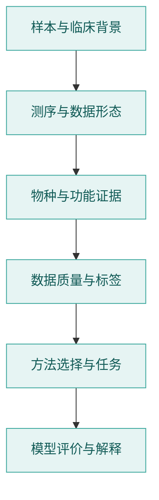
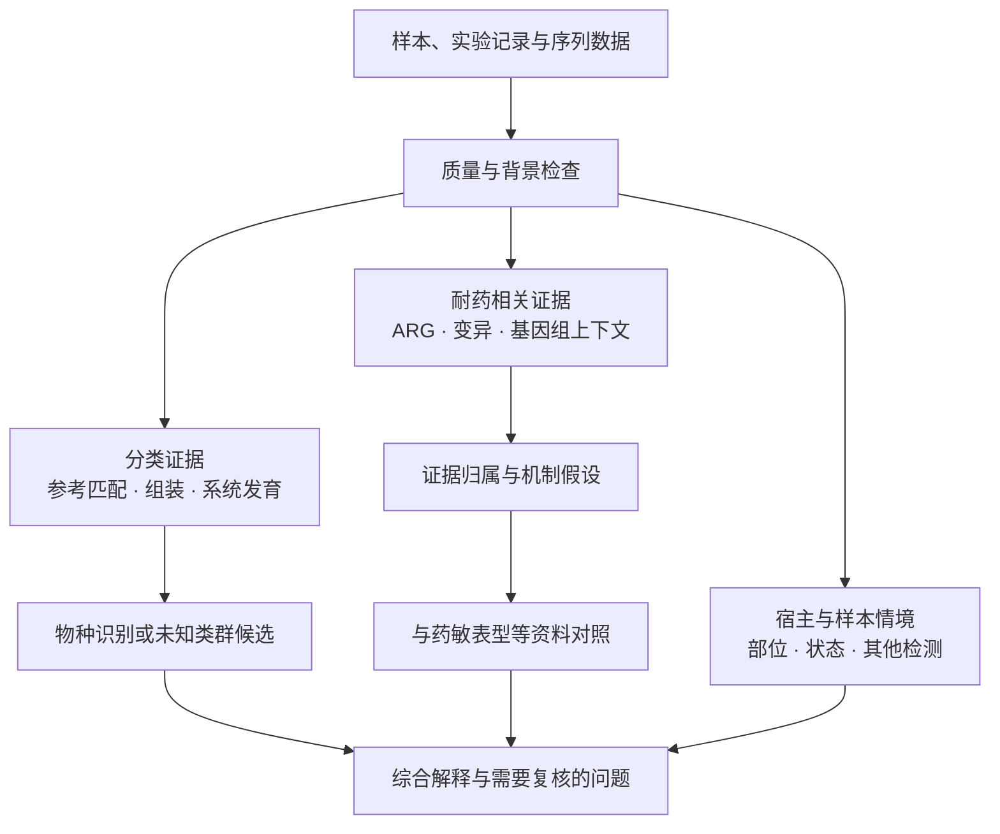

# 检验医学与病原生信

[AINGS](../README.md) · [多模态多组学](../02_多模态多组学/README.md) · [学习路径](../study-path.md) · [本方向参考资料](参考资料.md)

从样本、实验室流程与临床背景进入生信数据，理解真实数据的偏差，学习病原识别、耐药相关任务和 AI 方法。本方向包含四个知识模块，各主题分别展开概念、问题与方法。

## 知识模块与主题

### [01 检验医学与临床微生物学](01_检验医学与临床微生物学/README.md)

- [样本采集与前处理](01_检验医学与临床微生物学/01_样本采集与前处理.md)
- [培养、药敏与临床判读](01_检验医学与临床微生物学/02_培养_药敏与临床判读.md)
- [样本类型差异、污染与定植](01_检验医学与临床微生物学/03_样本类型差异_污染与定植.md)
- [病原体、致病性与宿主反应](01_检验医学与临床微生物学/04_病原体_致病性与宿主反应.md)

### [02 生物信息学基础](02_生物信息学基础/README.md)

- [测序技术与实验设计](02_生物信息学基础/01_测序技术与实验设计.md)
- [reads、contig、ORF、SNP、MAG 是什么](02_生物信息学基础/02_reads_contig_ORF_SNP_MAG.md)
- [物种鉴定与新物种判断](02_生物信息学基础/03_物种鉴定与新物种判断.md)
- [ARG、毒力与移动遗传元件](02_生物信息学基础/04_ARG_毒力与移动遗传元件.md)
- [常用数据库与工具](02_生物信息学基础/05_常用数据库与工具.md)

### [03 数据与统计基础](03_数据与统计基础/README.md)

- [丰度、归一化与组成型数据](03_数据与统计基础/01_丰度_归一化与组成型数据.md)
- [污染、批次效应与宿主背景](03_数据与统计基础/02_污染_批次效应与宿主背景.md)
- [训练、验证、测试与标签质量](03_数据与统计基础/03_训练验证测试与标签质量.md)

### [04 方法与模型基础](04_方法与模型基础/README.md)

- [比对、组装、k-mer 与 sketch](04_方法与模型基础/01_比对_组装_kmer与sketch.md)
- [病原识别任务设计](04_方法与模型基础/02_病原识别任务设计.md)
- [耐药检测任务设计](04_方法与模型基础/03_耐药检测任务设计.md)
- [评估、校准与拒识](04_方法与模型基础/04_评估_校准与拒识.md)

## 学习路线

## 学习顺序与问题

| 阶段 | 要回答的问题 | 核心材料 | 建议产出 |
| --- | --- | --- | --- |
| A1 样本与临床背景 | 同一检出结果为什么随样本类型而有不同含义？ | [采集与前处理](01_检验医学与临床微生物学/01_样本采集与前处理.md)、[培养与药敏](01_检验医学与临床微生物学/02_培养_药敏与临床判读.md)、[污染与定植](01_检验医学与临床微生物学/03_样本类型差异_污染与定植.md)、[病原与宿主](01_检验医学与临床微生物学/04_病原体_致病性与宿主反应.md) | 样本到报告图，标注每一步产生什么信息 |
| A2 测量与数据 | reads、contig、ORF、SNP、MAG 各自保留什么？ | [测序与实验设计](02_生物信息学基础/01_测序技术与实验设计.md)、[数据层级](02_生物信息学基础/02_reads_contig_ORF_SNP_MAG.md) | 数据层级表，列出对象、来源和可回答的问题 |
| A3 分类与功能证据 | 物种归类、新物种候选、耐药与毒力有哪些不同依据？ | [物种与新物种判断](02_生物信息学基础/03_物种鉴定与新物种判断.md)、[ARG 与移动遗传元件](02_生物信息学基础/04_ARG_毒力与移动遗传元件.md)、[数据库与工具](02_生物信息学基础/05_常用数据库与工具.md) | 论文证据表：观测、计算、解释分别是什么 |
| A4 数据与统计 | 测序深度、污染、批次和标签如何影响比较？ | [丰度与组成](03_数据与统计基础/01_丰度_归一化与组成型数据.md)、[污染与宿主背景](03_数据与统计基础/02_污染_批次效应与宿主背景.md)、[划分与标签](03_数据与统计基础/03_训练验证测试与标签质量.md) | 数据说明：来源、对象、标签、重复、划分和偏差 |
| A5 方法与任务 | 当前问题需要什么输入、输出与比较方法？ | [方法脉络](04_方法与模型基础/01_比对_组装_kmer与sketch.md)、[病原识别](04_方法与模型基础/02_病原识别任务设计.md)、[耐药任务](04_方法与模型基础/03_耐药检测任务设计.md) | 将研究问题转换成可计算对象的任务卡 |
| A6 评价与解释 | 模型的分类、概率与未判断对象分别表现如何？ | [评价、校准与拒识](04_方法与模型基础/04_评估_校准与拒识.md)、[专题索引](../topics.md) | 一份评价说明或小规模比较，说明适用对象 |

## 三种任务，分别建立证据

图中的三条分析路径分别组织分类、耐药与宿主情境的证据，并在综合解释时对照。

检出、致病性、新物种判断和耐药判断处于不同层次；真实数据结构、标签与实验条件应先于模型比较得到说明。

## 跨主线的相关知识

| 共同问题 | 本方向的情境 | 多模态多组学中的相关内容 |
| --- | --- | --- |
| 数值尺度与组成 | reads、测序深度、相对丰度 | [归一化与数据表示](../02_多模态多组学/03_质量控制_预处理与数据表示/README.md) |
| 独立样本与泛化 | 样本、菌株、研究来源的留出 | [模型评价与实验设计](../02_多模态多组学/08_模型评价_实验设计与生物学解释/README.md) |
| 序列进入模型 | k-mer、sketch、embedding | [神经网络与生物表示](../02_多模态多组学/05_神经网络_Transformer与生物表示/README.md)、[序列与结构](../02_多模态多组学/09_空间_序列_调控与实验闭环/02_序列与结构_词元的位置开始具有直接生物含义.md) |
| 额外信息的作用 | 序列外背景与标签证据 | [多模态融合](../02_多模态多组学/06_多模态整合_融合与预训练/README.md)、[消融实验](../02_多模态多组学/08_模型评价_实验设计与生物学解释/08_消融实验怎样支持解释.md) |
