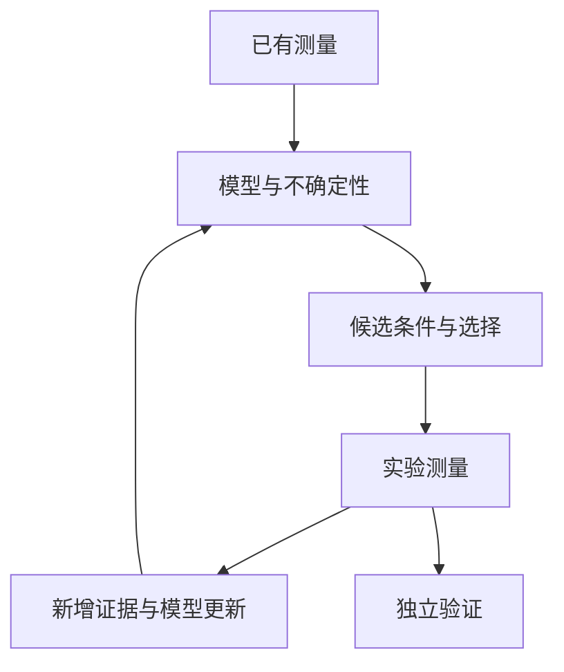

# 9.7 主动学习、贝叶斯优化与实验闭环

[AINGS](../../README.md) · [多模态多组学](../README.md) · [本模块目录](README.md)

**主动学习**根据当前模型和已有数据，选择下一批最有助于改善预测或减少知识不确定性的测量。**贝叶斯优化**利用模型对未知目标的预测和不确定性，选择有希望获得更优目标值的实验条件。二者都能形成“选择—测量—更新”的闭环，选择标准分别对应学习效果和目标优化。

**利用**倾向于测试目前预测效果最好的候选，**探索**倾向于测量模型尚不了解的区域。对于希望最大化某个实验目标的情形，一种上置信界风格的教学选择分数为

$$
a(c)=\widehat\mu(c)+\beta\,\widehat u(c),
$$

其中 $\widehat\mu(c)$ 是期望表现，$\widehat u(c)$ 是经验证的某种不确定性量，$\beta$ 控制探索权重；两项的尺度需要可比较。若候选 A 的两项为 $(0.8,0.05)$，B 为 $(0.6,0.3)$，取 $\beta=1$ 时分数分别为 0.85、0.9，会优先选择 B；取 $\beta=0$ 时则选择 A。GP-UCB 是将预测均值与不确定性用于这类选择的经典实例。[X7](https://arxiv.org/abs/0912.3995) 另一类学习目标可以是区分两个机制假设或覆盖缺少数据的状态，对应的选择分数也会改变。

闭环中要保留每轮的选择依据、测量结果和模型版本。主动挑选的数据通常集中于特定区域，评价整体适用范围时仍需要覆盖目标总体的独立证据。实验结果也可能推翻模型当前的规律，使下一轮选择发生变化。

---

[上一篇：9.6 生物知识、通路与文本怎样进入分析](06_生物知识_通路与文本怎样进入分析.md) · [下一篇：9.8 基础模型怎样把这些方向连接起来](08_基础模型怎样把这些方向连接起来.md)
