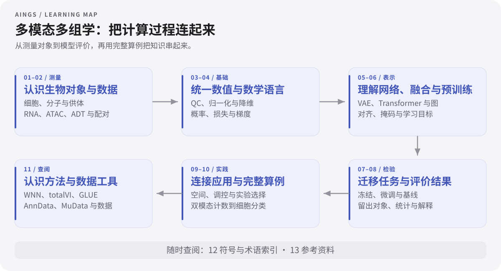
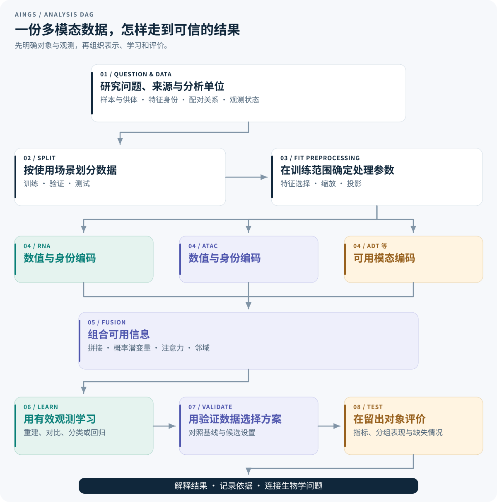

# 多模态多组学

[AINGS](../README.md) · [检验医学与病原生信](../01_检验医学与病原生信/README.md) · [学习导航](../study-path.md) · [运行完整算例](10_完整算例/运行说明.md)

从生物对象和实验测量开始，逐步理解数据表示、机器学习、多模态建模、迁移与评价。主线围绕四个问题展开：测到了什么，模型怎样计算，用什么目标学习，结果支持什么判断。

正文中的概念、符号和计算过程按学习顺序展开，关键环节配有可以跟算的例子。第 10 章把前面的知识串成一个完整分析流程，给出全部数据、手算过程和可直接运行的 Python 代码。各章自检附有答案；公开参考资料用于来源核对和进一步阅读。

## 先从一张论文图看起

[GLUE：没有逐一配对的细胞，怎样连接不同组学？](../papers/glue.md) 从一张框架图辨认数据、细胞表示、特征表示和引导图。图解中的链接可以直接回到 VAE、图、对齐与评价的相关章节。

## 学习主线

第一至三章建立“生物对象—实验测量—数值尺度”的联系；第四章统一数学、统计与机器学习语言；第五至七章从神经网络走到融合、预训练和任务迁移；第八章解释如何检验结果；第九章连接空间、分子序列、调控与实验设计。随后用完整算例贯通计算过程，再按方法和术语查阅具体知识。

## 模块总览

| 模块 | 核心内容 | 主题数 |
| --- | --- | --- |
| [01 生物学层次与研究对象](01_生物学层次与研究对象/README.md) | DNA、RNA、蛋白、染色质、细胞类型与状态、样本和供体 | 8 |
| [02 测量技术与多组学数据结构](02_测量技术与多组学数据结构/README.md) | scRNA、scATAC、ADT、CITE-seq、矩阵、配对、缺失与数据对象 | 9 |
| [03 质量控制、预处理与数据表示](03_质量控制_预处理与数据表示/README.md) | QC、log1p、HVG、TF-IDF、LSI、CLR、稀疏性与批次 | 11 |
| [04 数学、统计与机器学习基础](04_数学_统计与机器学习基础/README.md) | 向量矩阵、概率分布、PCA／SVD、损失、梯度与正则化 | 11 |
| [05 神经网络、Transformer 与生物表示](05_神经网络_Transformer与生物表示/README.md) | MLP、AE／VAE、词元、QKV、注意力、位置、图与计算效率 | 14 |
| [06 多模态整合、融合与预训练](06_多模态整合_融合与预训练/README.md) | 对齐与融合、共享与特有信息、观测掩码、对比学习与预训练 | 9 |
| [07 下游任务、迁移与预测方法](07_下游任务_迁移与预测方法/README.md) | 冻结与微调、输入输出接口、基线、集成、校准与不确定性 | 9 |
| [08 模型评价、实验设计与生物学解释](08_模型评价_实验设计与生物学解释/README.md) | 数据划分、数值与分类指标、生物重复、统计推断与消融 | 9 |
| [09 空间、序列、调控与实验闭环](09_空间_序列_调控与实验闭环/README.md) | 空间、序列结构、调控、扰动、知识、通路与实验选择 | 9 |
| [10 完整算例：从双模态计数到新供体的细胞分类](10_完整算例/README.md) | 从双模态计数到新供体分类：数据、手算、指标与可运行代码 | 9 |
| [11 代表方法与数据工具怎样对应前面的知识](11_代表方法与数据工具/README.md) | WNN、totalVI、MultiVI、GLUE、scVAEIT、scGPT、AnnData 与 MuData | 7 |
| [12 符号与术语索引](12_符号与术语索引/README.md) | 数学符号、生物与数据术语、模型组件、迁移、评价与应用术语 | 4 |
| [13 参考资料](13_参考资料/README.md) | 原始研究、基础教材、测量与方法论文、官方文档和数据入口 | 10 |

## 全部主题

### [01 生物学层次与研究对象](01_生物学层次与研究对象/README.md)

- [1.1 从细胞、DNA 和基因开始](01_生物学层次与研究对象/01_从细胞_DNA_和基因开始.md)
- [1.2 转录、转录本、翻译与蛋白质](01_生物学层次与研究对象/02_转录_转录本_翻译与蛋白质.md)
- [1.3 RNA、蛋白质与代谢物为什么会出现不同变化](01_生物学层次与研究对象/03_RNA_蛋白质与代谢物为什么会出现不同变化.md)
- [1.4 染色质、调控区域与可及性](01_生物学层次与研究对象/04_染色质_调控区域与可及性.md)
- [1.5 组学与模态分别描述什么](01_生物学层次与研究对象/05_组学与模态分别描述什么.md)
- [1.6 细胞类型、状态与组织组成](01_生物学层次与研究对象/06_细胞类型_状态与组织组成.md)
- [1.7 分子、细胞、样本与供体的层次](01_生物学层次与研究对象/07_分子_细胞_样本与供体的层次.md)
- [1.8 概念自检与答案](01_生物学层次与研究对象/08_概念自检与答案.md)

### [02 测量技术与多组学数据结构](02_测量技术与多组学数据结构/README.md)

- [2.1 从样本到测序：技术名称对应的实验范围](02_测量技术与多组学数据结构/01_从样本到测序_技术名称对应的实验范围.md)
- [2.2 scRNA-seq 如何得到一个基因计数](02_测量技术与多组学数据结构/02_scRNA-seq_如何得到一个基因计数.md)
- [2.3 scATAC-seq 如何得到一个区域计数](02_测量技术与多组学数据结构/03_scATAC-seq_如何得到一个区域计数.md)
- [2.4 ADT、CITE-seq 与联合测量](02_测量技术与多组学数据结构/04_ADT_CITE-seq_与联合测量.md)
- [2.5 矩阵、行列坐标与元数据](02_测量技术与多组学数据结构/05_矩阵_行列坐标与元数据.md)
- [2.6 配对、非配对、部分配对与 mosaic](02_测量技术与多组学数据结构/06_配对_非配对_部分配对与_mosaic.md)
- [2.7 观测零值、未测量与人工遮蔽](02_测量技术与多组学数据结构/07_观测零值_未测量与人工遮蔽.md)
- [2.8 文件、数据对象与可追溯信息](02_测量技术与多组学数据结构/08_文件_数据对象与可追溯信息.md)
- [2.9 概念自检与答案](02_测量技术与多组学数据结构/09_概念自检与答案.md)

### [03 质量控制、预处理与数据表示](03_质量控制_预处理与数据表示/README.md)

- [3.1 质量控制：先检查测量是否可靠](03_质量控制_预处理与数据表示/01_质量控制_先检查测量是否可靠.md)
- [3.2 ATAC 与 ADT 的质量指标](03_质量控制_预处理与数据表示/02_ATAC_与_ADT_的质量指标.md)
- [3.3 RNA 总量归一化与 log1p：完整算例](03_质量控制_预处理与数据表示/03_RNA_总量归一化与_log1p_完整算例.md)
- [3.4 总量归一化引入的组成关系](03_质量控制_预处理与数据表示/04_总量归一化引入的组成关系.md)
- [3.5 高变特征选择、标准化与降维的分工](03_质量控制_预处理与数据表示/05_高变特征选择_标准化与降维的分工.md)
- [3.6 ATAC 的 TF-IDF 与 LSI：完整算例](03_质量控制_预处理与数据表示/06_ATAC_的_TF-IDF_与_LSI_完整算例.md)
- [3.7 ADT 背景与 CLR：理解比值尺度](03_质量控制_预处理与数据表示/07_ADT_背景与_CLR_理解比值尺度.md)
- [3.8 稀疏存储与缺失信息的保存](03_质量控制_预处理与数据表示/08_稀疏存储与缺失信息的保存.md)
- [3.9 批次效应、供体差异与混杂](03_质量控制_预处理与数据表示/09_批次效应_供体差异与混杂.md)
- [3.10 让预处理与训练、验证保持同一个坐标系](03_质量控制_预处理与数据表示/10_让预处理与训练_验证保持同一个坐标系.md)
- [3.11 概念自检与答案](03_质量控制_预处理与数据表示/11_概念自检与答案.md)

### [04 数学、统计与机器学习基础](04_数学_统计与机器学习基础/README.md)

- [4.1 符号、向量与矩阵：先弄清每一维](04_数学_统计与机器学习基础/01_符号_向量与矩阵_先弄清每一维.md)
- [4.2 均值、方差、协方差与期望](04_数学_统计与机器学习基础/02_均值_方差_协方差与期望.md)
- [4.3 距离、相似度与相关系数](04_数学_统计与机器学习基础/03_距离_相似度与相关系数.md)
- [4.4 PCA 与 SVD：怎样从多个特征得到低维坐标](04_数学_统计与机器学习基础/04_PCA_与_SVD_怎样从多个特征得到低维坐标.md)
- [4.5 概率、条件概率、似然与后验](04_数学_统计与机器学习基础/05_概率_条件概率_似然与后验.md)
- [4.6 计数、二元状态与连续值该用什么分布](04_数学_统计与机器学习基础/06_计数_二元状态与连续值该用什么分布.md)
- [4.7 学习任务、监督信号与数据划分](04_数学_统计与机器学习基础/07_学习任务_监督信号与数据划分.md)
- [4.8 线性回归、分类概率与损失函数](04_数学_统计与机器学习基础/08_线性回归_分类概率与损失函数.md)
- [4.9 梯度下降与反向传播：参数怎样改变](04_数学_统计与机器学习基础/09_梯度下降与反向传播_参数怎样改变.md)
- [4.10 正则化、过拟合与基础比较](04_数学_统计与机器学习基础/10_正则化_过拟合与基础比较.md)
- [4.11 本章自检与答案](04_数学_统计与机器学习基础/11_本章自检与答案.md)

### [05 神经网络、Transformer 与生物表示](05_神经网络_Transformer与生物表示/README.md)

- [5.1 多层感知机：从加权求和到非线性关系](05_神经网络_Transformer与生物表示/01_多层感知机_从加权求和到非线性关系.md)
- [5.2 自动编码器：通过重建学习压缩表示](05_神经网络_Transformer与生物表示/02_自动编码器_通过重建学习压缩表示.md)
- [5.3 变分自动编码器：让潜在状态与观测都有概率含义](05_神经网络_Transformer与生物表示/03_变分自动编码器_让潜在状态与观测都有概率含义.md)
- [5.4 生物词元与嵌入：身份和数值怎样进入网络](05_神经网络_Transformer与生物表示/04_生物词元与嵌入_身份和数值怎样进入网络.md)
- [5.5 Q、K、V：完整计算一次注意力](05_神经网络_Transformer与生物表示/05_Q_K_V_完整计算一次注意力.md)
- [5.6 自注意力、交叉注意力与多头结构](05_神经网络_Transformer与生物表示/06_自注意力_交叉注意力与多头结构.md)
- [5.7 前馈网络、残差与归一化：组成一个 Transformer 块](05_神经网络_Transformer与生物表示/07_前馈网络_残差与归一化_组成一个_Transformer_块.md)
- [5.8 编码器、解码器与生成顺序](05_神经网络_Transformer与生物表示/08_编码器_解码器与生成顺序.md)
- [5.9 序列位置、RoPE 与集合的排列性质](05_神经网络_Transformer与生物表示/09_序列位置_RoPE_与集合的排列性质.md)
- [5.10 池化、汇总词元与潜在瓶颈](05_神经网络_Transformer与生物表示/10_池化_汇总词元与潜在瓶颈.md)
- [5.11 图、邻域与消息传递](05_神经网络_Transformer与生物表示/11_图_邻域与消息传递.md)
- [5.12 长输入与计算效率](05_神经网络_Transformer与生物表示/12_长输入与计算效率.md)
- [5.13 从网络结构走向预训练与下游任务](05_神经网络_Transformer与生物表示/13_从网络结构走向预训练与下游任务.md)
- [5.14 本章自检与答案](05_神经网络_Transformer与生物表示/14_本章自检与答案.md)

### [06 多模态整合、融合与预训练](06_多模态整合_融合与预训练/README.md)

- [6.1 数据的对应关系决定能够学习什么](06_多模态整合_融合与预训练/01_数据的对应关系决定能够学习什么.md)
- [6.2 整合、对齐、融合与补全各自要得到什么](06_多模态整合_融合与预训练/02_整合_对齐_融合与补全各自要得到什么.md)
- [6.3 早期、中间与晚期融合：用矩阵形状看清计算过程](06_多模态整合_融合与预训练/03_早期_中间与晚期融合_用矩阵形状看清计算过程.md)
- [6.4 共享信息、模态特有信息与可辨识性](06_多模态整合_融合与预训练/04_共享信息_模态特有信息与可辨识性.md)
- [6.5 观测掩码、重建损失与跨模态预测](06_多模态整合_融合与预训练/05_观测掩码_重建损失与跨模态预测.md)
- [6.6 对比学习：把对应关系变成相似度学习](06_多模态整合_融合与预训练/06_对比学习_把对应关系变成相似度学习.md)
- [6.7 多任务损失与缺失输入训练](06_多模态整合_融合与预训练/07_多任务损失与缺失输入训练.md)
- [6.8 预训练目标、条件生成与实际调用](06_多模态整合_融合与预训练/08_预训练目标_条件生成与实际调用.md)
- [6.9 概念自检与解答](06_多模态整合_融合与预训练/09_概念自检与解答.md)

### [07 下游任务、迁移与预测方法](07_下游任务_迁移与预测方法/README.md)

- [7.1 将研究问题写成输入与输出](07_下游任务_迁移与预测方法/01_将研究问题写成输入与输出.md)
- [7.2 冻结、线性探测与微调分别更新什么](07_下游任务_迁移与预测方法/02_冻结_线性探测与微调分别更新什么.md)
- [7.3 输入接口、条件词元与输出接口](07_下游任务_迁移与预测方法/03_输入接口_条件词元与输出接口.md)
- [7.4 基线帮助判断数据中已经存在多少可预测信息](07_下游任务_迁移与预测方法/04_基线帮助判断数据中已经存在多少可预测信息.md)
- [7.5 残差学习、集成与折外预测](07_下游任务_迁移与预测方法/05_残差学习_集成与折外预测.md)
- [7.6 概率校准：让置信度对应真实表现](07_下游任务_迁移与预测方法/06_概率校准_让置信度对应真实表现.md)
- [7.7 不确定性、预测区间与未知状态](07_下游任务_迁移与预测方法/07_不确定性_预测区间与未知状态.md)
- [7.8 数据效率与一条完整的使用路径](07_下游任务_迁移与预测方法/08_数据效率与一条完整的使用路径.md)
- [7.9 概念自检与解答](07_下游任务_迁移与预测方法/09_概念自检与解答.md)

### [08 模型评价、实验设计与生物学解释](08_模型评价_实验设计与生物学解释/README.md)

- [8.1 先把任务写成一份明确的输入输出说明](08_模型评价_实验设计与生物学解释/01_先把任务写成一份明确的输入输出说明.md)
- [8.2 训练集、验证集和测试集各自提供什么信息](08_模型评价_实验设计与生物学解释/02_训练集_验证集和测试集各自提供什么信息.md)
- [8.3 数值预测：误差、相关性与计算轴](08_模型评价_实验设计与生物学解释/03_数值预测_误差_相关性与计算轴.md)
- [8.4 分类：从混淆矩阵算到 F1、AUROC 与 AP](08_模型评价_实验设计与生物学解释/04_分类_从混淆矩阵算到_F1_AUROC_与_AP.md)
- [8.5 检索、整合与聚类各自评价什么](08_模型评价_实验设计与生物学解释/05_检索_整合与聚类各自评价什么.md)
- [8.6 生物重复、置信区间与差异分析](08_模型评价_实验设计与生物学解释/06_生物重复_置信区间与差异分析.md)
- [8.7 同时检验很多基因时，为什么需要多重检验校正](08_模型评价_实验设计与生物学解释/07_同时检验很多基因时_为什么需要多重检验校正.md)
- [8.8 消融实验怎样支持解释](08_模型评价_实验设计与生物学解释/08_消融实验怎样支持解释.md)
- [8.9 概念自检与答案](08_模型评价_实验设计与生物学解释/09_概念自检与答案.md)

### [09 空间、序列、调控与实验闭环](09_空间_序列_调控与实验闭环/README.md)

- [9.1 空间组学：测量值多了一层位置关系](09_空间_序列_调控与实验闭环/01_空间组学_测量值多了一层位置关系.md)
- [9.2 序列与结构：词元的位置开始具有直接生物含义](09_空间_序列_调控与实验闭环/02_序列与结构_词元的位置开始具有直接生物含义.md)
- [9.3 调控关系：从候选连接到可检验的机制](09_空间_序列_调控与实验闭环/03_调控关系_从候选连接到可检验的机制.md)
- [9.4 扰动预测：输入条件怎样连接到响应](09_空间_序列_调控与实验闭环/04_扰动预测_输入条件怎样连接到响应.md)
- [9.5 样本级多组学与潜在因子](09_空间_序列_调控与实验闭环/05_样本级多组学与潜在因子.md)
- [9.6 生物知识、通路与文本怎样进入分析](09_空间_序列_调控与实验闭环/06_生物知识_通路与文本怎样进入分析.md)
- [9.7 主动学习、贝叶斯优化与实验闭环](09_空间_序列_调控与实验闭环/07_主动学习_贝叶斯优化与实验闭环.md)
- [9.8 基础模型怎样把这些方向连接起来](09_空间_序列_调控与实验闭环/08_基础模型怎样把这些方向连接起来.md)
- [9.9 概念自检与答案](09_空间_序列_调控与实验闭环/09_概念自检与答案.md)

### [10 完整算例：从双模态计数到新供体的细胞分类](10_完整算例/README.md)

- [10.1 数据、任务与供体划分](10_完整算例/01_数据_任务与供体划分.md)
- [10.2 将计数变成有明确尺度的特征](10_完整算例/02_将计数变成有明确尺度的特征.md)
- [10.3 用训练数据拟合类别原型](10_完整算例/03_用训练数据拟合类别原型.md)
- [10.4 先在验证供体检查完整流程](10_完整算例/04_先在验证供体检查完整流程.md)
- [10.5 对测试供体逐步算出预测](10_完整算例/05_对测试供体逐步算出预测.md)
- [10.6 计算指标并解释它们支持的结论](10_完整算例/06_计算指标并解释它们支持的结论.md)
- [10.7 模态缺失时，输入和规则一起变化](10_完整算例/07_模态缺失时_输入和规则一起变化.md)
- [10.8 同样的数据接口怎样连接到 Transformer](10_完整算例/08_同样的数据接口怎样连接到_Transformer.md)
- [10.9 可直接复算的完整 Python 例子](10_完整算例/09_可直接复算的完整_Python_例子.md)

### [11 代表方法与数据工具怎样对应前面的知识](11_代表方法与数据工具/README.md)

- [11.1 先根据输出认识方法的位置](11_代表方法与数据工具/01_先根据输出认识方法的位置.md)
- [11.2 WNN：用每个细胞的局部信息组合模态](11_代表方法与数据工具/02_WNN_用每个细胞的局部信息组合模态.md)
- [11.3 totalVI、MultiVI 与 scVAEIT：把测量过程写入生成模型](11_代表方法与数据工具/03_totalVI_MultiVI_与_scVAEIT_把测量过程写入生成模型.md)
- [11.4 GLUE：利用特征关系连接不同组学](11_代表方法与数据工具/04_GLUE_利用特征关系连接不同组学.md)
- [11.5 scGPT：把测量转换成可以迁移的词元表示](11_代表方法与数据工具/05_scGPT_把测量转换成可以迁移的词元表示.md)
- [11.6 AnnData、MuData 与常用分析工具](11_代表方法与数据工具/06_AnnData_MuData_与常用分析工具.md)
- [11.7 把一次分析保存成可复用的完整流程](11_代表方法与数据工具/07_把一次分析保存成可复用的完整流程.md)

### [12 符号与术语索引](12_符号与术语索引/README.md)

- [12.1 常用数学符号](12_符号与术语索引/01_常用数学符号.md)
- [12.2 生物对象、测量与数据](12_符号与术语索引/02_生物对象_测量与数据.md)
- [12.3 数学、神经网络与融合](12_符号与术语索引/03_数学_神经网络与融合.md)
- [12.4 迁移、评价与应用](12_符号与术语索引/04_迁移_评价与应用.md)

### [13 参考资料](13_参考资料/README.md)

- [13.1 生物学与统计学习基础](13_参考资料/01_生物学与统计学习基础.md)
- [13.2 测量技术与多组学方法](13_参考资料/02_测量技术与多组学方法.md)
- [13.3 神经网络、表示与迁移](13_参考资料/03_神经网络_表示与迁移.md)
- [13.4 集成、评价与统计推断](13_参考资料/04_集成_评价与统计推断.md)
- [13.5 官方文档与数据入口](13_参考资料/05_官方文档与数据入口.md)
- [13.6 生物基础与测量流程](13_参考资料/06_生物基础与测量流程.md)
- [13.7 网络组件、优化与计算效率](13_参考资料/07_网络组件_优化与计算效率.md)
- [13.8 配对学习与连续提示](13_参考资料/08_配对学习与连续提示.md)
- [13.9 空间、序列、知识与实验设计](13_参考资料/09_空间_序列_知识与实验设计.md)
- [13.10 统计检验、图与可视化](13_参考资料/10_统计检验_图与可视化.md)

## 一条贯穿全程的数据流

同一细胞的 RNA 和 ATAC 首先需要通过细胞标识建立对应，基因与区域则各自保留特征身份。数值经过适当处理后，模型把它们转换为向量；融合决定两种信息怎样相互作用，训练目标规定模型要保留什么，预测头把表示转换成标签或分子值。最后，按照实际使用时的新对象条件划分数据，用相应指标检验结果。

在这条数据流中，测量值、模型表示和生物解释属于相连的三个层次。每一章都明确当前处理的对象、计算轴和可用信息，再把结果交给下一步。

## 一张图读懂多模态分析

这张图表示面向新对象预测的一种分析流程。转导式整合、描述性分析等其他设置，见[模型评价与实验设计](08_模型评价_实验设计与生物学解释/README.md)中的查询输入设置。

## 可以连着看的内容

| 共同问题 | 本方向的情境 | 检验医学与病原生信中的相关内容 |
| --- | --- | --- |
| 相对数值与分母 | 总量归一化、CLR 与特征尺度 | [丰度与组成型数据](../01_检验医学与病原生信/03_数据与统计基础/01_丰度_归一化与组成型数据.md) |
| 来源差异与泛化 | 供体、批次与数据划分 | [污染、批次与宿主背景](../01_检验医学与病原生信/03_数据与统计基础/02_污染_批次效应与宿主背景.md) |
| 序列表示 | 词元、位置与编码器 | [比对、组装、k-mer 与 sketch](../01_检验医学与病原生信/04_方法与模型基础/01_比对_组装_kmer与sketch.md) |
| 概率与任务输出 | 校准、不确定性与任务评价 | [评估、校准与拒识](../01_检验医学与病原生信/04_方法与模型基础/04_评估_校准与拒识.md) |

## 一起补充这个方向

欢迎带来相关论文、工具经验、笔记和新的问题。可以[推荐资料](https://github.com/moshookee-ux/AINGS-study-group/issues/new?template=01_resource.yml)、[补充或修正内容](https://github.com/moshookee-ux/AINGS-study-group/issues/new?template=02_content.yml)，也可以从[共建指南](../CONTRIBUTING.md)开始直接参与修改。
