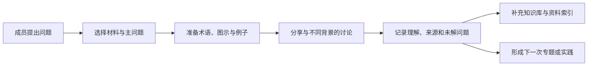

# 文献精读与教学组织

[返回统一入口](../README.md) · [首轮主题](../weekly-topics.md) · [资料索引](../reference-index.md)

这是两条路线共用的学习组织入口，承接原 AINGS 计划中的阅读清单、周会材料、术语解释和记录归档，也纳入论文、会议、工具经验与合作交流。

## 一次分享围绕一个问题

选题可以是一篇论文、一张结果图、一次工具使用经历，也可以是一个尚不清楚的概念。建议先说明这次要回答什么，以及成员需要预先知道哪几个词。

每次可安排 1 位主讲、1 位补充讨论者和 1 位记录者。一个可选的 60 分钟安排是：5 分钟说明问题，20 分钟介绍材料，20 分钟共同讨论，10 分钟核对例子或证据，5 分钟记录结论与后续问题。具体时间随活动调整。

## 从问题到可继续使用的记录

## 可直接使用的模板

| 需要做什么 | 入口 |
| --- | --- |
| 记录一次学习或组会 | [统一学习记录](../weekly_notes_template.md) |
| 拆解一篇论文 | [文献精读模板](paper-reading-template.md) |
| 分享讲座、会议、工具或资料 | [活动与工具分享模板](resource-sharing-template.md) |
| 提出一个小项目或找合作伙伴 | [项目想法模板](../projects/project-proposal-template.md) |

## 阅读时共同追问的内容

- 这篇材料回答什么问题，位于临床、生物测量、生信、统计还是模型层？
- 数据和标签从哪里来，哪些信息在使用时真正可获得？
- 作者做了哪些计算或比较，图表支持了什么判断？
- 它帮助我们理解了样本、证据、方法或评价中的哪一步？
- 哪些内容已经核对，哪些问题还适合继续阅读或动手尝试？

## 资料与记录放在哪里

基础知识补充进入相应知识模块，活动记录存入 [notes](../notes/README.md)，参考资料登记到统一索引。一次会议的临时决定留在纪要中，经过核对的通用解释再整理进正文。

推荐命名为 `YYYY-MM-DD_路线_主题.md`，如 `YYYY-MM-DD_B_缺失模态讨论.md`。每条记录包含材料链接、参与者愿意公开的署名、主要理解和下一步问题。需要更改原文中的事实或公式时，附上对应来源。
