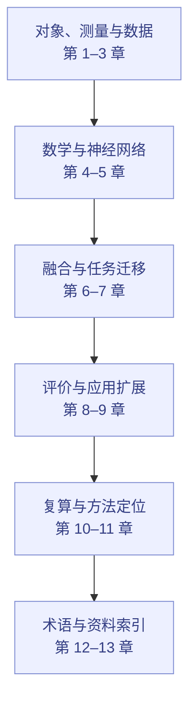
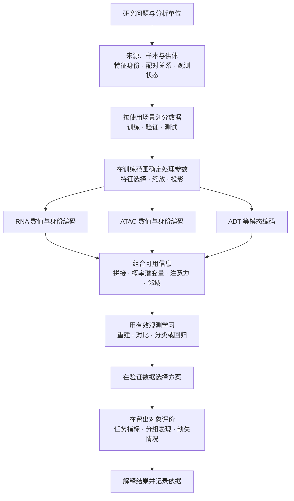

# 路线 B：多模态多组学

[返回统一入口](../README.md) · [路线 A](../tracks/clinical-bioinformatics.md) · [完整知识库](多模态多组学知识库.md) · [可运行算例](../examples/multiomics_toy/README.md)

本路线以贾晓撰写的《多模态多组学知识库》为核心，完整保留 13 章正文、公式、手算例子、自检答案、术语索引和参考资料。学习从生物对象与实验测量出发，逐步理解数据表示、机器学习、多模态建模、迁移与评价。

贯穿全程的四个问题是：**测到了什么，模型怎样计算，用什么目标学习，结果支持什么判断。**

## 先看整条路线

这是系统阅读顺序。想先看到一个完整结果的成员，也可以先跟算第 10 章，再回到相关基础章节。

## 13 章完整导航

| 章节 | 核心内容 | 建议完成的小练习 |
| --- | --- | --- |
| [1 生物学层次与研究对象](多模态多组学知识库.md#一生物学层次与研究对象) | DNA、RNA、蛋白、染色质、细胞类型与状态、组织组成、供体层次 | 画出分子、细胞、样本和供体的层级，解释一行数据代表谁 |
| [2 测量技术与多组学数据结构](多模态多组学知识库.md#二测量技术与多组学数据结构) | scRNA、scATAC、ADT、CITE-seq、TEA-seq、UMI、配对与 mosaic、观测掩码 | 写一张 RNA／ATAC／ADT 的对象—特征—观测表 |
| [3 质量控制、预处理与数据表示](多模态多组学知识库.md#三质量控制预处理与数据表示) | QC、归一化、log1p、HVG、TF-IDF、LSI、CLR、批次与坐标系 | 手算 RNA 归一化和 ATAC TF-IDF，说明数值尺度变化 |
| [4 数学、统计与机器学习基础](多模态多组学知识库.md#四数学统计与机器学习基础) | 矩阵、概率、分布、PCA／SVD、回归分类、损失、梯度和正则化 | 标出矩阵每一维的含义，跟算一次损失和参数更新 |
| [5 神经网络、Transformer 与生物表示](多模态多组学知识库.md#五神经网络transformer-与生物表示) | MLP、AE／VAE、词元、QKV、注意力、残差、归一化、图与计算效率 | 跟算 Q、K、V；画出特征身份、数值和状态如何进入模型 |
| [6 多模态整合、融合与预训练](多模态多组学知识库.md#六多模态整合融合与预训练) | 数据对应、整合／对齐／融合／补全、共享与特有表示、掩码与对比学习 | 分别画早期、中间、晚期融合，注明输入输出形状 |
| [7 下游任务、迁移与预测方法](多模态多组学知识库.md#七下游任务迁移与预测方法) | 冻结、线性探测、微调、LoRA、基线、残差、集成、校准 | 写出一个任务的可见输入、待学习参数、标签和输出 |
| [8 模型评价、实验设计与生物学解释](多模态多组学知识库.md#八模型评价实验设计与生物学解释) | 供体划分、嵌套验证、泄漏、计算轴、重复、区间、FDR、消融 | 设计新供体测试，解释它与随机细胞划分的区别 |
| [9 空间、序列、调控与实验闭环](多模态多组学知识库.md#九空间序列调控与实验闭环) | 空间与图像、序列结构、调控、扰动、MOFA+、知识、RAG、实验选择 | 选择一个方向，列出新增的坐标、条件或对应关系 |
| [10 完整算例](多模态多组学知识库.md#十完整算例从双模态计数到新供体的细胞分类) | 8 个虚拟细胞、4 位虚拟供体，从计数到分类概率和指标 | 运行[独立脚本](../examples/multiomics_toy/toy_classification.py)，核对单模态、双模态和缺失输入 |
| [11 代表方法与数据工具](多模态多组学知识库.md#十一代表方法与数据工具怎样对应前面的知识) | PCA、MOFA+、WNN、totalVI、MultiVI、GLUE、scVAEIT、scGPT、AnnData／MuData | 解释一个方法的数据关系、学习目标和输出 |
| [12 符号与术语索引](多模态多组学知识库.md#十二符号与术语索引) | 数学、生物、模型、迁移、评价和应用术语 | 为一次分享挑出最需要解释的 5 个术语 |
| [13 参考资料](多模态多组学知识库.md#十三参考资料) | 原始研究、教材、方法论文与官方文档 | 为笔记中的具体判断标上对应来源 |

## 一张图读懂多模态分析

这张图表示面向新对象预测的一种分析流程。转导式整合、描述性分析等其他设置，按知识库第 8 章明确查询输入的可见范围。

## 四个适合发起读书会的问题

1. **同一个细胞的 RNA 与蛋白为什么不总是同步变化？** 从第 1–3 章进入测量与数据表示，再读 totalVI 或 WNN。
2. **RNA＋ATAC 的配对、非配对与部分配对能提供哪些不同信息？** 从第 2、6 章进入，比较 MultiVI、GLUE、scVAEIT 对数据关系的处理。
3. **一个生物基础模型究竟学到了什么，怎样接到自己的任务？** 从第 5–7 章进入，对照 scGPT 的词元、目标、迁移和任务接口。
4. **加入一个模态后，怎样判断新增信息是否帮助了任务？** 从第 8、10 章进入，比较相同划分下的单模态、双模态与缺失输入。

每次讨论选一个主问题即可。材料入口见[统一资料索引](../reference-index.md)，记录可使用[文献精读模板](../05_文献精读与教学组织/paper-reading-template.md)。

## 实践怎么开始

先运行知识库自带的标准库算例，不需要下载数据或训练大模型。再根据兴趣选择公开数据上的一个小任务，先完成数据说明、简单基线与清楚的评价，再考虑引入复杂模型。[实践入口](../projects/README.md)给出了可选方向。

代码跑通、读懂一个公式、发现一个划分问题，都可以成为一次分享。持续把这些具体经验写下来，知识库就能逐渐连接到成员自己的研究问题。
