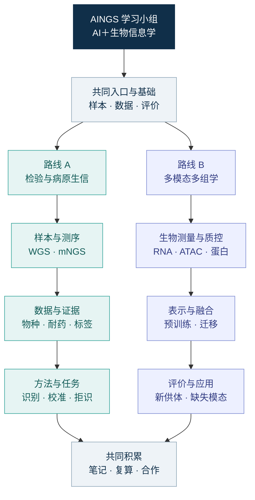

# AINGS 学习小组

**AI＋生物信息学 · 共同学习，交流问题，积累可继续使用的知识与实践**

**发起者：梅锐翔、贾晓。** 后续将招募小组管理者与各路线组长，欢迎一起组织分享、维护资料和推进专题学习。

[小组介绍与加入](community.md) · [从这里开始](study-path.md) · [路线 A：检验医学与病原生信](tracks/clinical-bioinformatics.md) · [路线 B：多模态多组学](06_多模态多组学/README.md)

[读书会主题](weekly-topics.md) · [资料索引](reference-index.md) · [实践与合作](projects/README.md) · [学习记录模板](weekly_notes_template.md) · [参与共建](CONTRIBUTING.md)

## 我们为什么聚在一起

AI 在生命科学与医学中的应用越来越广，很多学习障碍来自学科之间的信息断层。算法同学关注模型、任务与评价，医学和生物背景的同学更熟悉样本、实验与研究问题。把这些视角放到一起，才更容易理解数据为什么是现在的样子，以及模型结果能帮助回答什么问题。

我们希望从各自正在读、正在尝试和正在思考的内容出发，分享值得读的论文、会议与活动信息、工具使用经验、项目想法和合作机会，让共同兴趣逐渐形成可以持续交流的伙伴关系。

小组沿用 **AINGS 学习小组** 的名字，以梅锐翔整理的 [AINGS 学习目录](https://github.com/FairYJmrx/AINGS-study-group)为基础，加入贾晓撰写的 AI＋生物信息兴趣小组方案和多模态多组学知识库，形成统一入口和两条学习路线。

## 一个入口，两条路线

两条路线围绕各自的问题连续推进，共享术语、数据意识、统计基础、文献讨论和记录方式。成员可以先选一条主线，也可以在相近主题上互相补充。

图中的箭头表示学习顺序与知识依赖。两条路线的内容都在当前仓库中维护，现阶段先把内容与入口建设好。

| | 路线 A：检验医学与病原生信 | 路线 B：多模态多组学 |
| --- | --- | --- |
| 从哪里出发 | 样本、实验室流程、病原、药敏与临床背景 | 生物层次、RNA／ATAC／蛋白等测量及其对应关系 |
| 沿什么顺序学习 | 临床背景 → 生信数据 → 统计偏差 → 方法与任务 → 评价 | 生物与测量 → 数据与数学 → 表示与融合 → 迁移与评价 → 完整算例 |
| 主要问题 | 识别出了什么、证据属于谁、哪些判断需要进一步依据 | 测到了什么、怎样计算、用什么目标学习、结果支持什么判断 |
| 核心材料 | 原有 01–04 知识模块、原八周读书会主题 | 完整 13 章知识库、算例、自检、术语与参考资料 |
| 可以留下什么 | 样本到报告图、物种证据表、病原或耐药任务说明 | 配对与缺失表、融合计算图、供体划分实验、可复算代码 |

## 延续 TIDE 的共同学习方式

原 AINGS 学习目录是 TIDE 学习小组的知识与学习目录，学习来源为 **TIDE AINGS 项目组**，原负责人为梅锐翔。TIDE 俱乐部是青年学生自我管理、自主运营的实践平台，为小组提供平台、资料、工具与流程支持。

本小组延续其中的共同学习精神：以同学们为主体，提供自学支持、同伴交流、工具入门、主题探索与成果沉淀。我们从具体的小目标开始，以几周左右的短周期聚焦一个问题，通过讨论与反馈把学习推进下去。

- 让学习过程有记录，让成果能被后来者接着使用。
- 从一个具体问题、一篇论文或一个小练习开始。
- 鼓励使用 AI 辅助阅读、代码理解、分析与可视化，并核对输出依据。
- 把已经理解的内容与仍不清楚的问题一起记录下来。

## 欢迎哪些伙伴

欢迎计算机、人工智能、数据科学、生物信息、生命科学、医学与检验等背景的本科生、研究生，也欢迎正在了解这一交叉方向的朋友。参与可以从关注信息、提出问题、推荐论文和交流经验开始。

不要求一开始就同时掌握生物、医学和机器学习。愿意阅读英文资料、补充相邻领域的基础、在读不懂时通过 AI 和同伴讨论继续推进，就可以找到自己的入口。初学者可以先从样本与测量、数据形态、丰度与标签这几类问题开始；已有基础的成员可以按[学习路径](study-path.md)跳到合适位置。

## 我们会一起做什么

| 交流内容 | 可以怎样参与 | 怎样留下可查阅的材料 |
| --- | --- | --- |
| 论文与研究进展 | 讲一篇论文、一张结果图，或几篇工作之间的联系 | [文献精读模板](05_文献精读与教学组织/paper-reading-template.md) |
| 会议与学术活动 | 分享讲座、研讨会、征稿和参与体验 | [活动与工具分享模板](05_文献精读与教学组织/resource-sharing-template.md) |
| 工具、资料与实践经验 | 介绍数据、代码、教程及实际使用中的发现 | [资料索引](reference-index.md)、[实践入口](projects/README.md) |
| 项目想法与合作机会 | 说明研究问题、已有基础和希望认识的伙伴 | [项目想法模板](projects/project-proposal-template.md) |

先建立交流群，让大家认识彼此；随后结合成员的兴趣与时间安排相对固定的论文或专题分享。[首轮主题](weekly-topics.md)保留路线 A 的原八周顺序，并为路线 B 补充相应安排，可按实际节奏推进。

## 逐步建立的能力

1. 理解从生物或临床样本到实验测量、数值数据和分析输出的全过程。
2. 分清 WGS、mNGS、contig、MAG、ARG、ANI，以及 RNA、ATAC、ADT 等概念各自对应的对象与问题。
3. 区分物种识别、新物种候选、致病性、耐药证据，也能区分多模态对齐、融合、补全和预测。
4. 理解噪声、污染、批次、标签、配对和缺失如何影响建模与评价。
5. 沿着输入、表示、训练目标、输出和评价读懂一项 AI 方法，并通过小算例或复现加深理解。
6. 将不同背景的认识汇成笔记、图示和可继续探索的问题，找到合作的起点。

## 内容导航

| 入口 | 内容 |
| --- | --- |
| [小组介绍与加入](community.md) | 完整交流愿景、参与方式、发起者和后续管理者／组长招募 |
| [学习路径](study-path.md) | 按背景选择入口、两条路线的依赖关系与阶段成果 |
| [01 检验医学与临床微生物学](01_检验医学与临床微生物学/README.md) | 样本、培养、药敏、污染、定植、病原与宿主 |
| [02 生物信息学基础](02_生物信息学基础/README.md) | 测序、数据层级、物种、新物种候选、ARG、数据库与工具 |
| [03 数据与统计基础](03_数据与统计基础/README.md) | 丰度、组成、批次、宿主背景、划分与标签质量 |
| [04 方法与模型基础](04_方法与模型基础/README.md) | 比对、组装、k-mer、sketch、任务、校准与拒识 |
| [05 文献精读与教学组织](05_文献精读与教学组织/README.md) | 两条路线共用的组织方式、记录和分享模板 |
| [06 多模态多组学](06_多模态多组学/README.md) | 13 章完整知识库、阅读导航、依赖图和实践任务 |
| [实践与合作](projects/README.md) | 可选择的小练习、共同专题及项目说明 |
| [文件架构](folder-architecture.md) | 文件归属与维护方式 |
| [内容来源与整合说明](sources/README.md) | 两位发起人的材料、原始快照和逐项保留说明 |

## 如何加入与共建

目前正在组建交流群，欢迎联系**梅锐翔或贾晓**加入。入群后可以介绍自己的背景、关注路线、最近在读的论文或想讨论的问题。后续会招募管理者和组长，也欢迎先认领一次分享、一次记录或一个资料整理任务。

发现术语、链接或算例问题，可以在本仓库提出 Issue，写明所在文件和问题；愿意补充内容的成员可参考[共建说明](CONTRIBUTING.md)。
