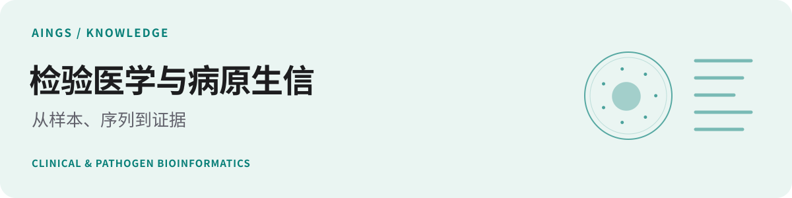
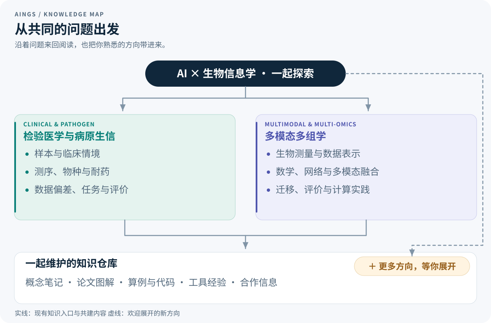

# AINGS 学习小组

  <a href="#逛逛知识地图">知识地图</a> ·
  <a href="papers/README.md">论文图解</a> ·
  <a href="study-path.md">学习导航</a> ·
  <a href="https://github.com/moshookee-ux/AINGS-study-group/issues/new?template=01_resource.yml">分享资料</a> ·
  <a href="CONTRIBUTING.md">一起共建</a> ·
  <a href="community.md#加入我们">加入小组</a>

**作者：梅锐翔、贾晓。** 欢迎每一位贡献者加入，也留下自己的署名。

**一起建设一个人人可以学习、人人可以贡献的 AI＋生信知识仓库。**

AINGS 是一个围绕共享知识仓库开展学习与交流的兴趣小组。我们的共同任务，是把大家在 AI 与生物信息学领域积累的资料、理解和实践整理下来，让更多人能够接着学、接着补充。

这个仓库向所有人开放。你可以直接阅读知识笔记、跟算公式、运行例子，也欢迎分享自己整理的笔记、论文、数据集、工具教程和代码。一个帮你想通概念的解释，一次实践中解决的小问题，都可能正好帮到下一个人。

**加入兴趣小组，也欢迎加入仓库协作。** 大家带着各自的兴趣和经验，一边交流，一边把资料整理好、把内容讲清楚，也把新的方向展开。[分享一份资料](https://github.com/moshookee-ux/AINGS-study-group/issues/new?template=01_resource.yml) · [了解怎样共建](CONTRIBUTING.md) · [加入我们](#加入我们)

## 逛逛知识地图

目前展开的两个方向，从不同的研究对象进入 AI 与生物信息学。你可以按问题来回查阅，也可以把新的兴趣写进来，让这里继续长出更多内容。

<table>
<tr>
<td width="50%" valign="top">

<h3><a href="01_检验医学与病原生信/README.md">检验医学与病原生信 →</a></h3>

一份样本怎样变成序列、分类结果和耐药相关证据？从实验与临床情境出发，理解数据、算法和结果之间的关系。

<b>样本与检验 · 测序与病原 · 数据统计 · 方法模型</b>

</td>
<td width="50%" valign="top">

<h3><a href="02_多模态多组学/README.md">多模态多组学 →</a></h3>

RNA、染色质和蛋白测量怎样进入同一个分析？从生物对象与数值尺度出发，理解表示、融合、迁移和评价。

<b>生物测量 · 数学与网络 · 多模态融合 · 计算实践</b>

</td>
</tr>
</table>

**还有哪些方向值得一起展开？** 也许你正在研究空间组学中的某个问题，想整理 AI 科研工具的使用经验，或者有一份完全不同的资料清单。都欢迎[把想法带来](https://github.com/moshookee-ux/AINGS-study-group/issues/new?template=03_new_direction.yml)，和感兴趣的伙伴慢慢把它写成新的内容。

## 从论文的一张图读起

模型图里的每一根箭头，通常都对应一个具体问题。我们把论文原图、中文阅读线索和知识章节放在一起，方便一边看图，一边回头查概念。

<table>
<tr>
<td width="50%" valign="top">

<b>CZ ID · 病原与耐药分析</b> Genome Medicine · 2025

<b>同一批 reads，为什么要走几条分析路径？</b>

从预处理开始，辨认 reads、contig、物种信息与耐药基因结果的关系。

<a href="papers/czid.md">看原图、读中文线索 →</a>

Lu et al., Fig. 1 · <a href="https://doi.org/10.1186/s13073-025-01480-2">原文</a> · <a href="https://creativecommons.org/licenses/by/4.0/">CC BY 4.0</a>
</td>
<td width="50%" valign="top">

<b>GLUE · 非配对多组学整合</b> Nature Biotechnology · 2022

<b>没有逐一配对的细胞，怎样连接不同组学？</b>

分清引导图、特征表示与细胞表示，沿着编码、重建和对齐三条线读懂框架。

<a href="papers/glue.md">看原图、读中文线索 →</a>

Cao &amp; Gao, Fig. 1 · <a href="https://doi.org/10.1038/s41587-022-01284-4">原文</a> · <a href="https://creativecommons.org/licenses/by/4.0/">CC BY 4.0</a> 部分素材：<a href="https://smart.servier.com/">Servier Medical Art</a> · <a href="https://creativecommons.org/licenses/by/3.0/">CC BY 3.0</a>
</td>
</tr>
</table>

图中保留原文标注，点击卡片可以查看大图和逐步解读。更多来源见[论文图解](papers/README.md)与[图片署名](assets/credits.md)，也欢迎分享你觉得值得讲清楚的一张图。

## 带着一个问题开始

| 你现在好奇什么 | 可以先读哪里 | 可以顺手做点什么 |
| --- | --- | --- |
| 测序文件里到底装着什么？ | [reads、contig、ORF、SNP 与 MAG](01_检验医学与病原生信/02_生物信息学基础/02_reads_contig_ORF_SNP_MAG.md) | 对照 [CZ ID 的流程图](papers/czid.md)，标出每一步的输入和输出 |
| 多测一种模态，究竟多了什么信息？ | [配对、非配对与部分配对](02_多模态多组学/02_测量技术与多组学数据结构/06_配对_非配对_部分配对与_mosaic.md)、[共享与特有信息](02_多模态多组学/06_多模态整合_融合与预训练/04_共享信息_模态特有信息与可辨识性.md) | 画出自己数据里“测了什么、缺了什么” |
| Transformer 里的注意力怎么算？ | [完整计算一次 Q、K、V](02_多模态多组学/05_神经网络_Transformer与生物表示/05_Q_K_V_完整计算一次注意力.md) | 跟着小矩阵手算一次，再改一个输入看看结果 |
| 能不能从头跑通一个分析？ | [双模态计数到新供体细胞分类](02_多模态多组学/10_完整算例/README.md) | 按[运行说明](02_多模态多组学/10_完整算例/运行说明.md)执行代码，对照手算与指标 |
| 一个结果为什么看起来好，却很难用？ | [划分与标签](01_检验医学与病原生信/03_数据与统计基础/03_训练验证测试与标签质量.md)、[模型评价](02_多模态多组学/08_模型评价_实验设计与生物学解释/README.md) | 检查分析单位、留出对象与基线各是什么 |

想按已有背景找入口，可以看[学习导航](study-path.md)；想快速查一个术语或主题，可以用[专题索引](topics.md)与[参考资料](reference-index.md)。

## 知识目录

### 检验医学与病原生信

从样本与实验室流程，进入病原、耐药、数据与计算任务。各主题分别展开概念、问题与方法。[查看全部主题 →](01_检验医学与病原生信/README.md)

| 模块 | 主要内容 |
| --- | --- |
| [01 检验医学与临床微生物学](01_检验医学与病原生信/01_检验医学与临床微生物学/README.md) | 样本采集、培养与药敏、污染与定植、病原与宿主 |
| [02 生物信息学基础](01_检验医学与病原生信/02_生物信息学基础/README.md) | 测序、reads／contig／ORF／MAG、物种判断、ARG、数据库与工具 |
| [03 数据与统计基础](01_检验医学与病原生信/03_数据与统计基础/README.md) | 丰度、归一化、组成型数据、批次、宿主背景、标签与划分 |
| [04 方法与模型基础](01_检验医学与病原生信/04_方法与模型基础/README.md) | 比对、组装、k-mer、sketch、病原与耐药任务、校准与拒识 |

### 多模态多组学

从细胞和分子层次，一直展开到模型、应用与完整算例。各章包含概念解释、计算过程和自检题。[查看全部主题 →](02_多模态多组学/README.md)

| 模块 | 主要内容 |
| --- | --- |
| [01 生物学层次与研究对象](02_多模态多组学/01_生物学层次与研究对象/README.md) | DNA、RNA、蛋白、染色质、细胞类型与状态、样本和供体 |
| [02 测量技术与多组学数据结构](02_多模态多组学/02_测量技术与多组学数据结构/README.md) | scRNA、scATAC、ADT、CITE-seq、矩阵、配对、缺失与数据对象 |
| [03 质量控制、预处理与数据表示](02_多模态多组学/03_质量控制_预处理与数据表示/README.md) | QC、log1p、HVG、TF-IDF、LSI、CLR、稀疏性与批次 |
| [04 数学、统计与机器学习基础](02_多模态多组学/04_数学_统计与机器学习基础/README.md) | 向量矩阵、概率分布、PCA／SVD、损失、梯度与正则化 |
| [05 神经网络、Transformer 与生物表示](02_多模态多组学/05_神经网络_Transformer与生物表示/README.md) | MLP、AE／VAE、词元、QKV、注意力、位置、图与计算效率 |
| [06 多模态整合、融合与预训练](02_多模态多组学/06_多模态整合_融合与预训练/README.md) | 对齐与融合、共享与特有信息、观测掩码、对比学习与预训练 |
| [07 下游任务、迁移与预测方法](02_多模态多组学/07_下游任务_迁移与预测方法/README.md) | 冻结与微调、输入输出接口、基线、集成、校准与不确定性 |
| [08 模型评价、实验设计与生物学解释](02_多模态多组学/08_模型评价_实验设计与生物学解释/README.md) | 数据划分、数值与分类指标、生物重复、统计推断与消融 |
| [09 空间、序列、调控与实验闭环](02_多模态多组学/09_空间_序列_调控与实验闭环/README.md) | 空间、序列结构、调控、扰动、知识、通路与实验选择 |
| [10 完整算例：从双模态计数到新供体的细胞分类](02_多模态多组学/10_完整算例/README.md) | 从双模态计数到新供体分类：数据、手算、指标与可运行代码 |
| [11 代表方法与数据工具怎样对应前面的知识](02_多模态多组学/11_代表方法与数据工具/README.md) | WNN、totalVI、MultiVI、GLUE、scVAEIT、scGPT、AnnData 与 MuData |
| [12 符号与术语索引](02_多模态多组学/12_符号与术语索引/README.md) | 数学符号、生物与数据术语、模型组件、迁移、评价与应用术语 |
| [13 参考资料](02_多模态多组学/13_参考资料/README.md) | 原始研究、基础教材、测量与方法论文、官方文档和数据入口 |

## 一起学习，也一起建设

**共建这个仓库，是小组会持续一起做的事。** 读到好资料，就分享出来；弄懂一个概念，就写下自己的理解；跑通一个方法，就留下代码和经验。大家再一起补充说明、核对来源、更新目录，让这些积累方便查找，也方便后来的人继续完善。

我们也会定期分享资料、工具、学术活动与合作信息。讨论中讲清楚的问题、值得收藏的资源、一起做出的算例，都可以整理进仓库。你可以从一处修改开始，也可以带着感兴趣的伙伴维护一个专题。

| 想带来什么 | 从这里开始 |
| --- | --- |
| 自己的学习笔记、教程、代码，或发现的论文、工具与数据集 | [分享资料](https://github.com/moshookee-ux/AINGS-study-group/issues/new?template=01_resource.yml)，贴上内容或链接，说说它能帮助大家做什么 |
| 一个问题、一处错误或一段更清楚的解释 | [补充与修正内容](https://github.com/moshookee-ux/AINGS-study-group/issues/new?template=02_content.yml)，告诉大家在哪一页 |
| 一个值得继续展开的方向 | [提出新方向](https://github.com/moshookee-ux/AINGS-study-group/issues/new?template=03_new_direction.yml)，从问题或几份材料开始 |
| 一个想找人一起做的项目 | [分享合作信息](https://github.com/moshookee-ux/AINGS-study-group/issues/new?template=04_collaboration.yml)，介绍已有基础与想认识的伙伴 |

任何人都欢迎通过 Issue 分享资料与问题，或按[共建指南](CONTRIBUTING.md)提交 Pull Request，把自己的内容加入仓库。文字、图示、代码、资料整理和问题反馈，都可以成为你的第一份贡献。

## 加入我们

欢迎计算机、人工智能、数据科学、生物信息、生命科学、医学与检验等背景的同学和伙伴，也欢迎刚开始了解这个交叉领域的朋友。

想和大家一起学习、持续共建，可以联系**[梅锐翔](https://github.com/FairYJmrx)**或**[贾晓](https://github.com/moshookee-ux)**加入兴趣小组。入群时把 **GitHub 用户名**发给我们，我们会安排仓库协作邀请；接受邀请后，就可以和小组伙伴一起维护内容。

也欢迎聊聊最近在读什么、想整理哪些资料，或者希望认识什么样的合作伙伴。后续会招募管理者与方向组长，一起照看目录、回应问题、组织内容更新，让更多人能够参与进来。

**这里还会长出什么，欢迎你一起来决定。**

---

[了解小组](community.md) · [一起贡献](CONTRIBUTING.md) · [项目与合作](projects/README.md) · [仓库导航](folder-architecture.md) · [图片署名](assets/credits.md)
