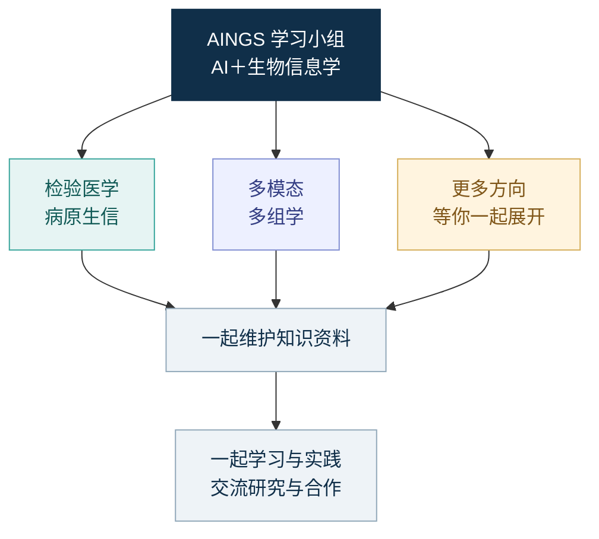

# AINGS 学习小组

**AI＋生物信息学｜一起学习，一起把这个仓库写下去。**

**作者：梅锐翔、贾晓。** 欢迎你一起补充、修正和继续展开这里的内容。

[加入小组](community.md#加入我们) · [一起维护仓库](CONTRIBUTING.md) · [推荐资料](https://github.com/moshookee-ux/AINGS-study-group/issues/new?template=01_resource.yml) · [提出新方向](https://github.com/moshookee-ux/AINGS-study-group/issues/new?template=03_new_direction.yml) · [寻找合作](https://github.com/moshookee-ux/AINGS-study-group/issues/new?template=04_collaboration.yml)

AINGS 是一个关注 AI 与生物信息学的兴趣小组。我们想找一些有共同兴趣的伙伴，分享读到的好论文，聊聊数据和工具使用中的发现，也把研究问题和合作想法带到一起。

这个仓库欢迎大家共同维护。读到一个没讲清楚的概念，可以补一个例子；发现一份好资料，可以加上链接和推荐理由；正在尝试一个方法，也可以留下代码和自己的理解。你解决过的小问题，也许正好能帮到下一位同学。

## 这里可以一起做什么

- **一起学：**交流论文、概念和实践中的问题，听听不同背景的伙伴怎样理解。
- **一起分享：**定期整理有用的资料、工具、学术活动和合作信息，也欢迎随时推荐新发现。
- **一起建设：**完善笔记、修正错误、补充算例，或者把自己感兴趣的新方向展开成一组内容。

## 逛逛知识目录

仓库里已有检验医学与病原生信、多模态多组学两个方向的内容。可以按自己的问题来回查阅，也欢迎带来其他方向，让目录随着大家的兴趣继续长出来。

| 想了解什么 | 从这里看看 |
| --- | --- |
| 样本、测序、物种、耐药与计算任务 | [检验医学与病原生信](01_检验医学与病原生信/README.md) |
| 生物测量、数据表示、神经网络、融合与评价 | [多模态多组学](02_多模态多组学/README.md) |
| 按问题或已有背景找资料 | [学习导航](study-path.md)、[专题索引](topics.md)、[参考资料](reference-index.md) |
| 想把新的兴趣方向写进来 | [提出一个新方向](https://github.com/moshookee-ux/AINGS-study-group/issues/new?template=03_new_direction.yml)，从问题、笔记或资料清单开始 |

## 检验医学与病原生信

从样本、实验室流程与临床背景开始，进入测序与生信数据，理解数据质量和统计问题，再学习病原识别、耐药检测与模型评价。

| 模块 | 主要内容 |
| --- | --- |
| [01 检验医学与临床微生物学](01_检验医学与病原生信/01_检验医学与临床微生物学/README.md) | 样本采集、培养与药敏、污染与定植、病原与宿主 |
| [02 生物信息学基础](01_检验医学与病原生信/02_生物信息学基础/README.md) | 测序、reads／contig／ORF／MAG、物种判断、ARG、数据库与工具 |
| [03 数据与统计基础](01_检验医学与病原生信/03_数据与统计基础/README.md) | 丰度、归一化、组成型数据、批次、宿主背景、标签与划分 |
| [04 方法与模型基础](01_检验医学与病原生信/04_方法与模型基础/README.md) | 比对、组装、k-mer、sketch、病原与耐药任务、校准与拒识 |

## 多模态多组学

从细胞与分子层次开始，沿着实验测量、数据表示、数学、神经网络、融合、迁移与评价展开，并连接空间组学、序列、调控和完整计算实践。

| 模块 | 主要内容 |
| --- | --- |
| [01 生物学层次与研究对象](02_多模态多组学/01_生物学层次与研究对象/README.md) | DNA、RNA、蛋白、染色质、细胞类型与状态、样本和供体 |
| [02 测量技术与多组学数据结构](02_多模态多组学/02_测量技术与多组学数据结构/README.md) | scRNA、scATAC、ADT、CITE-seq、矩阵、配对、缺失与数据对象 |
| [03 质量控制、预处理与数据表示](02_多模态多组学/03_质量控制_预处理与数据表示/README.md) | QC、log1p、HVG、TF-IDF、LSI、CLR、稀疏性与批次 |
| [04 数学、统计与机器学习基础](02_多模态多组学/04_数学_统计与机器学习基础/README.md) | 向量矩阵、概率分布、PCA／SVD、损失、梯度与正则化 |
| [05 神经网络、Transformer 与生物表示](02_多模态多组学/05_神经网络_Transformer与生物表示/README.md) | MLP、AE／VAE、词元、QKV、注意力、位置、图与计算效率 |
| [06 多模态整合、融合与预训练](02_多模态多组学/06_多模态整合_融合与预训练/README.md) | 对齐与融合、共享与特有信息、观测掩码、对比学习与预训练 |
| [07 下游任务、迁移与预测方法](02_多模态多组学/07_下游任务_迁移与预测方法/README.md) | 冻结与微调、输入输出接口、基线、集成、校准与不确定性 |
| [08 模型评价、实验设计与生物学解释](02_多模态多组学/08_模型评价_实验设计与生物学解释/README.md) | 数据划分、数值与分类指标、生物重复、统计推断与消融 |
| [09 空间、序列、调控与实验闭环](02_多模态多组学/09_空间_序列_调控与实验闭环/README.md) | 空间、序列结构、调控、扰动、知识、通路与实验选择 |
| [10 完整算例：从双模态计数到新供体的细胞分类](02_多模态多组学/10_完整算例/README.md) | 从双模态计数到新供体分类：数据、手算、指标与可运行代码 |
| [11 代表方法与数据工具怎样对应前面的知识](02_多模态多组学/11_代表方法与数据工具/README.md) | WNN、totalVI、MultiVI、GLUE、scVAEIT、scGPT、AnnData 与 MuData |
| [12 符号与术语索引](02_多模态多组学/12_符号与术语索引/README.md) | 数学符号、生物与数据术语、模型组件、迁移、评价与应用术语 |
| [13 参考资料](02_多模态多组学/13_参考资料/README.md) | 原始研究、基础教材、测量与方法论文、官方文档和数据入口 |

## 从一次小贡献开始

你可以[推荐一份资料](https://github.com/moshookee-ux/AINGS-study-group/issues/new?template=01_resource.yml)，也可以[指出一处问题或补充内容](https://github.com/moshookee-ux/AINGS-study-group/issues/new?template=02_content.yml)。想直接修改页面时，可以提交 Pull Request，让大家一起看看。具体做法写在[共建指南](CONTRIBUTING.md)里。

有一个想探索的方向，就带着它来。[新方向提议](https://github.com/moshookee-ux/AINGS-study-group/issues/new?template=03_new_direction.yml)可以从一个问题、几篇论文或一份初步笔记开始，之后再和感兴趣的伙伴慢慢展开。正在找人合作，也欢迎介绍[项目想法与已有基础](projects/README.md)。

## 加入我们

欢迎计算机、人工智能、数据科学、生物信息、生命科学、医学与检验等背景的同学和伙伴。可以联系**梅锐翔或贾晓**加入小组，聊聊你最近在读什么、遇到了什么问题，或者想认识什么样的合作伙伴。

后续会招募管理者和方向组长，一起照看资料、回应问题、维护感兴趣的内容。想持续参与的伙伴，欢迎来聊聊你愿意一起做的事。

[了解小组](community.md) · [一起贡献](CONTRIBUTING.md) · [仓库导航](folder-architecture.md)
