# AINGS 学习小组

**AINGS 是香港中文大学（深圳）人工智能学院 TIDE Club 的 AI＋生信学习小组。**

TIDE Club 是由教师指导、学生自主运营的学术实践社团。学院产学研中心为社团提供科研资源和实践机会，支持同学们围绕人工智能、数据科学及交叉领域发起学习小组和合作项目。[学院对 TIDE Club 的介绍](https://sai.cuhk.edu.cn/zh-hans/page/80) · [TIDE 学习小组](https://tide-club.github.io/studygroup.github.io/)

   
  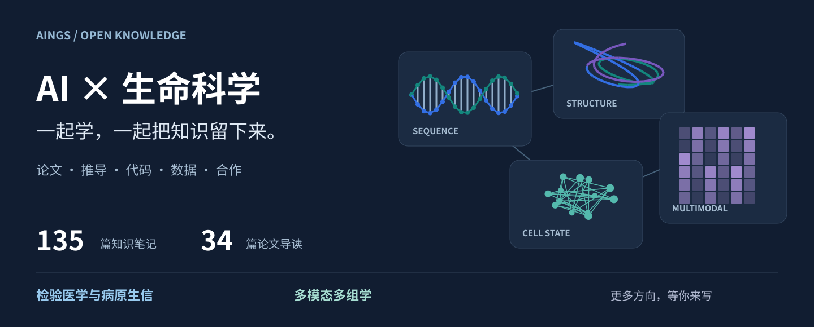

  <a href="#逛逛知识地图">知识地图</a> ·
  <a href="#研究画廊">研究画廊</a> ·
  <a href="papers/catalog.md">论文索引</a> ·
  <a href="study-path.md">学习导航</a> ·
  <a href="CONTRIBUTING.md">一起共建</a> ·
  <a href="#加入我们"><strong>微信加入</strong></a>

**作者：贾晓、梅锐翔。** 和每一位愿意留下笔记、代码与问题的你。

读论文时看不懂的一张图，跑分析时卡住的一步，常常也是别人正在找的答案。AINGS 想把这些学习中的积累放在一起，做成一个大家都能查、也都能继续写的 **AI＋生信共享知识仓库**。

这里有 **135 篇知识笔记、17 个知识模块、34 篇论文导读**，也有可以跟着手算、运行和修改的完整例子。从病原识别到多模态细胞模型，你可以带着自己的问题来逛，也可以把熟悉的领域展开给大家看。

**加入兴趣小组，也可以加入仓库协作。** 我们一起分享资料、维护内容、寻找研究伙伴；新的路线和项目，欢迎你来发起。

[开始探索](#逛逛知识地图) · [带来一份资料](https://github.com/moshookee-ux/AINGS-study-group/issues/new?template=01_resource.yml) · [加入 AINGS](#加入我们)

## 逛逛知识地图

两个方向并列展开，章节之间也有很多值得来回走走的连接。读到某个模型，可以回来看数学与测量；遇到一个生物问题，也可以顺着目录寻找合适的方法。

<table>
<tr>
<td width="50%" valign="top">

<h3><a href="01_检验医学与病原生信/README.md">检验医学与病原生信 →</a></h3>

一份样本怎样变成序列、分类结果和耐药相关证据？从实验与临床情境出发，理解数据、算法和结果之间的关系。

<b>样本与检验 · 测序与病原 · 数据统计 · 方法模型</b>

</td>
<td width="50%" valign="top">

<h3><a href="02_多模态多组学/README.md">多模态多组学 →</a></h3>

RNA、染色质和蛋白测量怎样进入同一个分析？从生物对象与数值尺度出发，理解表示、融合、迁移和评价。

<b>生物测量 · 数学与网络 · 多模态融合 · 计算实践</b>

</td>
</tr>
</table>

[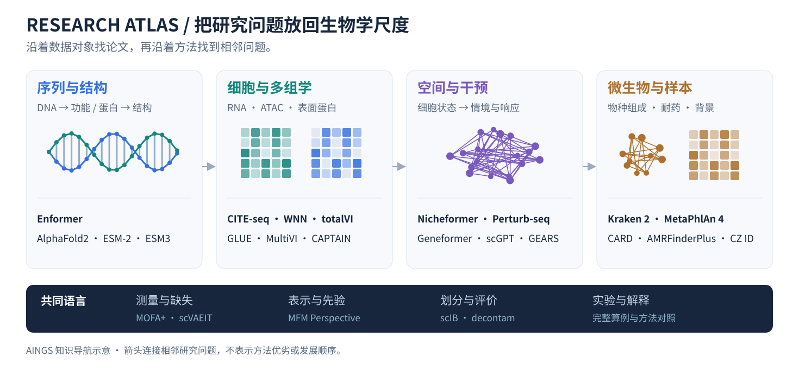](papers/README.md)

[打开全部知识目录](#知识目录) · [按背景找学习入口](study-path.md) · [提出一个新的方向](https://github.com/moshookee-ux/AINGS-study-group/issues/new?template=03_new_direction.yml)

## 研究画廊

先看图，再带着问题进入论文。这里精选了 **16 篇代表性研究**，从序列分类、耐药分析一直到蛋白结构、细胞表示和干预预测。每张卡片都能打开中文导读，继续看方法拆解、读图线索与小练习。

### 从序列中找到物种线索

同样是序列，索引、标记基因、蛋白匹配和语言模型提供了不同入口。

<table>
<tr>
<td width="50%" valign="top">
<a href="papers/kraken2.md">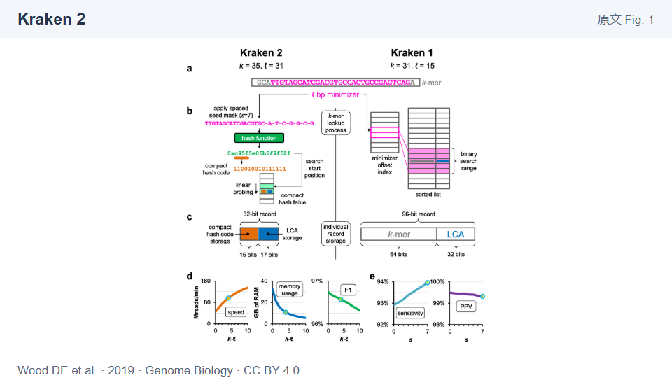</a>

Genome Biology · 2019 · 序列分类

<h3><a href="papers/kraken2.md">Kraken 2 →</a></h3>

从 minimizer、紧凑哈希表到分类树，拆开高速序列分类的三步。

<a href="papers/kraken2.md">读中文导读</a> · <a href="https://doi.org/10.1186/s13059-019-1891-0">原始论文</a>

Wood DE et al. · Fig. 1 · <a href="https://creativecommons.org/licenses/by/4.0/">CC BY 4.0</a> · <a href="assets/figures/kraken2-fig1.png">大图</a>
</td>
<td width="50%" valign="top">
<a href="papers/metaphlan4.md">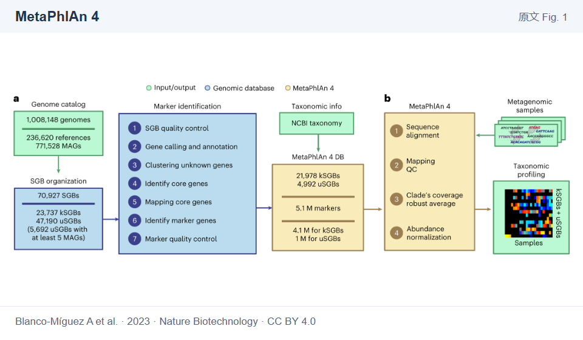</a>

Nature Biotechnology · 2023 · 微生物组组成

<h3><a href="papers/metaphlan4.md">MetaPhlAn 4 →</a></h3>

从未培养物种的基因组与标记基因，走到样本的相对组成。

<a href="papers/metaphlan4.md">读中文导读</a> · <a href="https://doi.org/10.1038/s41587-023-01688-w">原始论文</a>

Blanco-Míguez A et al. · Fig. 1 · <a href="https://creativecommons.org/licenses/by/4.0/">CC BY 4.0</a> · <a href="assets/figures/metaphlan4-fig1.png">大图</a>
</td>
</tr>
<tr>
<td width="50%" valign="top">
<a href="papers/kaiju.md">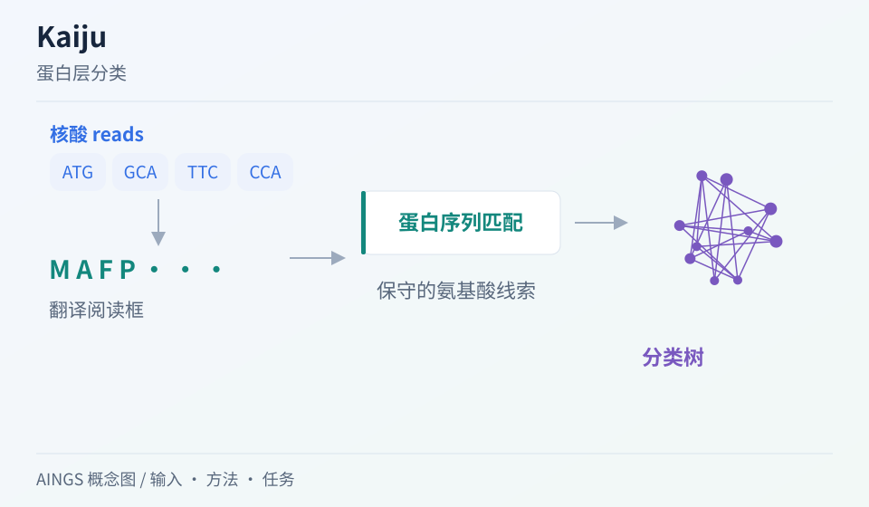</a>

Nature Communications · 2016 · 蛋白层分类

<h3><a href="papers/kaiju.md">Kaiju →</a></h3>

进入氨基酸空间，用蛋白层面的保守性寻找分类线索。

<a href="papers/kaiju.md">读中文导读</a> · <a href="https://doi.org/10.1038/ncomms11257">原始论文</a>

AINGS 方法概念图 · <a href="assets/gallery/kaiju.svg">大图</a>
</td>
<td width="50%" valign="top">
<a href="papers/bertax.md">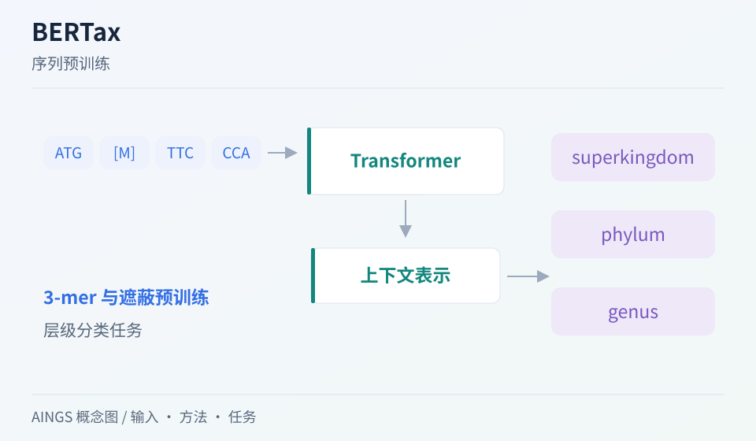</a>

PNAS · 2022 · 序列预训练

<h3><a href="papers/bertax.md">BERTax →</a></h3>

从 3-mer 上下文进入分类树，理解层级预测与未见类群。

<a href="papers/bertax.md">读中文导读</a> · <a href="https://doi.org/10.1073/pnas.2122636119">原始论文</a>

AINGS 方法概念图 · <a href="assets/gallery/bertax.svg">大图</a>
</td>
</tr>
</table>

### 让耐药与样本背景有据可查

把数据库、检测规则、序列上下文和样本对照连起来。

<table>
<tr>
<td width="50%" valign="top">
<a href="papers/card.md">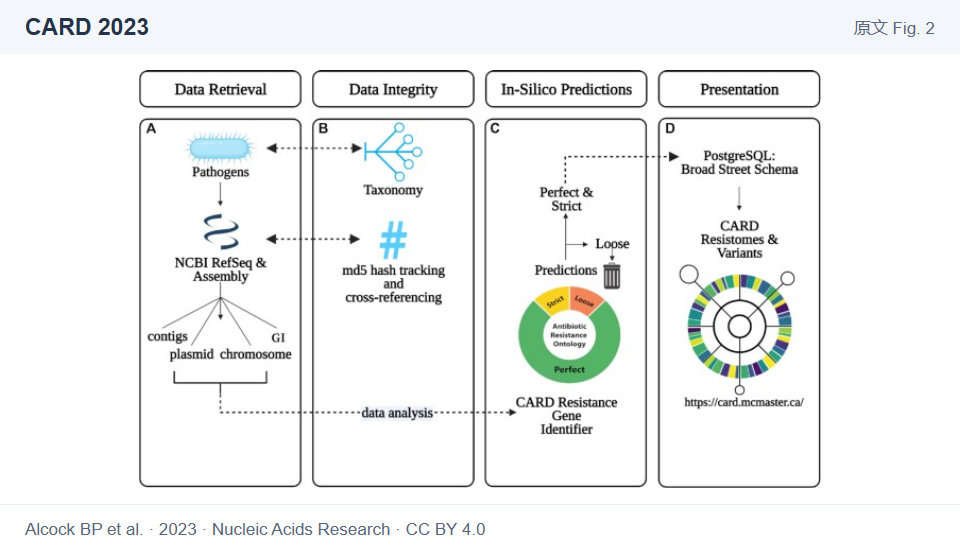</a>

Nucleic Acids Research · 2023 · 耐药数据库

<h3><a href="papers/card.md">CARD 2023 →</a></h3>

连接耐药本体、参考序列和检测规则，读懂 Perfect／Strict 命中。

<a href="papers/card.md">读中文导读</a> · <a href="https://doi.org/10.1093/nar/gkac920">原始论文</a>

Alcock BP et al. · Fig. 2 · <a href="https://creativecommons.org/licenses/by/4.0/">CC BY 4.0</a> · <a href="assets/figures/card-fig2.jpg">大图</a>
</td>
<td width="50%" valign="top">
<a href="papers/amrfinderplus.md">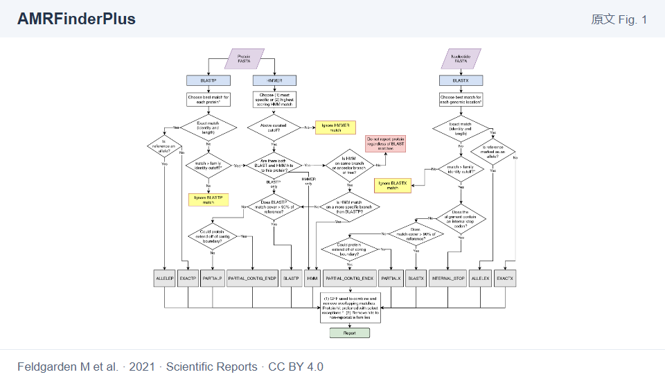</a>

Scientific Reports · 2021 · 耐药检测

<h3><a href="papers/amrfinderplus.md">AMRFinderPlus →</a></h3>

对照蛋白与核酸两条检测路径，追踪命中类别与判定依据。

<a href="papers/amrfinderplus.md">读中文导读</a> · <a href="https://doi.org/10.1038/s41598-021-91456-0">原始论文</a>

Feldgarden M et al. · Fig. 1 · <a href="https://creativecommons.org/licenses/by/4.0/">CC BY 4.0</a> · <a href="assets/figures/amrfinderplus-fig1.png">大图</a>
</td>
</tr>
<tr>
<td width="50%" valign="top">
<a href="papers/czid.md">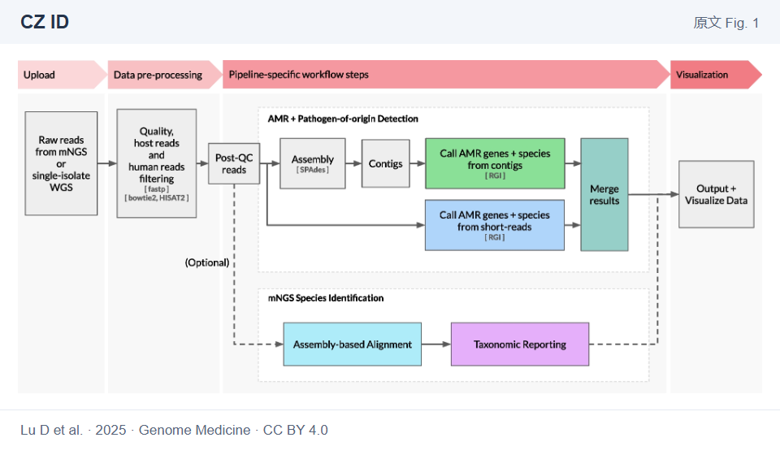</a>

Genome Medicine · 2025 · 病原与耐药流程

<h3><a href="papers/czid.md">CZ ID →</a></h3>

同一批 reads 分别进入组装、物种与耐药分析，再连接结果。

<a href="papers/czid.md">读中文导读</a> · <a href="https://doi.org/10.1186/s13073-025-01480-2">原始论文</a>

Lu D et al. · Fig. 1 · <a href="https://creativecommons.org/licenses/by/4.0/">CC BY 4.0</a> · <a href="assets/figures/czid-fig1.png">大图</a>
</td>
<td width="50%" valign="top">
<a href="papers/decontam.md">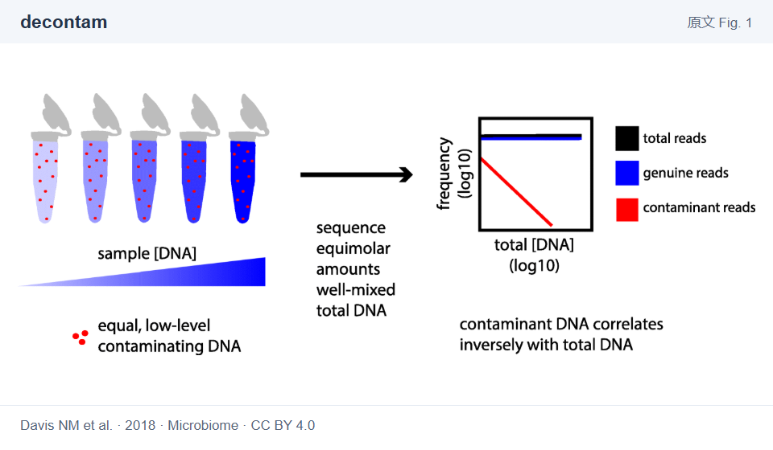</a>

Microbiome · 2018 · 污染控制

<h3><a href="papers/decontam.md">decontam →</a></h3>

沿着 DNA 浓度、阴性对照和出现频率寻找污染线索。

<a href="papers/decontam.md">读中文导读</a> · <a href="https://doi.org/10.1186/s40168-018-0605-2">原始论文</a>

Davis NM et al. · Fig. 1 · <a href="https://creativecommons.org/licenses/by/4.0/">CC BY 4.0</a> · <a href="assets/figures/decontam-fig1.png">大图</a>
</td>
</tr>
</table>

### 从分子结构走进细胞情境

比较输入的生物对象，看看预训练与结构设计各自承担什么工作。

<table>
<tr>
<td width="50%" valign="top">
<a href="papers/alphafold2.md">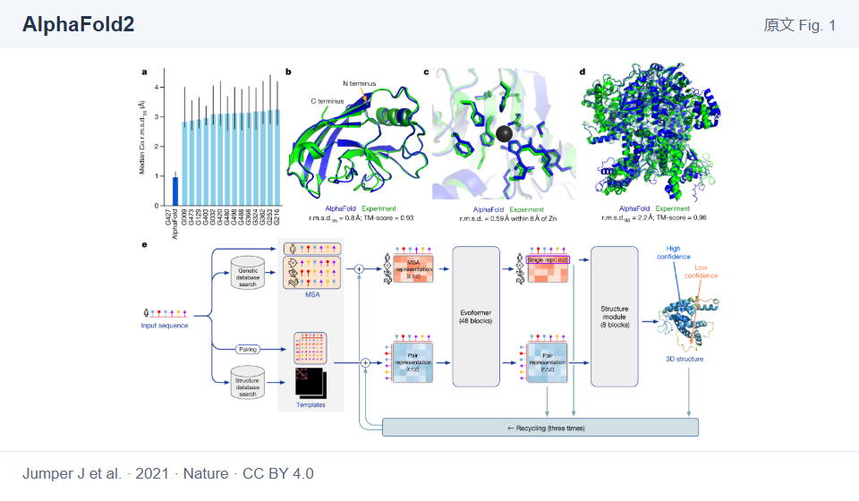</a>

Nature · 2021 · 蛋白结构

<h3><a href="papers/alphafold2.md">AlphaFold2 →</a></h3>

对照 Evoformer、结构模块和 recycling，看序列怎样通向结构。

<a href="papers/alphafold2.md">读中文导读</a> · <a href="https://doi.org/10.1038/s41586-021-03819-2">原始论文</a>

Jumper J et al. · Fig. 1 · <a href="https://creativecommons.org/licenses/by/4.0/">CC BY 4.0</a> · <a href="assets/figures/alphafold2-fig1.png">大图</a>
</td>
<td width="50%" valign="top">
<a href="papers/enformer.md">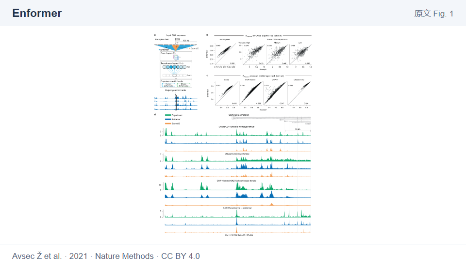</a>

Nature Methods · 2021 · 序列到功能

<h3><a href="papers/enformer.md">Enformer →</a></h3>

让远距离调控信息进入 DNA 到功能轨道的预测。

<a href="papers/enformer.md">读中文导读</a> · <a href="https://doi.org/10.1038/s41592-021-01252-x">原始论文</a>

Avsec Ž et al. · Fig. 1 · <a href="https://creativecommons.org/licenses/by/4.0/">CC BY 4.0</a> · <a href="assets/figures/enformer-fig1.png">大图</a>
</td>
</tr>
<tr>
<td width="50%" valign="top">
<a href="papers/geneformer.md">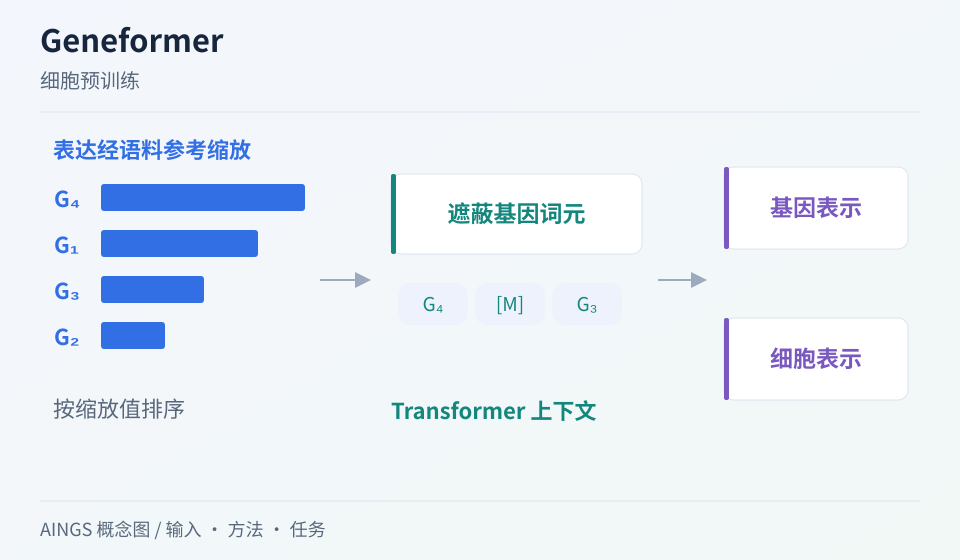</a>

Nature · 2023 · 细胞预训练

<h3><a href="papers/geneformer.md">Geneformer →</a></h3>

从基因排序到上下文表示，再到具体的细胞网络任务。

<a href="papers/geneformer.md">读中文导读</a> · <a href="https://doi.org/10.1038/s41586-023-06139-9">原始论文</a>

AINGS 方法概念图 · <a href="assets/gallery/geneformer.svg">大图</a>
</td>
<td width="50%" valign="top">
<a href="papers/nicheformer.md">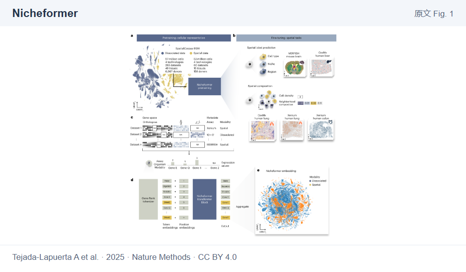</a>

Nature Methods · 2025 · 空间与细胞模型

<h3><a href="papers/nicheformer.md">Nicheformer →</a></h3>

从表达与技术情境进入空间相关任务，认识细胞的邻域。

<a href="papers/nicheformer.md">读中文导读</a> · <a href="https://doi.org/10.1038/s41592-025-02814-z">原始论文</a>

Tejada-Lapuerta A et al. · Fig. 1 · <a href="https://creativecommons.org/licenses/by/4.0/">CC BY 4.0</a> · <a href="assets/figures/nicheformer-fig1.png">大图</a>
</td>
</tr>
</table>

### 连接模态，也连接干预

图先验、生成模型与跨模态注意力，怎样落到具体的预测任务。

<table>
<tr>
<td width="50%" valign="top">
<a href="papers/glue.md">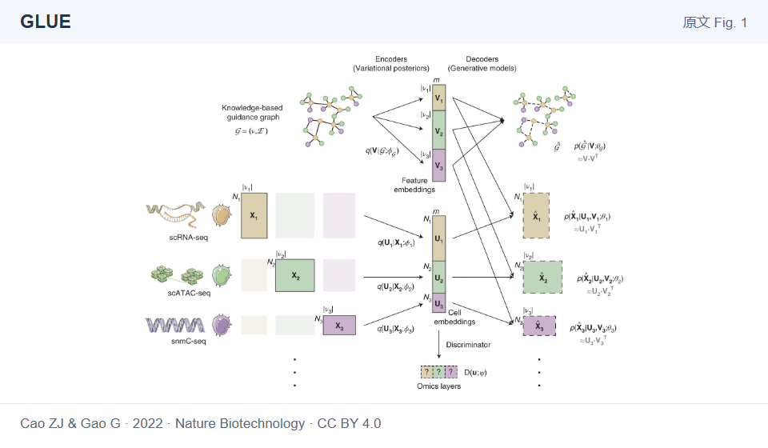</a>

Nature Biotechnology · 2022 · 图引导整合

<h3><a href="papers/glue.md">GLUE →</a></h3>

用特征关系图连接组学；沿原图读编码器、图模型与对齐。

<a href="papers/glue.md">读中文导读</a> · <a href="https://doi.org/10.1038/s41587-022-01284-4">原始论文</a>

Cao ZJ &amp; Gao G · Fig. 1 · <a href="https://creativecommons.org/licenses/by/4.0/">CC BY 4.0</a> · 部分素材 <a href="https://smart.servier.com/">Servier Medical Art</a> / <a href="https://creativecommons.org/licenses/by/3.0/">CC BY 3.0</a> · <a href="assets/figures/glue-fig1.png">大图</a>
</td>
<td width="50%" valign="top">
<a href="papers/multivi.md">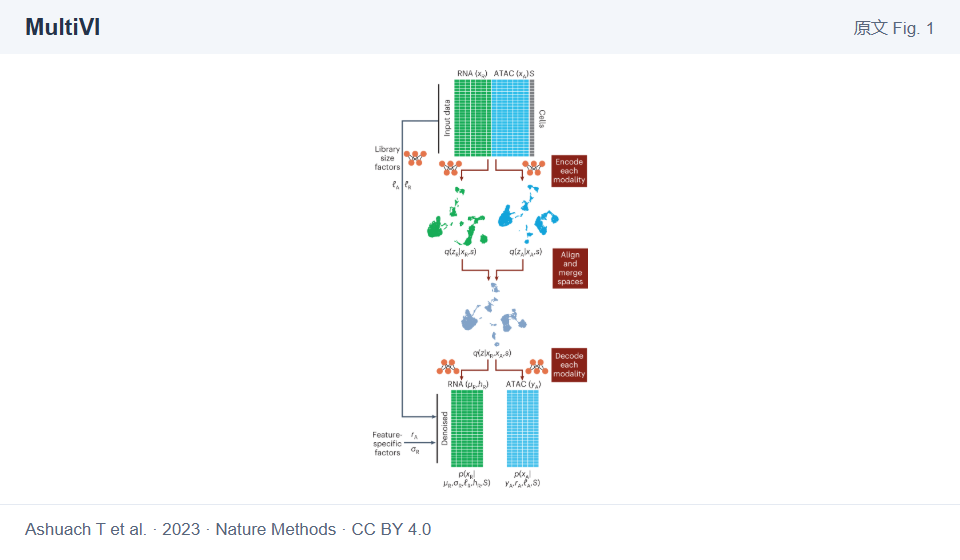</a>

Nature Methods · 2023 · 部分配对整合

<h3><a href="papers/multivi.md">MultiVI →</a></h3>

让配对与非配对数据共同训练，追踪不同观测的重构目标。

<a href="papers/multivi.md">读中文导读</a> · <a href="https://doi.org/10.1038/s41592-023-01909-9">原始论文</a>

Ashuach T et al. · Fig. 1 · <a href="https://creativecommons.org/licenses/by/4.0/">CC BY 4.0</a> · <a href="assets/figures/multivi-fig1.png">大图</a>
</td>
</tr>
<tr>
<td width="50%" valign="top">
<a href="papers/captain.md">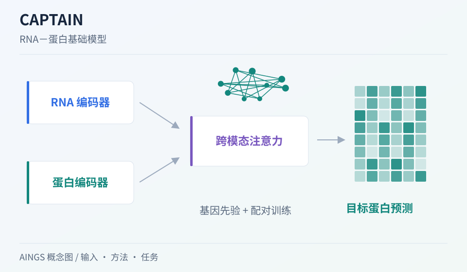</a>

Nature Communications · 2026 · RNA－蛋白基础模型

<h3><a href="papers/captain.md">CAPTAIN →</a></h3>

用配对 RNA／蛋白、跨模态注意力与先验预测目标蛋白。

<a href="papers/captain.md">读中文导读</a> · <a href="https://doi.org/10.1038/s41467-026-72882-y">原始论文</a>

AINGS 方法概念图 · <a href="assets/gallery/captain.svg">大图</a>
</td>
<td width="50%" valign="top">
<a href="papers/gears.md">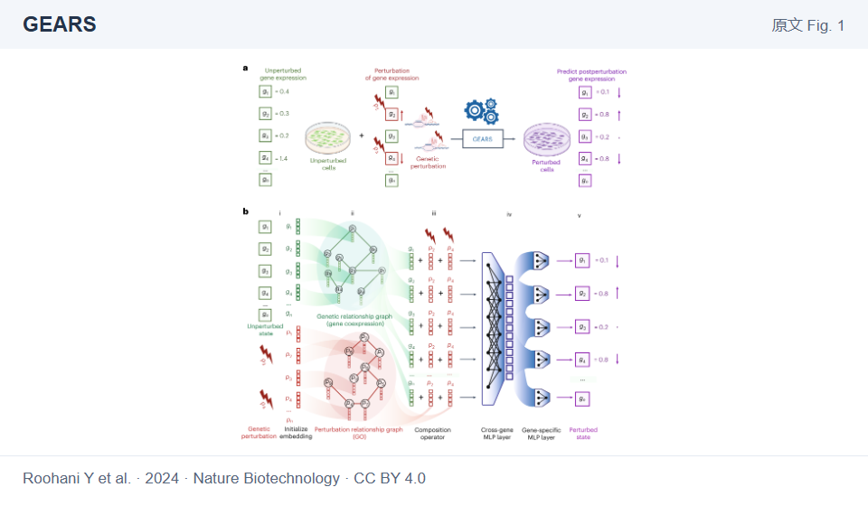</a>

Nature Biotechnology · 2024 · 扰动预测

<h3><a href="papers/gears.md">GEARS →</a></h3>

把基因关系和干预关系接入图网络，预测未见组合的响应。

<a href="papers/gears.md">读中文导读</a> · <a href="https://doi.org/10.1038/s41587-023-01905-6">原始论文</a>

Roohani Y et al. · Fig. 1 · <a href="https://creativecommons.org/licenses/by/4.0/">CC BY 4.0</a> · <a href="assets/figures/gears-fig1.png">大图</a>
</td>
</tr>
</table>

**还有更多值得一起读的工作：** ESM-2／ESMFold、ESM3、CITE-seq、TEA-seq、WNN、totalVI、scFoundation、scGPT、Perturb-seq、MOFA+、scVAEIT、scIB……

[进入完整画廊 · 34 篇导读 →](papers/README.md) · [查找论文与引用](papers/catalog.md) · [比较方法与数据前提](papers/compare.md)

### 焦点阅读 · 多模态基础模型的研究蓝图

**MFM Perspective · Nature · 2025**

序列、RNA、染色质、蛋白和空间信息，怎样进入可以迁移到不同任务的模型？这篇 Perspective 把统一词元、模态内与跨模态注意力、知识先验和实验反馈放在一起讨论。我们沿着这些连接展开导读，也把相关工作接到具体的知识章节。

[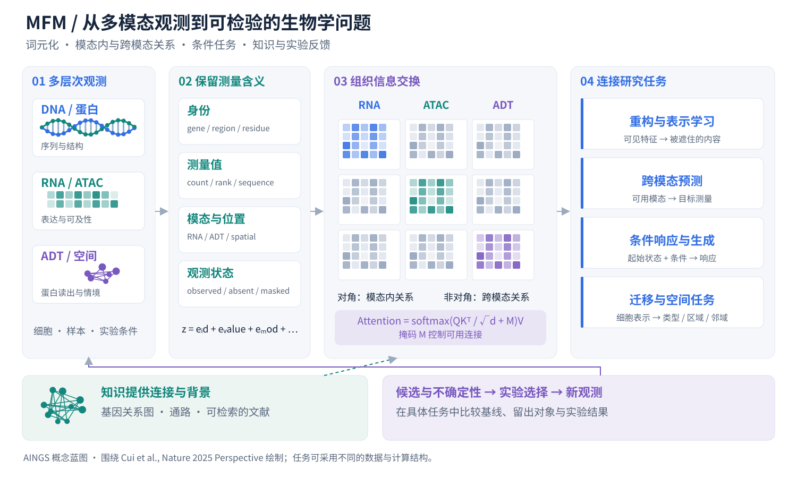](papers/mfm.md)

[展开 MFM 导读与计算图 →](papers/mfm.md) · [原始论文](https://doi.org/10.1038/s41586-025-08710-y) · [查看大图](assets/mfm-blueprint.svg)

画廊中收录 **15 张论文原图**，另有 **19 张 AINGS 方法概念图**。原图可以放大阅读，出处与许可见[图片署名](assets/credits.md)。如果一张图曾经帮你想通一个问题，也欢迎把它和你的理解一起带来。

## 带着一个问题开始

| 你现在好奇什么 | 可以先读哪里 | 可以顺手做点什么 |
| --- | --- | --- |
| 测序文件里到底装着什么？ | [reads、contig、ORF、SNP 与 MAG](01_检验医学与病原生信/02_生物信息学基础/02_reads_contig_ORF_SNP_MAG.md) | 对照 [CZ ID 的流程图](papers/czid.md)，标出每一步的输入和输出 |
| 多测一种模态，究竟多了什么信息？ | [配对、非配对与部分配对](02_多模态多组学/02_测量技术与多组学数据结构/06_配对_非配对_部分配对与_mosaic.md)、[共享与特有信息](02_多模态多组学/06_多模态整合_融合与预训练/04_共享信息_模态特有信息与可辨识性.md) | 画出自己数据里“测了什么、缺了什么” |
| Transformer 里的注意力怎么算？ | [完整计算一次 Q、K、V](02_多模态多组学/05_神经网络_Transformer与生物表示/05_Q_K_V_完整计算一次注意力.md) | 跟着小矩阵手算一次，再改一个输入看看结果 |
| 能不能从头跑通一个分析？ | [双模态计数到新供体细胞分类](02_多模态多组学/10_完整算例/README.md) | 按[运行说明](02_多模态多组学/10_完整算例/运行说明.md)执行代码，对照手算与指标 |
| 一个结果为什么看起来好，却很难用？ | [划分与标签](01_检验医学与病原生信/03_数据与统计基础/03_训练验证测试与标签质量.md)、[模型评价](02_多模态多组学/08_模型评价_实验设计与生物学解释/README.md) | 检查分析单位、留出对象与基线各是什么 |

想按已有背景找入口，可以看[学习导航](study-path.md)；想快速查一个术语或主题，可以用[专题索引](topics.md)与[参考资料](reference-index.md)。

## 知识目录

### 检验医学与病原生信

从样本与实验室流程，进入病原、耐药、数据与计算任务。各主题分别展开概念、问题与方法。[查看全部主题 →](01_检验医学与病原生信/README.md)

| 模块 | 主要内容 |
| --- | --- |
| [01 检验医学与临床微生物学](01_检验医学与病原生信/01_检验医学与临床微生物学/README.md) | 样本采集、培养与药敏、污染与定植、病原与宿主 |
| [02 生物信息学基础](01_检验医学与病原生信/02_生物信息学基础/README.md) | 测序、reads／contig／ORF／MAG、物种判断、ARG、数据库与工具 |
| [03 数据与统计基础](01_检验医学与病原生信/03_数据与统计基础/README.md) | 丰度、归一化、组成型数据、批次、宿主背景、标签与划分 |
| [04 方法与模型基础](01_检验医学与病原生信/04_方法与模型基础/README.md) | 比对、组装、k-mer、sketch、病原与耐药任务、校准与拒识 |

### 多模态多组学

从细胞和分子层次，一直展开到模型、应用与完整算例。各章包含概念解释、计算过程和自检题。[查看全部主题 →](02_多模态多组学/README.md)

| 模块 | 主要内容 |
| --- | --- |
| [01 生物学层次与研究对象](02_多模态多组学/01_生物学层次与研究对象/README.md) | DNA、RNA、蛋白、染色质、细胞类型与状态、样本和供体 |
| [02 测量技术与多组学数据结构](02_多模态多组学/02_测量技术与多组学数据结构/README.md) | scRNA、scATAC、ADT、CITE-seq、矩阵、配对、缺失与数据对象 |
| [03 质量控制、预处理与数据表示](02_多模态多组学/03_质量控制_预处理与数据表示/README.md) | QC、log1p、HVG、TF-IDF、LSI、CLR、稀疏性与批次 |
| [04 数学、统计与机器学习基础](02_多模态多组学/04_数学_统计与机器学习基础/README.md) | 向量矩阵、概率分布、PCA／SVD、损失、梯度与正则化 |
| [05 神经网络、Transformer 与生物表示](02_多模态多组学/05_神经网络_Transformer与生物表示/README.md) | MLP、AE／VAE、词元、QKV、注意力、位置、图与计算效率 |
| [06 多模态整合、融合与预训练](02_多模态多组学/06_多模态整合_融合与预训练/README.md) | 对齐与融合、共享与特有信息、观测掩码、对比学习与预训练 |
| [07 下游任务、迁移与预测方法](02_多模态多组学/07_下游任务_迁移与预测方法/README.md) | 冻结与微调、输入输出接口、基线、集成、校准与不确定性 |
| [08 模型评价、实验设计与生物学解释](02_多模态多组学/08_模型评价_实验设计与生物学解释/README.md) | 数据划分、数值与分类指标、生物重复、统计推断与消融 |
| [09 空间、序列、调控与实验闭环](02_多模态多组学/09_空间_序列_调控与实验闭环/README.md) | 空间、序列结构、调控、扰动、知识、通路与实验选择 |
| [10 完整算例：从双模态计数到新供体的细胞分类](02_多模态多组学/10_完整算例/README.md) | 从双模态计数到新供体分类：数据、手算、指标与可运行代码 |
| [11 代表方法与数据工具怎样对应前面的知识](02_多模态多组学/11_代表方法与数据工具/README.md) | WNN、totalVI、MultiVI、GLUE、scVAEIT、scGPT、AnnData 与 MuData |
| [12 符号与术语索引](02_多模态多组学/12_符号与术语索引/README.md) | 数学符号、生物与数据术语、模型组件、迁移、评价与应用术语 |
| [13 参考资料](02_多模态多组学/13_参考资料/README.md) | 原始研究、基础教材、测量与方法论文、官方文档和数据入口 |

## 一起学习，也一起建设

**这个仓库靠大家一起往前写。** 一处纠错、一份整理好的数据说明、一段跑通的代码，都很有用。还没整理成文章也没关系，可以先在 Issue 里贴出材料或问题，我们再一起补上解释和入口。

我们也会定期分享资料、工具、学术活动与合作信息。讨论中讲清楚的问题、值得收藏的资源、一起做出的算例，都可以整理进仓库。你可以从一处修改开始，也可以带着感兴趣的伙伴维护一个专题。

| 想带来什么 | 从这里开始 |
| --- | --- |
| 自己的学习笔记、教程、代码，或发现的论文、工具与数据集 | [分享资料](https://github.com/moshookee-ux/AINGS-study-group/issues/new?template=01_resource.yml)，贴上内容或链接，说说它能帮助大家做什么 |
| 一个问题、一处错误或一段更清楚的解释 | [补充与修正内容](https://github.com/moshookee-ux/AINGS-study-group/issues/new?template=02_content.yml)，告诉大家在哪一页 |
| 一个值得继续展开的方向 | [提出新方向](https://github.com/moshookee-ux/AINGS-study-group/issues/new?template=03_new_direction.yml)，从问题或几份材料开始 |
| 一个想找人一起做的项目 | [分享合作信息](https://github.com/moshookee-ux/AINGS-study-group/issues/new?template=04_collaboration.yml)，介绍已有基础与想认识的伙伴 |

任何人都欢迎通过 Issue 分享资料与问题，或按[共建指南](CONTRIBUTING.md)提交 Pull Request，把自己的内容加入仓库。文字、图示、代码、资料整理和问题反馈，都可以成为你的第一份贡献。

## 加入我们

想加入兴趣小组，或和大家一起维护这份 AI＋生信共享仓库，欢迎在微信里添加任意一位发起人。

- **梅锐翔**　`MaryyyyyyyyyyyyX`
- **贾晓**　`15204742084`

想一起维护仓库的伙伴，可以把 **GitHub 用户名**发给我们，我们会邀请你加入仓库协作。

欢迎计算机、人工智能、数据科学、生物信息、生命科学、医学与检验等背景的同学和伙伴，也欢迎刚开始了解这个交叉领域的朋友。

也欢迎聊聊最近在读什么、想整理哪些资料，或者希望认识什么样的合作伙伴。后续会招募管理者与方向组长，一起照看目录、回应问题、组织内容更新，让更多人能够参与进来。

**下一篇内容，可能就从你的一个问题开始。**

---

[了解小组](community.md) · [一起贡献](CONTRIBUTING.md) · [项目与合作](projects/README.md) · [仓库导航](folder-architecture.md) · [图片署名](assets/credits.md)
