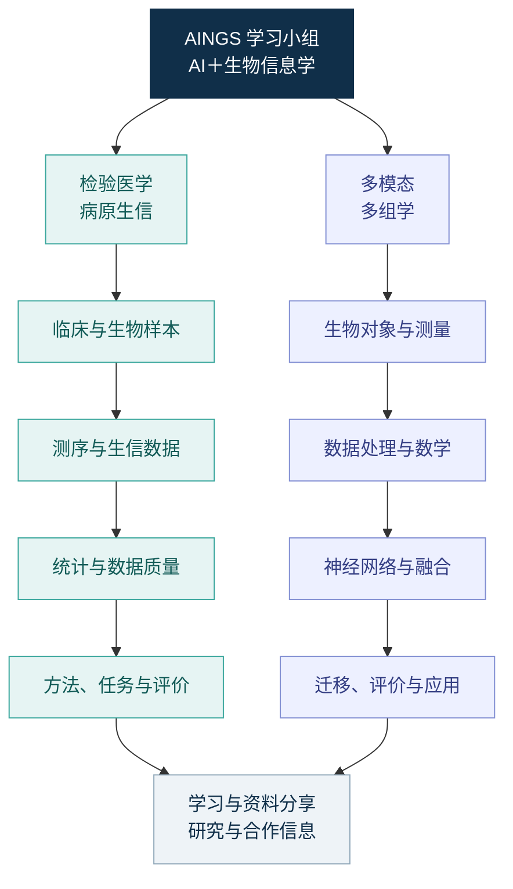

# AINGS 学习小组

**AI＋生物信息学｜知识学习、资料分享与合作交流**

**发起者：梅锐翔、贾晓。** 后续将招募管理者与各方向组长，一起整理知识、分享资料和连接合作机会。

[小组介绍与加入](community.md) · [学习路径](study-path.md) · [专题索引](topics.md) · [参考资料](reference-index.md) · [合作信息与实践](projects/README.md)

AINGS 汇集关注人工智能与生物信息学的伙伴。我们从各自正在读、正在尝试和正在思考的内容出发，分享论文、数据、工具、学术活动和项目想法，让算法、生命科学与医学背景的认识彼此连接。

知识内容分为两条主线：**检验医学与病原生信**、**多模态多组学**。两条主线各自展开基础概念、数据问题、方法与应用，共同构成小组的知识目录。

## 两条知识主线

| 主线 | 核心问题 | 内容入口 |
| --- | --- | --- |
| **[检验医学与病原生信](01_检验医学与病原生信/README.md)** | 临床样本如何形成测序数据，如何组织物种、耐药与宿主相关证据，怎样设计和评价计算任务 | 4 个模块、16 篇主题笔记，以及专题与参考资料 |
| **[多模态多组学](02_多模态多组学/README.md)** | 生物对象如何变成不同模态的测量，模型怎样表示和融合信息，如何迁移、评价并解释结果 | 13 个模块、119 篇主题页面，以及公式、算例、自检、术语和参考资料 |

## 检验医学与病原生信

从样本、实验室流程与临床背景开始，进入测序与生信数据，理解数据质量和统计问题，再学习病原识别、耐药检测与模型评价。

| 模块 | 主要内容 |
| --- | --- |
| [01 检验医学与临床微生物学](01_检验医学与病原生信/01_检验医学与临床微生物学/README.md) | 样本采集、培养与药敏、污染与定植、病原与宿主 |
| [02 生物信息学基础](01_检验医学与病原生信/02_生物信息学基础/README.md) | 测序、reads／contig／ORF／MAG、物种判断、ARG、数据库与工具 |
| [03 数据与统计基础](01_检验医学与病原生信/03_数据与统计基础/README.md) | 丰度、归一化、组成型数据、批次、宿主背景、标签与划分 |
| [04 方法与模型基础](01_检验医学与病原生信/04_方法与模型基础/README.md) | 比对、组装、k-mer、sketch、病原与耐药任务、校准与拒识 |

## 多模态多组学

从细胞与分子层次开始，沿着实验测量、数据表示、数学、神经网络、融合、迁移与评价展开，并连接空间组学、序列、调控和完整计算实践。

| 模块 | 主要内容 |
| --- | --- |
| [01 生物学层次与研究对象](02_多模态多组学/01_生物学层次与研究对象/README.md) | DNA、RNA、蛋白、染色质、细胞类型与状态、样本和供体 |
| [02 测量技术与多组学数据结构](02_多模态多组学/02_测量技术与多组学数据结构/README.md) | scRNA、scATAC、ADT、CITE-seq、矩阵、配对、缺失与数据对象 |
| [03 质量控制、预处理与数据表示](02_多模态多组学/03_质量控制_预处理与数据表示/README.md) | QC、log1p、HVG、TF-IDF、LSI、CLR、稀疏性与批次 |
| [04 数学、统计与机器学习基础](02_多模态多组学/04_数学_统计与机器学习基础/README.md) | 向量矩阵、概率分布、PCA／SVD、损失、梯度与正则化 |
| [05 神经网络、Transformer 与生物表示](02_多模态多组学/05_神经网络_Transformer与生物表示/README.md) | MLP、AE／VAE、词元、QKV、注意力、位置、图与计算效率 |
| [06 多模态整合、融合与预训练](02_多模态多组学/06_多模态整合_融合与预训练/README.md) | 对齐与融合、共享与特有信息、观测掩码、对比学习与预训练 |
| [07 下游任务、迁移与预测方法](02_多模态多组学/07_下游任务_迁移与预测方法/README.md) | 冻结与微调、输入输出接口、基线、集成、校准与不确定性 |
| [08 模型评价、实验设计与生物学解释](02_多模态多组学/08_模型评价_实验设计与生物学解释/README.md) | 数据划分、数值与分类指标、生物重复、统计推断与消融 |
| [09 空间、序列、调控与实验闭环](02_多模态多组学/09_空间_序列_调控与实验闭环/README.md) | 空间、序列结构、调控、扰动、知识、通路与实验选择 |
| [10 完整算例：从双模态计数到新供体的细胞分类](02_多模态多组学/10_完整算例/README.md) | 从双模态计数到新供体分类：数据、手算、指标与可运行代码 |
| [11 代表方法与数据工具怎样对应前面的知识](02_多模态多组学/11_代表方法与数据工具/README.md) | WNN、totalVI、MultiVI、GLUE、scVAEIT、scGPT、AnnData 与 MuData |
| [12 符号与术语索引](02_多模态多组学/12_符号与术语索引/README.md) | 数学符号、生物与数据术语、模型组件、迁移、评价与应用术语 |
| [13 参考资料](02_多模态多组学/13_参考资料/README.md) | 原始研究、基础教材、测量与方法论文、官方文档和数据入口 |

## 资料分享与合作交流

- **论文与研究进展：**推荐值得读的论文、综述和研究问题，交流方法、数据与结果。
- **工具、数据与经验：**分享公开数据集、开源代码、教程和实际使用中的发现。
- **学术活动信息：**分享会议、讲座、征稿、报名信息和参与收获。
- **项目想法与合作机会：**介绍正在探索的问题、已有材料和希望认识的伙伴。

小组会定期整理和分享资料、研究动态与合作信息。成员可以推荐内容、提出问题、交流经验，也可以把理解写成知识笔记或可复算的例子。

## 加入与共建

欢迎计算机、人工智能、数据科学、生物信息、生命科学、医学与检验等背景的同学和伙伴。可以联系**梅锐翔或贾晓**加入，介绍自己的背景、关注方向和最近想了解的问题。

后续将招募**管理者与各方向组长**，共同维护资料、整理知识和连接成员的研究兴趣。具体介绍见[小组介绍与加入](community.md)；知识修订和资料贡献见[共建说明](CONTRIBUTING.md)。

[文件架构](folder-architecture.md) · [内容来源](sources/README.md)
