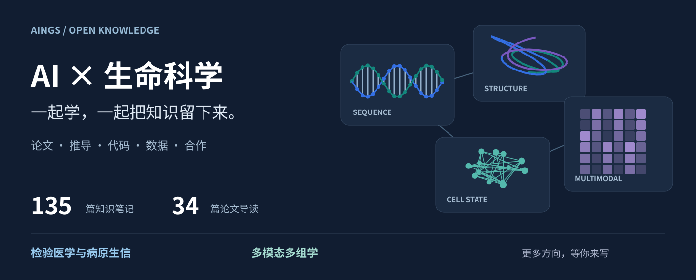

# AINGS 学习小组

**AI＋生信兴趣小组，欢迎一起学习、分享与共建。**

**作者与发起者：[贾晓](https://github.com/moshookee-ux)、[梅锐翔](https://github.com/FairYJmrx)。**

我们想找一些对 AI 与生物信息学感兴趣的伙伴，一起读懂研究、交流实践，也把各自学到的东西整理下来，做成一个大家都能使用、都能继续完善的共享知识仓库。

同一篇论文，做算法的同学可能先看模型和评价，生物或医学背景的同学可能更关心数据怎么来、结果意味着什么。交流起来，一张原本没看懂的图可能有了新的解释，一个模型也可能找到了值得尝试的问题。

**AINGS 想把这样的交流延续下去。** 你可以带着正在读的论文、分析中遇到的问题，或一个想找人聊聊的研究想法加入我们。仓库已经开放，欢迎先来逛逛。

[打开共享仓库](https://github.com/moshookee-ux/AINGS-study-group) · [逛逛论文画廊](papers/README.md) · [看看怎样贡献](CONTRIBUTING.md)

## 一起建设 AI＋生信共享知识仓库

这是小组想长期做的一件事：**让每个人的学习积累，成为其他人可以接着使用和补充的资料。**

仓库向所有人开放。任何人都可以通过它学习，也可以加入自己的知识笔记、论文解读、数据分析示例、工具教程和代码。加入兴趣小组后，还可以加入仓库协作，和大家一起整理内容、回应问题、维护感兴趣的主题。

一次贡献可以很具体：给一个概念补上例子，为一篇论文写下推荐理由，记录一次环境配置或数据处理的经验，修正一处解释，或者把自己熟悉的方向展开成新的目录。读到还没弄懂的地方，也欢迎留下问题，让有相关经验的伙伴接着补充。

我们希望这里逐渐有更清楚的学习导航、更丰富的论文画廊，以及更多能跟着运行的实例。以后仓库会长出哪些内容，也取决于加入的你。

## 目前可以从这些方向开始

### 检验医学与病原生信

从一份样本怎样进入实验室，到测序数据怎样成为病原识别与耐药分析的证据，连接检验背景、生信流程和 AI 方法。

我们会关注临床微生物学、宏基因组测序、序列组装与物种鉴定，也会一起理解数据中的污染、偏差和标签问题，看看它们怎样影响任务设计、模型评价与结果解释。

[进入检验医学与病原生信知识库](01_检验医学与病原生信/README.md)

### 多模态多组学

从 RNA、染色质、蛋白等不同测量出发，理解怎样把多种数据放在一起分析，研究细胞状态、调控关系与生物学变化。

我们会关注单细胞与空间组学、多模态表示学习、数据整合、缺失模态和生物基础模型，也会沿着具体问题补充数学、统计与计算方法，交流模型输出怎样回到生物学解释。

[进入多模态多组学知识库](02_多模态多组学/README.md)

**更多方向，欢迎你来展开。** 序列与蛋白模型、AI 辅助文献检索、科研编程，或你正在关注的其他 AI＋生信主题，都可以从一份资料、一个小例子开始，和有相近兴趣的伙伴一起慢慢补全。

## 平时可以分享什么

- **论文与研究进展。** 推荐一篇值得读的文章，聊聊它解决的问题、数据和方法；也可以只讨论其中一张图，或者几篇工作之间的联系。
- **工具与实践经验。** 分享公开数据集、开源代码、教程，以及使用 AI 阅读论文、编写代码、处理数据和制作可视化时的经验。说说自己怎么用、遇到过什么问题，后来的人就更容易上手。
- **会议与学术活动。** 交流感兴趣的讲座、研讨会、征稿与报名信息，也欢迎带回值得推荐的报告和资料。
- **项目想法与合作机会。** 介绍正在探索的问题、手头的进展和希望认识的伙伴。一个初步想法，也可以从交换资料和经验开始聊起来。

我们会定期整理值得关注的资料、研究动态和合作信息，也把交流中有用的内容收进仓库，方便大家查阅和继续完善。

## 欢迎什么样的伙伴

欢迎计算机、人工智能、数据科学、生物信息、生物学、医学与检验等背景的本科生、研究生和其他感兴趣的朋友。

刚开始接触这个领域，可以从自己的一个问题或一份入门资料开始；已经在做相关研究，也欢迎带来熟悉的工具、真实的分析经验，或者想寻找合作者的课题。我们希望算法、数据和生物医学背景的伙伴能在这里认识彼此，把各自熟悉的部分讲给对方听。

也期待有人愿意帮忙整理资料、回应问题、维护目录。后续会招募管理者与方向组长，有兴趣的伙伴可以一起参与，让更多主题有人接着做、有人一起学。

## 加入我们

联系 **贾晓或梅锐翔**，就可以加入兴趣小组。可以简单聊聊你的背景、最近关注的方向，或想一起探索的问题。

想参与仓库维护的话，把 **GitHub 用户名**发给我们，我们会安排协作邀请。熟悉 GitHub 的伙伴可以直接提交修改；第一次参与共建，也可以先把资料和想法发出来，我们一起整理。

欢迎把这个邀请转给同样对 AI＋生信感兴趣的朋友。也许你最近想弄明白的问题，恰好有人正在研究。

[开始探索](https://github.com/moshookee-ux/AINGS-study-group) · [带来一份资料](https://github.com/moshookee-ux/AINGS-study-group/issues/new?template=01_resource.yml) · [提出新方向](https://github.com/moshookee-ux/AINGS-study-group/issues/new?template=03_new_direction.yml) · [分享合作信息](projects/README.md)
