# 研究画廊

**沿着一张图，走进一个研究问题。**

[首页](../README.md) · [检验医学与病原生信](#检验医学与病原生信) · [多模态多组学](#多模态多组学) · [论文索引](catalog.md) · [方法对照](compare.md) · [BibTeX](references.bib)

这里收录 **34 篇独立导读**。可以先看图找到感兴趣的方法，也可以把同一问题下的几篇放在一起读。卡片连接原始论文与中文拆解，导读继续连接知识章节、评价问题和小练习。

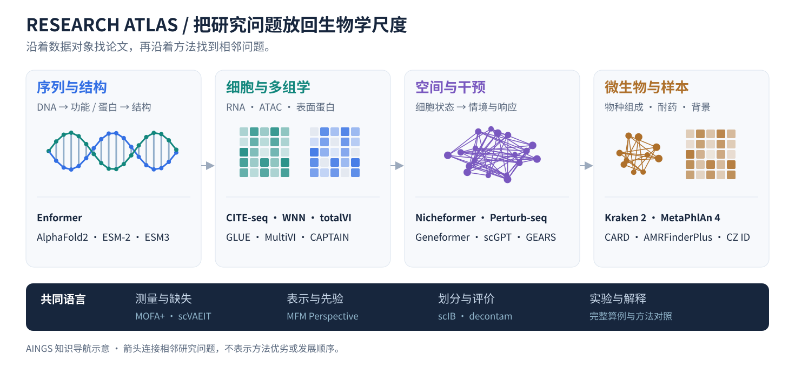

## 检验医学与病原生信

从序列、参考库与样本出发，追踪物种组成、耐药基因、基因组比较和背景信号。[进入知识目录 →](../01_检验医学与病原生信/README.md)

### 序列与分类

匹配什么、依靠什么参考、最后输出什么，是比较这些方法的起点。

<table>
<tr>
<td width="50%" valign="top">
<a href="kraken2.md">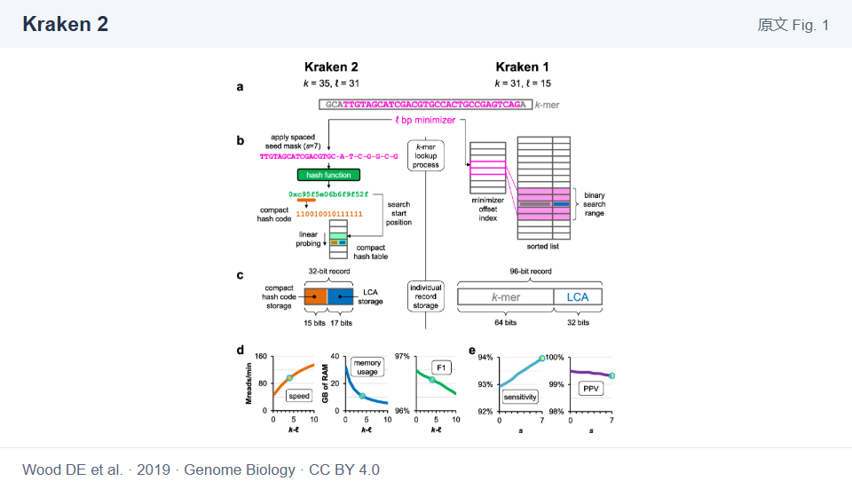</a>

Genome Biology · 2019 · 序列分类

<h3><a href="kraken2.md">Kraken 2 →</a></h3>

从 minimizer、紧凑哈希表到分类树，拆开高速序列分类的三步。

<a href="kraken2.md">读中文导读</a> · <a href="https://doi.org/10.1186/s13059-019-1891-0">原始论文</a>

Wood DE et al. · Fig. 1 · <a href="https://creativecommons.org/licenses/by/4.0/">CC BY 4.0</a> · <a href="../assets/figures/kraken2-fig1.png">大图</a>
</td>
<td width="50%" valign="top">
<a href="centrifuge.md">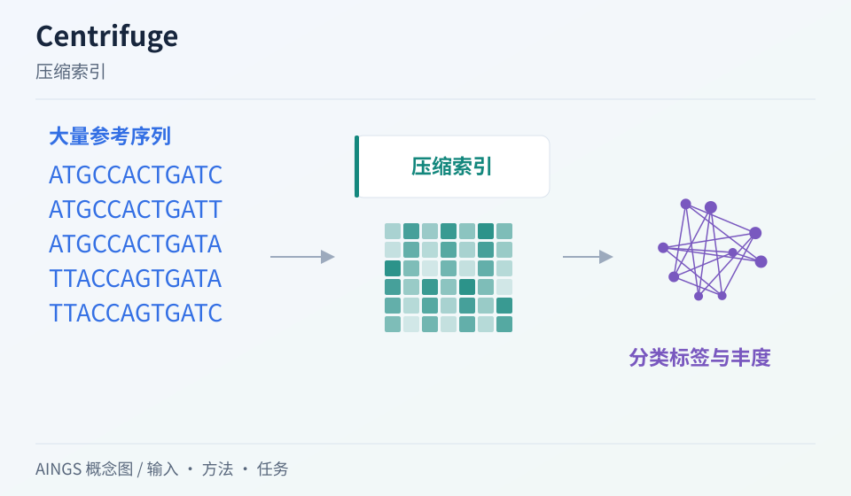</a>

Genome Research · 2016 · 压缩索引

<h3><a href="centrifuge.md">Centrifuge →</a></h3>

把参考库压进索引，再看序列匹配怎样形成分类与丰度估计。

<a href="centrifuge.md">读中文导读</a> · <a href="https://doi.org/10.1101/gr.210641.116">原始论文</a>

AINGS 方法概念图 · <a href="../assets/gallery/centrifuge.svg">大图</a>
</td>
</tr>
<tr>
<td width="50%" valign="top">

Nature Communications · 2016 · 蛋白层分类

<h3><a href="kaiju.md">Kaiju →</a></h3>

进入氨基酸空间，用蛋白层面的保守性寻找分类线索。

<a href="kaiju.md">读中文导读</a> · <a href="https://doi.org/10.1038/ncomms11257">原始论文</a>

AINGS 方法概念图 · <a href="../assets/gallery/kaiju.svg">大图</a>
</td>
<td width="50%" valign="top">
<a href="metaphlan4.md">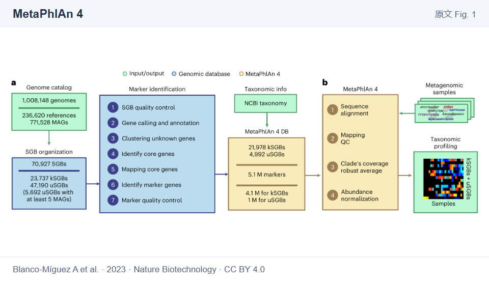</a>

Nature Biotechnology · 2023 · 微生物组组成

<h3><a href="metaphlan4.md">MetaPhlAn 4 →</a></h3>

从未培养物种的基因组与标记基因，走到样本的相对组成。

<a href="metaphlan4.md">读中文导读</a> · <a href="https://doi.org/10.1038/s41587-023-01688-w">原始论文</a>

Blanco-Míguez A et al. · Fig. 1 · <a href="https://creativecommons.org/licenses/by/4.0/">CC BY 4.0</a> · <a href="../assets/figures/metaphlan4-fig1.png">大图</a>
</td>
</tr>
<tr>
<td width="50%" valign="top">
<a href="deepmicrobes.md">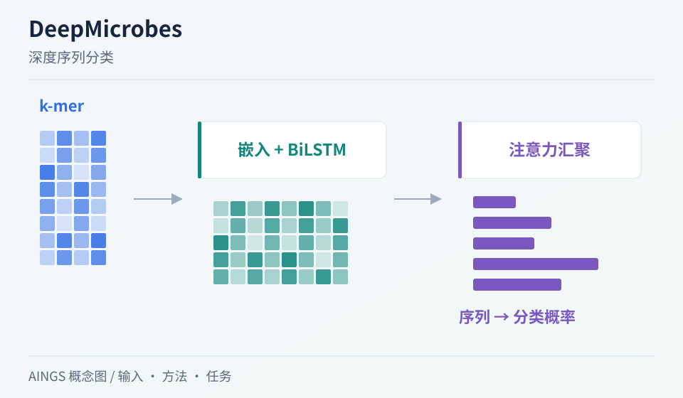</a>

NAR Genomics and Bioinformatics · 2020 · 深度序列分类

<h3><a href="deepmicrobes.md">DeepMicrobes →</a></h3>

k-mer、BiLSTM 与注意力怎样共同学习短序列特征。

<a href="deepmicrobes.md">读中文导读</a> · <a href="https://doi.org/10.1093/nargab/lqaa009">原始论文</a>

AINGS 方法概念图 · <a href="../assets/gallery/deepmicrobes.svg">大图</a>
</td>
<td width="50%" valign="top">
<a href="bertax.md">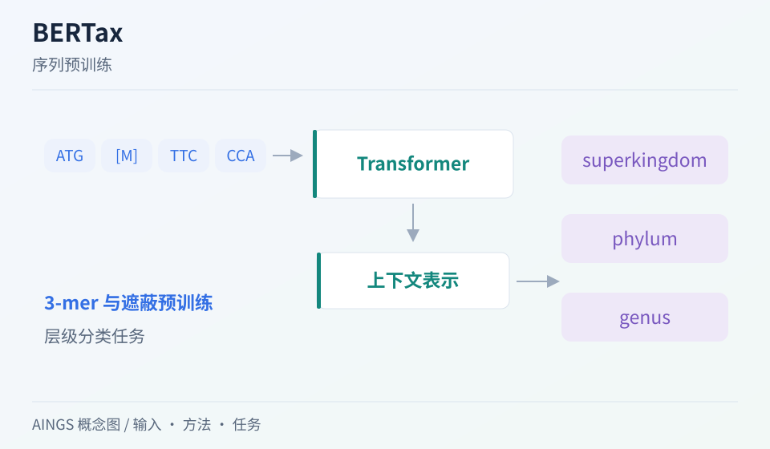</a>

PNAS · 2022 · 序列预训练

<h3><a href="bertax.md">BERTax →</a></h3>

从 3-mer 上下文进入分类树，理解层级预测与未见类群。

<a href="bertax.md">读中文导读</a> · <a href="https://doi.org/10.1073/pnas.2122636119">原始论文</a>

AINGS 方法概念图 · <a href="../assets/gallery/bertax.svg">大图</a>
</td>
</tr>
</table>

### 耐药与分析流程

把参考资源、分类模型与实际检测流程放到一起读。

<table>
<tr>
<td width="50%" valign="top">
<a href="card.md">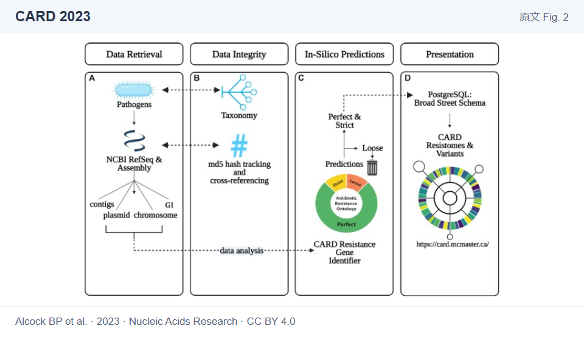</a>

Nucleic Acids Research · 2023 · 耐药数据库

<h3><a href="card.md">CARD 2023 →</a></h3>

连接耐药本体、参考序列和检测规则，读懂 Perfect／Strict 命中。

<a href="card.md">读中文导读</a> · <a href="https://doi.org/10.1093/nar/gkac920">原始论文</a>

Alcock BP et al. · Fig. 2 · <a href="https://creativecommons.org/licenses/by/4.0/">CC BY 4.0</a> · <a href="../assets/figures/card-fig2.jpg">大图</a>
</td>
<td width="50%" valign="top">
<a href="amrfinderplus.md">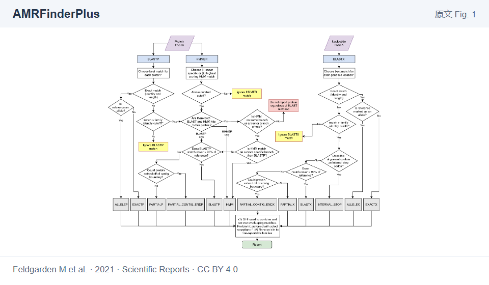</a>

Scientific Reports · 2021 · 耐药检测

<h3><a href="amrfinderplus.md">AMRFinderPlus →</a></h3>

对照蛋白与核酸两条检测路径，追踪命中类别与判定依据。

<a href="amrfinderplus.md">读中文导读</a> · <a href="https://doi.org/10.1038/s41598-021-91456-0">原始论文</a>

Feldgarden M et al. · Fig. 1 · <a href="https://creativecommons.org/licenses/by/4.0/">CC BY 4.0</a> · <a href="../assets/figures/amrfinderplus-fig1.png">大图</a>
</td>
</tr>
<tr>
<td width="50%" valign="top">
<a href="deeparg.md">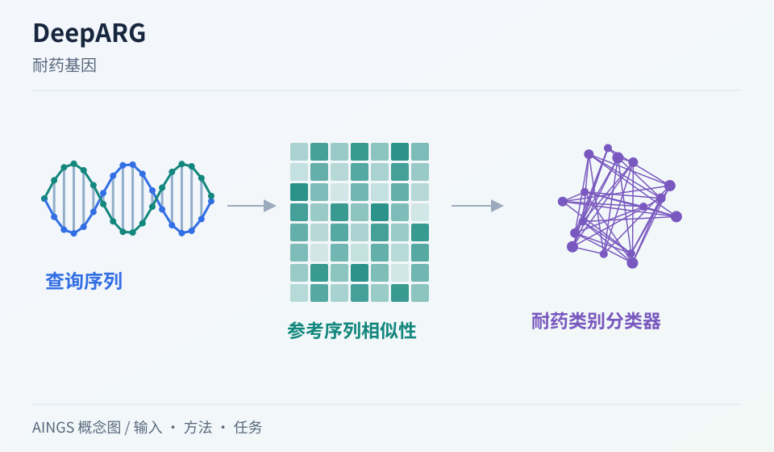</a>

Microbiome · 2018 · 耐药基因

<h3><a href="deeparg.md">DeepARG →</a></h3>

参考序列相似性如何成为神经网络的耐药分类输入。

<a href="deeparg.md">读中文导读</a> · <a href="https://doi.org/10.1186/s40168-018-0401-z">原始论文</a>

AINGS 方法概念图 · <a href="../assets/gallery/deeparg.svg">大图</a>
</td>
<td width="50%" valign="top">
<a href="czid.md">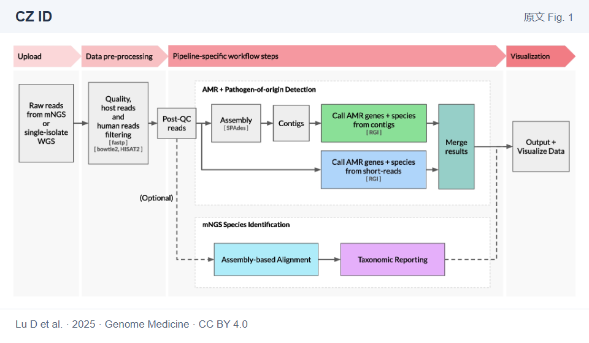</a>

Genome Medicine · 2025 · 病原与耐药流程

<h3><a href="czid.md">CZ ID →</a></h3>

同一批 reads 分别进入组装、物种与耐药分析，再连接结果。

<a href="czid.md">读中文导读</a> · <a href="https://doi.org/10.1186/s13073-025-01480-2">原始论文</a>

Lu D et al. · Fig. 1 · <a href="https://creativecommons.org/licenses/by/4.0/">CC BY 4.0</a> · <a href="../assets/figures/czid-fig1.png">大图</a>
</td>
</tr>
</table>

### 基因组、污染与组成

分析结果回到样本时，比较单位和背景信息会改变解释。

<table>
<tr>
<td width="50%" valign="top">
<a href="fastani.md">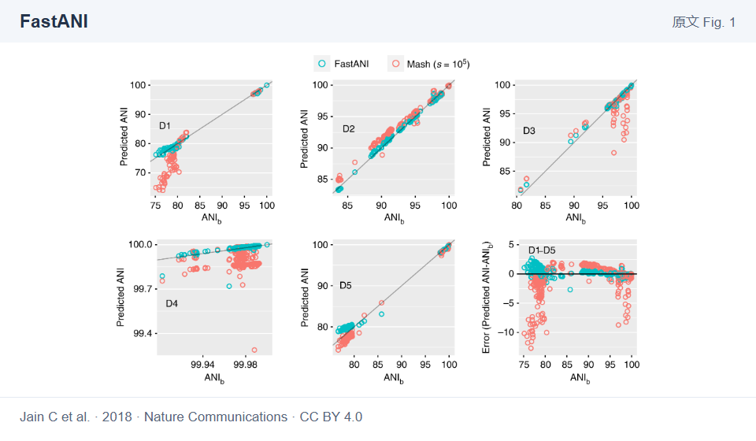</a>

Nature Communications · 2018 · 基因组比较

<h3><a href="fastani.md">FastANI →</a></h3>

用片段映射快速估计 ANI，理解基因组相似性及其比较单位。

<a href="fastani.md">读中文导读</a> · <a href="https://doi.org/10.1038/s41467-018-07641-9">原始论文</a>

Jain C et al. · Fig. 1 · <a href="https://creativecommons.org/licenses/by/4.0/">CC BY 4.0</a> · <a href="../assets/figures/fastani-fig1.png">大图</a>
</td>
<td width="50%" valign="top">
<a href="decontam.md">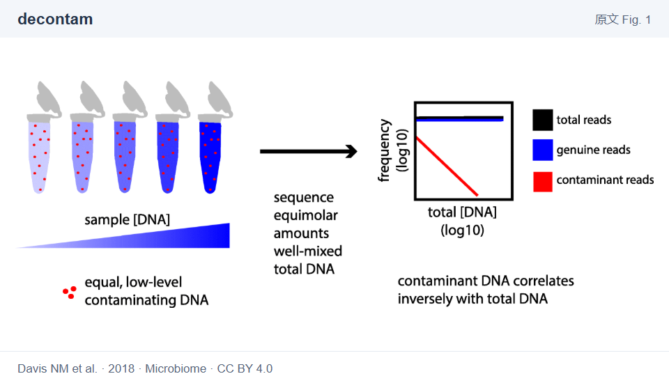</a>

Microbiome · 2018 · 污染控制

<h3><a href="decontam.md">decontam →</a></h3>

沿着 DNA 浓度、阴性对照和出现频率寻找污染线索。

<a href="decontam.md">读中文导读</a> · <a href="https://doi.org/10.1186/s40168-018-0605-2">原始论文</a>

Davis NM et al. · Fig. 1 · <a href="https://creativecommons.org/licenses/by/4.0/">CC BY 4.0</a> · <a href="../assets/figures/decontam-fig1.png">大图</a>
</td>
</tr>
<tr>
<td width="50%" valign="top">
<a href="compositionality.md">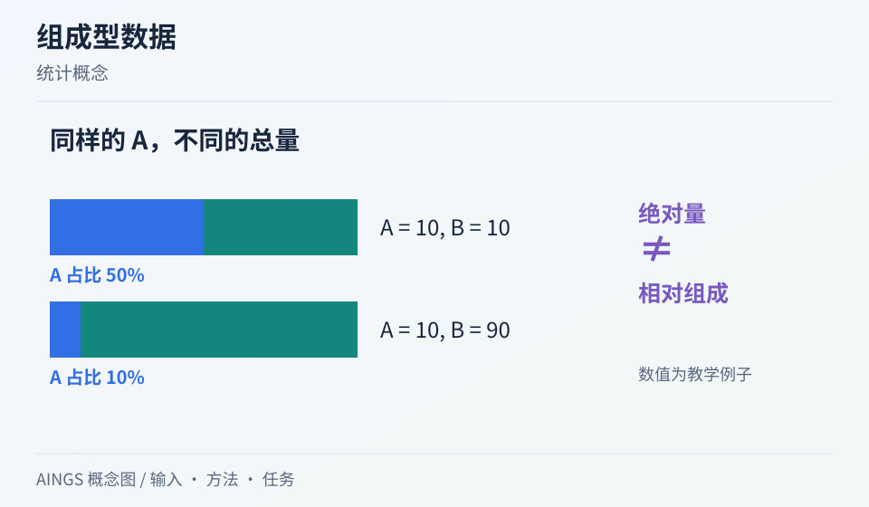</a>

Frontiers in Microbiology · 2017 · 统计概念

<h3><a href="compositionality.md">组成型数据 →</a></h3>

用一个两成员例子看清绝对量、相对丰度与总量约束。

<a href="compositionality.md">读中文导读</a> · <a href="https://doi.org/10.3389/fmicb.2017.02224">原始论文</a>

AINGS 方法概念图 · <a href="../assets/gallery/compositionality.svg">大图</a>
</td>
</tr>
</table>

## 多模态多组学

从分子与细胞测量进入表示、融合和预训练，再连接空间、干预与实验。[进入知识目录 →](../02_多模态多组学/README.md)

### 焦点阅读 · 多模态基础模型的研究蓝图

**MFM Perspective · Nature · 2025**

序列、RNA、染色质、蛋白和空间信息，怎样进入可以迁移到不同任务的模型？这篇 Perspective 把统一词元、模态内与跨模态注意力、知识先验和实验反馈放在一起讨论。我们沿着这些连接展开导读，也把相关工作接到具体的知识章节。

[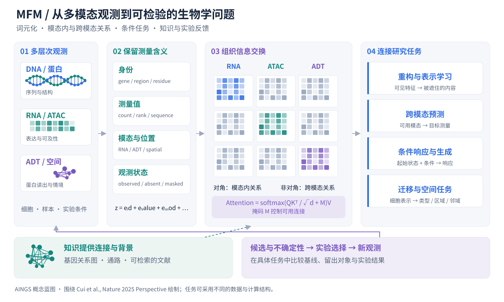](mfm.md)

[展开 MFM 导读与计算图 →](mfm.md) · [原始论文](https://doi.org/10.1038/s41586-025-08710-y) · [查看大图](../assets/mfm-blueprint.svg)

### 序列、结构与功能

从长程调控到蛋白生成，看看哪些信息进入了模型。

<table>
<tr>
<td width="50%" valign="top">
<a href="alphafold2.md">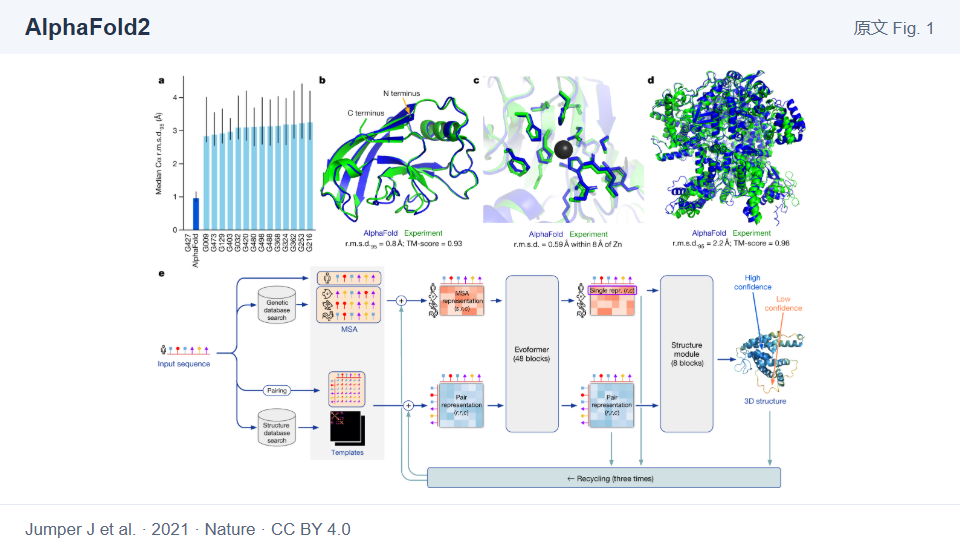</a>

Nature · 2021 · 蛋白结构

<h3><a href="alphafold2.md">AlphaFold2 →</a></h3>

对照 Evoformer、结构模块和 recycling，看序列怎样通向结构。

<a href="alphafold2.md">读中文导读</a> · <a href="https://doi.org/10.1038/s41586-021-03819-2">原始论文</a>

Jumper J et al. · Fig. 1 · <a href="https://creativecommons.org/licenses/by/4.0/">CC BY 4.0</a> · <a href="../assets/figures/alphafold2-fig1.png">大图</a>
</td>
<td width="50%" valign="top">
<a href="enformer.md">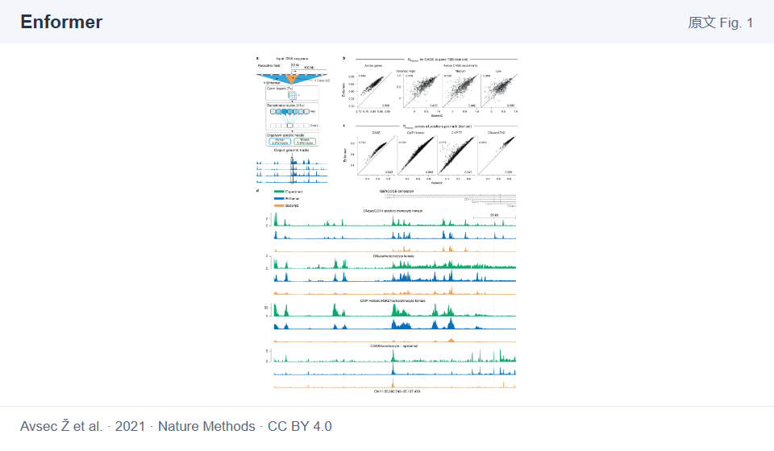</a>

Nature Methods · 2021 · 序列到功能

<h3><a href="enformer.md">Enformer →</a></h3>

让远距离调控信息进入 DNA 到功能轨道的预测。

<a href="enformer.md">读中文导读</a> · <a href="https://doi.org/10.1038/s41592-021-01252-x">原始论文</a>

Avsec Ž et al. · Fig. 1 · <a href="https://creativecommons.org/licenses/by/4.0/">CC BY 4.0</a> · <a href="../assets/figures/enformer-fig1.png">大图</a>
</td>
</tr>
<tr>
<td width="50%" valign="top">
<a href="esm2.md">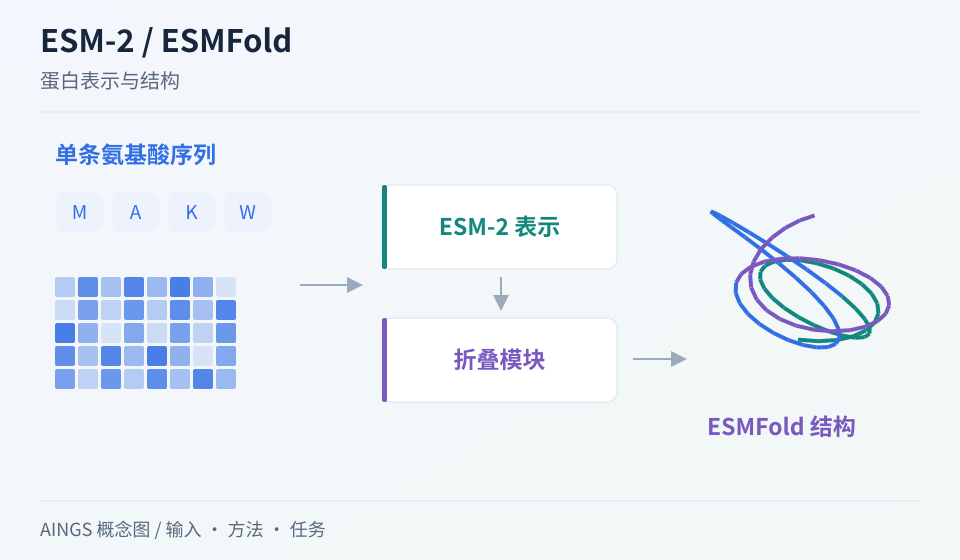</a>

Science (New York, N.Y.) · 2023 · 蛋白表示与结构

<h3><a href="esm2.md">ESM-2 / ESMFold →</a></h3>

蛋白语言模型学到的表示，怎样支持单序列结构预测。

<a href="esm2.md">读中文导读</a> · <a href="https://doi.org/10.1126/science.ade2574">原始论文</a>

AINGS 方法概念图 · <a href="../assets/gallery/esm2.svg">大图</a>
</td>
<td width="50%" valign="top">
<a href="esm3.md">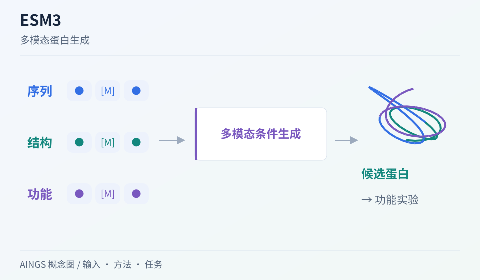</a>

Science (New York, N.Y.) · 2025 · 多模态蛋白生成

<h3><a href="esm3.md">ESM3 →</a></h3>

联合序列、结构与功能条件，理解蛋白生成和实验验证。

<a href="esm3.md">读中文导读</a> · <a href="https://doi.org/10.1126/science.ads0018">原始论文</a>

AINGS 方法概念图 · <a href="../assets/gallery/esm3.svg">大图</a>
</td>
</tr>
</table>

### 联合测量与局部邻域

先理解测量如何建立对应，再看多模态信息如何互补。

<table>
<tr>
<td width="50%" valign="top">
<a href="cite-seq.md">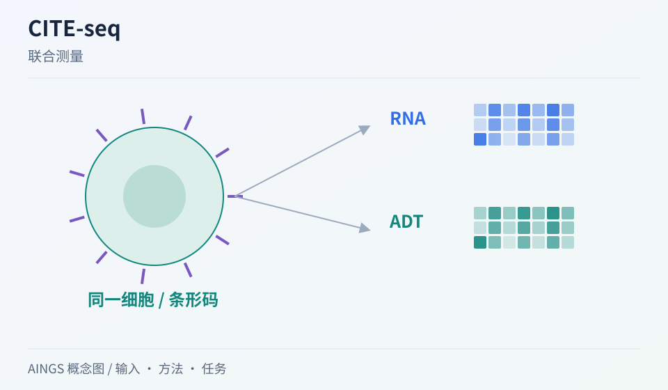</a>

Nature Methods · 2017 · 联合测量

<h3><a href="cite-seq.md">CITE-seq →</a></h3>

给同一细胞的 RNA 与表面蛋白建立共同条形码。

<a href="cite-seq.md">读中文导读</a> · <a href="https://doi.org/10.1038/nmeth.4380">原始论文</a>

AINGS 方法概念图 · <a href="../assets/gallery/cite-seq.svg">大图</a>
</td>
<td width="50%" valign="top">
<a href="tea-seq.md">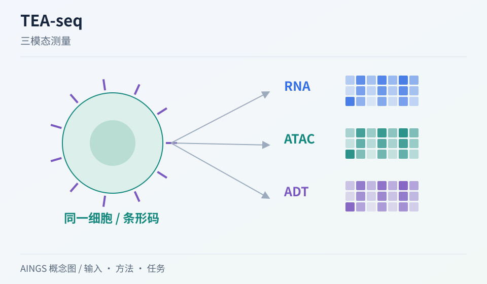</a>

eLife · 2021 · 三模态测量

<h3><a href="tea-seq.md">TEA-seq →</a></h3>

把转录、染色质可及性和蛋白测量接到同一个细胞。

<a href="tea-seq.md">读中文导读</a> · <a href="https://doi.org/10.7554/elife.63632">原始论文</a>

AINGS 方法概念图 · <a href="../assets/gallery/tea-seq.svg">大图</a>
</td>
</tr>
<tr>
<td width="50%" valign="top">
<a href="wnn.md">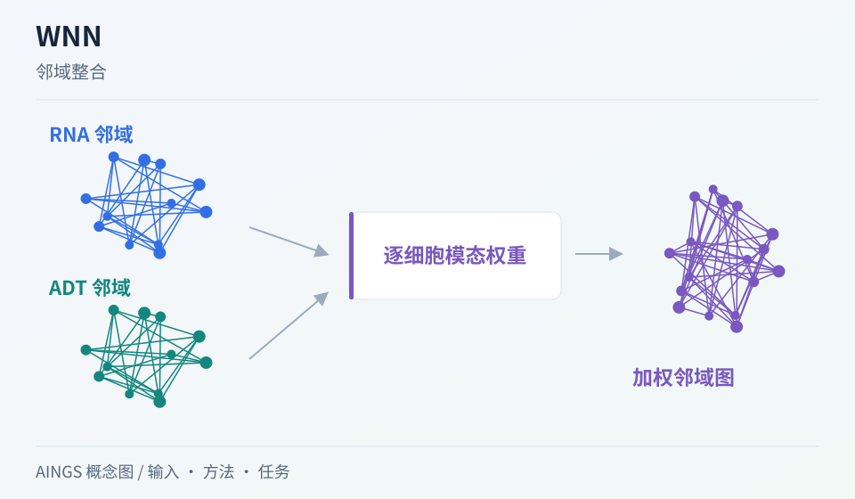</a>

Cell · 2021 · 邻域整合

<h3><a href="wnn.md">WNN →</a></h3>

逐细胞学习模态权重，再把互补的局部邻域合在一起。

<a href="wnn.md">读中文导读</a> · <a href="https://doi.org/10.1016/j.cell.2021.04.048">原始论文</a>

AINGS 方法概念图 · <a href="../assets/gallery/wnn.svg">大图</a>
</td>
</tr>
</table>

### 融合、缺失与生成模型

同一细胞是否配对、哪些模态缺失，决定了不同的建模方式。

<table>
<tr>
<td width="50%" valign="top">
<a href="totalvi.md">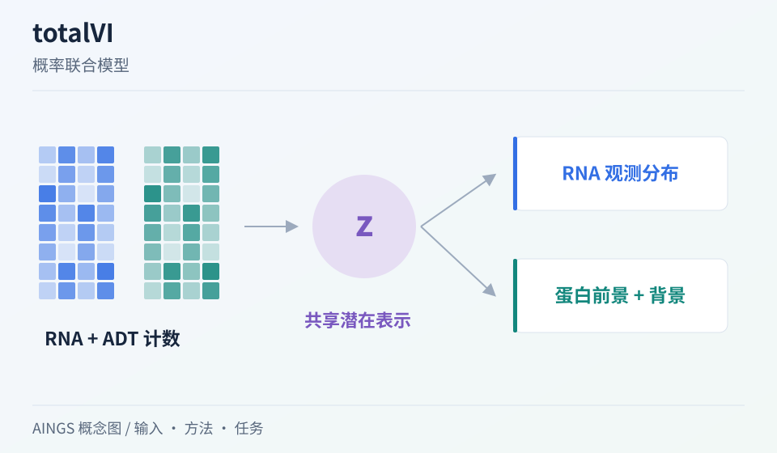</a>

Nature Methods · 2021 · 概率联合模型

<h3><a href="totalvi.md">totalVI →</a></h3>

共享细胞状态，分别描述 RNA 计数和蛋白背景。

<a href="totalvi.md">读中文导读</a> · <a href="https://doi.org/10.1038/s41592-020-01050-x">原始论文</a>

AINGS 方法概念图 · <a href="../assets/gallery/totalvi.svg">大图</a>
</td>
<td width="50%" valign="top">
<a href="multivi.md">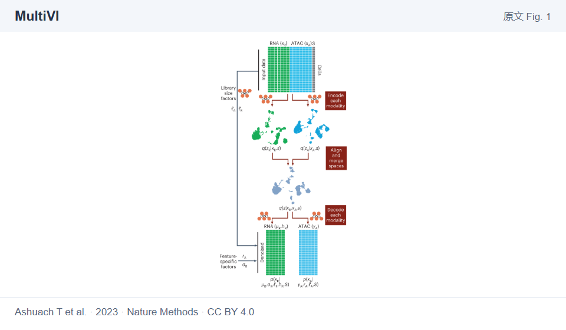</a>

Nature Methods · 2023 · 部分配对整合

<h3><a href="multivi.md">MultiVI →</a></h3>

让配对与非配对数据共同训练，追踪不同观测的重构目标。

<a href="multivi.md">读中文导读</a> · <a href="https://doi.org/10.1038/s41592-023-01909-9">原始论文</a>

Ashuach T et al. · Fig. 1 · <a href="https://creativecommons.org/licenses/by/4.0/">CC BY 4.0</a> · <a href="../assets/figures/multivi-fig1.png">大图</a>
</td>
</tr>
<tr>
<td width="50%" valign="top">
<a href="glue.md">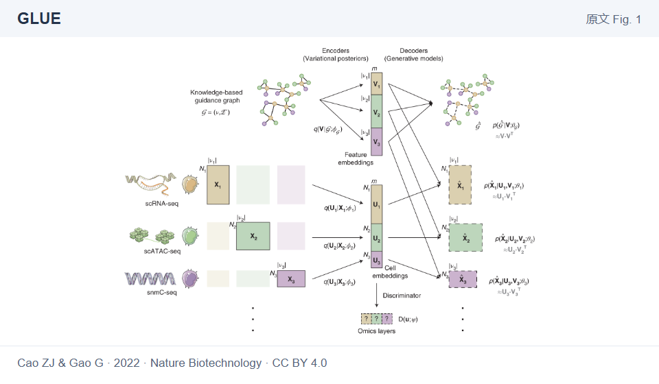</a>

Nature Biotechnology · 2022 · 图引导整合

<h3><a href="glue.md">GLUE →</a></h3>

用特征关系图连接组学；沿原图读编码器、图模型与对齐。

<a href="glue.md">读中文导读</a> · <a href="https://doi.org/10.1038/s41587-022-01284-4">原始论文</a>

Cao ZJ &amp; Gao G · Fig. 1 · <a href="https://creativecommons.org/licenses/by/4.0/">CC BY 4.0</a> · 部分素材 <a href="https://smart.servier.com/">Servier Medical Art</a> / <a href="https://creativecommons.org/licenses/by/3.0/">CC BY 3.0</a> · <a href="../assets/figures/glue-fig1.png">大图</a>
</td>
<td width="50%" valign="top">
<a href="mofa.md">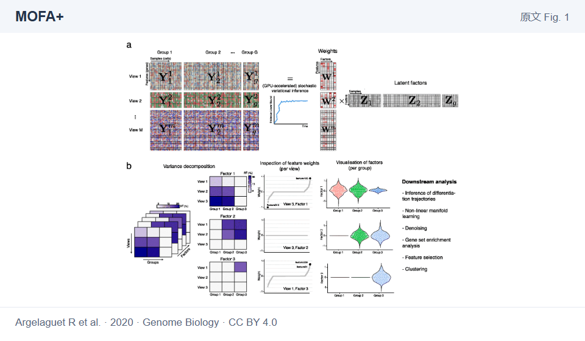</a>

Genome Biology · 2020 · 可解释因子模型

<h3><a href="mofa.md">MOFA+ →</a></h3>

从因子与载荷出发，寻找不同测量间共享和特有的变化。

<a href="mofa.md">读中文导读</a> · <a href="https://doi.org/10.1186/s13059-020-02015-1">原始论文</a>

Argelaguet R et al. · Fig. 1 · <a href="https://creativecommons.org/licenses/by/4.0/">CC BY 4.0</a> · <a href="../assets/figures/mofa-fig1.png">大图</a>
</td>
</tr>
<tr>
<td width="50%" valign="top">

PNAS · 2022 · mosaic 与补全

<h3><a href="scvaeit.md">scVAEIT →</a></h3>

显式标记缺失，通过条件生成学习跨模态补全。

<a href="scvaeit.md">读中文导读</a> · <a href="https://doi.org/10.1073/pnas.2214414119">原始论文</a>

AINGS 方法概念图 · <a href="../assets/gallery/scvaeit.svg">大图</a>
</td>
</tr>
</table>

### 细胞基础模型与空间情境

比较词元、预训练数据、条件信息与实际适配任务。

<table>
<tr>
<td width="50%" valign="top">
<a href="geneformer.md">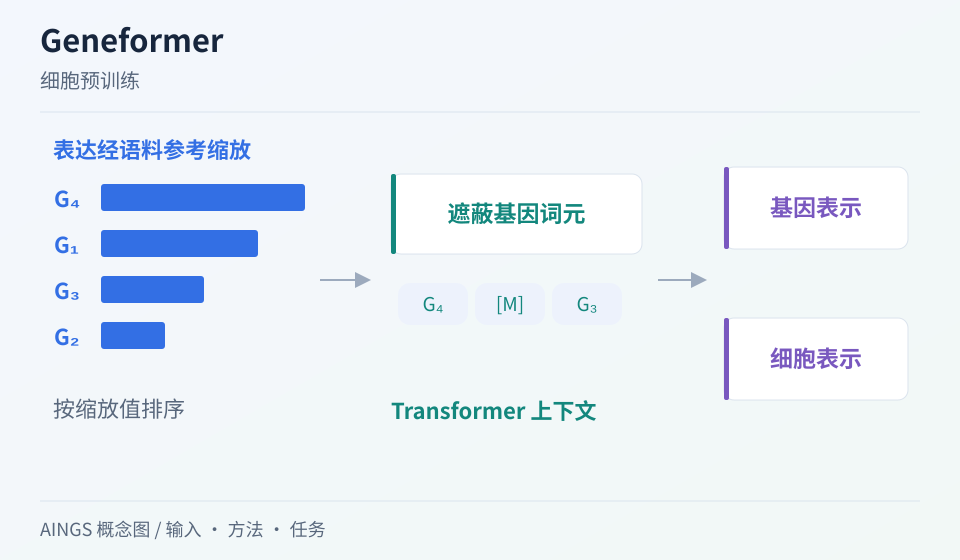</a>

Nature · 2023 · 细胞预训练

<h3><a href="geneformer.md">Geneformer →</a></h3>

从基因排序到上下文表示，再到具体的细胞网络任务。

<a href="geneformer.md">读中文导读</a> · <a href="https://doi.org/10.1038/s41586-023-06139-9">原始论文</a>

AINGS 方法概念图 · <a href="../assets/gallery/geneformer.svg">大图</a>
</td>
<td width="50%" valign="top">
<a href="scgpt.md">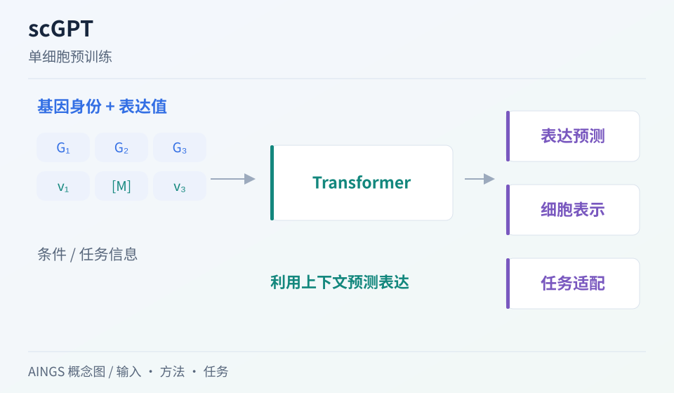</a>

Nature Methods · 2024 · 单细胞预训练

<h3><a href="scgpt.md">scGPT →</a></h3>

基因身份、表达值和任务信息怎样进入预训练与适配。

<a href="scgpt.md">读中文导读</a> · <a href="https://doi.org/10.1038/s41592-024-02201-0">原始论文</a>

AINGS 方法概念图 · <a href="../assets/gallery/scgpt.svg">大图</a>
</td>
</tr>
<tr>
<td width="50%" valign="top">
<a href="scfoundation.md">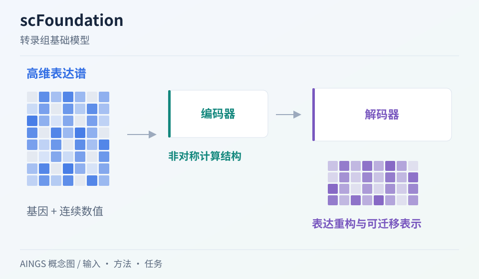</a>

Nature Methods · 2024 · 转录组基础模型

<h3><a href="scfoundation.md">scFoundation →</a></h3>

面向高维表达谱的预训练，连接细胞与基因层面的表示。

<a href="scfoundation.md">读中文导读</a> · <a href="https://doi.org/10.1038/s41592-024-02305-7">原始论文</a>

AINGS 方法概念图 · <a href="../assets/gallery/scfoundation.svg">大图</a>
</td>
<td width="50%" valign="top">
<a href="nicheformer.md">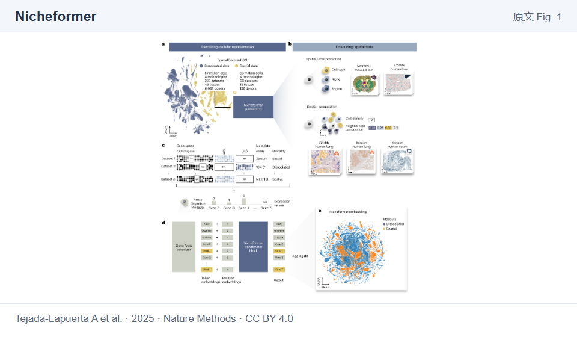</a>

Nature Methods · 2025 · 空间与细胞模型

<h3><a href="nicheformer.md">Nicheformer →</a></h3>

从表达与技术情境进入空间相关任务，认识细胞的邻域。

<a href="nicheformer.md">读中文导读</a> · <a href="https://doi.org/10.1038/s41592-025-02814-z">原始论文</a>

Tejada-Lapuerta A et al. · Fig. 1 · <a href="https://creativecommons.org/licenses/by/4.0/">CC BY 4.0</a> · <a href="../assets/figures/nicheformer-fig1.png">大图</a>
</td>
</tr>
<tr>
<td width="50%" valign="top">
<a href="captain.md">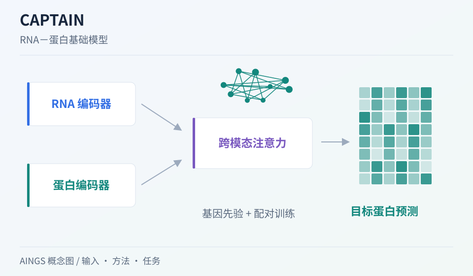</a>

Nature Communications · 2026 · RNA－蛋白基础模型

<h3><a href="captain.md">CAPTAIN →</a></h3>

用配对 RNA／蛋白、跨模态注意力与先验预测目标蛋白。

<a href="captain.md">读中文导读</a> · <a href="https://doi.org/10.1038/s41467-026-72882-y">原始论文</a>

AINGS 方法概念图 · <a href="../assets/gallery/captain.svg">大图</a>
</td>
</tr>
</table>

### 扰动测量与响应预测

从实验中的干预记录，到模型对新干预的预测。

<table>
<tr>
<td width="50%" valign="top">
<a href="perturbseq.md">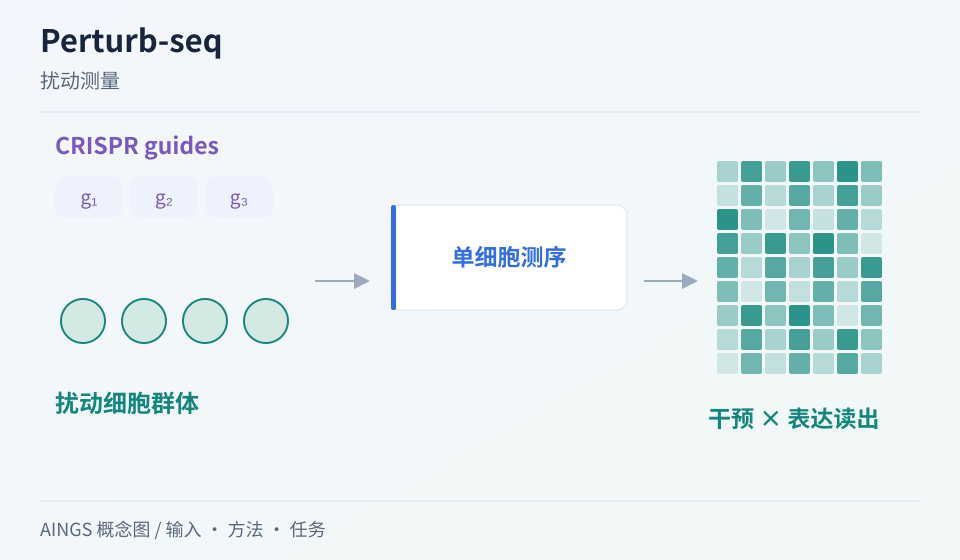</a>

Cell · 2016 · 扰动测量

<h3><a href="perturbseq.md">Perturb-seq →</a></h3>

把池化 CRISPR 干预与单细胞表达连接成可读出的实验。

<a href="perturbseq.md">读中文导读</a> · <a href="https://doi.org/10.1016/j.cell.2016.11.038">原始论文</a>

AINGS 方法概念图 · <a href="../assets/gallery/perturbseq.svg">大图</a>
</td>
<td width="50%" valign="top">
<a href="gears.md">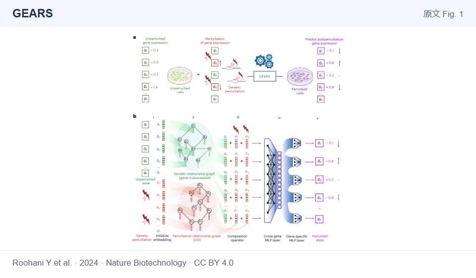</a>

Nature Biotechnology · 2024 · 扰动预测

<h3><a href="gears.md">GEARS →</a></h3>

把基因关系和干预关系接入图网络，预测未见组合的响应。

<a href="gears.md">读中文导读</a> · <a href="https://doi.org/10.1038/s41587-023-01905-6">原始论文</a>

Roohani Y et al. · Fig. 1 · <a href="https://creativecommons.org/licenses/by/4.0/">CC BY 4.0</a> · <a href="../assets/figures/gears-fig1.png">大图</a>
</td>
</tr>
</table>

### 把评价放回研究问题

整合得更好意味着什么？同时看批次效应、细胞结构和真实任务。

<table>
<tr>
<td width="50%" valign="top">
<a href="scib.md">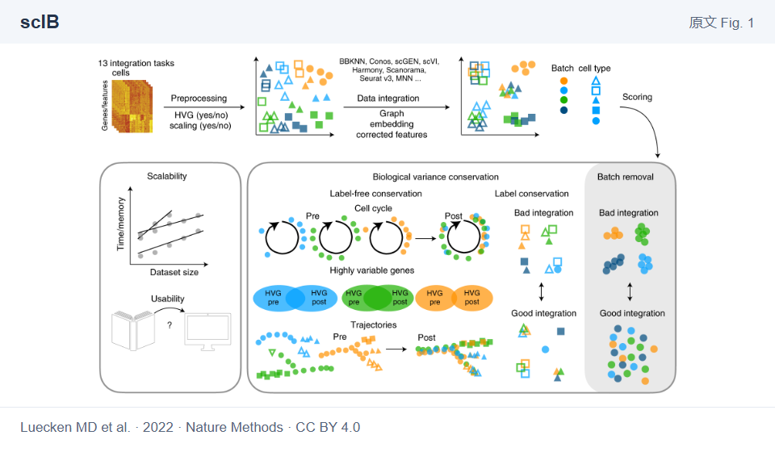</a>

Nature Methods · 2022 · 整合评价

<h3><a href="scib.md">scIB →</a></h3>

并列检查批次混合与生物学保留，读懂多目标整合评价。

<a href="scib.md">读中文导读</a> · <a href="https://doi.org/10.1038/s41592-021-01336-8">原始论文</a>

Luecken MD et al. · Fig. 1 · <a href="https://creativecommons.org/licenses/by/4.0/">CC BY 4.0</a> · <a href="../assets/figures/scib-fig1.png">大图</a>
</td>
</tr>
</table>

## 把你读过的好论文放进来

一篇经典方法、一张解释得很清楚的图，或者一个值得复现的新工作，都欢迎加入。可以先[分享论文链接](https://github.com/moshookee-ux/AINGS-study-group/issues/new?template=01_resource.yml)，说说它解决什么问题、最想推荐大家看哪里；也可以按[导读模板](paper-template.md)写一页中文笔记。

**图像说明：** 15 张论文原图保留完整内容，以等比缩略图展示；19 张方法概念图由 AINGS 绘制。原图署名、图号与许可见[图片署名](../assets/credits.md)，概念图中的矩阵和网络用于说明方法结构。

[全部论文索引](catalog.md) · [方法对照](compare.md) · [引用清单](references.bib) · [一起贡献](../CONTRIBUTING.md)
