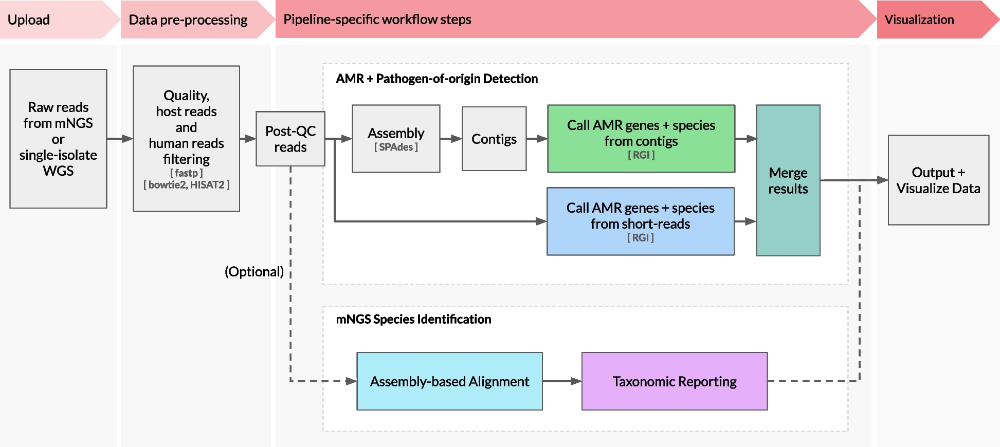
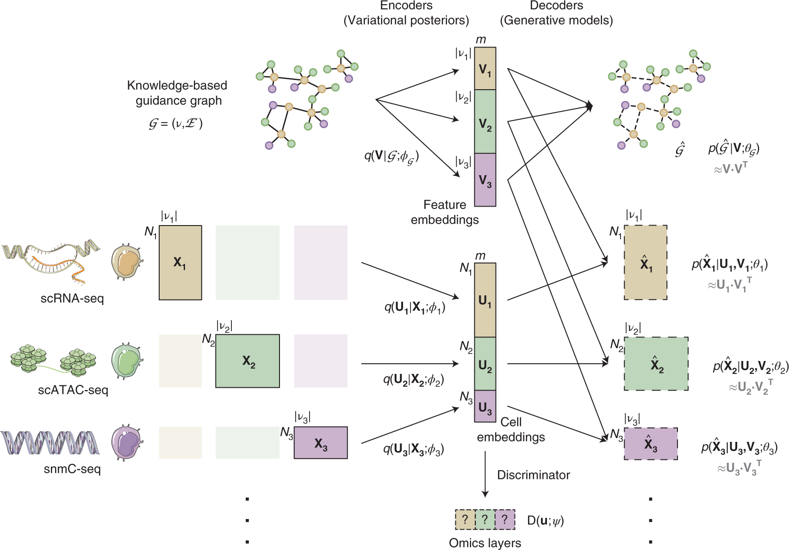

# 从论文的一张图读起

[首页](../README.md) · [检验医学与病原生信](../01_检验医学与病原生信/README.md) · [多模态多组学](../02_多模态多组学/README.md) · [参考资料](../reference-index.md)

读论文时，一张图常常比几个缩写更能把问题说清楚。这里收集值得停下来看的研究图，配上中文阅读线索，再把图中的概念连回知识库。

你可以先看图里出现了哪些对象，再沿箭头寻找输入、计算和输出。遇到一个不熟悉的词，就顺着链接回去查；有了自己的理解，也欢迎回来补上更好的解释。

## 同一批 reads，怎样连接病原与耐药分析？

**[CZ ID 图解 →](czid.md)** · Lu et al., *Genome Medicine* (2025), Fig. 1。原图按 [CC BY 4.0](https://creativecommons.org/licenses/by/4.0/) 复用；[论文原文](https://doi.org/10.1186/s13073-025-01480-2)。

看懂四件事：数据如何预处理，reads 为什么要组装，耐药基因与物种信息怎样连接，输出各自回答什么问题。

## 没有逐一配对的细胞，怎样连接不同组学？

**[GLUE 图解 →](glue.md)** · Cao & Gao, *Nature Biotechnology* (2022), Fig. 1。原图按 [CC BY 4.0](https://creativecommons.org/licenses/by/4.0/) 复用；[论文原文](https://doi.org/10.1038/s41587-022-01284-4)。部分图形素材来自 [Servier Medical Art](https://smart.servier.com/)，按 [CC BY 3.0](https://creativecommons.org/licenses/by/3.0/) 署名。

看懂四件事：非配对数据有什么困难，细胞与特征分别怎样表示，生物先验在哪一步进入，重建和对齐怎样共同学习。

## 下一张图，欢迎你来讲

你可能在论文里遇到过一张“终于把这个方法讲明白了”的图，也可能对某个箭头始终有疑问。欢迎[推荐这篇论文](https://github.com/moshookee-ux/AINGS-study-group/issues/new?template=01_resource.yml)，或者按[共建指南](../CONTRIBUTING.md)写一篇图解。

一篇图解可以很短：写下想回答的问题，标出原图与出处，解释几个关键对象，再接上仓库里相关的笔记。引用图片时保留作者、图号、原始链接和复用许可；有自己的改绘，也注明调整了什么。可以参考这里的[图片署名](../assets/credits.md)。
