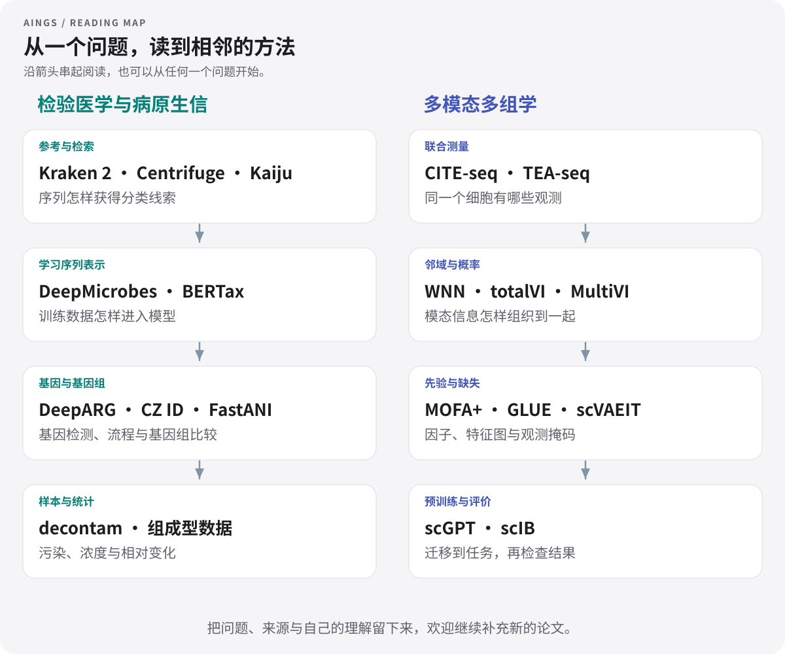

# 论文与方法

[首页](../README.md) · [按问题找论文](#按问题找论文) · [检验医学与病原生信](#检验医学与病原生信) · [多模态多组学](#多模态多组学) · [方法对照](compare.md) · [引用清单](references.bib)

一篇论文可以是一扇门：从一个具体问题进去，认识一类数据、一种方法，也认识它适合怎样的任务。这里的 **20 篇导读**连接两个知识方向，配有方法拆解、读图线索、评价问题和可以自己试一试的小练习。

可以先挑一个好奇的问题，也可以把几篇放在一起读。读到值得补充的解释、发现新的方法，欢迎把它写进来，让下一位读者少绕一点路。

## 按问题找论文

| 你想弄清什么 | 可以一起读 | 读完试着说清楚 |
| --- | --- | --- |
| 一条序列怎样获得分类标签？ | [Kraken 2](kraken2.md)、[Centrifuge](centrifuge.md)、[Kaiju](kaiju.md) | 参考库、匹配对象和索引结构各是什么 |
| 深度学习怎样认识 DNA 序列？ | [DeepMicrobes](deepmicrobes.md)、[BERTax](bertax.md) | token、上下文、训练标签与未见类群 |
| 从序列怎样走到耐药相关证据？ | [DeepARG](deeparg.md)、[CZ ID](czid.md) | ARG 类别、物种信息、序列上下文怎样连接 |
| 样本中的变化可能来自哪里？ | [decontam](decontam.md)、[组成型数据](compositionality.md)、[FastANI](fastani.md) | 污染、比例与基因组相似性各怎样解释 |
| 多测一种模态，究竟多了什么？ | [CITE-seq](cite-seq.md)、[TEA-seq](tea-seq.md)、[WNN](wnn.md) | 观测对象、配对关系与局部信息的互补 |
| 不同缺失方式怎样影响整合？ | [totalVI](totalvi.md)、[MultiVI](multivi.md)、[scVAEIT](scvaeit.md) | 观测分布、缺失掩码与补全目标 |
| 生物知识与可解释结构怎样进入模型？ | [GLUE](glue.md)、[MOFA+](mofa.md) | 特征图、细胞表示、因子与载荷 |
| 大模型与整合结果怎样评价？ | [scGPT](scgpt.md)、[scIB](scib.md) | 预训练、适配、数据划分与多目标评价 |

## 一张阅读地图

图中的箭头表示建议的阅读衔接。每一篇也可以单独查阅，详细比较见[方法对照](compare.md)。

## 检验医学与病原生信

从参考序列与样本背景出发，读懂分类、耐药基因检测、基因组比较和统计解释。[回到知识目录 →](../01_检验医学与病原生信/README.md)

| 论文与导读 | 出版信息 | 这篇重点看什么 |
| --- | --- | --- |
| **[Kraken 2](kraken2.md)** · [原文](https://doi.org/10.1186/s13059-019-1891-0) | Genome Biology · 2019 | 海量短序列怎样快速获得分类线索？ |
| **[Centrifuge](centrifuge.md)** · [原文](https://doi.org/10.1101/gr.210641.116) | Genome Research · 2016 | 参考基因组越来越多，索引怎样装得下？ |
| **[Kaiju](kaiju.md)** · [原文](https://doi.org/10.1038/ncomms11257) | Nature Communications · 2016 | 换到蛋白层面，能多认出哪些序列？ |
| **[DeepMicrobes](deepmicrobes.md)** · [原文](https://doi.org/10.1093/nargab/lqaa009) | NAR Genomics and Bioinformatics · 2020 | 短序列的分类信息，能否由网络学出来？ |
| **[BERTax](bertax.md)** · [原文](https://doi.org/10.1073/pnas.2122636119) | PNAS · 2022 | 离训练参考较远的序列，模型还能判断到哪一级？ |
| **[DeepARG](deeparg.md)** · [原文](https://doi.org/10.1186/s40168-018-0401-z) | Microbiome · 2018 | 怎样把序列相似性变成耐药基因的分类特征？ |
| **[CZ ID](czid.md)** · [原文](https://doi.org/10.1186/s13073-025-01480-2) | Genome Medicine · 2025 | 同一批 reads，怎样连接病原与耐药分析？ |
| **[FastANI](fastani.md)** · [原文](https://doi.org/10.1038/s41467-018-07641-9) | Nature Communications · 2018 | 两个基因组有多相近，怎样高效估计？ |
| **[decontam](decontam.md)** · [原文](https://doi.org/10.1186/s40168-018-0605-2) | Microbiome · 2018 | 污染线索为什么藏在浓度和阴性对照里？ |
| **[组成型数据](compositionality.md)** · [原文](https://doi.org/10.3389/fmicb.2017.02224) | Frontiers in Microbiology · 2017 | 相对丰度上升，究竟是哪一种变化？ |

## 多模态多组学

从联合测量进入邻域、因子、概率模型与预训练，再回到整合和迁移的评价。[回到知识目录 →](../02_多模态多组学/README.md)

| 论文与导读 | 出版信息 | 这篇重点看什么 |
| --- | --- | --- |
| **[CITE-seq](cite-seq.md)** · [原文](https://doi.org/10.1038/nmeth.4380) | Nature Methods · 2017 | 怎样给同一个细胞同时读出 RNA 与表面蛋白？ |
| **[TEA-seq](tea-seq.md)** · [原文](https://doi.org/10.7554/elife.63632) | eLife · 2021 | 同一细胞的三种测量怎样彼此补充？ |
| **[WNN](wnn.md)** · [原文](https://doi.org/10.1016/j.cell.2021.04.048) | Cell · 2021 | 每个细胞都应该使用相同的模态权重吗？ |
| **[totalVI](totalvi.md)** · [原文](https://doi.org/10.1038/s41592-020-01050-x) | Nature Methods · 2021 | 蛋白背景与真实细胞状态，怎样一起建模？ |
| **[MultiVI](multivi.md)** · [原文](https://doi.org/10.1038/s41592-023-01909-9) | Nature Methods · 2023 | 配对与未配对数据怎样进入同一个模型？ |
| **[GLUE](glue.md)** · [原文](https://doi.org/10.1038/s41587-022-01284-4) | Nature Biotechnology · 2022 | 没有逐一配对的细胞，怎样连接不同组学？ |
| **[MOFA+](mofa.md)** · [原文](https://doi.org/10.1186/s13059-020-02015-1) | Genome Biology · 2020 | 哪些变化是多组学共享的，哪些只出现在一层？ |
| **[scVAEIT](scvaeit.md)** · [原文](https://doi.org/10.1073/pnas.2214414119) | PNAS · 2022 | 缺整种模态和缺一部分特征，怎样统一表示？ |
| **[scGPT](scgpt.md)** · [原文](https://doi.org/10.1038/s41592-024-02201-0) | Nature Methods · 2024 | 预训练的细胞表示，怎样接到具体分析任务？ |
| **[scIB](scib.md)** · [原文](https://doi.org/10.1038/s41592-021-01336-8) | Nature Methods · 2022 | 怎样同时检查批次混合与生物结构保留？ |

## 把几篇放在一起看

同样叫“整合”，输入配对关系可能不同；同样给出“分类”，对象也可能是 read、基因或细胞。比较前，先对齐它们回答的问题。

- [序列分类：索引、蛋白匹配与学习表示](compare.md#序列分类先比较参考信息与任务层级)
- [多组学：配对、部分配对与特征先验](compare.md#多组学先画出数据的对应关系)
- [评价：从数据结构到结果解释](compare.md#给自己的比较留一张记录表)

查引用时可以使用 [BibTeX 文献表](references.bib)；想按年份、主题或 DOI 整理自己的阅读清单，可以使用 [JSON 目录](library.json)。论文原图的出处与许可汇总在[图片署名](../assets/credits.md)。

## 下一篇，欢迎你来写

一篇笔记可以从一个问题开始：为什么要这样处理数据，这张图中的箭头表示什么，或者换一种输入还会怎样。把你的解释、原始链接和相关知识页放在一起，就能帮到接着读的人。

[推荐论文与资料](https://github.com/moshookee-ux/AINGS-study-group/issues/new?template=01_resource.yml) · [参考导读模板](paper-template.md) · [一起贡献](../CONTRIBUTING.md)
