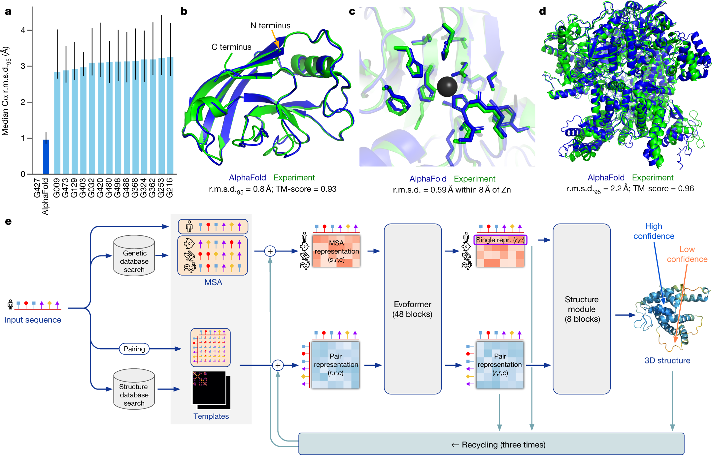

# AlphaFold2：序列与进化信息如何约束三维结构

[研究画廊](README.md) · [全部文献](catalog.md) · [方法对照](compare.md)

**Highly accurate protein structure prediction with AlphaFold** 
Jumper J, Evans R, Pritzel A et al. · *Nature* · 2021 
[原文与图表](https://doi.org/10.1038/s41586-021-03819-2) · [PubMed](https://pubmed.ncbi.nlm.nih.gov/34265844/)

AlphaFold2 将序列、同源序列信息和残基对关系放入可迭代的网络，用几何结构模块产生蛋白坐标。它适合连接“表示学习”与“结构约束”两个视角。

| 输入／研究起点 | 输出／研究目标 |
| --- | --- |
| 氨基酸序列、MSA 与可用的模板信息 | 蛋白质三维结构及模型置信度 |

## 方法中的关键连接

### 序列表示与成对表示互相更新

Evoformer 让多序列比对中的位置关系与残基对表示交换信息。读框架图时，把序列轴、残基轴与通道轴分别标出。

### 把表示变成几何结构

结构模块从内部表示产生残基的空间构型；recycling 将中间结果送回模型继续细化。

### 结构精度需要结构参考

CASP 与后续结构数据提供了可对照的实验结构。局部置信度与两个结构之间的实际误差承担不同角色。

## 对照论文的图

Jumper J, Evans R, Pritzel A et al.，Fig. 1，*Nature*。[原文图注](https://doi.org/10.1038/s41586-021-03819-2) · [打开原尺寸图片](../assets/figures/alphafold2-fig1.png)。© The Author(s) 2021；[CC BY 4.0](https://creativecommons.org/licenses/by/4.0/)，图片完整保留。

## 沿着 Figure 1 读

| 分面 | 读图线索 |
| --- | --- |
| a：CASP14 比较 | 纵轴衡量与实验结构的接近程度，比较对象是蛋白结构域；同时留意中位数和区间。 |
| b–d：结构案例 | 对照预测与实验结构，分别观察整体折叠、局部结合位点和多结构域排布。 |
| e：计算架构 | 先追踪 MSA 表示与 pair 表示，再到结构模块；最后沿 recycling 箭头看哪些信息返回前面的计算。 |

可以在图 e 旁写下两种张量：MSA 表示按“序列 × 残基 × 通道”组织，pair 表示按“残基 × 残基 × 通道”组织。两者的轴不同，交换的信息也不同。

## 对照自己的研究问题

- 看测试结构的时间与同源性控制，再读整体、结构域和局部误差。
- 结合 pLDDT 等置信度理解局部区域，另外检查多结构域的相对排布。

## 可以动手做什么

画出一个 5 残基蛋白的序列表示与 5×5 成对表示。说明为何三维结构预测需要残基对关系，而不只是逐位置分类。

## 继续阅读

[ESM-2 / ESMFold](esm2.md) · [ESM3](esm3.md) · [Enformer](enformer.md)

**相关知识：** [神经网络、Transformer与生物表示](../02_多模态多组学/05_神经网络_Transformer与生物表示/README.md) · [空间、序列、调控与实验闭环](../02_多模态多组学/09_空间_序列_调控与实验闭环/README.md)。

[补充这篇导读](https://github.com/moshookee-ux/AINGS-study-group/issues/new?template=02_content.yml) · [一起贡献](../CONTRIBUTING.md)
