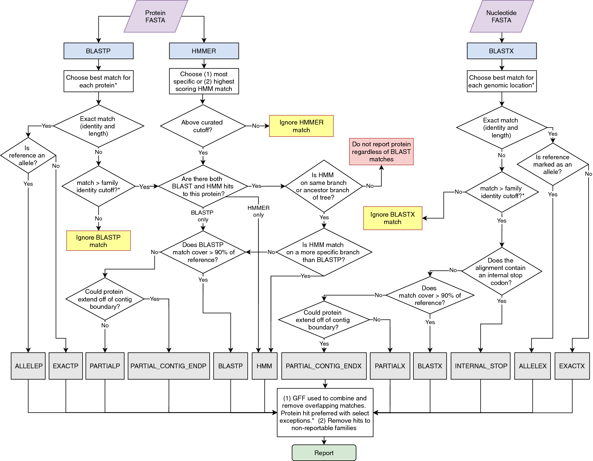

# AMRFinderPlus：序列匹配如何形成可追溯的耐药注释

[研究画廊](README.md) · [全部文献](catalog.md) · [方法对照](compare.md)

**AMRFinderPlus and the Reference Gene Catalog facilitate examination of the genomic links among antimicrobial resistance, stress response, and virulence** 
Feldgarden M, Brover V, Gonzalez-Escalona N et al. · *Scientific Reports* · 2021 
[原文与图表](https://doi.org/10.1038/s41598-021-91456-0) · [PubMed](https://pubmed.ncbi.nlm.nih.gov/34135355/)

AMRFinderPlus 将整理后的参考基因与检测流程结合，识别耐药相关基因、特定点突变，并扩展到应激和毒力等信息。它尤其适合练习从输出结果追溯匹配依据。

| 输入／研究起点 | 输出／研究目标 |
| --- | --- |
| 蛋白和／或核酸序列，及所需的物种信息 | 基因、点突变、功能分类与匹配证据 |

## 方法中的关键连接

### 不同输入走不同检测路径

蛋白与核酸模式使用的信息不同，框架图中要分别追踪比对、HMM 和分类规则。

### 参考库提供名称与功能层次

注释结果连接到具体参考、基因家族和功能类别，需要与使用的数据库版本一起记录。

### 结果保留序列与位置证据

contig 位置、序列匹配方法、内部终止密码子等信息，可以帮助复查候选。

## 对照论文的图

Feldgarden M, Brover V, Gonzalez-Escalona N et al.，Figure 1，*Scientific Reports*。[原文图注](https://doi.org/10.1038/s41598-021-91456-0) · [打开原尺寸图片](../assets/figures/amrfinderplus-fig1.png)。© This is a U.S. Government work and not under copyright protection in the US; foreign copyright protection may apply 2021；[CC BY 4.0](https://creativecommons.org/licenses/by/4.0/)，图片完整保留。

## 沿着 Figure 1 读

先从输入端将流程分成蛋白与核酸两条路径，再追踪 BLAST 命中、HMM 家族信息与各类判定规则如何汇合。

- **蛋白输入路径：** 同时观察序列匹配与 HMM 信息；不同证据可能形成不同的命中类别。
- **核酸输入路径：** 按该分支使用相应的匹配方法；纯核酸模式不使用 HMM。
- **Ignored 分支：** 某种匹配被忽略，和这个蛋白最终完全没有报告，是不同的情况；另一种方法仍可能报告它。

读输出表时，保留命中类别、覆盖、身份相似性和参考标识。要比较两次运行，还需要同时记录输入模式、数据库版本及物种设置。

## 对照自己的研究问题

- 核对输入模式、数据库版本和物种特异点突变的适用范围。
- 查看完整与截短命中、序列一致性和覆盖范围，再解释功能。

## 可以动手做什么

为一个假想基因命中设计结果表，至少包含参考名称、位置、覆盖、识别方法和功能类别；说明每列回答什么问题。

## 继续阅读

[CARD 2023](card.md) · [DeepARG](deeparg.md) · [CZ ID](czid.md)

**相关知识：** [生物信息学基础](../01_检验医学与病原生信/02_生物信息学基础/README.md) · [方法与模型基础](../01_检验医学与病原生信/04_方法与模型基础/README.md)。

[补充这篇导读](https://github.com/moshookee-ux/AINGS-study-group/issues/new?template=02_content.yml) · [一起贡献](../CONTRIBUTING.md)
