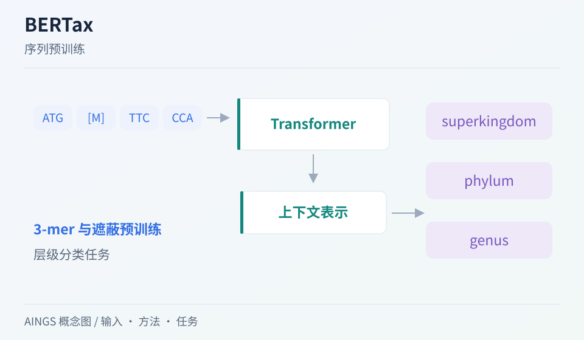

# BERTax：离训练参考较远的序列，模型还能判断到哪一级？

[研究画廊](README.md) · [检验医学与病原生信](../01_检验医学与病原生信/README.md) · [方法对照](compare.md)

**Taxonomic classification of DNA sequences beyond sequence similarity using deep neural networks** 
Mock F, Kretschmer F, Kriese A et al. · *PNAS* · 2022 
[论文与图表](https://doi.org/10.1073/pnas.2122636119) · [PubMed](https://pubmed.ncbi.nlm.nih.gov/36018838/) · [开放全文](https://europepmc.org/articles/PMC9436379)

BERTax 用 DNA 片段上的预训练表示支持分类。它值得关注的不仅是 Transformer 结构，还有训练与测试在分类树上如何隔开：模型究竟是在识别近邻，还是对较远的类群仍有可用信息？

AINGS 概念图，沿输入、方法与任务整理阅读线索。

## 先把问题放在桌上

| 项目 | 内容 |
| --- | --- |
| 输入 | 切分为 3-mer 的 DNA 片段与训练标签 |
| 输出 | 超界、门等层级的分类结果；最终模型还包含属级输出 |
| 核心思路 | BERT 式预训练表示与分层监督分类 |

## 沿着方法读

### 1. 先区分预训练和分类

预训练利用序列上下文学习表示，后续分类任务再把表示映射到标签。分别写出这两个阶段看到的数据与优化目标。

### 2. 沿分类树查看预测头

图中的不同分类层级拥有不同标签集合。把超界、门、属画成层次，避免把某一级的结果直接当成所有层级的能力。

### 3. 把泛化落到划分上

论文区分较近缘与较远缘的测试设置，其中按属隔开的设计尤其值得阅读。检查每一组实验允许哪些亲缘信息跨越训练与测试。

## 找一张图，把关系看清楚

原文 Figure 1 把序列预训练、分类层级和模型设计放在一起。先指出哪些部分由无标签序列学习，再找监督信号进入的位置。 [对照原文](https://doi.org/10.1073/pnas.2122636119)。

## 读结果时，留意这些信息

- “未见对象”具体指未见序列、未见基因组，还是未见属？
- 不同方法是否拥有相近的参考信息，以及相同的预测层级？
- 读各类群表现和混淆情况，确认总体分数主要来自哪些类别。

## 试着做一件小事

画一棵包含两个门、四个属的小分类树，设计随机片段划分和按属留出的两种方案。说明它们分别能回答怎样的泛化问题。

## 接着读，也接着写

**回到知识库：** [数据与统计基础](../01_检验医学与病原生信/03_数据与统计基础/README.md) · [方法与模型基础](../01_检验医学与病原生信/04_方法与模型基础/README.md) · [神经网络、Transformer与生物表示](../02_多模态多组学/05_神经网络_Transformer与生物表示/README.md)。

**相邻论文：** [DeepMicrobes](deepmicrobes.md) · [Kaiju](kaiju.md) · [scGPT](scgpt.md) · [方法对照](compare.md)。

你也可以补一段解释、一个小例子，或指出尚未想清楚的地方。[分享笔记与问题](https://github.com/moshookee-ux/AINGS-study-group/issues/new?template=01_resource.yml) · [共建指南](../CONTRIBUTING.md)。
