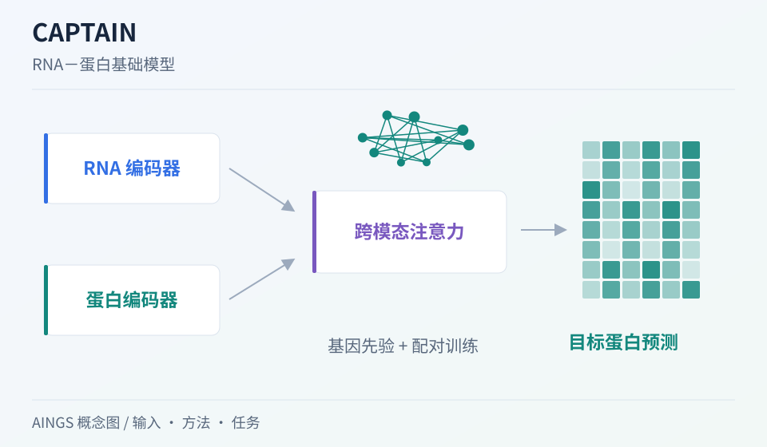

# CAPTAIN：配对 RNA 与蛋白，怎样支持跨模态预训练

[研究画廊](README.md) · [全部文献](catalog.md) · [方法对照](compare.md)

**CAPTAIN: a multimodal foundation model pretrained on co-assayed single-cell RNA and protein** 
Ji B, Hu T, Wang J et al. · *Nature Communications* · 2026 
[原文与图表](https://doi.org/10.1038/s41467-026-72882-y) · [PubMed](https://pubmed.ncbi.nlm.nih.gov/42098152/)

CAPTAIN 利用共同测量 RNA 和表面蛋白的单细胞数据预训练。模型分别处理两种模态，通过跨模态注意力联合表示，并研究蛋白补全、注释与整合等任务。

| 输入／研究起点 | 输出／研究目标 |
| --- | --- |
| RNA／表面蛋白观测、基因关系知识及任务数据 | 联合表示与词表范围内的蛋白预测等任务输出 |

## 方法中的关键连接

### 配对观测提供跨模态对应

RNA 和蛋白来自同一细胞，提供直接的跨模态训练信号。蛋白面板之间的覆盖差异仍需显式组织。

### 双编码器与知识模块

RNA 编码器使用 scGPT 表示初始化，并引入基因关系；蛋白分支与跨模态注意力共同学习 RNA－蛋白联系。

### 把零样本和微调结果分开

原文的蛋白预测范围对应整理后的 382 蛋白词表。未测面板中的目标、未见数据集与词表外目标需要分别理解。

## 把结构画出来

AINGS 方法概念图。图示整理输入、计算与输出的关系；详细结构与实验结果见[原文](https://doi.org/10.1038/s41467-026-72882-y)。

## 对照自己的研究问题

- 查看测试配对数据是否出现在预训练或微调中。
- 记录可预测的目标词表，并按蛋白、细胞群和供体检查表现。

## 可以动手做什么

画出两个分别测了 3 和 4 个抗体的面板，其中 2 个抗体共有。标出共有、未测和词表外的目标，说明三者的评价方式。

## 继续阅读

[CITE-seq](cite-seq.md) · [totalVI](totalvi.md) · [scGPT](scgpt.md) · [scVAEIT](scvaeit.md)

**相关知识：** [测量技术与多组学数据结构](../02_多模态多组学/02_测量技术与多组学数据结构/README.md) · [多模态整合、融合与预训练](../02_多模态多组学/06_多模态整合_融合与预训练/README.md) · [模型评价、实验设计与生物学解释](../02_多模态多组学/08_模型评价_实验设计与生物学解释/README.md)。

[补充这篇导读](https://github.com/moshookee-ux/AINGS-study-group/issues/new?template=02_content.yml) · [一起贡献](../CONTRIBUTING.md)
