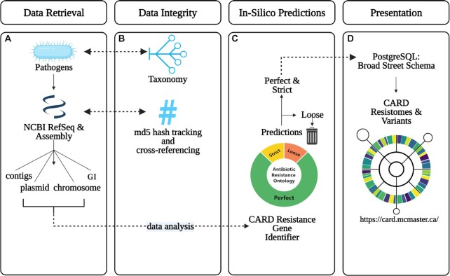

# CARD 2023：耐药检测的参考知识怎样被组织起来

[研究画廊](README.md) · [全部文献](catalog.md) · [方法对照](compare.md)

**CARD 2023: expanded curation, support for machine learning, and resistome prediction at the Comprehensive Antibiotic Resistance Database** 
Alcock BP, Huynh W, Chalil R et al. · *Nucleic Acids Research* · 2023 
[原文与图表](https://doi.org/10.1093/nar/gkac920) · [PubMed](https://pubmed.ncbi.nlm.nih.gov/36263822/)

CARD 将耐药本体、参考序列、耐药相关突变和检测模型连接起来，支持 RGI 等分析流程。它适合用来理解：数据库中的一个“命中”，背后有哪些整理规则和证据关系。

| 输入／研究起点 | 输出／研究目标 |
| --- | --- |
| 整理后的耐药文献、基因序列、突变和本体关系 | 检测模型、注释结果与可追溯的耐药知识 |

## 方法中的关键连接

### 先认识本体与序列的关系

ARO 组织药物类别、机制和基因等知识，参考序列与突变提供可用于检测的对象。

### 检测模型规定匹配条件

不同类型的 ARG 或突变需要对应检测规则。查看 RGI 的匹配类别和阈值，比只看基因名称更能理解结果。

### 用基因组上下文连接知识

Figure 2 从参考基因组、质粒与染色体等来源，经 RGI 预测和筛选进入数据库，再用于查看与分析。

## 对照论文的图

Alcock BP, Huynh W, Chalil R et al.，Figure 2.，*Nucleic Acids Research*。[原文图注](https://doi.org/10.1093/nar/gkac920) · [打开原尺寸图片](../assets/figures/card-fig2.jpg)。© The Author(s) 2022. Published by Oxford University Press on behalf of Nucleic Acids Research.；[CC BY 4.0](https://creativecommons.org/licenses/by/4.0/)，图片完整保留。

## 沿着 Figure 2 读

这张图展示的是 **CARD Resistomes and Variants** 工作流。

| 步骤 | 在图中追踪什么 |
| --- | --- |
| A：收集基因组 | 从 RefSeq 获取病原相关组装，区分质粒、染色体和基因组岛。 |
| B：核对来源 | 用分类标识和校验信息连接物种、序列与版本。 |
| C：预测耐药组 | RGI 根据参考模型产生结果，再按模型阈值区分命中类别。 |
| D：形成资源 | 将保留结果连回 CARD 与耐药本体，供查询、下载或映射分析使用。 |

可以沿一个基因的结果反向追溯：它用了哪条参考序列、哪种模型、什么阈值，又落在哪段基因组上下文中。这些信息共同构成注释的依据。

## 对照自己的研究问题

- 记录 CARD 与 RGI 版本、命中类别和支持证据。
- 将数据库支持的耐药机制与具体样本的表型测量对照。

## 可以动手做什么

挑一个 ARG，整理“参考序列—检测模型—耐药机制—药物类别”四项信息，并写出在一个样本中解释该命中还需要什么。

## 继续阅读

[DeepARG](deeparg.md) · [CZ ID](czid.md) · [AMRFinderPlus](amrfinderplus.md)

**相关知识：** [生物信息学基础](../01_检验医学与病原生信/02_生物信息学基础/README.md) · [方法与模型基础](../01_检验医学与病原生信/04_方法与模型基础/README.md)。

[补充这篇导读](https://github.com/moshookee-ux/AINGS-study-group/issues/new?template=02_content.yml) · [一起贡献](../CONTRIBUTING.md)
