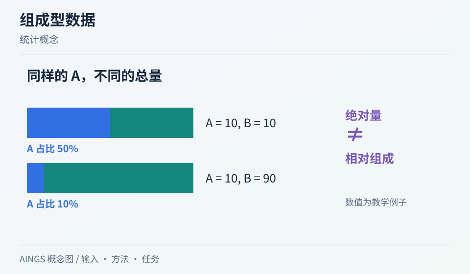

# 组成型数据：相对丰度上升，究竟是哪一种变化？

[研究画廊](README.md) · [检验医学与病原生信](../01_检验医学与病原生信/README.md) · [方法对照](compare.md)

**Microbiome Datasets Are Compositional: And This Is Not Optional** 
Gloor GB, Macklaim JM, Pawlowsky-Glahn V et al. · *Frontiers in Microbiology* · 2017 
[论文与图表](https://doi.org/10.3389/fmicb.2017.02224) · [PubMed](https://pubmed.ncbi.nlm.nih.gov/29187837/) · [开放全文](https://europepmc.org/articles/PMC5695134)

测序常常给出固定测序深度下的相对组成。Gloor 等人的这篇文章从比例约束出发，解释为何一个特征的数值变化必须放回其他特征与总量中理解，是阅读微生物丰度分析的基础。

AINGS 概念图，沿输入、方法与任务整理阅读线索。

## 先把问题放在桌上

| 项目 | 内容 |
| --- | --- |
| 输入 | 按样本记录的多特征计数或相对丰度 |
| 输出 | 关于比例、比值与分析尺度的统计理解 |
| 核心思路 | 从组成约束出发，用特征间比值理解信息 |

## 沿着方法读

### 1. 先区别总量和组成

两个样本可以有相同相对丰度，却拥有不同的绝对分子数；也可以只改变一个成员的绝对量，就让其他成员的比例一起变化。

### 2. 看清闭合约束

所有比例加起来等于 1，导致各分量无法独立变化。直接对比例做相关或比较时，需要考虑这种共同约束。

### 3. 再进入 log-ratio 语言

比值把一个特征相对于参照的变化写清楚。选择参照、处理零值和解释变换后的数值，都应与数据产生过程对应。

## 找一张图，把关系看清楚

原文 Figure 1 对照绝对量和相对表示。先自己计算每组总量与比例，再观察不同绝对情形怎样映射到相对数据。 [对照原文](https://doi.org/10.3389/fmicb.2017.02224)。

## 读结果时，留意这些信息

- 报告中说的“增加”，指原始计数、相对比例、某个比值还是绝对丰度？
- 零代表未观测、检测限，还是确实不存在？采用的零值处理会怎样改变比值？
- 若有外源标准或额外总量测量，说明它提供了哪一部分新信息。

## 试着做一件小事

样本 A 有两种菌，绝对量为 (10, 10)；样本 B 为 (10, 90)。算出第一种菌的相对丰度变化，再写一句同时准确描述绝对量和比例的话。

## 接着读，也接着写

**回到知识库：** [数据与统计基础](../01_检验医学与病原生信/03_数据与统计基础/README.md) · [质量控制、预处理与数据表示](../02_多模态多组学/03_质量控制_预处理与数据表示/README.md) · [数学、统计与机器学习基础](../02_多模态多组学/04_数学_统计与机器学习基础/README.md)。

**相邻论文：** [decontam](decontam.md) · [WNN](wnn.md) · [MOFA+](mofa.md) · [方法对照](compare.md)。

你也可以补一段解释、一个小例子，或指出尚未想清楚的地方。[分享笔记与问题](https://github.com/moshookee-ux/AINGS-study-group/issues/new?template=01_resource.yml) · [共建指南](../CONTRIBUTING.md)。
