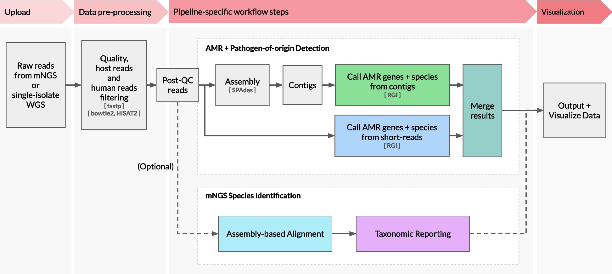

# CZ ID：同一批 reads，怎样连接病原与耐药分析？

[论文与方法](README.md) · [检验医学与病原生信](../01_检验医学与病原生信/README.md) · [首页](../README.md)

**Simultaneous detection of pathogens and antimicrobial resistance genes with the open source, cloud-based, CZ ID platform** 
Lu D, Kalantar KL, Glascock AL et al. · *Genome Medicine* · 2025 
[论文与图表](https://doi.org/10.1186/s13073-025-01480-2) · [PubMed](https://pubmed.ncbi.nlm.nih.gov/40329334/) · [开放全文](https://europepmc.org/articles/PMC12057172)

一份测序数据里，物种信息与耐药基因信息可以沿不同路径提取。这张图把 CZ ID 的 mNGS 与 AMR 模块放在一起，适合对照“原始序列—分析对象—结果解释”这条线阅读。

**原图与出处：** Dan Lu et al. (2025). *Simultaneous detection of pathogens and antimicrobial resistance genes with the open source, cloud-based, CZ ID platform*. **Genome Medicine, 17**, 46. Figure 1。[论文](https://doi.org/10.1186/s13073-025-01480-2) · [开放全文](https://europepmc.org/articles/PMC12057172) · [查看原尺寸图片](../assets/figures/czid-fig1.png)。© The Author(s) 2025，按 [CC BY 4.0](https://creativecommons.org/licenses/by/4.0/) 复用，图片内容未改动。

## 顺着图读四步

| 图中的位置 | 看见了什么 | 回到知识库 |
| --- | --- | --- |
| 左侧：Raw reads → Data pre-processing | 输入可以来自 mNGS 或单菌株全基因组测序；随后处理质量、宿主和人源序列背景 | [测序与实验设计](../01_检验医学与病原生信/02_生物信息学基础/01_测序技术与实验设计.md)、[污染与宿主背景](../01_检验医学与病原生信/03_数据与统计基础/02_污染_批次效应与宿主背景.md) |
| 中上：Assembly → Contigs | 部分 reads 经组装形成 contig，分析对象由短片段进入更长的序列上下文 | [reads 与 contig](../01_检验医学与病原生信/02_生物信息学基础/02_reads_contig_ORF_SNP_MAG.md)、[比对与组装](../01_检验医学与病原生信/04_方法与模型基础/01_比对_组装_kmer与sketch.md) |
| 中部：两条 AMR 路径 | 图中分别从 contig 与 short reads 识别 AMR 基因及相关物种信息，再汇总结果；RGI 是图中标出的耐药分析工具 | [ARG 与移动遗传元件](../01_检验医学与病原生信/02_生物信息学基础/04_ARG_毒力与移动遗传元件.md)、[耐药任务设计](../01_检验医学与病原生信/04_方法与模型基础/03_耐药检测任务设计.md) |
| 下部与右侧：物种分析 → 输出 | mNGS 物种鉴定模块产生分类信息，与其他分析输出一起呈现；图中的可选路径提示要先明确使用了哪些模块 | [物种鉴定](../01_检验医学与病原生信/02_生物信息学基础/03_物种鉴定与新物种判断.md)、[病原识别任务](../01_检验医学与病原生信/04_方法与模型基础/02_病原识别任务设计.md) |

## 读完这张图，可以继续追问

- **每一步处理的对象是什么？** 写出 reads、contig、基因、物种四种对象，看看自己能否指出它们在图里出现的位置。
- **序列上下文带来了什么？** 比较短 reads 与组装后 contig 的路径，想一想物种归属、基因位置和覆盖情况各需要什么信息。
- **结果怎样回到样本？** 把样本类型、宿主背景、污染情况，以及培养与药敏等资料放回解释过程。相关概念见[培养、药敏与临床判读](../01_检验医学与病原生信/01_检验医学与临床微生物学/02_培养_药敏与临床判读.md)。

可以试着给图里的每根主要箭头写一句话：“输入是什么，发生了什么，输出是什么。”写不清楚的那一步，往往就是接下来值得查的概念。

[继续看本方向的证据图](../01_检验医学与病原生信/README.md#三种任务分别建立证据) · [分享你的理解](https://github.com/moshookee-ux/AINGS-study-group/issues/new?template=02_content.yml)

## 把流程与结果对上

- 样本来自 mNGS 还是单菌株 WGS？先写下对应的分析路径与参考数据库。
- reads 与 contig 提供的覆盖、序列上下文和物种归属信息有什么不同？
- 将 ARG 检测结果与药敏表型分别记录，再结合培养、宿主和样本背景比较它们的关系。

## 接着读，也接着写

**回到知识库：** [生物信息学基础](../01_检验医学与病原生信/02_生物信息学基础/README.md) · [数据与统计基础](../01_检验医学与病原生信/03_数据与统计基础/README.md) · [方法与模型基础](../01_检验医学与病原生信/04_方法与模型基础/README.md)。

**相邻论文：** [DeepARG](deeparg.md) · [Kraken 2](kraken2.md) · [decontam](decontam.md) · [方法对照](compare.md)。

你也可以补一段解释、一个小例子，或指出尚未想清楚的地方。[分享笔记与问题](https://github.com/moshookee-ux/AINGS-study-group/issues/new?template=01_resource.yml) · [共建指南](../CONTRIBUTING.md)。
