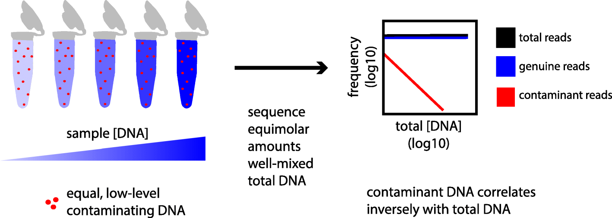

# decontam：污染线索为什么藏在浓度和阴性对照里？

[研究画廊](README.md) · [检验医学与病原生信](../01_检验医学与病原生信/README.md) · [方法对照](compare.md)

**Simple statistical identification and removal of contaminant sequences in marker-gene and metagenomics data** 
Davis NM, Proctor DM, Holmes SP et al. · *Microbiome* · 2018 
[论文与图表](https://doi.org/10.1186/s40168-018-0605-2) · [PubMed](https://pubmed.ncbi.nlm.nih.gov/30558668/) · [开放全文](https://europepmc.org/articles/PMC6298009)

低生物量样本中的少量外源 DNA 可能显著改变测序结果。decontam 把污染识别写成可检查的统计问题：某个特征是否随着总 DNA 浓度下降而相对增多，又是否更常出现在阴性对照中？

## 先把问题放在桌上

| 项目 | 内容 |
| --- | --- |
| 输入 | 特征计数／频率、DNA 浓度、阴性对照与批次信息 |
| 输出 | 特征的污染证据分数及按阈值得到的标记 |
| 核心思路 | frequency 与 prevalence 两类证据识别污染候选 |

## 沿着方法读

### 1. 读懂浓度关系的前提

固定量的背景污染混入不同生物量样本时，污染的相对频率会随样本 DNA 增加而下降。这个关系来自混合过程。

### 2. 让阴性对照提供另一条线索

prevalence 方法比较特征在阴性对照和真实样本中出现的情况。对照的设计、数量和覆盖批次直接影响证据质量。

### 3. 把判断落实到批次和阈值

试剂、处理批次与样本类型可能改变背景。阅读作者怎样分组、怎样组合证据、怎样选择阈值，并保留处理前后的记录。

## 找一张图，把关系看清楚

**原图署名：** Davis NM, Proctor DM, Holmes SP et al. (2018), Figure 1, *Microbiome*。[论文与图注](https://doi.org/10.1186/s40168-018-0605-2) · [原尺寸图片](../assets/figures/decontam-fig1.png)。© The Author(s) 2018，按 [CC BY 4.0](https://creativecommons.org/licenses/by/4.0/) 复用，图片内容未改动。

Figure 1 左侧的红点表示近似固定的污染 DNA，蓝色代表变化的样本 DNA；右侧画出对应的相对频率趋势。它解释的是 frequency 方法的混合假设。 [对照原文](https://doi.org/10.1186/s40168-018-0605-2)。

## 读结果时，留意这些信息

- 样本的总 DNA 浓度是否可靠，批次与阴性对照是否匹配？
- 有哪些已知污染和已知真实信号可用于检查误判？
- 比较处理前后的主要结论，并查看不同阈值下哪些特征会改变判断。

## 试着做一件小事

设背景污染量为 1，真实样本量为 9、99、999，分别计算污染比例。再想想：当污染量本身随批次变化时，应该补记什么信息？

## 接着读，也接着写

**回到知识库：** [检验医学与临床微生物学](../01_检验医学与病原生信/01_检验医学与临床微生物学/README.md) · [数据与统计基础](../01_检验医学与病原生信/03_数据与统计基础/README.md) · [质量控制、预处理与数据表示](../02_多模态多组学/03_质量控制_预处理与数据表示/README.md)。

**相邻论文：** [组成型数据](compositionality.md) · [CZ ID](czid.md) · [FastANI](fastani.md) · [方法对照](compare.md)。

你也可以补一段解释、一个小例子，或指出尚未想清楚的地方。[分享笔记与问题](https://github.com/moshookee-ux/AINGS-study-group/issues/new?template=01_resource.yml) · [共建指南](../CONTRIBUTING.md)。
