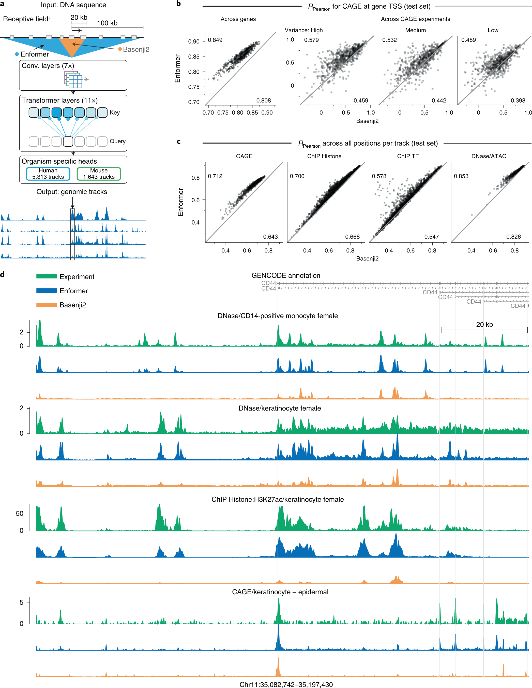

# Enformer：远端 DNA 元件怎样影响表达预测

[研究画廊](README.md) · [全部文献](catalog.md) · [方法对照](compare.md)

**Effective gene expression prediction from sequence by integrating long-range interactions** 
Avsec Ž, Agarwal V, Visentin D et al. · *Nature Methods* · 2021 
[原文与图表](https://doi.org/10.1038/s41592-021-01252-x) · [PubMed](https://pubmed.ncbi.nlm.nih.gov/34608324/)

基因附近的局部序列并不能包含所有调控信息。Enformer 用卷积提取局部模式，再通过 Transformer 汇集较远位置的信息，从 DNA 预测表达和其他基因组功能轨道。

| 输入／研究起点 | 输出／研究目标 |
| --- | --- |
| 较长的 DNA 序列窗口 | 多个实验对应的基因组信号轨道 |

## 方法中的关键连接

### 局部模式与长程联系

卷积模块压缩序列并提取局部特征，注意力再连接较远位置。关注分辨率在这些步骤中怎样变化。

### 一个序列对应多个实验读出

输出通道分别对应不同实验和情境，模型学习的是带情境的功能读出。

### 把预测轨道放回基因座

Figure 1 同时展示模型、评测和具体基因座。沿坐标比较观测与预测，再追问哪些远端区域提供信息。

## 对照论文的图

Avsec Ž, Agarwal V, Visentin D et al.，Fig. 1，*Nature Methods*。[原文图注](https://doi.org/10.1038/s41592-021-01252-x) · [打开原尺寸图片](../assets/figures/enformer-fig1.png)。© The Author(s) 2021；[CC BY 4.0](https://creativecommons.org/licenses/by/4.0/)，图片完整保留。

## 沿着 Figure 1 读

| 分面 | 读图线索 |
| --- | --- |
| a：架构与感受野 | 从约 200 kb 的 DNA 输入出发，追踪卷积、Transformer 与功能轨道输出；128 bp 是输出轨道的分辨率。 |
| b：表达预测 | “跨基因”和“跨实验”的相关性沿不同维度计算，需要分别理解。 |
| c：不同实验轨道 | 看不同 assay 下的散点分布和比较对象，而不只看一个总体分数。 |
| d：基因组区段 | 对照真实与预测信号的位置、峰形及幅度，检查同一区段中的多个实验轨道。 |

输入长度、输出分辨率和模型能利用的远距离信息是三个不同量。试着在图 a 和 d 上分别标出它们，再回到“远处调控元件怎样影响目标位置”的问题。

## 对照自己的研究问题

- 检查训练／测试的基因组区域划分及参考模型是否使用相同数据。
- 跨基因的预测相关性与某个位点的变异效应，是不同的评价问题。

## 可以动手做什么

画出启动子与较远增强子的位置，用不同窗口长度标出模型能看到的范围，再写出扩大感受野可能增加哪些信息。

## 继续阅读

[AlphaFold2](alphafold2.md) · [Geneformer](geneformer.md) · [MFM Perspective](mfm.md)

**相关知识：** [神经网络、Transformer与生物表示](../02_多模态多组学/05_神经网络_Transformer与生物表示/README.md) · [空间、序列、调控与实验闭环](../02_多模态多组学/09_空间_序列_调控与实验闭环/README.md)。

[补充这篇导读](https://github.com/moshookee-ux/AINGS-study-group/issues/new?template=02_content.yml) · [一起贡献](../CONTRIBUTING.md)
