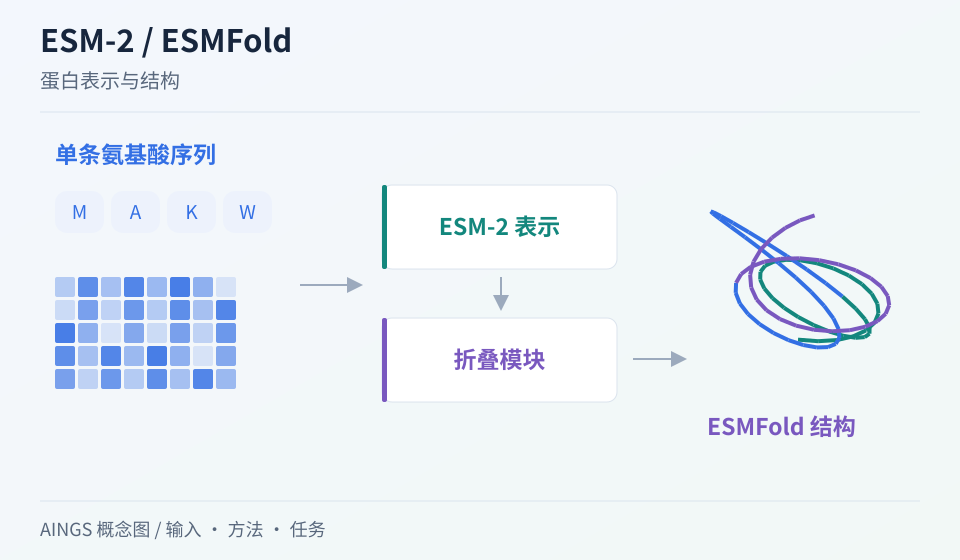

# ESM-2 / ESMFold：蛋白语言模型怎样接上结构预测

[研究画廊](README.md) · [全部文献](catalog.md) · [方法对照](compare.md)

**Evolutionary-scale prediction of atomic-level protein structure with a language model** 
Lin Z, Akin H, Rao R et al. · *Science (New York, N.Y.)* · 2023 
[原文与图表](https://doi.org/10.1126/science.ade2574) · [PubMed](https://pubmed.ncbi.nlm.nih.gov/36927031/)

这项工作把大规模蛋白序列上的语言模型表示接入结构预测，并用于构建宏基因组蛋白结构图谱。阅读时可以把 ESM-2 的序列表示与 ESMFold 的结构输出分开理解。

| 输入／研究起点 | 输出／研究目标 |
| --- | --- |
| 单条蛋白质氨基酸序列 | 蛋白表示，以及 ESMFold 产生的结构预测 |

## 方法中的关键连接

### 先学序列中的上下文

蛋白语言模型通过大量天然序列学习氨基酸位置间的统计关系，为后续结构模块提供表示。

### 结构模块读取学到的表示

ESMFold 从单序列路径形成结构预测。与 AlphaFold2 对照时，重点比较推理输入及进化信息进入模型的方式。

### 把规模应用和预测质量一起看

大规模图谱依赖吞吐量，也需要置信度和结构覆盖的记录。论文中的预测结构数量属于该论文版本的资源规模。

## 把结构画出来

AINGS 方法概念图。图示整理输入、计算与输出的关系；详细结构与实验结果见[原文](https://doi.org/10.1126/science.ade2574)。

## 对照自己的研究问题

- 比较单序列与 MSA 路线时，记录输入资源、速度及同源性分组。
- 查看结构质量在蛋白长度、无序区与低置信度区域上的差异。

## 可以动手做什么

列出单序列语言模型与基于 MSA 的结构模型各自使用的信息。想一想：一种信息在预训练中被学到，与在推理时显式提供，有何区别？

## 继续阅读

[AlphaFold2](alphafold2.md) · [ESM3](esm3.md) · [MetaPhlAn 4](metaphlan4.md)

**相关知识：** [神经网络、Transformer与生物表示](../02_多模态多组学/05_神经网络_Transformer与生物表示/README.md) · [空间、序列、调控与实验闭环](../02_多模态多组学/09_空间_序列_调控与实验闭环/README.md)。

[补充这篇导读](https://github.com/moshookee-ux/AINGS-study-group/issues/new?template=02_content.yml) · [一起贡献](../CONTRIBUTING.md)
