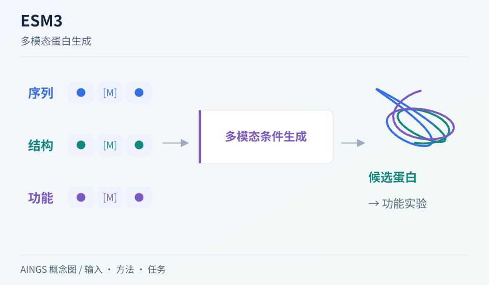

# ESM3：序列、结构与功能如何共同约束蛋白生成

[研究画廊](README.md) · [全部文献](catalog.md) · [方法对照](compare.md)

**Simulating 500 million years of evolution with a language model** 
Hayes T, Rao R, Akin H et al. · *Science (New York, N.Y.)* · 2025 
[原文与图表](https://doi.org/10.1126/science.ads0018) · [PubMed](https://pubmed.ncbi.nlm.nih.gov/39818825/)

ESM3 联合建模蛋白序列、结构和功能，通过给定部分条件来生成其余内容。它让多模态学习进入蛋白设计，也把计算候选与实际合成、功能测量连在一起。

| 输入／研究起点 | 输出／研究目标 |
| --- | --- |
| 蛋白序列、结构和功能中的部分条件 | 满足条件的蛋白候选及相应模态预测 |

## 方法中的关键连接

### 把不同模态组织成条件

序列与结构所提供的信息不同。先看哪些位置或属性已给定，哪些内容需要生成。

### 在模态之间传递约束

给定结构片段或功能信息，可以为序列生成提供限制；同一个候选仍需要检查不同模态之间的一致性。

### 沿候选走到实验读出

论文包含对生成荧光蛋白的合成和测量。把生成数量、筛选过程与实际测到的功能分别记录，才能理解设计结果。

## 把结构画出来

AINGS 方法概念图。图示整理输入、计算与输出的关系；详细结构与实验结果见[原文](https://doi.org/10.1126/science.ads0018)。

## 对照自己的研究问题

- 分开比较序列新颖性、预测结构与实验功能。
- 标题中的进化时间是论文使用的估计类比，阅读具体结果时回到序列距离和实验测量。

## 可以动手做什么

写一个概念性的蛋白设计条件：保留哪些残基、约束哪段结构、希望测什么功能。再列出验证这个候选所需的计算与实验读出。

## 继续阅读

[ESM-2 / ESMFold](esm2.md) · [AlphaFold2](alphafold2.md) · [MFM Perspective](mfm.md)

**相关知识：** [多模态整合、融合与预训练](../02_多模态多组学/06_多模态整合_融合与预训练/README.md) · [空间、序列、调控与实验闭环](../02_多模态多组学/09_空间_序列_调控与实验闭环/README.md)。

[补充这篇导读](https://github.com/moshookee-ux/AINGS-study-group/issues/new?template=02_content.yml) · [一起贡献](../CONTRIBUTING.md)
