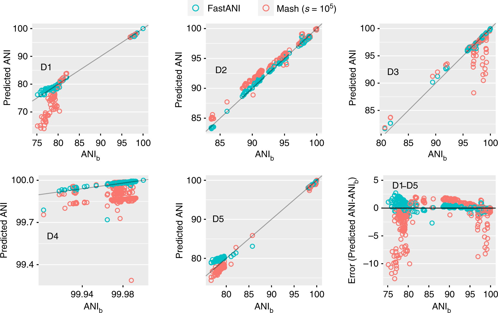

# FastANI：两个基因组有多相近，怎样高效估计？

[研究画廊](README.md) · [检验医学与病原生信](../01_检验医学与病原生信/README.md) · [方法对照](compare.md)

**High throughput ANI analysis of 90K prokaryotic genomes reveals clear species boundaries** 
Jain C, Rodriguez-R LM, Phillippy AM et al. · *Nature Communications* · 2018 
[论文与图表](https://doi.org/10.1038/s41467-018-07641-9) · [PubMed](https://pubmed.ncbi.nlm.nih.gov/30504855/) · [开放全文](https://europepmc.org/articles/PMC6269478)

read 分类之后，研究者有时还需要比较完整或草图基因组。FastANI 以较低计算成本估计平均核苷酸一致性（ANI），并用大规模基因组比较讨论物种边界。

## 先把问题放在桌上

| 项目 | 内容 |
| --- | --- |
| 输入 | 成对比较的原核生物完整或草图基因组 |
| 输出 | ANI 估计及与片段匹配有关的信息 |
| 核心思路 | 基因组分片、快速近似映射与匹配结果汇总 |

## 沿着方法读

### 1. 先把单位换成基因组

这里比较的是基因组之间的关系。基因组质量、覆盖范围和共享区域会进入估计，分析对象与单条 read 分类不同。

### 2. 追踪片段与参考的映射

论文通过快速映射寻找可比较片段，再聚合一致性信息。看清有多少片段参与，以及映射关系怎样筛选。

### 3. 把算法评价和生物学分布分别读

前者比较 ANI 估计与基于比对的方法，后者观察大量基因组对的分布。它们回答的是不同问题。

## 找一张图，把关系看清楚

**原图署名：** Jain C, Rodriguez-R LM, Phillippy AM et al. (2018), Figure 1, *Nature Communications*。[论文与图注](https://doi.org/10.1038/s41467-018-07641-9) · [原尺寸图片](../assets/figures/fastani-fig1.png)。© The Author(s) 2018，按 [CC BY 4.0](https://creativecommons.org/licenses/by/4.0/) 复用，图片内容未改动。

Figure 1 的 D1–D5 面板使用不同数据集与坐标范围，对角线表示与 ANIb 一致；右下角显示估计误差。先读轴的范围，再比较偏离方向与误差大小。 [对照原文](https://doi.org/10.1038/s41467-018-07641-9)。

## 读结果时，留意这些信息

- 组装完整性、碎片化和污染如何影响可匹配区域？
- 算法在哪个相似性范围、多少有效匹配下报告结果？没有报告的基因组对也应记录。
- 讨论物种划分时，把 ANI 分布、参考分类与其他基因组证据放在一起。

## 试着做一件小事

给两对基因组分别设定 96% 的匹配片段一致性，但令有效匹配覆盖比例不同。说明为什么这两个 96% 需要连同覆盖信息一起解读。

## 接着读，也接着写

**回到知识库：** [生物信息学基础](../01_检验医学与病原生信/02_生物信息学基础/README.md) · [方法与模型基础](../01_检验医学与病原生信/04_方法与模型基础/README.md) · [数据与统计基础](../01_检验医学与病原生信/03_数据与统计基础/README.md)。

**相邻论文：** [Kraken 2](kraken2.md) · [Centrifuge](centrifuge.md) · [decontam](decontam.md) · [方法对照](compare.md)。

你也可以补一段解释、一个小例子，或指出尚未想清楚的地方。[分享笔记与问题](https://github.com/moshookee-ux/AINGS-study-group/issues/new?template=01_resource.yml) · [共建指南](../CONTRIBUTING.md)。
