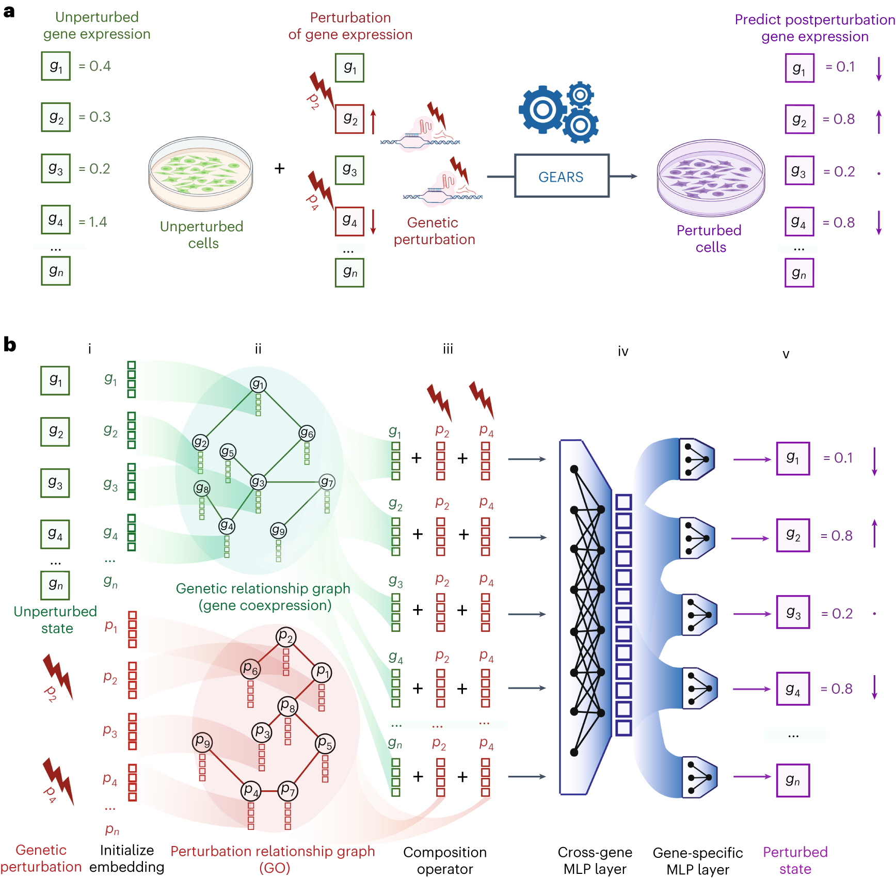

# GEARS：未测过的基因组合扰动，能否提前预测

[研究画廊](README.md) · [全部文献](catalog.md) · [方法对照](compare.md)

**Predicting transcriptional outcomes of novel multigene perturbations with GEARS** 
Roohani Y, Huang K, Leskovec J. · *Nature Biotechnology* · 2024 
[原文与图表](https://doi.org/10.1038/s41587-023-01905-6) · [PubMed](https://pubmed.ncbi.nlm.nih.gov/37592036/)

组合扰动的数量很快超过实验预算。GEARS 将基因关系和扰动关系作为先验图，结合单细胞表达数据学习施加一个或多个基因扰动后的响应。

| 输入／研究起点 | 输出／研究目标 |
| --- | --- |
| 未扰动表达、扰动基因集合与基因关系图 | 扰动后的基因表达预测 |

## 方法中的关键连接

### 两类嵌入对应两类角色

基因表示描述表达输出中的基因，扰动表示描述施加改变的对象。论文为两者组织不同的关系图。

### 在图中传播信息

图神经网络汇集相邻节点的信息，再将扰动集合的表示与各基因的表示结合。

### 按未见程度拆开测试

某个基因从未被扰动过，与见过单基因但没见过组合，是不同难度的外推问题。

## 对照论文的图

Roohani Y, Huang K, Leskovec J.，Fig. 1，*Nature Biotechnology*。[原文图注](https://doi.org/10.1038/s41587-023-01905-6) · [打开原尺寸图片](../assets/figures/gears-fig1.png)。© The Author(s) 2023；[CC BY 4.0](https://creativecommons.org/licenses/by/4.0/)，图片完整保留。

## 沿着 Figure 1 读

图 a 给出任务：未扰动表达与施加的干预共同决定预测目标。图 b 则把计算分成五步：初始化基因与扰动嵌入、放进两类关系图、聚合邻居、合并指定干预、通过跨基因层与基因输出层预测表达。

| 两类关系 | 图中承担的工作 |
| --- | --- |
| 基因关系图 | 为基因表示提供表达相关的邻域信息 |
| 扰动关系图 | 让干预表示利用相关基因的知识关系 |
| 指定的干预集合 | 将这次实际施加的一个或多个干预接到基因表示上 |

阅读组合扰动结果时，先标清训练中见过哪些单基因、哪些组合，以及测试中的新意落在哪个层面。这样才能解释模型利用了什么关系进行迁移。

## 对照自己的研究问题

- 同时记录所有基因与差异表达基因上的评价，明确对照状态。
- 按未见基因、未见组合与不同细胞情境分开理解结果。

## 可以动手做什么

对 A、B、C 三个基因设计训练扰动与测试组合。分别构造“见过 A 和 B，但没见过 A+B”以及“从未见过 C”的测试。

## 继续阅读

[Perturb-seq](perturbseq.md) · [Geneformer](geneformer.md) · [MFM Perspective](mfm.md)

**相关知识：** [神经网络、Transformer与生物表示](../02_多模态多组学/05_神经网络_Transformer与生物表示/README.md) · [模型评价、实验设计与生物学解释](../02_多模态多组学/08_模型评价_实验设计与生物学解释/README.md) · [空间、序列、调控与实验闭环](../02_多模态多组学/09_空间_序列_调控与实验闭环/README.md)。

[补充这篇导读](https://github.com/moshookee-ux/AINGS-study-group/issues/new?template=02_content.yml) · [一起贡献](../CONTRIBUTING.md)
