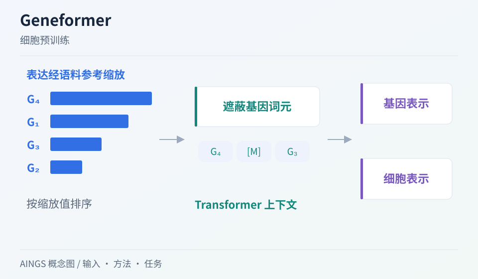

# Geneformer：怎样把大规模转录组知识迁移到小数据任务

[研究画廊](README.md) · [全部文献](catalog.md) · [方法对照](compare.md)

**Transfer learning enables predictions in network biology** 
Theodoris CV, Xiao L, Chopra A et al. · *Nature* · 2023 
[原文与图表](https://doi.org/10.1038/s41586-023-06139-9) · [PubMed](https://pubmed.ncbi.nlm.nih.gov/37258680/)

Geneformer 从约三千万单细胞转录组中学习上下文表示，再适配到网络生物学的具体任务。基因在细胞中的相对位置、上下文和任务标签共同决定后续预测。

| 输入／研究起点 | 输出／研究目标 |
| --- | --- |
| 按表达秩组织的基因词元与任务所需数据 | 细胞／基因表示，以及微调后的任务预测 |

## 方法中的关键连接

### 表达谱怎样组成序列

rank-value 编码先按细胞总量归一化，再用语料中对应基因的非零表达中位数缩放，最后在细胞内排序并映射成基因词元。这个排序突出相对于基因通常水平的表达信息。具体输入和版本设置可对照[官方 tokenizer](https://geneformer.readthedocs.io/en/latest/geneformer.tokenizer.html)与[作者模型说明](https://huggingface.co/ctheodoris/Geneformer)。

### 预训练与微调各自学习什么

预训练使用大量转录组形成上下文表示，任务微调加入特定预测目标。分别记录两个阶段的数据范围。

### 网络解释回到可检验对象

注意力和计算扰动能够提供候选关系。阅读疾病相关应用时，继续追踪这些候选怎样被实验或独立数据检查。

## 把结构画出来

AINGS 方法概念图。图示整理输入、计算与输出的关系；详细结构与实验结果见[原文](https://doi.org/10.1038/s41586-023-06139-9)。

## 对照自己的研究问题

- 将细胞、供体与研究来源区分开，检查微调和测试的独立性。
- 比较不微调、微调和从头学习时，记录任务数据与可更新参数。

## 可以动手做什么

给同一个细胞的 6 个基因指定表达值，再给出各基因的参考中位数。先比较原始表达排序与缩放后排序，再改变一个基因的表达，观察哪些词元位置发生变化。

## 继续阅读

[scGPT](scgpt.md) · [scFoundation](scfoundation.md) · [GEARS](gears.md)

**相关知识：** [神经网络、Transformer与生物表示](../02_多模态多组学/05_神经网络_Transformer与生物表示/README.md) · [下游任务、迁移与预测方法](../02_多模态多组学/07_下游任务_迁移与预测方法/README.md) · [模型评价、实验设计与生物学解释](../02_多模态多组学/08_模型评价_实验设计与生物学解释/README.md)。

[补充这篇导读](https://github.com/moshookee-ux/AINGS-study-group/issues/new?template=02_content.yml) · [一起贡献](../CONTRIBUTING.md)
