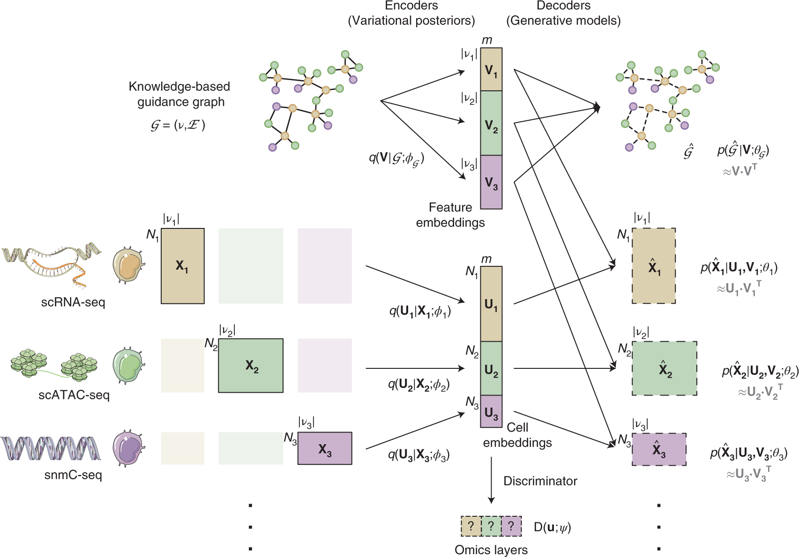

# GLUE：没有逐一配对的细胞，怎样连接不同组学？

[研究画廊](README.md) · [多模态多组学](../02_多模态多组学/README.md) · [首页](../README.md)

**Multi-omics single-cell data integration and regulatory inference with graph-linked embedding** 
Cao ZJ, Gao G. · *Nature Biotechnology* · 2022 
[论文与图表](https://doi.org/10.1038/s41587-022-01284-4) · [PubMed](https://pubmed.ncbi.nlm.nih.gov/35501393/) · [开放全文](https://europepmc.org/articles/PMC9546775)

不同组学可能测量不同的细胞，特征也不同：一边是基因，一边是染色质区域，还可能有其他分子层次。GLUE 用特征间的先验关系连接这些数据。这张框架图把“细胞怎样表示”和“特征怎样连接”放在了同一个模型里。

**原图与出处：** Zhi-Jie Cao & Ge Gao (2022). *Multi-omics single-cell data integration and regulatory inference with graph-linked embedding*. **Nature Biotechnology, 40**, 1458–1466. Figure 1。[论文](https://doi.org/10.1038/s41587-022-01284-4) · [开放全文](https://europepmc.org/articles/PMC9546775) · [查看原尺寸图片](../assets/figures/glue-fig1.png)。© The Author(s) 2022，按 [CC BY 4.0](https://creativecommons.org/licenses/by/4.0/) 复用，图片内容未改动。部分图形素材来自 [Servier Medical Art](https://smart.servier.com/)，按 [CC BY 3.0](https://creativecommons.org/licenses/by/3.0/) 署名。

## 先认清图里的四个对象

| 记号与位置 | 表示什么 | 对应知识 |
| --- | --- | --- |
| **X**：左侧不同组学矩阵 | 每个组学有自己的细胞数和特征集合，数据分布也可以不同 | [矩阵、坐标与元数据](../02_多模态多组学/02_测量技术与多组学数据结构/05_矩阵_行列坐标与元数据.md)、[配对与非配对](../02_多模态多组学/02_测量技术与多组学数据结构/06_配对_非配对_部分配对与_mosaic.md) |
| **U**：中下部 cell embeddings | 由各组学编码器学习的细胞低维表示 | [变分自动编码器](../02_多模态多组学/05_神经网络_Transformer与生物表示/03_变分自动编码器_让潜在状态与观测都有概率含义.md) |
| **G、V**：上方引导图与 feature embeddings | G 以组学特征为节点组织先验关系；图编码器据此学习特征表示 V | [图与消息传递](../02_多模态多组学/05_神经网络_Transformer与生物表示/11_图_邻域与消息传递.md)、[生物知识与通路](../02_多模态多组学/09_空间_序列_调控与实验闭环/06_生物知识_通路与文本怎样进入分析.md) |
| **D**：下方 discriminator | 判别细胞表示来自哪个组学，参与对抗学习与跨组学对齐 | [整合、对齐与融合](../02_多模态多组学/06_多模态整合_融合与预训练/02_整合_对齐_融合与补全各自要得到什么.md) |

## 再沿着三条线看计算

1. **数据线：X → U。** 各组学分别经过变分编码器，学习细胞表示。图中细胞数量可以不同，表示的维度保持一致。
2. **知识线：G → V。** 先验引导图把不同组学的特征连起来，图编码器学习特征表示；图的重建也参与模型训练。
3. **联合学习线：U、V → 重建，U → 对齐。** 数据解码器结合细胞与特征表示重建各组学观测，判别器帮助对齐不同组学的细胞表示。图右侧的内积说明了两类表示怎样在重建中相遇。

把这三条线画到自己的笔记里，会更容易区分：哪些节点是细胞，哪些是特征，哪些关系来自数据，哪些关系作为先验提供给模型。

## 读完之后，可以继续想

- **如果先验图换了，哪些环节会受影响？** 从 G 到 V，再到各组学的解码器，沿箭头追一次。相关思路见[消融实验](../02_多模态多组学/08_模型评价_实验设计与生物学解释/08_消融实验怎样支持解释.md)。
- **怎样检查整合后的表示？** 同时看跨组学的对齐与生物学结构的保留。具体指标见[检索、整合与聚类的评价](../02_多模态多组学/08_模型评价_实验设计与生物学解释/05_检索_整合与聚类各自评价什么.md)。
- **自己的数据需要哪些对应关系？** 先写清细胞、特征、供体和观测模态，再考虑适合的整合方式。可以接着读[数据的对应关系](../02_多模态多组学/06_多模态整合_融合与预训练/01_数据的对应关系决定能够学习什么.md)。

[继续看多模态分析流程](../02_多模态多组学/README.md#一张图读懂多模态分析) · [分享你的理解](https://github.com/moshookee-ux/AINGS-study-group/issues/new?template=02_content.yml)

## 把模型与结果对上

- 引导图中的边来自哪些生物知识，连接的是哪两类特征？
- 配对参考或细胞标签在训练、调参和评价中分别起什么作用？
- 同时检查跨模态对齐与细胞结构保留，并观察更换或扰动引导图后的变化。

## 接着读，也接着写

**回到知识库：** [神经网络、Transformer与生物表示](../02_多模态多组学/05_神经网络_Transformer与生物表示/README.md) · [多模态整合、融合与预训练](../02_多模态多组学/06_多模态整合_融合与预训练/README.md) · [模型评价、实验设计与生物学解释](../02_多模态多组学/08_模型评价_实验设计与生物学解释/README.md)。

**相邻论文：** [MultiVI](multivi.md) · [MOFA+](mofa.md) · [scIB](scib.md) · [方法对照](compare.md)。

你也可以补一段解释、一个小例子，或指出尚未想清楚的地方。[分享笔记与问题](https://github.com/moshookee-ux/AINGS-study-group/issues/new?template=01_resource.yml) · [共建指南](../CONTRIBUTING.md)。
