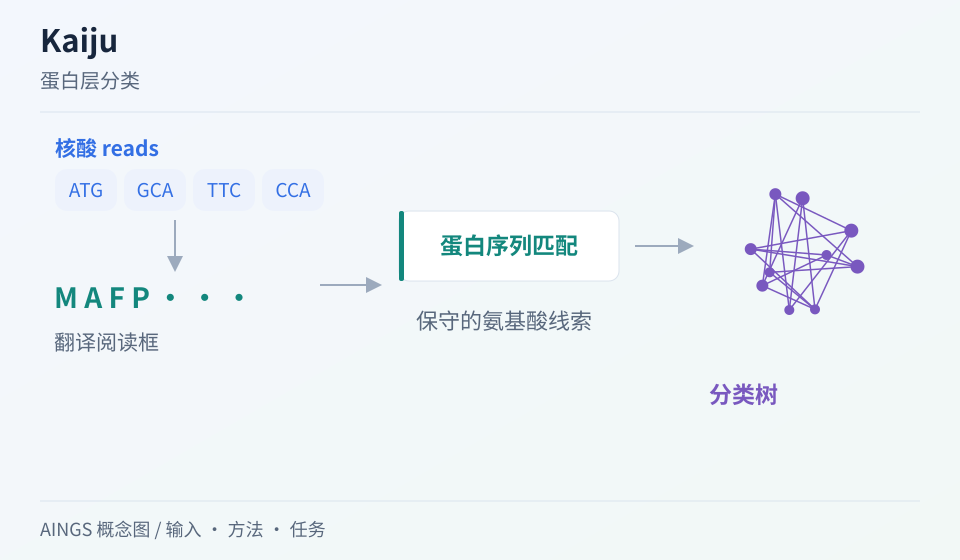

# Kaiju：换到蛋白层面，能多认出哪些序列？

[研究画廊](README.md) · [检验医学与病原生信](../01_检验医学与病原生信/README.md) · [方法对照](compare.md)

**Fast and sensitive taxonomic classification for metagenomics with Kaiju** 
Menzel P, Ng KL, Krogh A. · *Nature Communications* · 2016 
[论文与图表](https://doi.org/10.1038/ncomms11257) · [PubMed](https://pubmed.ncbi.nlm.nih.gov/27071849/) · [开放全文](https://europepmc.org/articles/PMC4833860)

当样本中的生物与已知参考相隔较远，核酸层面的相似性可能降低。Kaiju 将 reads 的翻译结果与蛋白参考比较，利用编码序列中的保守信息寻找分类线索。

AINGS 概念图，沿输入、方法与任务整理阅读线索。

## 先把问题放在桌上

| 项目 | 内容 |
| --- | --- |
| 输入 | 核酸 reads、带物种标签的蛋白参考库 |
| 输出 | read 的分类标签 |
| 核心思路 | 翻译 reads，在蛋白序列空间搜索长的精确或近似匹配 |

## 沿着方法读

### 1. 核酸怎样进入蛋白搜索

读清翻译阅读框、停止密码子和可用片段的处理。输入是 DNA reads，而检索对象是蛋白片段。

### 2. 保守性怎样带来识别机会

氨基酸相似性可以保留一些核酸层面不明显的关系。搜索参数与允许的替换，又会改变灵敏度和误匹配之间的平衡。

### 3. 多重匹配怎样形成分类

一个片段可能匹配多个参考蛋白。关注候选匹配的长度、得分，以及这些参考在分类树上的共同位置。

## 找一张图，把关系看清楚

原文 Figure 1 将基准结果按属中的参考基因组数量分组。读图时比较“参考稀少”与“参考丰富”的组，再结合删除测试基因组的实验设计理解难度。 [对照原文](https://doi.org/10.1038/ncomms11257)。

## 读结果时，留意这些信息

- 记录是否从数据库中排除了测试基因组，以及剩余近缘参考的情况。
- 分清编码区与非编码区的输入；蛋白参考能够利用的信息取决于序列性质。
- 同时查看灵敏度与精确率，并确认 genus／species 等分类层级。

## 试着做一件小事

用两个编码相同氨基酸的不同密码子举例，解释为什么核酸变化未必等于蛋白变化。再写出一个蛋白搜索难以利用的输入情形。

## 接着读，也接着写

**回到知识库：** [生物信息学基础](../01_检验医学与病原生信/02_生物信息学基础/README.md) · [方法与模型基础](../01_检验医学与病原生信/04_方法与模型基础/README.md)。

**相邻论文：** [Kraken 2](kraken2.md) · [Centrifuge](centrifuge.md) · [BERTax](bertax.md) · [方法对照](compare.md)。

你也可以补一段解释、一个小例子，或指出尚未想清楚的地方。[分享笔记与问题](https://github.com/moshookee-ux/AINGS-study-group/issues/new?template=01_resource.yml) · [共建指南](../CONTRIBUTING.md)。
