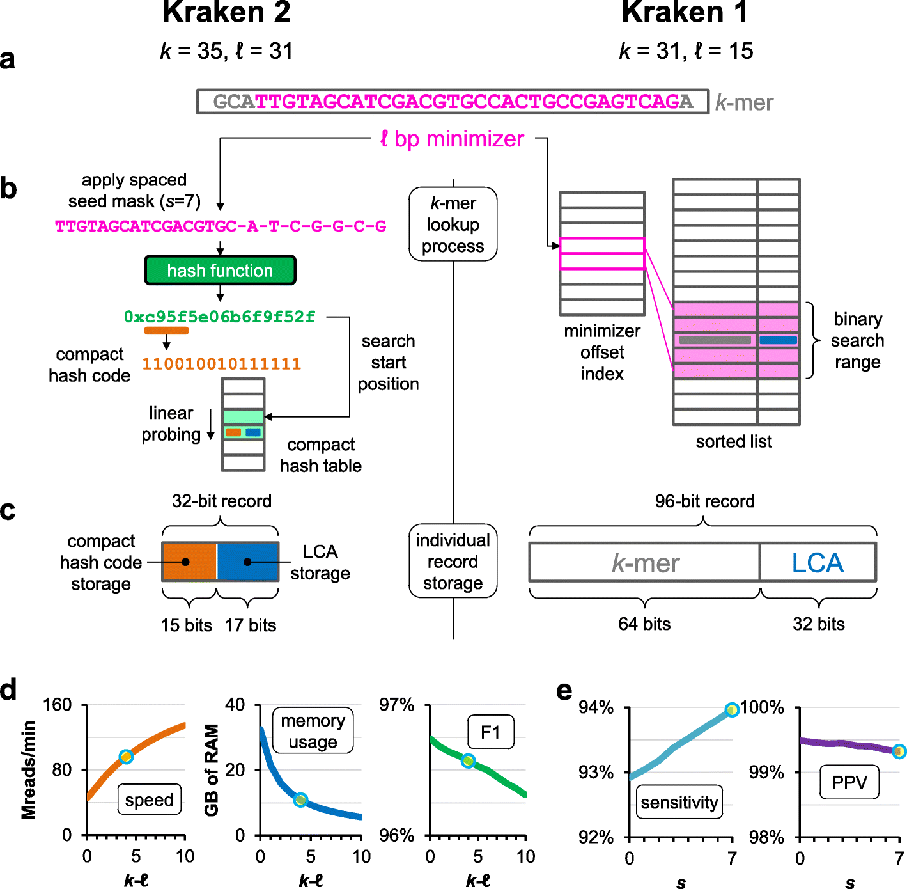

# Kraken 2：海量短序列怎样快速获得分类线索？

[论文与方法](README.md) · [检验医学与病原生信](../01_检验医学与病原生信/README.md) · [方法对照](compare.md)

**Improved metagenomic analysis with Kraken 2** 
Wood DE, Lu J, Langmead B. · *Genome Biology* · 2019 
[论文与图表](https://doi.org/10.1186/s13059-019-1891-0) · [PubMed](https://pubmed.ncbi.nlm.nih.gov/31779668/) · [开放全文](https://europepmc.org/articles/PMC6883579)

宏基因组样本里有大量短 reads。Kraken 2 把参考序列整理成可快速查找的索引，再沿分类树汇总匹配证据。读这篇论文，可以同时理解算法表示、数据库规模与实际计算成本。

## 先把问题放在桌上

| 项目 | 内容 |
| --- | --- |
| 输入 | 待分类 reads、带分类信息的参考数据库 |
| 输出 | read 的分类标签及分类汇总 |
| 核心思路 | minimizer、间隔种子与紧凑哈希表组织序列证据 |

## 沿着方法读

### 1. 先找真正存储的对象

一个 k-mer 可以用其中选出的较短 minimizer 表示。相邻窗口可能共享 minimizer，因此索引条目的数量和存储方式都会改变。

### 2. 把空间换算到记录上

紧凑哈希记录保存部分哈希信息与分类树上的最低共同祖先（LCA）。读图时把序列、哈希值、分类节点分开，才能理解节约内存来自哪里。

### 3. 把参数看成一组取舍

k、minimizer 长度和间隔种子设置会影响速度、内存及分类表现。论文的参数曲线适合用来理解这些变化，而具体效果还与参考数据库和评测对象有关。

## 找一张图，把关系看清楚

**原图署名：** Wood DE, Lu J, Langmead B. (2019), Figure 1, *Genome Biology*。[论文与图注](https://doi.org/10.1186/s13059-019-1891-0) · [原尺寸图片](../assets/figures/kraken2-fig1.png)。© The Author(s) 2019，按 [CC BY 4.0](https://creativecommons.org/licenses/by/4.0/) 复用，图片内容未改动。

Figure 1a–c 对照 Kraken 1 与 Kraken 2 的查找过程；1d–e 把参数变化与速度、内存、F1、灵敏度和阳性预测值联系起来。先看上半部的表示，再读下半部的坐标轴。 [对照原文](https://doi.org/10.1186/s13059-019-1891-0)。

## 读结果时，留意这些信息

- 分类到属还是种？分母是全部 reads 还是已分类 reads？记录各指标的层级与定义。
- 参考数据库覆盖了哪些基因组？测试序列与数据库的距离，会影响匹配难度。
- 比较速度时，把线程、硬件、数据库构建和查询成本分别记下。

## 试着做一件小事

选一段短 DNA，写出相邻的几个 k-mer，再标出可能重复出现的短子串。用自己的话解释：减少索引条目为什么可能加快查询，又会丢掉哪一部分区分信息？

## 接着读，也接着写

**回到知识库：** [生物信息学基础](../01_检验医学与病原生信/02_生物信息学基础/README.md) · [方法与模型基础](../01_检验医学与病原生信/04_方法与模型基础/README.md) · [数据与统计基础](../01_检验医学与病原生信/03_数据与统计基础/README.md)。

**相邻论文：** [Centrifuge](centrifuge.md) · [Kaiju](kaiju.md) · [DeepMicrobes](deepmicrobes.md) · [方法对照](compare.md)。

你也可以补一段解释、一个小例子，或指出尚未想清楚的地方。[分享笔记与问题](https://github.com/moshookee-ux/AINGS-study-group/issues/new?template=01_resource.yml) · [共建指南](../CONTRIBUTING.md)。
