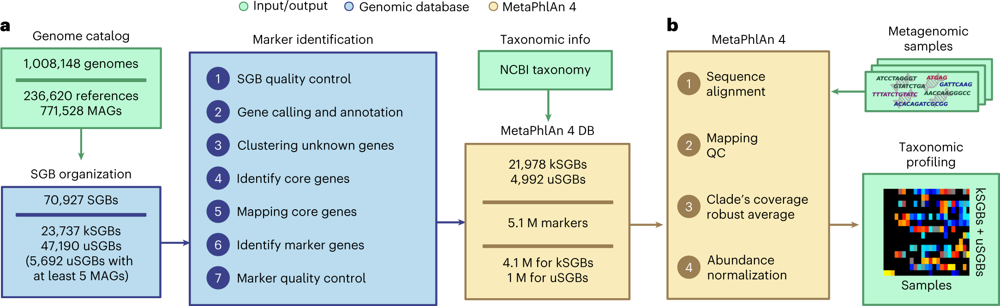

# MetaPhlAn 4：未培养微生物怎样进入宏基因组谱系分析

[研究画廊](README.md) · [全部文献](catalog.md) · [方法对照](compare.md)

**Extending and improving metagenomic taxonomic profiling with uncharacterized species using MetaPhlAn 4** 
Blanco-Míguez A, Beghini F, Cumbo F et al. · *Nature Biotechnology* · 2023 
[原文与图表](https://doi.org/10.1038/s41587-023-01688-w) · [PubMed](https://pubmed.ncbi.nlm.nih.gov/36823356/)

MetaPhlAn 4 将分离株参考与宏基因组组装基因组汇入物种级基因组簇，再使用特异标记基因估计群落组成。它把参考库建设与相对丰度分析连接起来。

| 输入／研究起点 | 输出／研究目标 |
| --- | --- |
| 宏基因组 reads 与 SGB 特异标记库 | 物种级基因组簇的存在与相对丰度 |

## 方法中的关键连接

### SGB 扩展参考对象

species-level genome bin 将基因组组织为物种级簇，部分簇来自缺乏培养参考的 MAG。

### 从标记覆盖估计组成

reads 比对到标记库，经质量过滤和覆盖汇总后产生相对丰度。标记选择决定可区分的对象。

### 参考库与丰度算法共同影响输出

新参考可以增加覆盖范围；读结果时还要检查标记特异性、覆盖一致性和未分类成分。

## 对照论文的图

Blanco-Míguez A, Beghini F, Cumbo F et al.，Fig. 1，*Nature Biotechnology*。[原文图注](https://doi.org/10.1038/s41587-023-01688-w) · [打开原尺寸图片](../assets/figures/metaphlan4-fig1.png)。© The Author(s) 2023；[CC BY 4.0](https://creativecommons.org/licenses/by/4.0/)，图片完整保留。

## 沿着 Figure 1 读

| 分面 | 读图线索 |
| --- | --- |
| a：建立参考 | 分离株基因组与 MAG 汇入物种层次基因组单元 SGB，再识别特异的标记基因。 |
| b：分析样本 | reads 映射到标记库，过滤低质量比对，计算各 SGB 标记的稳健平均覆盖，最后形成相对丰度。 |

图 a 解释“哪些生物可以被参考库表示”，图 b 解释“怎样由样本信号估计它们的组成”。与逐条 reads 的分类结果比较时，先对齐最终的统计单位和归一化方式。

## 对照自己的研究问题

- 区分 read 分类准确率与群落组成估计的评价。
- 参考库中的已知／未表征 SGB、样本环境和真实群落构成是否对应？

## 可以动手做什么

画出两个 SGB 的标记基因集合，模拟几个标记的 reads 覆盖。说明为何需要汇总多个标记，而不能把单次命中直接当作丰度。

## 继续阅读

[Kraken 2](kraken2.md) · [FastANI](fastani.md) · [组成型数据](compositionality.md)

**相关知识：** [生物信息学基础](../01_检验医学与病原生信/02_生物信息学基础/README.md) · [数据与统计基础](../01_检验医学与病原生信/03_数据与统计基础/README.md) · [方法与模型基础](../01_检验医学与病原生信/04_方法与模型基础/README.md)。

[补充这篇导读](https://github.com/moshookee-ux/AINGS-study-group/issues/new?template=02_content.yml) · [一起贡献](../CONTRIBUTING.md)
