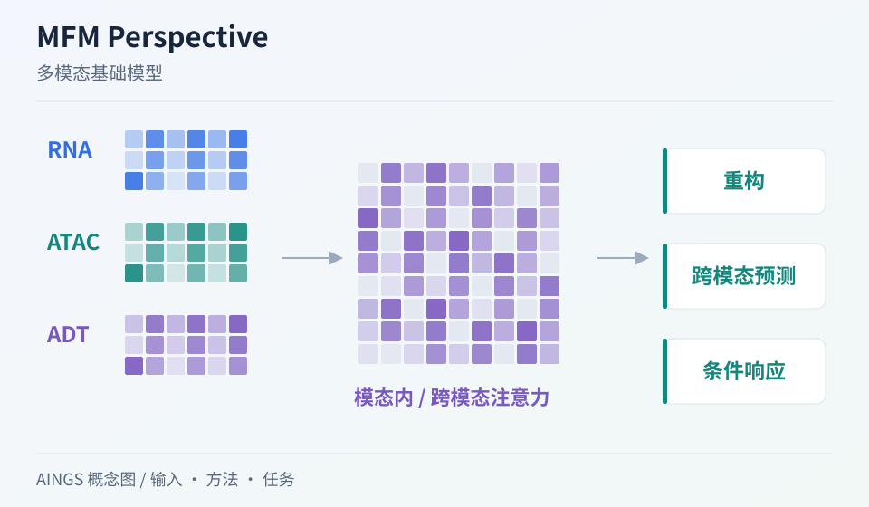
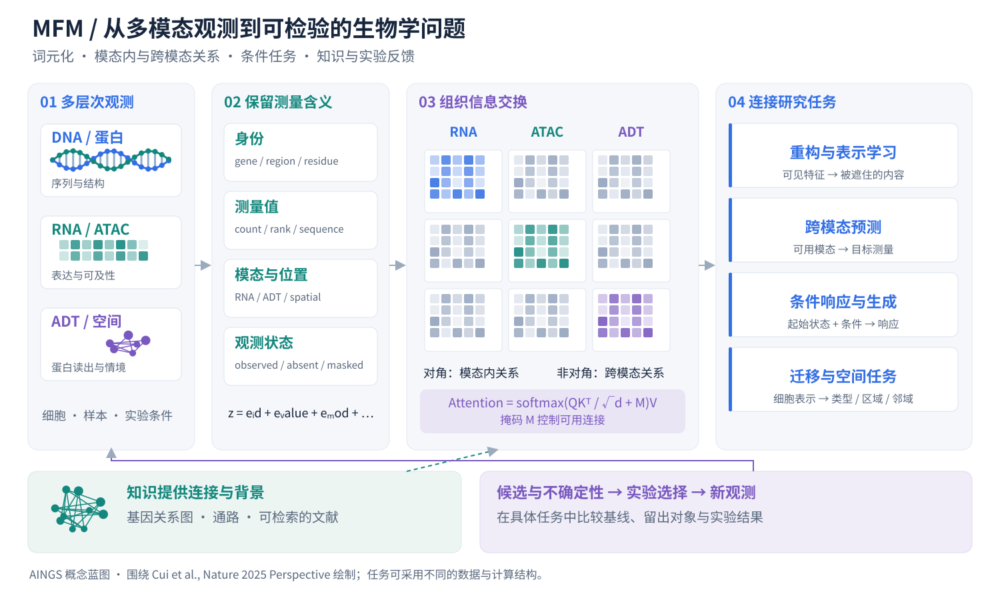

# MFM Perspective：把序列、细胞与实验连成一条研究路线

[研究画廊](README.md) · [全部文献](catalog.md) · [方法对照](compare.md)

**Towards multimodal foundation models in molecular cell biology** 
Cui H, Tejada-Lapuerta A, Brbić M et al. · *Nature* · 2025 
[原文与图表](https://doi.org/10.1038/s41586-025-08710-y) · [PubMed](https://pubmed.ncbi.nlm.nih.gov/40240854/)

这篇 Nature Perspective 提出一个贯穿分子细胞生物学的问题：能否在多种组学和实验情境中预训练共享模型，再将学到的表示用于细胞状态、调控和扰动等任务？它把数据、模型组件与实验组织放在同一张研究蓝图里。

| 输入／研究起点 | 输出／研究目标 |
| --- | --- |
| 多情境的序列、转录组、表观组、蛋白与空间观测 | 可迁移的表示，以及面向不同生物问题的任务接口 |

## 方法中的关键连接

### 统一词元，不抹掉测量含义

DNA 片段、基因表达和蛋白读出具有不同的身份、尺度与观测过程。统一的向量空间仍需要保留模态、数值、位置与实验情境。

### 模态内计算与跨模态计算

局部关系与跨层关系可以通过不同的注意力结构组织。计算图需要说明哪些对象能够交换信息，哪些对应关系由联合测量提供。

### 让训练目标对应研究任务

重构、跨模态预测、条件生成和对比学习各自提供不同监督信号。任务词元和条件输入可以帮助共享主干连接不同输出。

## 把结构画出来

AINGS 方法概念图。图示整理输入、计算与输出的关系；详细结构与实验结果见[原文](https://doi.org/10.1038/s41586-025-08710-y)。

## 从测量对象到统一表示

RNA 计数、ATAC 可及性、抗体标签与 DNA 序列并不使用同一种数值语言。一个概念性的输入表示，可以写成：

$$z_i=e_{\mathrm{id},i}+e_{\mathrm{value},i}+e_{\mathrm{modality},i}+e_{\mathrm{observed},i}+e_{\mathrm{context},i}.$$

各项按测量类型选用，空间或有序序列还需要相应位置表示。这里最值得追问的是：同一个零，究竟是测到了零、这个面板没有测，还是训练时暂时遮住了？这些情况决定模型可以使用哪些信息、损失在哪些位置计算。

在 [CITE-seq](cite-seq.md) 中，RNA 和 ADT 通过同一细胞建立对应；在 [GLUE](glue.md) 中，不同细胞集合依靠特征关系图连接；[MultiVI](multivi.md) 和 [scVAEIT](scvaeit.md) 则进一步组织部分配对与缺失观测。它们提供了理解统一模型之前的具体例子。

## 注意力应该连接哪些对象

$$\operatorname{Attention}(Q,K,V)=\operatorname{softmax}\!\left(\frac{QK^{\mathsf T}}{\sqrt{d_k}}+M\right)V.$$

在这个计算里，掩码 $M$ 决定哪些位置可以交换信息。模态内的块可以组织基因之间或序列片段之间的关系；跨模态的块连接 RNA、蛋白或染色质特征。任务设计还要决定 Q、K、V 来自同一模态还是不同模态，以及这种连接有没有配对数据或生物先验支持。

这是围绕论文设计问题绘制的计算示意。点击图片可以放大查看观测掩码、注意力块与任务之间的关系。

## 让训练目标对应真实任务

| 训练任务 | 已知条件 | 希望预测什么 | 可以衔接的工作 |
| --- | --- | --- | --- |
| 模态内重构 | 部分可见的基因或序列 | 被遮住的内容 | [Geneformer](geneformer.md)、[scFoundation](scfoundation.md) |
| 跨模态预测 | 同一细胞的可用模态 | 未测模态中的目标 | [totalVI](totalvi.md)、[CAPTAIN](captain.md) |
| 条件响应 | 起始状态与施加的干预 | 干预后的表达变化 | [Perturb-seq](perturbseq.md)、[GEARS](gears.md) |
| 空间相关任务 | 细胞表达与可用情境 | 区域、生态位或邻域组成 | [Nicheformer](nicheformer.md) |
| 蛋白条件生成 | 给定的序列、结构或功能条件 | 候选蛋白及相关模态 | [ESM3](esm3.md) |

这些论文各自解决具体任务，可以用来逐项理解 Perspective 中的设想。构建自己的模型时，先写清输入与目标，再选择共享主干和任务接口。

## 生物知识怎样进入计算

一种路径是把基因关系、通路和特征连接做成图，用来初始化表示、传播信息或限制可用连接；另一种路径是把文献与文本作为可检索的外部信息。两条路径分别需要检查知识来源、版本以及与测试对象的关系。[GLUE](glue.md) 的特征引导图和 [GEARS](gears.md) 的基因／扰动关系图，可以作为具体的对照。

## 从模型建议到下一次实验

模型可以给出候选干预、预测变化及不确定性。研究者还需要结合实验成本、可操作性和当前最想弄清的问题来选择下一批测量，再让真实结果回到分析中。

例如，读完 GEARS 后可以问：对于未见基因组合，哪些候选最能区分两种竞争解释？读完跨模态预测后可以问：补测哪些蛋白最有助于确认细胞状态？这样的提问把“模型表现”接到可检验的实验问题上。

## 一组可以连起来读的论文

- **序列与结构：** [AlphaFold2](alphafold2.md) → [ESM-2／ESMFold](esm2.md) → [ESM3](esm3.md)。比较进化信息、预训练表示和多模态生成。
- **DNA 与功能：** [Enformer](enformer.md)。看长程序列关系怎样进入表达与功能轨道预测。
- **细胞与情境：** [Geneformer](geneformer.md)、[scGPT](scgpt.md)、[scFoundation](scfoundation.md) → [Nicheformer](nicheformer.md)、[CAPTAIN](captain.md)。对照输入模态、词元化、预训练和适配。
- **干预与验证：** [Perturb-seq](perturbseq.md) → [GEARS](gears.md)，再结合 [scIB](scib.md) 与[模型评价章节](../02_多模态多组学/08_模型评价_实验设计与生物学解释/README.md)整理评价问题。

## 对照自己的研究问题

- 先为一个实际数据集画出“测了什么、同一细胞如何对应、哪些特征缺失”。
- 挑一个具体任务，写清适配时新增什么数据，以及用什么独立实验或留出对象评价。

## 可以动手做什么

以 RNA、ADT 和 ATAC 为例，为每个特征设计身份、测量值、模态和观测状态四种标记；再分别画出“重构 RNA”和“由 RNA 预测 ADT”的输入与目标。

## 继续阅读

[CITE-seq](cite-seq.md) · [totalVI](totalvi.md) · [GLUE](glue.md) · [CAPTAIN](captain.md) · [Nicheformer](nicheformer.md) · [GEARS](gears.md)

**相关知识：** [测量技术与多组学数据结构](../02_多模态多组学/02_测量技术与多组学数据结构/README.md) · [神经网络、Transformer与生物表示](../02_多模态多组学/05_神经网络_Transformer与生物表示/README.md) · [多模态整合、融合与预训练](../02_多模态多组学/06_多模态整合_融合与预训练/README.md) · [空间、序列、调控与实验闭环](../02_多模态多组学/09_空间_序列_调控与实验闭环/README.md)。

[补充这篇导读](https://github.com/moshookee-ux/AINGS-study-group/issues/new?template=02_content.yml) · [一起贡献](../CONTRIBUTING.md)
