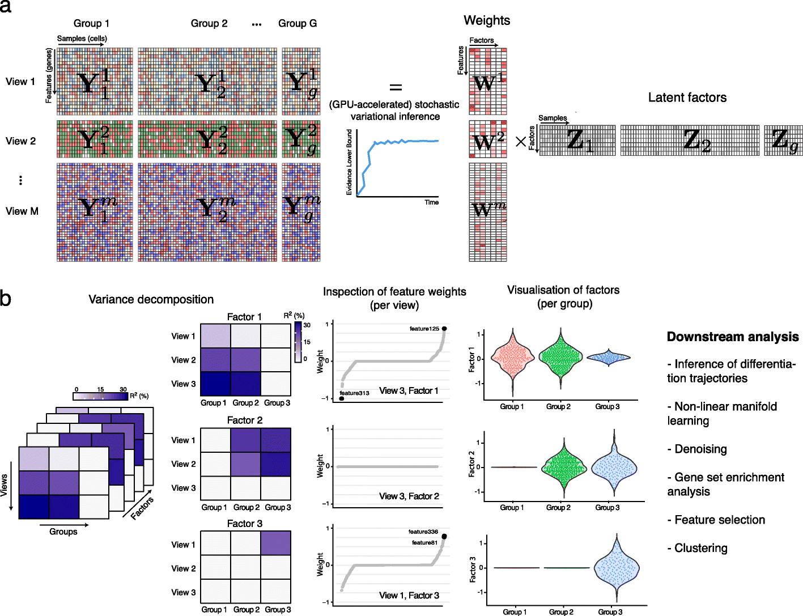

# MOFA+：哪些变化是多组学共享的，哪些只出现在一层？

[论文与方法](README.md) · [多模态多组学](../02_多模态多组学/README.md) · [方法对照](compare.md)

**MOFA+: a statistical framework for comprehensive integration of multi-modal single-cell data** 
Argelaguet R, Arnol D, Bredikhin D et al. · *Genome Biology* · 2020 
[论文与图表](https://doi.org/10.1186/s13059-020-02015-1) · [PubMed](https://pubmed.ncbi.nlm.nih.gov/32393329/) · [开放全文](https://europepmc.org/articles/PMC7212577)

MOFA+ 通过低维因子解释多组学中的变化，把样本得分与特征载荷放在同一框架下。它特别适合学习多视图、多组别与方差分解，并将统计结构连回具体特征。

## 先把问题放在桌上

| 项目 | 内容 |
| --- | --- |
| 输入 | 按样本组织的多个组学视图，可包含分组与缺失观测 |
| 输出 | 样本因子、各视图的特征载荷与解释方差 |
| 核心思路 | 多视图／多组别因子分解与变分推断 |

## 沿着方法读

### 1. 分开 view 和 group

view 表示测量层次或特征集合，group 表示样本组别。二者在矩阵结构中沿不同维度组织。

### 2. 看懂 Z 和 W 的分工

Z 描述样本在因子上的得分，W 描述各视图特征与因子的关联。矩阵乘积把低维状态连接回观测。

### 3. 用方差分解找共享与特有结构

查看一个因子在不同视图、组别中解释多少变化，再查看对应特征载荷。稀疏结构帮助识别与某些视图有关的因子。

## 找一张图，把关系看清楚

**原图署名：** Argelaguet R, Arnol D, Bredikhin D et al. (2020), Figure 1, *Genome Biology*。[论文与图注](https://doi.org/10.1186/s13059-020-02015-1) · [原尺寸图片](../assets/figures/mofa-fig1.png)。© The Author(s) 2020，按 [CC BY 4.0](https://creativecommons.org/licenses/by/4.0/) 复用，图片内容未改动。

Figure 1a 按组别排列样本、按视图排列特征，并展示 Y、W、Z 的关系；1b 从解释方差、特征权重和因子分布连接到后续分析。 [对照原文](https://doi.org/10.1186/s13059-020-02015-1)。

## 读结果时，留意这些信息

- 大方差因子与细胞状态、批次、文库大小等变量分别有什么关系？
- 解释某个因子时，是否结合了高载荷特征和相应的组学背景？
- 查看因子数、预处理与缺失模式变化后，主要结构是否稳定。

## 试着做一件小事

设 4 个样本、两个视图分别有 3 与 2 个特征，用 2 个因子表示。按“样本 × 特征”的约定写出 Z、两个 W 与重建矩阵的形状。

## 接着读，也接着写

**回到知识库：** [数学、统计与机器学习基础](../02_多模态多组学/04_数学_统计与机器学习基础/README.md) · [多模态整合、融合与预训练](../02_多模态多组学/06_多模态整合_融合与预训练/README.md) · [模型评价、实验设计与生物学解释](../02_多模态多组学/08_模型评价_实验设计与生物学解释/README.md)。

**相邻论文：** [totalVI](totalvi.md) · [GLUE](glue.md) · [组成型数据](compositionality.md) · [方法对照](compare.md)。

你也可以补一段解释、一个小例子，或指出尚未想清楚的地方。[分享笔记与问题](https://github.com/moshookee-ux/AINGS-study-group/issues/new?template=01_resource.yml) · [共建指南](../CONTRIBUTING.md)。
