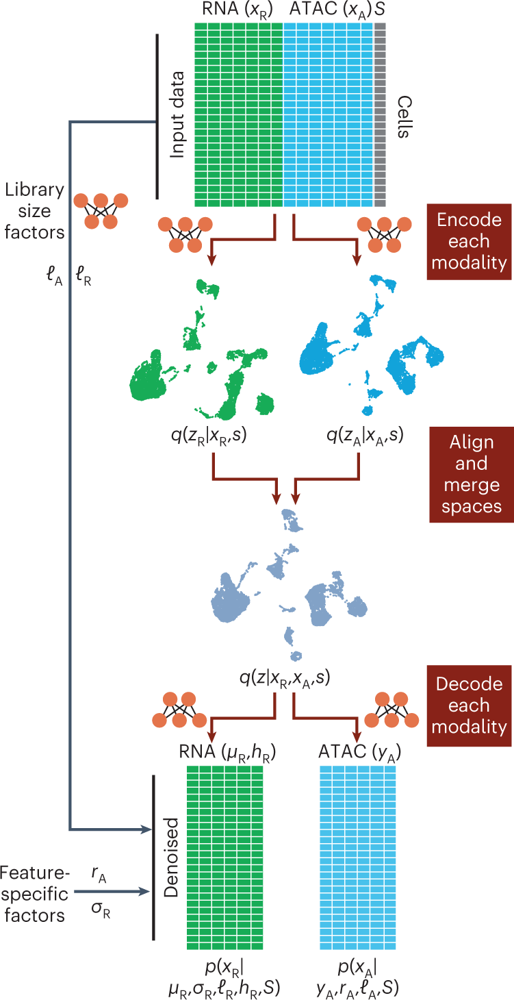

# MultiVI：配对与未配对数据怎样进入同一个模型？

[论文与方法](README.md) · [多模态多组学](../02_多模态多组学/README.md) · [方法对照](compare.md)

**MultiVI: deep generative model for the integration of multimodal data** 
Ashuach T, Gabitto MI, Koodli RV et al. · *Nature Methods* · 2023 
[论文与图表](https://doi.org/10.1038/s41592-023-01909-9) · [PubMed](https://pubmed.ncbi.nlm.nih.gov/37386189/) · [开放全文](https://europepmc.org/articles/PMC10406609)

一个研究可能同时拥有 RNA-only、ATAC-only 和 RNA＋ATAC 的细胞。MultiVI 为不同模态建立编码与生成过程，再利用可用观测形成联合表示，适合学习“有些细胞缺一种模态”的建模方式。

## 先把问题放在桌上

| 项目 | 内容 |
| --- | --- |
| 输入 | 配对和／或非配对的 RNA、ATAC 数据与批次信息 |
| 输出 | 联合细胞表示，以及未测模态的模型预测 |
| 核心思路 | 模态编码器、潜在空间对齐与合并、各自的观测似然 |

## 沿着方法读

### 1. 给每个细胞标观测状态

先列出哪些细胞拥有 RNA、ATAC 或两者。配对与非配对样本在模型中可使用的观测项不同。

### 2. 沿编码、合并、解码追踪

RNA 和 ATAC 分别编码，潜在表示经过对齐和组合，再由对应解码器重建各自观测。注意批次协变量和尺度因子的入口。

### 3. 分清两类观测分布

RNA 使用计数模型，ATAC 可及性采用相应的二元观测建模。损失应与实际观测及其分布对应，缺失项也应明确标记。

## 找一张图，把关系看清楚

**原图署名：** Ashuach T, Gabitto MI, Koodli RV et al. (2023), Figure 1, *Nature Methods*。[论文与图注](https://doi.org/10.1038/s41592-023-01909-9) · [原尺寸图片](../assets/figures/multivi-fig1.png)。© The Author(s) 2023，按 [CC BY 4.0](https://creativecommons.org/licenses/by/4.0/) 复用，图片内容未改动。

Figure 1 从上方输入矩阵向下依次画出分别编码、潜在空间合并和分别解码。左侧的文库大小与特征参数帮助解释：共享空间之外，模态仍保留自己的观测机制。 [对照原文](https://doi.org/10.1038/s41592-023-01909-9)。

## 读结果时，留意这些信息

- 人为拆开配对细胞的实验，与实际独立采集的数据各能检查什么？
- 缺失比例、细胞群组成及批次是否改变预测与整合效果？
- 评价补全时只在有真实测量的留出对象上计算误差，同时查看不同细胞群和特征。

## 试着做一件小事

画一个 6 行 × 2 列的观测表：2 个细胞双模态、2 个仅 RNA、2 个仅 ATAC。分别标出每类细胞有哪些真实重建项，哪些输出属于对未测模态的预测。

## 接着读，也接着写

**回到知识库：** [测量技术与多组学数据结构](../02_多模态多组学/02_测量技术与多组学数据结构/README.md) · [神经网络、Transformer与生物表示](../02_多模态多组学/05_神经网络_Transformer与生物表示/README.md) · [多模态整合、融合与预训练](../02_多模态多组学/06_多模态整合_融合与预训练/README.md) · [模型评价、实验设计与生物学解释](../02_多模态多组学/08_模型评价_实验设计与生物学解释/README.md)。

**相邻论文：** [totalVI](totalvi.md) · [scVAEIT](scvaeit.md) · [GLUE](glue.md) · [方法对照](compare.md)。

你也可以补一段解释、一个小例子，或指出尚未想清楚的地方。[分享笔记与问题](https://github.com/moshookee-ux/AINGS-study-group/issues/new?template=01_resource.yml) · [共建指南](../CONTRIBUTING.md)。
