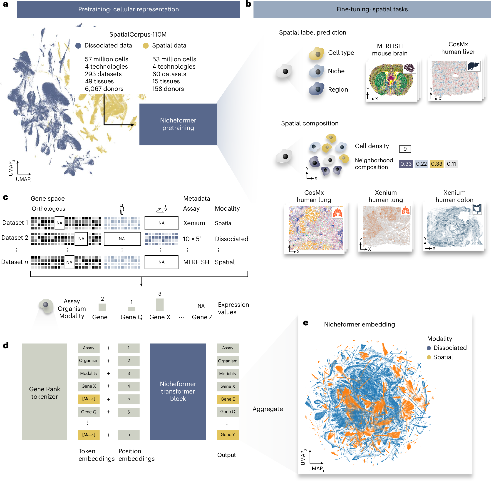

# Nicheformer：空间图谱中的信息，怎样迁移到解离细胞

[研究画廊](README.md) · [全部文献](catalog.md) · [方法对照](compare.md)

**Nicheformer: a foundation model for single-cell and spatial omics** 
Tejada-Lapuerta A, Schaar AC, Gutgesell R et al. · *Nature Methods* · 2025 
[原文与图表](https://doi.org/10.1038/s41592-025-02814-z) · [PubMed](https://pubmed.ncbi.nlm.nih.gov/41168487/)

Nicheformer 在解离单细胞与空间转录组上预训练，通过基因词元和样本协变量组织跨技术数据，再适配空间区域、生态位与邻域组成等任务。

| 输入／研究起点 | 输出／研究目标 |
| --- | --- |
| 单细胞表达、技术与物种等信息；空间任务所需的标注 | 细胞表示与空间相关任务预测 |

## 方法中的关键连接

### 不同技术进入同一语料

SpatialCorpus-110M 汇集解离与空间细胞。各技术的基因覆盖、采样区域与读出方式，是理解语料的重要背景。

### 基因秩与协变量进入词元化

模型将表达谱和技术、模态等元信息编码，再用掩码目标学习。先读输入接口，再看共享表示。

### 空间知识通过具体任务迁移

区域、生态位和邻域组成是不同的目标。比较新组织或解离数据时，记录每项任务得到的监督和适配方式。

## 对照论文的图

Tejada-Lapuerta A, Schaar AC, Gutgesell R et al.，Fig. 1，*Nature Methods*。[原文图注](https://doi.org/10.1038/s41592-025-02814-z) · [打开原尺寸图片](../assets/figures/nicheformer-fig1.png)。© The Author(s) 2025；[CC BY 4.0](https://creativecommons.org/licenses/by/4.0/)，图片完整保留。

## 沿着 Figure 1 读

| 分面 | 读图线索 |
| --- | --- |
| a：预训练语料 | 先看解离与空间技术的来源；图中的 UMAP 展示语料的一个抽样。 |
| b：空间任务 | 区域、生态位、邻域密度与组成具有不同的目标和标注。 |
| c：统一输入 | 对齐基因身份，并保留物种、模态、assay 等元信息。 |
| d：词元与模型 | 从基因秩和协变量进入 Transformer，以遮蔽目标预训练，再汇聚为细胞表示。 |
| e：预训练表示 | 与 a 对照输入和表示空间，同时回到实际下游任务看效果。 |

“在空间数据上学习”和“把空间坐标直接作为输入”需要分别查清。这里沿图 d 的实际输入接口读模型，再沿图 b 理解空间信息对应的预测目标。

## 对照自己的研究问题

- 分清细胞类型预测与空间邻域预测的评价单位。
- 新数据的组织、物种和基因面板与预训练语料有何关系？

## 可以动手做什么

为两个表达相近但邻居不同的细胞画出邻域。写出仅靠细胞表达可以利用的信息，以及训练空间预测还需要哪些标注。

## 继续阅读

[scGPT](scgpt.md) · [scFoundation](scfoundation.md) · [MFM Perspective](mfm.md)

**相关知识：** [测量技术与多组学数据结构](../02_多模态多组学/02_测量技术与多组学数据结构/README.md) · [多模态整合、融合与预训练](../02_多模态多组学/06_多模态整合_融合与预训练/README.md) · [空间、序列、调控与实验闭环](../02_多模态多组学/09_空间_序列_调控与实验闭环/README.md)。

[补充这篇导读](https://github.com/moshookee-ux/AINGS-study-group/issues/new?template=02_content.yml) · [一起贡献](../CONTRIBUTING.md)
