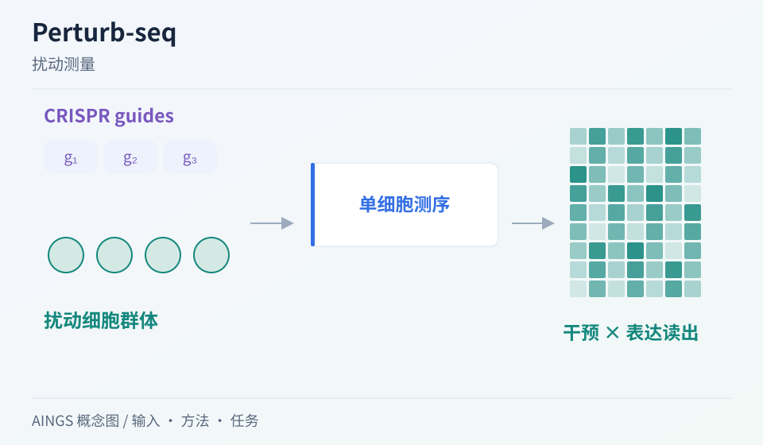

# Perturb-seq：怎样把基因干预与单细胞表型接起来

[研究画廊](README.md) · [全部文献](catalog.md) · [方法对照](compare.md)

**Perturb-Seq: Dissecting Molecular Circuits with Scalable Single-Cell RNA Profiling of Pooled Genetic Screens** 
Dixit A, Parnas O, Li B et al. · *Cell* · 2016 
[原文与图表](https://doi.org/10.1016/j.cell.2016.11.038) · [PubMed](https://pubmed.ncbi.nlm.nih.gov/27984732/)

Perturb-seq 把 CRISPR 干预与单细胞 RNA 读出结合，在混合实验中连接“施加了什么改变”和“细胞怎样响应”。这是理解许多计算扰动模型所需数据的起点。

| 输入／研究起点 | 输出／研究目标 |
| --- | --- |
| 混合 CRISPR 扰动实验与单细胞测序 | 细胞的干预身份、转录组与相关元数据 |

## 方法中的关键连接

### 干预身份如何回到细胞

实验设计需要让测到的表达谱能对应其扰动条件，才能比较不同干预后的细胞。

### 高维表型提供多种观察

转录组读出可以组织基因签名、细胞状态和干预相互作用，超出单个标记的变化。

### 统计分析保留实验结构

干预效率、对照、细胞状态与重复都会影响响应解释，也会影响后续模型的训练目标。

## 把结构画出来

AINGS 方法概念图。图示整理输入、计算与输出的关系；详细结构与实验结果见[原文](https://doi.org/10.1016/j.cell.2016.11.038)。

## 对照自己的研究问题

- 检查 guide、目标基因和细胞之间的对应关系与质量。
- 区分细胞数量、独立重复与不同干预条件的数量。

## 可以动手做什么

建立一个小表：细胞 ID、guide、目标基因、对照／处理、供体、表达读出。指出哪些列决定任务标签，哪些列决定数据划分。

## 继续阅读

[GEARS](gears.md) · [CITE-seq](cite-seq.md) · [MFM Perspective](mfm.md)

**相关知识：** [测量技术与多组学数据结构](../02_多模态多组学/02_测量技术与多组学数据结构/README.md) · [模型评价、实验设计与生物学解释](../02_多模态多组学/08_模型评价_实验设计与生物学解释/README.md) · [空间、序列、调控与实验闭环](../02_多模态多组学/09_空间_序列_调控与实验闭环/README.md)。

[补充这篇导读](https://github.com/moshookee-ux/AINGS-study-group/issues/new?template=02_content.yml) · [一起贡献](../CONTRIBUTING.md)
