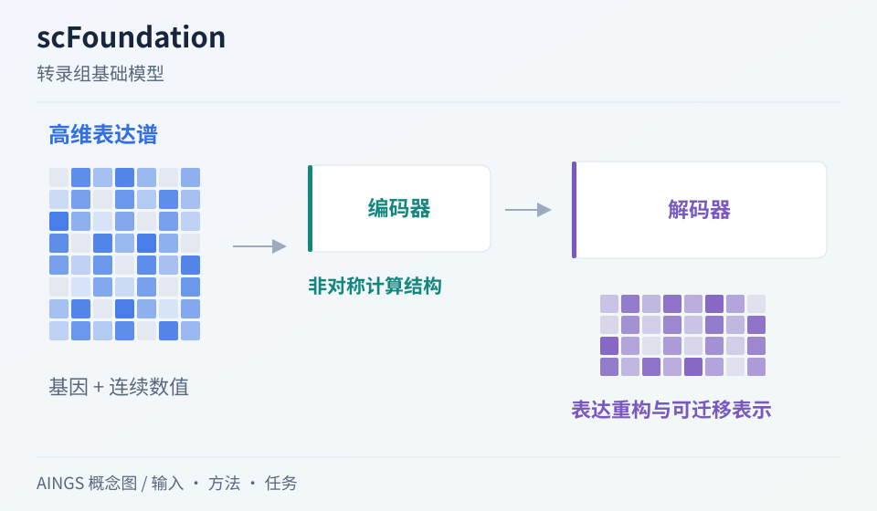

# scFoundation：大规模表达模型怎样形成可复用的细胞表示

[研究画廊](README.md) · [全部文献](catalog.md) · [方法对照](compare.md)

**Large-scale foundation model on single-cell transcriptomics** 
Hao M, Gong J, Zeng X et al. · *Nature Methods* · 2024 
[原文与图表](https://doi.org/10.1038/s41592-024-02305-7) · [PubMed](https://pubmed.ncbi.nlm.nih.gov/38844628/)

scFoundation 使用非对称 Transformer 式结构，在超过五千万个人类单细胞转录组上预训练。它把较广的基因覆盖与预训练任务设计放在一起，研究表达增强、细胞注释、药物与扰动相关任务。

| 输入／研究起点 | 输出／研究目标 |
| --- | --- |
| 基因表达谱与模型要求的基因、数值接口 | 细胞／基因表示与适配后的任务输出 |

## 方法中的关键连接

### 先对齐基因空间

模型覆盖约两万个基因。使用模型时，需要确认基因身份、缺失特征与数值处理如何进入输入；[官方模型说明](https://github.com/biomap-research/scFoundation/blob/main/model/README.md)还区分细胞／基因表示输出，以及源测序深度 S 与目标深度 T 的设置。

### 非对称结构分配计算

论文采用非对称 Transformer 式架构组织编码与重构。阅读时跟踪哪些特征参与编码，以及如何恢复完整目标。

### 一个预训练模型进入多种任务

表达增强、药物响应和细胞分类使用不同目标。把表示提取、任务适配与最终评价分别写下。

## 把结构画出来

AINGS 方法概念图。图示整理输入、计算与输出的关系；详细结构与实验结果见[原文](https://doi.org/10.1038/s41592-024-02305-7)。

## 对照自己的研究问题

- 比较基线时对齐基因集合、训练数据与适配预算。
- 查看结果是否在不同数据来源、细胞类型和任务划分中保持一致。

## 可以动手做什么

选择细胞注释与表达补全两个任务，为它们分别写出输入、监督、输出形状和指标。标出哪些部分可以共享。

## 继续阅读

[Geneformer](geneformer.md) · [scGPT](scgpt.md) · [CAPTAIN](captain.md)

**相关知识：** [神经网络、Transformer与生物表示](../02_多模态多组学/05_神经网络_Transformer与生物表示/README.md) · [多模态整合、融合与预训练](../02_多模态多组学/06_多模态整合_融合与预训练/README.md) · [下游任务、迁移与预测方法](../02_多模态多组学/07_下游任务_迁移与预测方法/README.md)。

[补充这篇导读](https://github.com/moshookee-ux/AINGS-study-group/issues/new?template=02_content.yml) · [一起贡献](../CONTRIBUTING.md)
