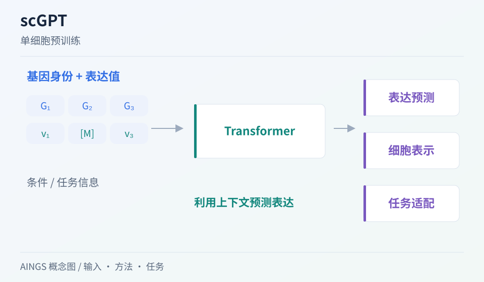

# scGPT：预训练的细胞表示，怎样接到具体分析任务？

[研究画廊](README.md) · [多模态多组学](../02_多模态多组学/README.md) · [方法对照](compare.md)

**scGPT: toward building a foundation model for single-cell multi-omics using generative AI** 
Cui H, Wang C, Maan H et al. · *Nature Methods* · 2024 
[论文与图表](https://doi.org/10.1038/s41592-024-02201-0) · [PubMed](https://pubmed.ncbi.nlm.nih.gov/38409223/) · [作者代码](https://github.com/bowang-lab/scGPT)

scGPT 将基因身份与表达信息放进生成式预训练框架，并探索细胞注释、整合和扰动预测等用途。读这篇论文时，最有帮助的是把预训练、任务适配和评价设置逐一对应。

AINGS 概念图，沿输入、方法与任务整理阅读线索。

## 先把问题放在桌上

| 项目 | 内容 |
| --- | --- |
| 输入 | 基因身份、表达值与任务相关输入 |
| 输出 | 基因／细胞表示，以及适配任务后的预测 |
| 核心思路 | 大规模单细胞数据上的生成式 Transformer 预训练与任务迁移 |

## 沿着方法读

### 1. 先检查输入接口

基因词表、表达数值处理及序列组织方式决定模型实际看到什么。使用已有模型时，要先对齐基因身份和所需的数据格式。

### 2. 把训练阶段分别写清楚

论文使用超过三千万细胞开展预训练，并探索多种任务。每个结果需要对应预训练模型、后续数据、更新的参数以及任务目标。

### 3. 按任务阅读图与结果

细胞注释、扰动预测和多组学整合使用不同的输出与评价。逐一检查输入、监督信息、比较方法和测试划分，才能理解迁移的作用。

## 找一张图，把关系看清楚

原文 Figure 1 概括模型；Figure 2、3 分别对应细胞注释与扰动预测，Figure 4 展示批次与多组学整合。可以挑一个与自己问题最接近的任务深入读。 [对照原文](https://doi.org/10.1038/s41592-024-02201-0)。

## 读结果时，留意这些信息

- 测试对象是否与预训练、适配数据有重叠，或存在近似样本？
- 结果来自直接使用表示、冻结编码器，还是任务微调？
- 与使用相同输入的基线相比，改进发生在哪些细胞群、基因或任务条件下？

## 试着做一件小事

为一个细胞注释任务做四栏记录：输入特征、使用的标签、更新的参数、留出的供体。分别写下冻结表示与完整微调两种方案。

## 接着读，也接着写

**回到知识库：** [神经网络、Transformer与生物表示](../02_多模态多组学/05_神经网络_Transformer与生物表示/README.md) · [多模态整合、融合与预训练](../02_多模态多组学/06_多模态整合_融合与预训练/README.md) · [下游任务、迁移与预测方法](../02_多模态多组学/07_下游任务_迁移与预测方法/README.md) · [模型评价、实验设计与生物学解释](../02_多模态多组学/08_模型评价_实验设计与生物学解释/README.md)。

**相邻论文：** [BERTax](bertax.md) · [scVAEIT](scvaeit.md) · [scIB](scib.md) · [方法对照](compare.md)。

你也可以补一段解释、一个小例子，或指出尚未想清楚的地方。[分享笔记与问题](https://github.com/moshookee-ux/AINGS-study-group/issues/new?template=01_resource.yml) · [共建指南](../CONTRIBUTING.md)。
