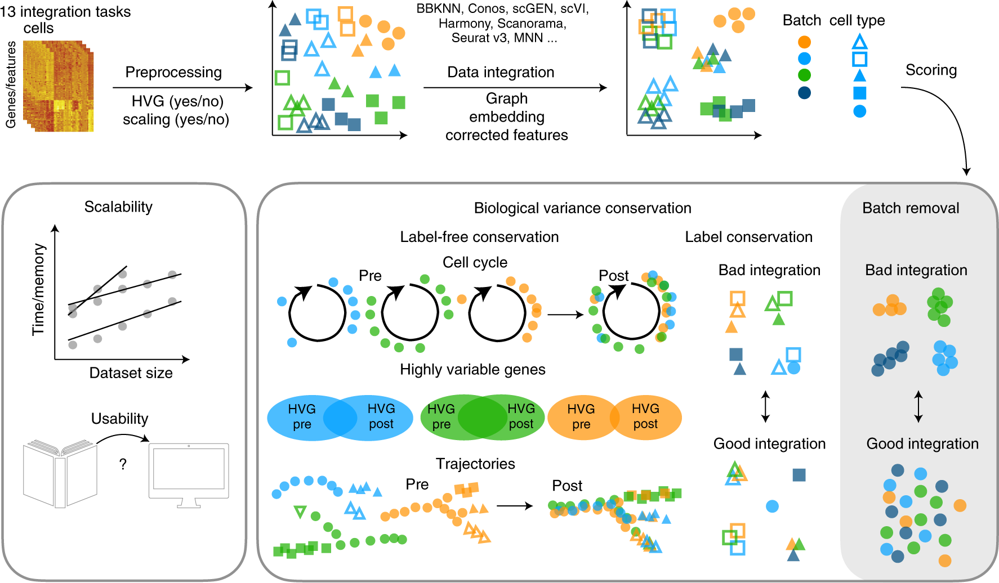

# scIB：怎样同时检查批次混合与生物结构保留？

[论文与方法](README.md) · [多模态多组学](../02_多模态多组学/README.md) · [方法对照](compare.md)

**Benchmarking atlas-level data integration in single-cell genomics** 
Luecken MD, Büttner M, Chaichoompu K et al. · *Nature Methods* · 2022 
[论文与图表](https://doi.org/10.1038/s41592-021-01336-8) · [PubMed](https://pubmed.ncbi.nlm.nih.gov/34949812/) · [开放全文](https://europepmc.org/articles/PMC8748196)

整合后的图看起来混在一起，仍需要问细胞类型、连续状态与其他生物信息保留了多少。scIB 的基准研究把数据任务、预处理、整合输出和多类评价放到一个比较框架中。

## 先把问题放在桌上

| 项目 | 内容 |
| --- | --- |
| 输入 | 多个整合任务、方法与预处理组合，以及相应评价信息 |
| 输出 | 批次去除、生物结构保留、资源与可用性等评价 |
| 核心思路 | 按不同目标组织指标，并在多个数据任务中比较 |

## 沿着方法读

### 1. 先读任务和输出类型

论文比较的方法可能输出图、低维表示或校正后的特征。指标需要能够作用于对应输出，才能形成可解释的比较。

### 2. 把两类目标放在一起

理想整合让可比较的细胞跨批次靠近，同时保留细胞类型及状态等结构。过度混合也可能抹掉真实差异。

### 3. 把预处理纳入方法比较

高变基因选择、缩放等设置会改变结果。论文比较方法与预处理组合，提醒读者记录完整处理路径。

## 找一张图，把关系看清楚

**原图署名：** Luecken MD, Büttner M, Chaichoompu K et al. (2022), Figure 1, *Nature Methods*。[论文与图注](https://doi.org/10.1038/s41592-021-01336-8) · [原尺寸图片](../assets/figures/scib-fig1.png)。© The Author(s) 2021，按 [CC BY 4.0](https://creativecommons.org/licenses/by/4.0/) 复用，图片内容未改动。

Figure 1 上半部从输入、预处理到整合与评分；下半部分开可扩展性、生物变异保留和批次去除。图中颜色表示批次、形状表示细胞类型，先读图例再比较“好”与“坏”。 [对照原文](https://doi.org/10.1038/s41592-021-01336-8)。

## 读结果时，留意这些信息

- 哪些指标需要细胞标签，标签是否独立于正在比较的整合结果？
- 总分怎样聚合不同指标，换权重后方法排序是否变化？
- 同一方法在不同组织、技术与细胞组成下是否表现一致，资源成本又是多少？

## 试着做一件小事

画四种整合结果：批次分开／混合 × 类型保留／混杂。给每种结果写一句评价，再说明只看一张 UMAP 或单一批次指标会漏掉什么。

## 接着读，也接着写

**回到知识库：** [质量控制、预处理与数据表示](../02_多模态多组学/03_质量控制_预处理与数据表示/README.md) · [下游任务、迁移与预测方法](../02_多模态多组学/07_下游任务_迁移与预测方法/README.md) · [模型评价、实验设计与生物学解释](../02_多模态多组学/08_模型评价_实验设计与生物学解释/README.md)。

**相邻论文：** [WNN](wnn.md) · [GLUE](glue.md) · [scGPT](scgpt.md) · [方法对照](compare.md)。

你也可以补一段解释、一个小例子，或指出尚未想清楚的地方。[分享笔记与问题](https://github.com/moshookee-ux/AINGS-study-group/issues/new?template=01_resource.yml) · [共建指南](../CONTRIBUTING.md)。
