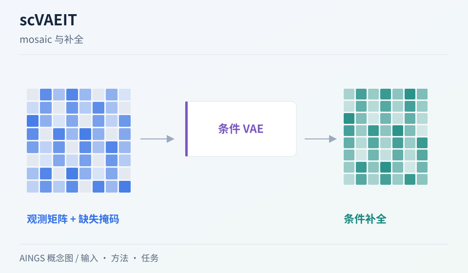

# scVAEIT：缺整种模态和缺一部分特征，怎样统一表示？

[研究画廊](README.md) · [多模态多组学](../02_多模态多组学/README.md) · [方法对照](compare.md)

**Robust probabilistic modeling for single-cell multimodal mosaic integration and imputation via scVAEIT** 
Du JH, Cai Z, Roeder K. · *PNAS* · 2022 
[论文与图表](https://doi.org/10.1073/pnas.2214414119) · [PubMed](https://pubmed.ncbi.nlm.nih.gov/36459654/) · [开放全文](https://europepmc.org/articles/PMC9894175)

不同批次可能测了不同抗体面板，也可能只测了某一类组学。scVAEIT 用显式缺失掩码组织这种 mosaic 数据，并通过条件概率模型学习从可用信息预测目标特征。

AINGS 概念图，沿输入、方法与任务整理阅读线索。

## 先把问题放在桌上

| 项目 | 内容 |
| --- | --- |
| 输入 | 多模态观测、真实缺失掩码与相关协变量 |
| 输出 | 联合表示与给定可用观测时的补全预测 |
| 核心思路 | 以缺失模式为条件的 VAE，训练中加入随机遮挡 |

## 沿着方法读

### 1. 掩码也是输入的一部分

掩码说明哪些特征真正被测量。真实缺失、观测为零和训练时临时遮挡，需要分别理解。

### 2. 随机遮挡教模型做什么

训练时隐藏一部分已知观测，让模型学习利用剩余信息预测目标。遮挡方案决定训练覆盖了哪些预测情景。

### 3. 从条件预测理解补全

模型输出依赖当前可用特征与学到的相关结构。换抗体面板、细胞群或模态组合，都可能改变预测依据。

## 找一张图，把关系看清楚

原文 Figure 1 展示不同模态与面板形成的 mosaic 输入，以及掩码怎样进入模型。先为每块矩阵标注“已测／未测”，再沿模型看训练遮挡的位置。 [对照原文](https://doi.org/10.1073/pnas.2214414119)。

## 读结果时，留意这些信息

- 实验中留出的到底是特征、细胞、供体，还是未见细胞类型？
- 随机模拟的缺失方式与目标应用中的实际缺失方式有多接近？
- 补全质量是否在不同特征、细胞群和供体上分别报告？

## 试着做一件小事

给同一细胞写出 5 个特征：两个实测正值、一个实测零、两个未测。设计数值向量与掩码，再临时隐藏一个正值，标出训练目标。

## 接着读，也接着写

**回到知识库：** [测量技术与多组学数据结构](../02_多模态多组学/02_测量技术与多组学数据结构/README.md) · [神经网络、Transformer与生物表示](../02_多模态多组学/05_神经网络_Transformer与生物表示/README.md) · [多模态整合、融合与预训练](../02_多模态多组学/06_多模态整合_融合与预训练/README.md) · [模型评价、实验设计与生物学解释](../02_多模态多组学/08_模型评价_实验设计与生物学解释/README.md)。

**相邻论文：** [MultiVI](multivi.md) · [totalVI](totalvi.md) · [scGPT](scgpt.md) · [方法对照](compare.md)。

你也可以补一段解释、一个小例子，或指出尚未想清楚的地方。[分享笔记与问题](https://github.com/moshookee-ux/AINGS-study-group/issues/new?template=01_resource.yml) · [共建指南](../CONTRIBUTING.md)。
