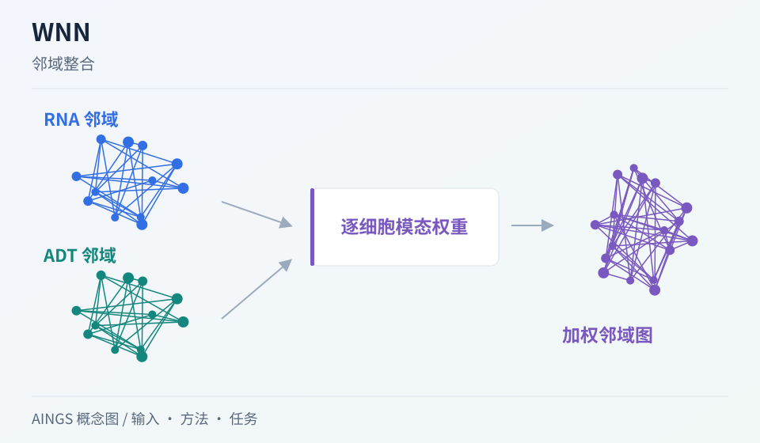

# WNN：每个细胞都应该使用相同的模态权重吗？

[研究画廊](README.md) · [多模态多组学](../02_多模态多组学/README.md) · [方法对照](compare.md)

**Integrated analysis of multimodal single-cell data** 
Hao Y, Hao S, Andersen-Nissen E et al. · *Cell* · 2021 
[论文与图表](https://doi.org/10.1016/j.cell.2021.04.048) · [PubMed](https://pubmed.ncbi.nlm.nih.gov/34062119/) · [开放全文](https://europepmc.org/articles/PMC8238499)

不同细胞中的 RNA 与蛋白可能提供不同程度的区分信息。WNN 从每个细胞的邻域出发学习模态权重，再构建加权近邻图，适合把“融合”理解为局部信息的组合。

AINGS 概念图，沿输入、方法与任务整理阅读线索。

## 先把问题放在桌上

| 项目 | 内容 |
| --- | --- |
| 输入 | 同一细胞集合的多模态低维表示 |
| 输出 | 每个细胞的模态权重与加权近邻图 |
| 核心思路 | 比较模态内及跨模态的邻域预测，再组合邻接关系 |

## 沿着方法读

### 1. 先分别建立表示

各模态按自己的数据特点预处理与降维。WNN 接收到的距离与邻域，已受到前面这些选择的影响。

### 2. 用邻域预测理解权重

作者比较一个模态中的邻居能否重建该细胞的信息，也考察另一模态的邻居。由此衡量不同模态在该细胞周围的相对作用。

### 3. 从局部权重到联合图

每个细胞可以拥有不同权重，最终用于组织多模态邻域。联合图可进一步用于聚类和可视化。

## 找一张图，把关系看清楚

原文 Figure 1 展示同一目标细胞在 RNA 与蛋白空间中的邻居，以及模态内、跨模态预测。沿着这几组邻居读，比先记算法缩写更容易理解权重的来源。 [对照原文](https://doi.org/10.1016/j.cell.2021.04.048)。

## 读结果时，留意这些信息

- 哪些细胞群更依赖 RNA，哪些更依赖蛋白？检查这与标记信号是否一致。
- 比较单模态与联合图，记录新增信息改善了什么具体区分。
- 聚类与 UMAP 的变化需要结合标签、标记和邻域结构一起解释。

## 试着做一件小事

假设细胞 A 在 RNA 中邻居很一致，在蛋白中邻居混杂；细胞 B 则相反。画两张局部邻域图，说明为什么全局固定权重可能不适合两者。

## 接着读，也接着写

**回到知识库：** [质量控制、预处理与数据表示](../02_多模态多组学/03_质量控制_预处理与数据表示/README.md) · [神经网络、Transformer与生物表示](../02_多模态多组学/05_神经网络_Transformer与生物表示/README.md) · [多模态整合、融合与预训练](../02_多模态多组学/06_多模态整合_融合与预训练/README.md) · [模型评价、实验设计与生物学解释](../02_多模态多组学/08_模型评价_实验设计与生物学解释/README.md)。

**相邻论文：** [CITE-seq](cite-seq.md) · [totalVI](totalvi.md) · [scIB](scib.md) · [方法对照](compare.md)。

你也可以补一段解释、一个小例子，或指出尚未想清楚的地方。[分享笔记与问题](https://github.com/moshookee-ux/AINGS-study-group/issues/new?template=01_resource.yml) · [共建指南](../CONTRIBUTING.md)。
