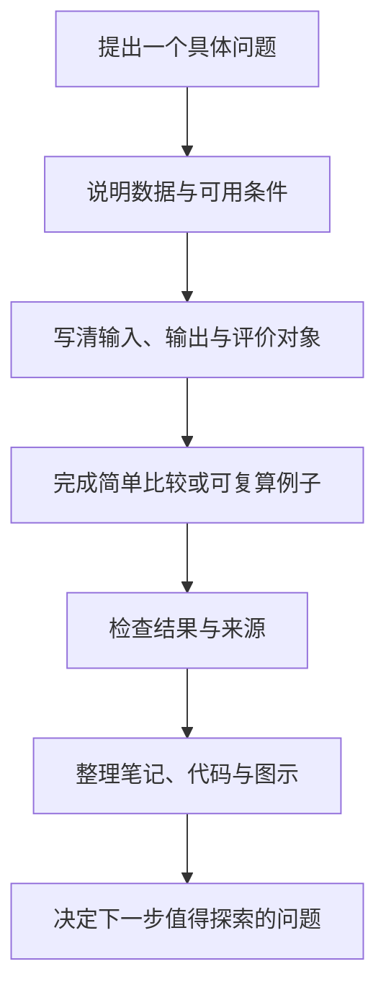

# 实践与合作

[返回统一入口](../README.md) · [项目想法模板](project-proposal-template.md) · [学习记录](../weekly_notes_template.md)

这里收集可以从一次讨论、一个小算例逐步展开的实践方向。下面是供成员认领的建议，尚未安排负责人或形成已完成成果。

## 从一个可以完成的问题开始

初次实践可以只做图示或小计算。需要数据时，先选有明确来源和使用条件的公开材料，并记录版本与处理方式。

## 路线 A：检验医学与病原生信

| 选题 | 可以从哪里开始 | 第一份成果 |
| --- | --- | --- |
| 从样本到报告 | 选一种样本，按原有模块梳理采样、检测、数据与解释 | 一张流程图，标明每一步提供的证据 |
| 物种判断的证据地图 | 选择一篇公开论文，对照 reads、组装、参考比较与系统发育 | 一份证据表，区分分类结果与未知类群候选 |
| 耐药任务拆解 | 读一篇 ARG 或表型预测论文，分别记录序列证据、归属、机制与表型 | 一张输入输出卡与论文比较表 |
| 方法比较怎么设计 | 围绕一个明确的序列分类任务，整理传统方法与学习方法的信息条件 | 数据划分、基线、指标、未知类群处理的实验草案 |

## 路线 B：多模态多组学

| 选题 | 可以从哪里开始 | 第一份成果 |
| --- | --- | --- |
| 双模态细胞分类复算 | 运行[知识库第 10 章独立脚本](../examples/multiomics_toy/README.md) | 手算与程序结果对照，解释 ATAC 缺失后发生什么 |
| 数据对象与缺失地图 | 为一份公开 RNA＋ADT 或 RNA＋ATAC 教程数据整理字段 | 对象、特征、配对、掩码、供体与批次的数据说明 |
| 从简单融合开始 | 选择一个明确任务，比较单模态与拼接特征的基础方法 | 相同划分与目标下的比较表及分组表现 |
| 方法结构阅读 | 从 WNN、totalVI、MultiVI、GLUE、scVAEIT、scGPT 中选一个 | 输入、表示、目标、输出和适用数据关系的图 |

## 两条路线可以一起讨论的主题

- **相对丰度与归一化：**用两个小数值例子，比较 mNGS 丰度和单细胞总量归一化中分母的作用。
- **数据划分与任务：**比较按细胞、样本、供体或菌株划分时，测试问题如何改变。
- **从序列到表示：**把 k-mer 与生物词元放在一起，说明表示单位、顺序和输出怎样确定。
- **模型输出与证据：**分别用一篇病原生信论文和一篇多组学论文，讨论预测、校准和生物解释各自需要什么依据。
- **AI 辅助论文阅读：**选择公开论文，核对 AI 对方法、图表和术语的解释，整理可复用的阅读步骤与具体错误案例。

## 如何发起合作

在群里或本仓库 Issue 中写清问题、已有材料、希望尝试的第一步，以及希望认识什么背景的伙伴。成员自愿认领后，再商定时间、分工和记录位置。

项目规模可以从一次分享扩大到几周的小专题。每轮留下能被他人理解的成果，再根据数据、时间和共同兴趣决定是否继续。
