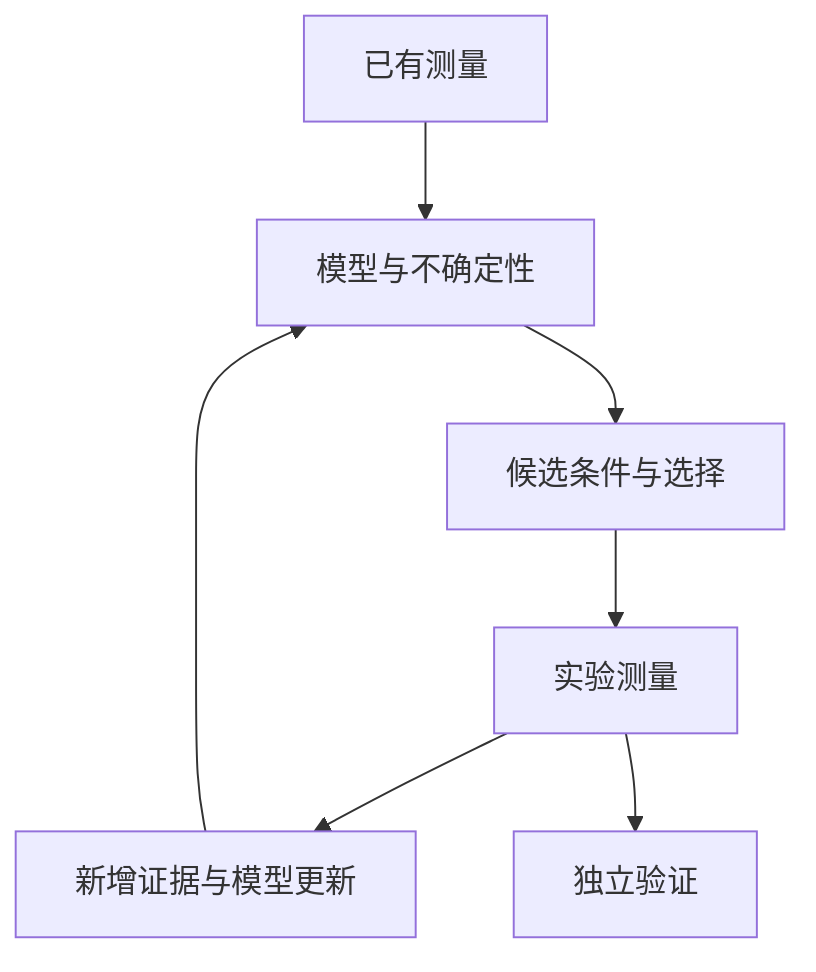

# 多模态多组学知识库

从生物对象和实验测量开始，逐步理解数据表示、机器学习、多模态建模、迁移与评价。主线围绕四个问题展开：测到了什么，模型怎样计算，用什么目标学习，结果支持什么判断。

正文中的概念、符号和计算过程按学习顺序展开，关键环节配有可以跟算的例子。第 10 章把前面的知识串成一个完整分析流程，给出全部数据、手算过程和可直接运行的 Python 代码。各章自检附有答案；公开参考资料用于来源核对和进一步阅读。

## 学习主线

第一至三章建立“生物对象—实验测量—数值尺度”的联系；第四章统一数学、统计与机器学习语言；第五至七章从神经网络走到融合、预训练和任务迁移；第八章解释如何检验结果；第九章连接空间、分子序列、调控与实验设计。随后用完整算例贯通计算过程，再按方法和术语查阅具体知识。

| 章节 | 读完能够解释的问题 |
| --- | --- |
| [一、生物学层次与研究对象](#一生物学层次与研究对象) | RNA、蛋白、染色质、细胞类型和组织组成怎样联系 |
| [二、测量技术与多组学数据结构](#二测量技术与多组学数据结构) | read、UMI 和实验信号怎样形成有坐标、有缺失状态的矩阵 |
| [三、质量控制、预处理与数据表示](#三质量控制预处理与数据表示) | 质控、log、HVG、TF-IDF、CLR 分别改变了什么 |
| [四、数学、统计与机器学习基础](#四数学统计与机器学习基础) | 矩阵、概率、损失与梯度怎样共同描述一次学习 |
| [五、神经网络、Transformer 与生物表示](#五神经网络transformer-与生物表示) | VAE、注意力、Transformer、图和计算效率组件怎样工作 |
| [六、多模态整合、融合与预训练](#六多模态整合融合与预训练) | 配对条件怎样决定对齐、融合、重建和对比目标 |
| [七、下游任务、迁移与预测方法](#七下游任务迁移与预测方法) | 预训练参数怎样接到新任务，如何适配与组合预测 |
| [八、模型评价、实验设计与生物学解释](#八模型评价实验设计与生物学解释) | 划分、指标、重复、校准和统计证据怎样支持结论 |
| [九、空间、序列、调控与实验闭环](#九空间序列调控与实验闭环) | 空间、序列、调控、知识和实验选择怎样接入共同框架 |
| [十、完整算例：从双模态计数到新供体的细胞分类](#十完整算例从双模态计数到新供体的细胞分类) | 怎样从给定计数一路复算到分类概率与评价 |
| [十一、代表方法与数据工具怎样对应前面的知识](#十一代表方法与数据工具怎样对应前面的知识) | 常见方法、数据容器和分析工具各自负责哪一段计算 |
| [十二、符号与术语索引](#十二符号与术语索引) | 怎样快速定位常用符号、英文术语和相关解释 |
| [十三、参考资料](#十三参考资料) | 本文使用的公开原始研究、教材与官方文档 |

### 一条贯穿全文的数据流

同一细胞的 RNA 和 ATAC 首先需要通过细胞标识建立对应，基因与区域则各自保留特征身份。数值经过适当处理后，模型把它们转换为向量；融合决定两种信息怎样相互作用，训练目标规定模型要保留什么，预测头把表示转换成标签或分子值。最后，按照实际使用时的新对象条件划分数据，用相应指标检验结果。

在这条数据流中，测量值、模型表示和生物解释属于相连的三个层次。每一章都明确当前处理的对象、计算轴和可用信息，再把结果交给下一步。

## 一、生物学层次与研究对象

多模态多组学研究从一个问题出发：同一个生物系统，在不同测量方式下呈现的变化怎样联系起来？理解这个问题，需要先分清三个层次：**生物对象是什么、实验实际测到了什么、模型收到的数字代表什么**。本章建立生物对象，[第 2 章](#二测量技术与多组学数据结构)解释测量，[第 3 章](#三质量控制预处理与数据表示)把测量连接到可分析的数据。

### 1.1 从细胞、DNA 和基因开始

细胞是具有自身结构和生化活动的生命单位。以人的有核细胞为例，细胞核保存了大部分遗传信息，细胞质中进行蛋白质合成等活动，细胞膜参与物质交换和信号接收。组织由多类细胞及其周围环境组成，例如同一组织中可以同时出现上皮细胞、免疫细胞和基质细胞。研究一个组织时，测量可能同时受到细胞内部状态和细胞组成的影响。

**DNA** 是由核苷酸组成的分子，常用 A、C、G、T 四种字母记录其碱基序列。序列表示碱基沿分子的排列顺序。**基因组**是一个生物体的整套遗传物质；**基因**可以先理解为参与产生功能性 RNA 或蛋白质产物的一段遗传信息。蛋白编码基因通过 RNA 中间过程参与蛋白质合成，非编码 RNA 基因产生具有其他功能的 RNA。[BIO1](https://www.genome.gov/genetics-glossary/Gene)

**基因名称、基因位置、基因表达量是三个不同的信息。**基因名称回答“讨论哪个对象”；基因位置回答“它在参考基因组的哪里”；表达量描述某种条件下观测到的 RNA 丰度。后面数据矩阵中的列名通常承担身份标识，矩阵中的数字承担测量值，二者需要一起保存。

同一个人的许多细胞具有基本相同的基因组，却可以形成不同的细胞类型。其关键原因之一是不同细胞使用了不同的基因表达程序。遗传变异、拷贝数变化和其他基因组差异也会影响细胞行为，因此“基因组相近”与“细胞状态相同”需要分别理解。

### 1.2 转录、转录本、翻译与蛋白质

**转录（transcription）**是以 DNA 的信息为依据合成 RNA 的过程。**转录本（transcript）**指由转录及相关加工过程产生的 RNA 形式。在典型的真核蛋白编码基因中，初始 RNA 可以包含外显子和内含子；剪接过程移除内含子，并把保留的外显子连接起来。不同的剪接组合可以产生同一基因的不同转录本。外显子中也可以包含不翻译成蛋白的区域。[BIO2](https://www.genome.gov/genetics-glossary/Transcription) [BIO3](https://www.genome.gov/genetics-glossary/Exon)

例如，假设一个基因的外显子标记为 E1、E2、E3，一种转录本连接 E1–E2–E3，另一种连接 E1–E3。这是帮助理解可变剪接的简化例子。按“基因”汇总时，两种转录本可以归到同一列；按“转录本”定量时，它们是不同特征。因此，一张基因表达矩阵通常没有完整保留所有转录本之间的差异。

**mRNA** 是信使 RNA，它携带合成蛋白质所需的信息。**翻译（translation）**发生在核糖体上，核糖体根据 mRNA 中的密码子信息把氨基酸连接成多肽链。多肽经过折叠、加工和修饰后参与细胞功能。蛋白质可以形成结构、催化化学反应、接收信号，也可以调控其他基因的表达。[BIO4](https://www.genome.gov/genetics-glossary/Translation) [B3](https://www.genome.gov/genetics-glossary/Protein)

**核糖体**是由 RNA 和蛋白组成、执行翻译的分子复合体。**密码子**通常由相邻三个核苷酸组成，指定一种氨基酸或翻译终止信号；氨基酸是组成蛋白链的基本单位。这些定义把“序列中的信息”和“实际合成的分子”连接起来。

基因表达还有多种 RNA 参与：核糖体 RNA 参与核糖体结构与功能，转运 RNA 在翻译时携带氨基酸，其他非编码 RNA 可以参与调控。实际测序技术有各自的捕获范围；看到“RNA 测序”时，需要继续确认它主要覆盖哪些 RNA、采用完整细胞还是细胞核、按基因还是转录本计数。

### 1.3 RNA、蛋白质与代谢物为什么会出现不同变化

RNA 丰度受到转录速度和 RNA 降解的共同影响；蛋白质丰度又受到翻译速度、蛋白降解、运输和定位的影响。蛋白的磷酸化等修饰还可以改变其活性，而不必同步改变总量。因而，同一时间测到的 RNA 和蛋白，分别反映了不同过程累积后的状态。[BIO5](https://www.ncbi.nlm.nih.gov/books/NBK26890/)

**磷酸化**是在分子上添加磷酸基团的一类修饰，能改变部分蛋白的活性或相互作用。**酶**是催化生化反应的分子，许多酶属于蛋白质；少数 RNA 也具有催化能力。

用一个简化例子理解这种关系：两个细胞都含有某种 mRNA 10 份。假设在一个很短的时间段内，细胞 A 新合成对应蛋白 20 份、降解 2 份，细胞 B 新合成 10 份、降解 5 份，那么蛋白净增加量分别是 18 和 5。相同的起始 mRNA 数量可以对应不同的蛋白变化；蛋白当前总量还取决于此前积累了多少。这些数值用于解释过程之间的关系。

**代谢物**是参与生化反应的小分子，包括能量代谢与物质合成中的底物和产物。某个代谢物的丰度受到生成、消耗、转运等过程共同影响。即使一个酶的 RNA 上升，相关反应的实际速率仍可能受到酶活性、底物供应和其他反应的限制。

这些联系给多组学建模提出两个同时存在的目标：一方面寻找不同测量中的共同生物状态，另一方面保留每个分子层次独有的信息。后面的“共享表示”“模态特有表示”“跨模态预测”，都建立在这个生物学背景上。[R1](https://www.nature.com/articles/s41586-025-08710-y)

### 1.4 染色质、调控区域与可及性

真核细胞中的 DNA 与组蛋白等分子一起形成**染色质**。DNA 缠绕组蛋白形成核小体，染色质的排列方式会影响其他分子接近 DNA 的机会。**染色质可及性**描述 DNA 区域在实验条件下被相关分子接近或切入的程度。[B4](https://www.genome.gov/genetics-glossary/Chromatin)

理解调控时，需要先认识以下对象：

| 概念 | 含义 | 与数据分析的联系 |
| --- | --- | --- |
| 转录起始位点 TSS | RNA 转录开始的位置 | 用于组织启动子附近信号与 ATAC 质控 |
| 启动子 promoter | 与转录起始调控密切相关的区域 | 常与附近基因建立候选关系 |
| 增强子 enhancer | 可以参与提高目标基因转录的调控区域 | 可以远离目标基因，需要证据建立连接 |
| 转录因子 TF | 参与调控转录、常具有序列识别能力的蛋白 | 将蛋白活动、DNA 序列和表达变化连接起来 |
| 序列基序 motif | 某类蛋白可能识别的短序列模式 | 提供候选结合或调控关系的信息 |

ATAC-seq 利用转座酶对可接近的 DNA 进行切入和标记，再通过测序读取相关片段。分析得到的开放区域信号可以帮助研究调控环境。某一区域可及性较高，说明该实验在这里捕获了较强的开放染色质相关信号；结合具体转录因子、基因表达和干预实验，才能进一步讨论调控过程。[BIO6](https://www.nature.com/articles/nmeth.2688)

**Peak（峰）**是根据测序信号确定的一段基因组区间。一个 peak 可以位于启动子、远端调控区域或其他位置。把 peak 与基因相连时，“位置靠近”“在细胞间共同变化”“含有某个 motif”“扰动后影响表达”提供的是不同类型的证据。后面提到的特征关系图，可以把这些候选关系编码成边，但边的含义取决于它的证据来源。

### 1.5 组学与模态分别描述什么

“组学”通常指系统地观察某一类分子及其属性。“模态”强调数据的测量方式与表示形式，范围还可以包括图像、空间位置和文本。

| 层次或模态 | 常见特征 | 记录的主要变化 | 典型分析对象 |
| --- | --- | --- | --- |
| 基因组 | 序列位置、变异、拷贝数 | 遗传信息的差异 | 分子、细胞或个体 |
| 表观基因组 | 可及区域、甲基化位点、组蛋白修饰 | 调控相关状态 | 细胞或样本 |
| 转录组 | 基因、转录本 | RNA 丰度 | 细胞或样本 |
| 蛋白质组或蛋白面板 | 蛋白、肽段、抗体通道 | 丰度、修饰或定位相关信号 | 细胞或样本 |
| 代谢组 | 代谢物、质谱特征 | 小分子组成 | 细胞、组织或体液样本 |
| 组织图像 | 像素、图像区域、细胞形态 | 组织结构与形态 | 图像块、细胞或切片 |
| 空间信息 | 坐标、邻域、组织区域 | 对象的位置与相邻关系 | 细胞或空间位点 |

表中的几个属性还需要区分。**遗传变异**是相对于某个参照的序列差别，**拷贝数**描述某段 DNA 有多少份；**DNA 甲基化**是在 DNA 上添加甲基的一类化学修饰，**组蛋白修饰**则发生在组蛋白上，它们可以与调控状态相关。**肽段**是较短的氨基酸链，可作为蛋白测量的对象；**质谱**根据带电粒子的质荷比等信息产生信号，分析中还要确定这些信号对应哪些分子。不同技术中的“一个特征”可以对应已明确身份的分子，也可以先对应尚需鉴定的测量信号。

RNA＋ATAC 是多组学的一种组合；RNA＋组织图像是更广义的多模态组合。多模态建模首先要确定共同的分析单位。如果 RNA 按单细胞测量，而图像以包含多个细胞的区域为单位，两者之间就需要建立细胞与区域的对应，或在相同尺度上汇总后分析。[R1](https://www.nature.com/articles/s41586-025-08710-y)

### 1.6 细胞类型、状态与组织组成

**细胞类型**描述相对稳定的身份与功能分工；**细胞状态**描述激活、增殖、应激、分化等条件下的变化。一个类型可以出现多种状态，相同状态程序也可以出现在不同类型中。**标记基因（marker gene）**是在特定比较背景下有助于识别类型或状态的基因。判断细胞身份时，通常需要结合一组标记、其他测量和组织背景。

**谱系**描述细胞在发育或分化中的来源关系；**表达程序**指一组在某类功能或状态中协调变化的基因，例如细胞周期相关程序。谱系、类型与状态有联系，但各自描述细胞的不同方面。

例如，两个不同谱系的细胞都可能正在增殖。若使用细胞周期相关基因建立相似性，模型可能突出“增殖与非增殖”的区别；若使用谱系相关基因，则可能突出细胞类型。所谓“好的细胞表示”，需要结合任务判断它保留了哪些变化。

**Bulk 测量**把一个样本中的大量细胞信号汇总起来；**单细胞测量**尽量为每个细胞建立独立记录。用一个假设每个细胞贡献相同权重的例子说明差别：类型 A 的某基因平均表达为 10，类型 B 为 0。样本甲由 80% 的 A 和 20% 的 B 组成，其混合均值为 $0.8\times10+0.2\times0=8$；样本乙由各 50% 组成，混合均值为 5。两类细胞内部的表达没有变化，样本层面的均值已经从 8 降到 5。

实际 bulk RNA 信号的权重还受到各类细胞 RNA 总量、捕获和归一化方式影响。因此，看到组织水平的表达差异时，要把**细胞比例变化**与**同类细胞内部的表达变化**分开考察。单细胞数据提供了拆分这两类来源的途径。

### 1.7 分子、细胞、样本与供体的层次

一个细胞有许多分子测量；同一样本含有许多细胞；同一供体可以提供多个组织、时间点或处理条件下的样本。供体是提供生物材料的个体，样本是具体采集和处理的一份材料，批次则描述实验处理来源。

假设有 6 位供体，每位提供一个样本，每个样本保留 2,000 个细胞，则数据有 12,000 行细胞记录，也有 6 个供体层面的生物学重复。不同层次承担不同的信息：大量细胞帮助描述每位供体的细胞分布，更多独立供体帮助认识个体之间的变化。研究新供体的泛化能力时，训练与测试的划分需要反映这一层次关系。

后面的预测任务应同时交代**输出单位**和**独立性单位**。细胞类型分类可以对每个细胞输出一个类别，但检验跨供体效果时仍要按供体划分或汇总；样本表型预测则通常对每个样本或个体输出结果。

### 1.8 概念自检与答案

1. **一个基因的 RNA 上升，为什么对应蛋白可能暂时没有上升？** RNA 与蛋白具有各自的生成、降解和时间尺度；翻译调控、蛋白周转与定位也会影响测量。需要结合时间、测量层次和实验范围理解变化。
2. **样本的平均表达升高，是否足以说明每个细胞都表达得更多？** 还需考察细胞组成。高表达细胞比例增加，即使每类细胞内部表达不变，也会使样本均值升高。
3. **同一供体中有一万个细胞，对“跨供体泛化”提供了多少个供体来源？** 一个。细胞数与供体数分别描述不同层次的覆盖。

## 二、测量技术与多组学数据结构

[第 1 章](#一生物学层次与研究对象)中的基因、区域和蛋白，需要经过实验与计算步骤才能变成模型输入。理解这些步骤，可以解释为什么矩阵包含大量零、为什么 RNA 与 ADT 数值不能直接比较，以及为什么细胞和特征的对应关系会影响全部后续分析。

### 2.1 从样本到测序：技术名称对应的实验范围

`sc` 表示 single-cell，即单细胞；`sn` 表示 single-nucleus，即单细胞核。完整细胞和细胞核包含的 RNA 组成不同，样本处理方式也不同。技术说明中的“单细胞”通常是在强调每个捕获单位具有独立标识；实际分析还需判断该单位是否对应一个质量合格的细胞或细胞核。

一种常见流程是先把样本处理为细胞或细胞核悬液，再把单个单位分配到微小反应空间，在分子上加入用于追踪来源的标签，构建可测序的文库，最后读取序列。**文库（library）**在这里指经过处理、可以被测序仪读取的一组分子材料。不同技术使用液滴、孔板或其他方式建立单细胞标识；它们的捕获范围和数据特点也有所不同。[BIO7](https://www.nature.com/articles/ncomms14049)

### 2.2 scRNA-seq 如何得到一个基因计数

以常见的带 UMI 的液滴式 RNA 测序为例，先区分四个术语：

| 术语 | 作用 | 它回答的问题 |
| --- | --- | --- |
| Read，测序读段 | 测序仪读出的短序列 | 这条分子片段读到了什么序列 |
| Cell barcode，细胞条形码 | 标记同一反应空间中的分子来源 | 哪些读段归入同一个捕获单位 |
| UMI，唯一分子标识 | 辅助识别扩增前的分子 | 哪些读段可能来自同一原始捕获分子 |
| Gene annotation，基因注释 | 把参考位置与基因联系起来 | 这条读段应归属哪个基因 |

RNA 通常先被逆转录为互补 DNA，即 cDNA，再扩增和测序。扩增能够让一个起始分子产生多个拷贝，因此直接数 reads 会受到扩增次数的影响。UMI 在扩增前加入，帮助把来自同一捕获分子的多个 reads 合并计数。[BIO7](https://www.nature.com/articles/ncomms14049) [BIO8](https://www.10xgenomics.com/support/software/cell-ranger/latest/algorithms-overview/cr-gex-algorithm)

一个简化的数据处理过程如下：

1. **读取与校正标签。**根据读段中的条形码和 UMI 序列识别来源，并处理可判断的测序错误。
2. **序列比对。**将测得的序列与参考基因组或转录组比较，确定它可能来自的位置。参考基因组是带版本的序列坐标系，基因注释说明这些位置对应哪些基因或转录本。
3. **归属与去重。**在适当规则下把读段归到基因，按“细胞条形码＋基因＋校正后的 UMI”汇总分子记录。
4. **形成矩阵。**把每个细胞中每个基因的保留计数填入表格，并识别哪些条形码具有细胞相关信号。[BIO8](https://www.10xgenomics.com/support/software/cell-ranger/latest/algorithms-overview/cr-gex-algorithm)

例如，同一细胞、同一基因有 7 条 reads，其中 5 条归到 UMI-A，2 条归到 UMI-B。简化去重后计数为 2，而 read 数为 7。实际软件还要考虑 UMI 错误、碰撞和归属歧义；“2”描述的是按当前实验与规则识别到的分子计数。

这也解释了两个常见差别。**测序深度**通常与读取了多少 reads 有关；**文库复杂度**与读到了多少不同的起始分子有关。如果继续测序主要读到已有分子的重复拷贝，reads 增加时新的 UMI 增长就可能有限。短读段与特定末端的捕获方式还会限制转录本区分能力，所以分析前要明确矩阵按基因还是按转录本定量。

### 2.3 scATAC-seq 如何得到一个区域计数

ATAC-seq 的实验对象是染色质中的 DNA。Tn5 转座酶在较容易接近的位置切入并接入测序所需的标签。测序读段比对到参考基因组后，可以恢复相关插入位置或片段区间，形成按细胞追踪的染色质可及性数据。[BIO6](https://www.nature.com/articles/nmeth.2688)

把这些信息组织成矩阵，还需要定义**特征集合**。常见做法是在汇总信号中识别 peaks，再统计每个细胞在每个区间中的片段或插入事件。也可以按预先定义的区间或固定长度的窗口计数。不同处理方式的计数单位应明确记录。

假设参考区间 P1 是某条染色体上的一个指定区间，细胞 A 有两条符合计数规则的独立片段与 P1 相交，则在“片段计数”定义下 $X_{A,P1}=2$。如果改成“是否存在片段”的二值定义，该位置变为 1。两种矩阵都可用于相应模型，但数值所表达的信息不同。

**Fragment file** 保存片段区间与细胞标识，通常比 peak 矩阵保留更多位置细节；**peak matrix** 是选定区间集合上的汇总。保留 fragment 文件，可以在重新定义 peaks 时重新统计。每个区间还需要参考基因组版本、染色体名称、起止坐标和坐标约定，避免同名区间指向不同的位置。[BIO9](https://www.nature.com/articles/s41592-021-01282-5)

### 2.4 ADT、CITE-seq 与联合测量

**ADT（antibody-derived tag，抗体来源标签）**来自带有寡核苷酸标签的抗体。抗体结合目标表位，寡核苷酸标签通过测序读取，进而形成与抗体通道相关的计数。**表位（epitope）**是抗体识别的目标结构。常见应用测量一组细胞表面蛋白，实际覆盖范围由抗体面板和实验设计决定。[R2](https://www.nature.com/articles/nmeth.4380)

ADT 数值受到目标量、抗体结合、实验背景和测序过程的影响。两个通道计数不同，也可能与两种抗体的性质不同有关。将一个抗体通道用于同一实验中的细胞比较，与把不同通道解释成可直接比较的绝对蛋白分子数，具有不同的假设要求。

| 技术或实验组合 | 同一捕获单位的测量 | 形成的典型关系 |
| --- | --- | --- |
| scRNA-seq | RNA | 单模态的细胞表达矩阵 |
| scATAC-seq | 染色质可及性 | 单模态的细胞×区域矩阵 |
| CITE-seq | RNA＋抗体标签 | 同一细胞的 RNA 与选定蛋白标签配对 |
| RNA–ATAC Multiome | RNA＋染色质可及性 | 同一细胞核的转录与可及性配对 |
| TEA-seq | RNA＋表位标签＋染色质可及性 | 同一细胞的三类测量配对 |

技术名称帮助识别大致组合；数据中最终保留的细胞、特征和模态还取决于处理与质控。CITE-seq、TEA-seq 及支持联合数据的模型，分别展示了这些组合的实验与分析方式。[R2](https://www.nature.com/articles/nmeth.4380) [R3](https://elifesciences.org/articles/63632) [R7](https://www.nature.com/articles/s41592-023-01909-9)

### 2.5 矩阵、行列坐标与元数据

本知识库把**一行定义为一个观测对象，一列定义为一个特征**。单细胞 RNA 的行是细胞，列是基因。例如：

| cell_id | Gene-A | Gene-B | Gene-C |
| --- | --- | --- | --- |
| S1:A | 2 | 8 | 0 |
| S1:B | 4 | 16 | 0 |
| S2:C | 8 | 0 | 2 |

这张表有 3 行细胞、3 列基因。用 $X\in\mathbb R^{3\times3}$ 表示其形状，$X_{ij}$ 表示第 $i$ 行、第 $j$ 列的数值，$\mathbb R$ 表示实数集合。虽然原始计数是非负整数，后续变换可以产生小数，所以常用实数矩阵统一记号。不同模态写为 $X^{(m)}\in\mathbb R^{n_m\times p_m}$，其中 $m$ 是模态编号，$n_m$ 是对象数，$p_m$ 是特征数。

**元数据（metadata）**描述数值的背景。例如 `S1:A` 这一行来自哪位供体、哪个组织、哪次实验，`Gene-A` 这一列使用哪个稳定标识与注释版本。矩阵形状只说明有多少行列；元数据与坐标才说明这些行列对应什么。

细胞轴与特征轴需要分别对齐。若蛋白矩阵的细胞顺序为 C、A、B，应按细胞标识重排到 A、B、C 后再与 RNA 配对；若两张 RNA 矩阵的列顺序分别为 G1、G2 和 G2、G1，也需要重排列。单纯检查“形状相同”无法发现这类错误。

跨样本时，一个条形码可以重复出现，因此常使用“样本标识＋条形码”作为联合键。跨研究时，基因名称可能变化或重复，稳定基因 ID 与参考版本能够帮助建立对应；ATAC 对应区间需要处理区间重叠和参考版本；ADT 对应需要确认靶标、抗体及面板信息。

两份数据的特征集合不同，还需要决定怎样合并。A 测量 G1、G2，B 测量 G2、G3，取**交集**只保留 G2；取**并集**得到 G1、G2、G3，同时需要记录 A 中 G3、B 中 G1 未被测量。模型的**特征词表**是预先约定的特征身份列表，作用是让各批数据遵循同一输入接口。列名、列顺序和观测范围的变化，都应在送入模型前明确处理。

### 2.6 配对、非配对、部分配对与 mosaic

**配对（paired）**表示两种测量能够在指定分析单位上一一对应。同一细胞的 RNA 与 ADT 有明确配对，模型可以学习“这个细胞的 RNA 对应这个细胞的 ADT”。**非配对（unpaired）**表示两个测量集合的对象不同，即使来自同一组织，也不能直接指定哪一行与哪一行是同一个细胞。

例如，实验 A 破坏性地测了 1,000 个细胞的 RNA，实验 B 测了另 1,000 个细胞的 ATAC。两者可能包含相似细胞类型，因而具有群体联系；在缺少额外信息时，逐个细胞的真实对应关系仍不在数据中。

**部分配对**包含一些联合测量对象，也包含只测了一种模态的对象。**Mosaic（拼接式或马赛克式数据）**进一步描述不同数据块覆盖不同模态或特征的结构。例如：

| 数据块 | 细胞集合 | RNA | ATAC | ADT |
| --- | --- | --- | --- | --- |
| A | A1–A100 | 有 | 无 | 有 |
| B | B1–B120 | 有 | 有 | 无 |
| C | C1–C80 | 有 | 无 | 无 |

A 块内部有 RNA–ADT 配对，B 块内部有 RNA–ATAC 配对，各块细胞之间没有一一对应。共享 RNA 可以帮助连接细胞状态；建立 ATAC–ADT 联系时，模型还需利用这些中间联系、监督或其他假设。模型能获得的关系由实际观测结构决定。[R7](https://www.nature.com/articles/s41592-023-01909-9) [R8](https://pubmed.ncbi.nlm.nih.gov/36459654/)

配对还有尺度：同一供体的组织图像与 bulk RNA 可以在样本层面配对，同一供体的两批单细胞数据则未必具有细胞层面的配对。描述数据时，最好完整写出“在什么单位上配对”。

### 2.7 观测零值、未测量与人工遮蔽

一个零值的解释取决于它是否处于实际测量范围。

| 状态 | 示例 | 是否有可用于监督的观测目标 |
| --- | --- | --- |
| 已测量且记录为零 | 基因属于测量范围，但未得到计数 | 有，观测值为 0 |
| 特征未测量 | 面板没有某个抗体 | 无 |
| 整个模态缺失 | 一个细胞只做了 RNA 测量 | 缺失模态没有观测目标 |
| 人工遮蔽 | 原本测得 7，训练时把输入中的 7 隐藏 | 有，目标仍可保留为 7 |
| 质控排除 | 某模态存在，但质量未达到分析要求 | 是否使用取决于明确的排除规则 |

RNA 的观测零值可能源于低表达、有限捕获或抽样。假设某类分子每个独立分子被捕获的概率都是 0.2，一个细胞实际上有 3 个分子，那么三个都未被捕获的概率是 $0.8^3=0.512$。这个简化抽样例子说明“测得零”与“细胞中完全没有”可以产生不同解释；真实实验的捕获过程还受到更多因素影响。

计算中可以用**掩码（mask）**显式保存状态。设 $O_{ij}=1$ 表示位置 $(i,j)$ 原本有观测，$O_{ij}=0$ 表示未观测；再用 $V_{ij}=1$ 表示该观测值当前对模型输入可见。已观测的 7 被遮蔽时，可以写作 $O_{ij}=1,V_{ij}=0$，模型看不到 7，但训练程序仍可用 7 计算预测误差。一个从未测量的位置则有 $O_{ij}=0$，缺少可直接比较的真实目标。

训练目标还可以另设一个“在哪些位置计算损失”的掩码。它允许只在被遮住、且原本有观测的位置检查重建效果。把原始观测、当前输入和训练目标分开，后续的缺失模态建模就有了清楚的数据基础。[R8](https://pubmed.ncbi.nlm.nih.gov/36459654/)

### 2.8 文件、数据对象与可追溯信息

常见文件保存的是不同处理阶段：FASTQ 保存读段及测序质量；BAM 等比对文件保存读段与参考位置的对应；ATAC fragment 文件保存片段与细胞来源；计数矩阵保存特征汇总后的数值。`raw matrix` 常指未经细胞筛选的条形码矩阵或未经某类变换的矩阵，具体含义应结合生成程序判断。

分析软件会把数值和注释放入统一对象。以 AnnData 为例，`X` 保存观测×特征矩阵，`obs` 保存每行注释，`var` 保存每列注释，`layers` 保存与主矩阵同形状的其他数值层，`obsm` 保存每个观测对应的低维表示等信息。`X` 具体装的是计数还是变换值由使用者决定，字段名本身无法替代处理记录。[D5](https://anndata.readthedocs.io/en/stable/generated/anndata.AnnData.html)

一份完整的数据至少需要同时保留：细胞或样本标识、特征标识与参考版本、原始计数的定义、各层的变换方法、观测掩码、实验与供体注释。后续模型产生的表示，也应能重新对应到这些对象。这样，一个聚类结果或预测值才能追溯到原始测量。

### 2.9 概念自检与答案

1. **同一细胞、同一基因的 10 条 reads 都来自同一校正后 UMI，简化去重计数是多少？** 是 1。reads 记录测序读段数，UMI 汇总估计当前规则下的不同捕获分子数。
2. **两个矩阵都为 1,000×100，能否直接逐行拼接？** 还需核对行标识与分析单位。形状相同只说明行列数相同。
3. **某抗体未进入面板，把它补成零并用于预测监督会造成什么问题？** 模型会把未知值当成已测得的零。应保留未观测状态，并在需要真实目标的损失和评价中排除这些位置。

## 三、质量控制、预处理与数据表示

预处理把实验观测转成适合分析的输入。每一步都改变某些数值性质，因此需要同时理解它解决的问题、保留的信息和输出尺度。下面以[第 2 章](#二测量技术与多组学数据结构)的 RNA、ATAC 和 ADT 为例，建立可跟随的数据处理链。

### 3.1 质量控制：先检查测量是否可靠

**质量控制（quality control，QC）**检查测量的完整性、背景和异常。需要同时观察单个细胞、单个特征和整个样本：一个细胞可能捕获不足，一个抗体可能背景很高，一个样本也可能整体质量较差。

RNA 常用指标包括：

| 指标 | 怎样理解 | 与其他指标一起判断的原因 |
| --- | --- | --- |
| 总 UMI 数 | 一个细胞所有基因计数之和 | 同时受到捕获、深度和 RNA 总量影响 |
| 检测基因数 | 计数大于零的基因数量 | 反映可观测范围，也依赖深度 |
| 线粒体比例 | 线粒体编码基因计数占总计数的比例 | 可能与损伤相关，也具有组织与状态差异 |
| 双细胞相关信号 | 两个细胞进入同一捕获单位形成的混合表现 | 可以表现为异常总量或多类标记共现 |

例如，一个细胞总 UMI 为 1,000，其中线粒体编码基因为 80，则线粒体比例为 $80/1000=8\%$。这个比例需要与该样本其他细胞、组织背景及总量一起解释。某类细胞的正常 RNA 含量较低，直接用统一总量阈值筛选就可能改变其保留比例。[D9](https://scanpy.readthedocs.io/en/stable/tutorials/basics/clustering.html)

**Doublet（双细胞）**指一个捕获单位包含两个细胞，从而混合了它们的测量。同类型双细胞与不同类型双细胞的表现可能不同。**Ambient RNA（环境 RNA）**是细胞外游离 RNA 被一起捕获形成的背景；它可以让原本低表达某基因的细胞出现少量该基因计数。空液滴背景、细胞群体的标记模式和专门的估计方法可以帮助研究这类污染。[BIO10](https://academic.oup.com/gigascience/article/9/12/giaa151/6049831)

### 3.2 ATAC 与 ADT 的质量指标

ATAC 的质量检查围绕片段数量、信号定位和片段结构展开。**TSS enrichment** 比较转录起始位置附近与两侧背景区域的信号，衡量测得的片段是否在一类预期调控位置富集。**FRiP** 表示落在选定 peaks 内的片段占相关总片段的比例。若一个细胞有 4,000 条用于计算的片段，其中 1,200 条落在 peaks 内，则该定义下的 FRiP 为 30%。峰集合变化时，FRiP 也可能变化。[D3](https://stuartlab.org/signac/articles/pbmc_vignette)

以 TSS 富集的比值思想为例，若中心区域平均每个碱基的插入信号为 5，按相同单位计算的背景为 1，则富集比为 5。实际算法需要指定中心窗口、背景窗口、平滑及汇总方式；这些选择定义了具体数值。先把不同长度区域换成可比较的信号密度，再进行比值，才能明确分子和分母的含义。

ATAC 还可观察有效片段总量与片段长度分布。核小体保护的 DNA 长度结构，会使实验呈现与无核小体、单核小体等状态有关的片段模式；某些软件以不同长度段的比例形成核小体信号指标。对这类指标，先理解分子与分母，再判断数值大小的含义。记录方法时，应注明使用片段还是插入事件、使用什么区域与参考注释。[BIO6](https://www.nature.com/articles/nmeth.2688) [BIO9](https://www.nature.com/articles/s41592-021-01282-5)

ADT 质控关注各通道的背景、阳性与阴性分布、对照以及面板整体表现。**同型对照（isotype control）**使用与目标抗体某些性质匹配、但不针对研究靶标的抗体，辅助认识非特异性信号。空液滴中的抗体标签也可以提供环境背景信息。把背景估计与真正的细胞信号区分开，有助于后续的归一化和概率建模。[BIO11](https://www.nature.com/articles/s41467-022-29356-8)

质控阈值需要结合样本分布确定。有效的记录应说明每条规则排除了多少对象、影响了哪些样本或群体，以及多个模态采用联合过滤还是分别保留。如果某细胞 RNA 合格而 ATAC 较差，保留 RNA 并将 ATAC 标记为不可用，是一种与“只保留全部模态合格细胞”不同的数据选择；后续模型必须知道采用了哪一种。

### 3.3 RNA 总量归一化与 log1p：完整算例

两个细胞的原始计数可能因为捕获和深度而整体相差一倍。**总量归一化**先计算每个细胞总计数，再把各基因调整到相同的目标总量。

$$
s_i=\sum_{g=1}^{p}x_{ig},\qquad
x'_{ig}=c\frac{x_{ig}}{s_i},\qquad
z_{ig}=\log(1+x'_{ig}).
$$

这里 $i$ 是细胞，$g$ 是基因，$p$ 是基因数；$\sum$ 表示把指定范围的数相加，$s_i$ 是细胞总计数，$c$ 是人为选择的目标总量。$\log$ 在这里是自然对数，$\log(1+x)$ 常写成 `log1p(x)`，加 1 使零值也可以变换。总量为零的行需要在这一除法前处理。[D1](https://scanpy.readthedocs.io/en/latest/api/generated/scanpy.pp.normalize_total.html) [D2](https://scanpy.readthedocs.io/en/latest/api/generated/scanpy.pp.log1p.html)

用[第 2 章](#二测量技术与多组学数据结构)的三细胞矩阵，取便于手算的 $c=100$：

| 细胞 | 原始计数（G1，G2，G3） | 总计数 | 总量归一化后 | 再做 log1p，约值 |
| --- | --- | --- | --- | --- |
| A | (2，8，0) | 10 | (20，80，0) | (3.045，4.394，0) |
| B | (4，16，0) | 20 | (20，80，0) | (3.045，4.394，0) |
| C | (8，0，2) | 10 | (80，0，20) | (4.394，0，3.045) |

A 与 B 原始总量不同，但各基因比例相同，归一化后落在同一相对表达尺度。对数进一步压缩大数之间的差距：20 到 80 的差为 60，变换后的差约为 1.349。这样，一些距离和模型不会完全由最高计数的特征主导。

对数变换后的数值已经是新的表示尺度，不能继续当作原始分子计数。针对原始计数建立的概率模型，可以直接使用保留的 counts 层，并在模型中处理总量；采用归一化表达的模型则使用相应变换层。具体输入需要与模型的观测假设一致。

### 3.4 总量归一化引入的组成关系

总量归一化比较相对组成。如果一个细胞有两个基因计数为 $(10,10)$，另一个为 $(10,30)$，把总量统一到 100 后分别变成 $(50,50)$ 与 $(25,75)$。第一个基因的原始计数仍为 10，相对表示却从 50 降到 25，因为第二个基因增加改变了分母。

因此，需要区分“归一化表达下降”“相对组成下降”和“细胞内绝对分子量下降”。实验捕获本身已经使原始计数与真实分子总量存在差别，后续总量变换又进一步强调相对关系。分析全局 RNA 变化或整体细胞大小时，应考虑这些信息是怎样进入测量和变换的。

### 3.5 高变特征选择、标准化与降维的分工

**高变基因（highly variable genes，HVG）选择**寻找跨细胞变化较丰富的一组基因，用于建立细胞表示。它需要考虑“平均值较高的基因可能自然具有较大计数方差”等背景，所以实际算法常结合均值—方差关系或相应统计模型。[D9](https://scanpy.readthedocs.io/en/stable/tutorials/basics/clustering.html)

用同均值的简化例子说明变化信息：基因 A 在三个细胞中的值为 $(10,10,10)$，基因 B 为 $(0,10,20)$，二者平均值都是 10。A 没有区分这三个细胞的变化，B 有明显变化。若采用除以 $n-1$ 的样本方差，B 的方差为 $[(0-10)^2+(10-10)^2+(20-10)^2]/2=100$。真正的 HVG 选择还要在大量基因、细胞和技术变化下判断，不能仅按这个三细胞示例决定。

**标准化（standardization）**常指按特征减均值、除以标准差：

$$
z_{ij}=\frac{x_{ij}-\mu_j}{\sigma_j}.
$$

$\mu_j$ 是参考数据中第 $j$ 个特征的平均值，$\sigma_j$ 是其标准差，即变化程度的一种尺度。若某特征的参考均值为 10、标准差为 2，数值 14 被变成 2，表示高于参考均值两个标准差。负数表示低于均值，属于正常结果。零方差特征不能直接除以零，需要过滤或采用明确处理。

**降维**把许多原始特征组织成较少的新坐标。例如，2,000 个基因经 PCA 得到 30 个坐标，新的每一维通常综合了多个基因。HVG 决定使用哪些原始列，标准化决定这些列的相对尺度，降维决定怎样形成新坐标。三者的功能不同，具体 PCA 和 SVD 运算将在数学基础中展开。

### 3.6 ATAC 的 TF-IDF 与 LSI：完整算例

ATAC 数据常含大量零。不同细胞的片段总量不同，某些区域在几乎所有细胞都有信号，另一些区域更具有群体区分度。**TF-IDF**结合细胞内的相对信号与区域在细胞群体中的普遍程度。这里 TF 是 term frequency（词频），IDF 是 inverse document frequency（逆文档频率）；这些名称源于文本分析，在本例中对应“单细胞中的区域信号”和“区域在细胞群体中的普遍程度”。这里的 TF 与生物学中的转录因子缩写使用不同含义。在 TF-IDF 结果上做截断 SVD 得到低维坐标，构成常见的 **LSI（latent semantic indexing）**流程。[D3](https://stuartlab.org/signac/articles/pbmc_vignette) [BIO12](https://stuartlab.org/signac/reference/runtfidf)

用二值可及性矩阵建立一个明确定义的教学版本。$b_{ij}=1$ 表示细胞 $i$ 的 peak $j$ 中观测到了信号，$N$ 是细胞总数，$d_j$ 是在 peak $j$ 中有信号的细胞数：

$$
\mathrm{TF}_{ij}=\frac{b_{ij}}{\sum_k b_{ik}},\qquad
\mathrm{IDF}_j=\log\left(1+\frac{N}{d_j}\right),\qquad
t_{ij}=\mathrm{TF}_{ij}\mathrm{IDF}_j.
$$

| 细胞 | P1 | P2 | P3 |
| --- | --- | --- | --- |
| A | 1 | 1 | 0 |
| B | 1 | 0 | 1 |
| C | 1 | 0 | 0 |

这里 $N=3$，$d_1=3,d_2=d_3=1$，所以三个 IDF 约为 $(0.693,1.386,1.386)$。A 的 TF 为 $(0.5,0.5,0)$，加权后为 $(0.347,0.693,0)$；B 为 $(0.347,0,0.693)$；C 为 $(0.693,0,0)$。P1 广泛出现，P2 和 P3 在这个数据中更稀有，因此 IDF 权重更大。

这个例子说明两层作用：TF 调整同一细胞内的总量关系，IDF 调整不同区域的群体普遍程度。现实实现可能使用计数、不同的对数位置、缩放或 IDF 定义，不能把一种软件输出直接当成另一种公式结果。实际记录应保留输入定义和使用的方法。全零行或从未出现的列需要先处理，以避免公式中的零分母。

随后 SVD 寻找这个矩阵中的主要联合变化方向，用少量坐标概括每个细胞。部分方向可能同时反映技术深度，因此需要检查低维分量与片段数等变量的关联，再结合分析目标决定使用哪些方向。

### 3.7 ADT 背景与 CLR：理解比值尺度

ADT 数据中的背景可能来自未结合的标签、非特异性结合和其他实验过程。背景估计可以利用空液滴、对照通道与各细胞的信号分布；不同归一化方法采用的信息和假设不同。[BIO11](https://www.nature.com/articles/s41467-022-29356-8)

**CLR（centered log-ratio，中心化对数比）**是一种以相对比值表达组成的方法。对全部为正数的向量 $x=(x_1,\ldots,x_K)$，先计算几何均值 $g(x)$，再取每个分量相对于它的对数：

$$
g(x)=\left(\prod_{k=1}^{K}x_k\right)^{1/K},\qquad
\operatorname{clr}(x_j)=\log\frac{x_j}{g(x)}
=\log x_j-\frac{1}{K}\sum_{k=1}^{K}\log x_k.
$$

这里 $\prod$ 表示把指定范围内的数相乘；几何均值先相乘，再开相应次数的方。对两个通道 $(1,9)$，几何均值为 $\sqrt{1\times9}=3$，CLR 结果为 $(-1.099,1.099)$。两个数相加为零，反映它们相对于同一个参照中心的位置。

若所有通道同时乘以 10，向量变成 $(10,90)$，几何均值变成 30，两个比值仍为 $1/3$ 与 3，CLR 结果保持不变。因此，经典 CLR 强调相对比例。它的负值表示低于几何均值，无需把负值解释成负的蛋白丰度。

零值需要先处理。例如使用加 1 的伪计数，$(0,8)$ 变成 $(1,9)$，再得到上述结果。但伪计数会影响低计数之间的比例。还需确定是在一个细胞的多个抗体之间计算，还是在某抗体的多个细胞之间计算。软件中名为 CLR 的选项可以包含偏移与实现差异，记录公式、方向和参数才能明确输出尺度。[D4](https://satijalab.org/seurat/reference/normalizedata)

面板本身也是参照的一部分。把第三个通道加入向量后，几何均值会改变，即使前两个原始值保持相同。因此，跨面板比较或预测时，要对齐特征集合，并明确模型学习的是哪一种处理后的目标值。

### 3.8 稀疏存储与缺失信息的保存

**稀疏矩阵**只显式保存非零元素及其位置，适合包含大量零的测量。假设 100,000 个细胞、20,000 个基因使用每个数 4 字节的稠密数组，仅数值就约占 $100000\times20000\times4=8\times10^9$ 字节，即约 8 GB；稀疏表示在非零比例低时能显著减少存储，但也需要保存索引。

稀疏矩阵里省略的位置通常在数值运算中视为零。一个未测抗体用零占位时，还必须另存观测掩码。存储中的“省略”和实验中的“未测”由不同信息表达，二者应一起传递给模型。

一些运算会破坏稀疏性。例如，每列减去一个非零均值，会使原来的零变成非零负数，从而增加内存需求。软件可以采用隐式中心化或适合稀疏矩阵的算法；理解这里的数值变化，有助于解释为什么相同数据在不同处理步骤中占用不同内存。

### 3.9 批次效应、供体差异与混杂

**批次效应（batch effect）**指样本处理、试剂、仪器或建库条件等技术来源带来的系统差异。**供体差异**来自不同生物个体，既可能包含研究目标，也可能包含需要控制的背景。批次、供体和处理条件可以交叉，也可能重合。

例如，处理组全部在批次 A 制备，对照组全部在批次 B 制备。假设观测差异为“处理效应＋批次效应”，仅凭这两个完全重合的分组，无法唯一分出两项：观测到的 5 个单位差异，可以被解释为处理贡献 5、批次贡献 0，也可以被解释为处理贡献 2、批次贡献 3。这种变量关系称为**混杂（confounding）**。

实验中让不同条件分布在多个批次，加入合适重复并记录处理过程，有助于提供区分这些来源的信息。计算中的批次整合则试图在可用数据条件下减少相关技术变化，同时保留任务关注的生物差异。评价时要同时查看批次混合程度、细胞类型与状态、标记表达及下游任务表现。[R17](https://www.nature.com/articles/s41592-021-01336-8)

“供体”这个变量在不同问题中也有不同作用。研究疾病组间差异时，它是生物学重复的一部分；建立可推广到新供体的模型时，它决定评价划分；研究某个体特有状态时，其差异本身可能就是目标。变量的处理方式需要由问题与设计共同决定。

### 3.10 让预处理与训练、验证保持同一个坐标系

预处理既包含单个样本自身可计算的操作，也包含需要从数据中学习的操作。按每个细胞总量做归一化，主要使用该细胞自身计数；HVG 选择、特征均值和标准差、PCA 方向、ATAC 的 IDF 则通常依赖某一组参考数据。

预测新细胞时，应明确哪些参数在训练数据上确定，并在新数据上沿用。例如训练特征的均值为 10、标准差为 2，新细胞的值为 14，应使用训练参数得到 2。如果在新数据中重新估计另一套均值和尺度，相同数字就会被映射到不同坐标。类似地，新数据需要使用相同基因顺序、特征筛选和模型词表。

对计划评估独立新样本的任务，先按供体、样本或研究划定训练与留出部分，再在适当的训练范围内确定可学习的预处理参数。训练之外的整合或自监督数据如何使用，也要与评价设定一致。这个原则会在评价章节中与数据泄漏、归纳和转导设定进一步连接。

一个可追溯的处理链可以写为：原始观测及其坐标，经过质量控制和特征对齐，形成明确的计数层；再根据模型需要产生归一化值、标准化值或低维表示；同时保留观测状态和全部变换参数。最终交给模型的至少有三类信息：**数值、特征身份、观测状态**。理解这三类信息后，就可以继续学习它们如何被编码为向量和词元。

### 3.11 概念自检与答案

1. **两个细胞的计数分别为 $(2,8)$ 和 $(4,16)$，总量归一化到 100 后是什么？** 都是 $(20,80)$。它们的总量不同，相对组成相同。
2. **CLR 或标准化后出现负值，为什么不需要将它改成零？** 数值表达的是相对参照中心的位置。负值可以表示低于几何均值或低于特征均值，直接截断会改变这种信息。
3. **测试细胞出现后，为什么一般要沿用训练数据的特征顺序、均值与降维方向？** 训练模型接收的是一个确定的输入坐标系。沿用这套定义，才能使测试值与训练时学到的权重对应；评价中允许重新拟合的部分，应另有明确的任务设定。

## 四、数学、统计与机器学习基础

本章从一个细胞的测量向量出发，依次解释怎样组合数值、描述变异、定义预测任务，再让模型通过误差更新参数。后面的注意力、概率模型和多模态学习，都会重复使用这里的计算。

### 4.1 符号、向量与矩阵：先弄清每一维

**标量**是一个数，如某细胞某基因的计数 12。**向量**是一列或一行有顺序的数，如一个细胞在三个基因上的值 $(2,1,0)$。**矩阵**是把多个向量按行列排列得到的表。全书的数据矩阵采用“行是观测对象，列是特征”的约定：

$$
X\in\mathbb R^{n\times p},\qquad X_{ij}=\text{第 }i\text{ 个细胞在第 }j\text{ 个特征上的值}.
$$

$\mathbb R$ 表示实数，$n\times p$ 表示 $n$ 行、$p$ 列；$i,j$ 是索引。$X^{\mathsf T}$ 表示转置，把行列互换。$\sum_j$ 表示沿 $j$ 所指的轴求和；例如 $\sum_{j=1}^{p}X_{ij}$ 是第 $i$ 个细胞所有特征值的和。上标 $(m)$ 常用来标记模态；它与乘方的含义由上下文区分。

后文的 $\log$ 默认表示自然对数，与 $\exp(a)=e^a$ 互为逆运算，$e\approx2.718$。例如 $e^{\log3}=3$、$\log(ab)=\log a+\log b$，后一性质把概率连乘变成对数相加。$k!$ 是从 1 到 $k$ 的整数连乘，例如 $3!=6$，并约定 $0!=1$。$\|\cdot\|$ 表示向量的某种长度；本章使用的 L2 长度是各元素平方和的平方根。

矩阵乘法把原始特征组合成新特征。若 $X$ 为 $n\times p$，权重矩阵 $W$ 为 $p\times d$，则 $H=XW$ 为 $n\times d$，其元素满足 $H_{ik}=\sum_jX_{ij}W_{jk}$。中间的 $p$ 必须一致：每个输出是同一细胞各输入数值的加权和。

取两个细胞、三个特征，实际算一次：

$$
X=\begin{bmatrix}2&1&0\\0&1&3\end{bmatrix},\qquad
W=\begin{bmatrix}1&0\\0&1\\1&1\end{bmatrix},\qquad
XW=\begin{bmatrix}2&1\\3&4\end{bmatrix}.
$$

新特征 1 是“原特征 1＋原特征 3”，新特征 2 是“原特征 2＋原特征 3”。例如第二个细胞的新特征 2 等于 $0\times0+1\times1+3\times1=4$。这个例子已经包含线性层、PCA 投影和注意力投影的基本运算。模型训练的作用之一，就是从数据确定 $W$ 中合适的数值。

**张量**是带有更多轴的数值数组。例如，一次处理 $B$ 个细胞，每个细胞有 $L$ 个词元，每个词元表示为 $d$ 个数，形状为 $B\times L\times d$。这里 $B$ 是计算批量大小，$L$ 是词元数量，$d$ 是表示宽度。沿 $L$ 求平均会得到每个细胞的表示；沿 $B$ 求平均则把多个细胞汇总。阅读模型时，给每个轴写上生物学或计算含义，比单记一个维度数字更有用。

### 4.2 均值、方差、协方差与期望

均值描述一组数的中心，方差描述它们离中心有多远。对 $n$ 个数 $x_1,\ldots,x_n$，先用描述这组数本身的定义：

$$
\bar x=\frac1n\sum_i x_i,\qquad
v_x=\frac1n\sum_i(x_i-\bar x)^2,\qquad s_x=\sqrt{v_x}.
$$

$\bar x$ 是均值，$v_x$ 是方差，$s_x$ 是标准差。平方使正负偏差不会相互抵消；开平方使标准差回到原数值的单位。对于 $(1,2,3)$，均值为 2，偏差为 $(-1,0,1)$，方差为 $2/3$，标准差约为 0.816。用样本估计总体方差时，常把分母换为 $n-1$；比较公式或软件结果时，应记录采用的约定。

两个特征的**协方差**描述它们是否同向变化：

$$
\operatorname{cov}(x,y)=\frac1n\sum_i(x_i-\bar x)(y_i-\bar y).
$$

若 $x=(1,2,3)$、$y=(2,4,6)$，对应偏差分别为 $(-1,0,1)$、$(-2,0,2)$，协方差为 $4/3$。值为正表示它们倾向于一起高、一起低。协方差的大小受测量单位影响，后面的相关系数会消除这种尺度差异。

**期望**是按概率加权的平均。若一个随机变量以概率 0.25 取值 0、以概率 0.75 取值 4，那么 $\mathbb E[X]=0.25\times0+0.75\times4=3$。训练公式里的 $\mathbb E$ 表示对可能的数据或随机扰动做平均；实际计算时，常用有限批次或有限次采样的平均值来估计它。

这些统计量都有计算轴。基因的均值与方差通常沿细胞轴计算；某个细胞内不同基因的均值则沿特征轴计算。两者回答的问题不同，直接影响高变基因选择、标准化和模型内部归一化。

### 4.3 距离、相似度与相关系数

**欧氏距离**是两点之间的直线距离。对同样长的向量 $u,v$，定义为 $\|u-v\|_2=\sqrt{\sum_j(u_j-v_j)^2}$。其中 $\|u\|_2$ 是向量长度，$u^{\mathsf T}v=\sum_j u_jv_j$ 是点积。**余弦相似度**用点积除以两个向量长度：

$$
\operatorname{cos}(u,v)=\frac{u^{\mathsf T}v}{\|u\|_2\|v\|_2}.
$$

例如 $(1,2)$ 与 $(2,4)$ 方向相同，余弦相似度为 1，欧氏距离却为 $\sqrt5$。前者强调组成方向，后者同时保留幅度差异。零向量没有可定义的方向，使用余弦相似度时要单独处理。

**Pearson 相关系数**先对每个向量减去自身均值，再计算方向相似度：

$$
r=\frac{\sum_i(x_i-\bar x)(y_i-\bar y)}
{\sqrt{\sum_i(x_i-\bar x)^2}\sqrt{\sum_i(y_i-\bar y)^2}}.
$$

$r$ 在 $-1$ 到 1 之间。取 $x=(1,2,3)$、$y=(3,5,7)$，由于 $y=2x+1$，中心化后的两个向量成正比例，相关系数为 1。预测值即使整体放大并平移，也可能有很高的相关性；数值预测还需要检查绝对误差。若某向量完全不变，分母为零，相关系数无法定义。

**Spearman 相关系数**先把数值换成排名，再计算 Pearson 相关。例如 $x=(1,2,3)$、$y=(1,4,9)$ 的排名相同，Spearman 相关为 1；它反映单调关系，对线性比例没有同样要求。并列数值通常使用平均排名。

这些概念决定“相近细胞”如何被识别。假设某一维取值在 0–10，另一维在 0–10,000，原始欧氏距离容易被后一维控制；取对数或逐特征标准化会改变这种权重。距离的意义来自测量尺度、预处理和使用目标的组合。[B1](https://hastie.su.domains/ElemStatLearn/)

### 4.4 PCA 与 SVD：怎样从多个特征得到低维坐标

若两个基因总是同时升高，它们携带的变化有一部分重叠。**主成分分析（PCA）**寻找数据变化最大的方向，用较少坐标保留主要的线性变化。每个方向由原特征的权重组成，称为**载荷**；每个细胞投影到这个方向后得到的数值称为**得分**。

用三个细胞的两个特征做一个完整例子：原始坐标为 $(1,1)$、$(2,2)$、$(3,3)$。两列均值都是 2，中心化后得到 $(-1,-1)$、$(0,0)$、$(1,1)$。它们完全落在对角线上，第一主成分方向可以取单位向量 $v_1=(1/\sqrt2,1/\sqrt2)$。将每行与它点积，得到一维坐标 $(-\sqrt2,0,\sqrt2)$。

只保存这三个数和方向 $v_1$，就能恢复中心化坐标：例如 $\sqrt2v_1=(1,1)$；再加回列均值，得到原始点 $(3,3)$。垂直方向 $v_2=(-1/\sqrt2,1/\sqrt2)$ 上的投影全为零，因此这个例子的第二主成分没有额外变化。真实数据通常有残余变化，减少维数便产生近似误差。

如果把中心化矩阵记为 $X_c$，协方差矩阵是 $C=X_c^{\mathsf T}X_c/n$。PCA 所求方向满足 $Cv=\lambda v$：沿方向 $v$ 的变化大小为 $\lambda$。在上述例子中，两个主方向的方差分别为 $4/3$ 和 0。**解释方差比例**就是某个分量的方差除以全部分量方差之和；它描述保留多少数值变化，不能直接等同于保留多少生物学意义。

**奇异值分解（SVD）**把矩阵写为 $X_c=U\Sigma V^{\mathsf T}$。矩阵的**秩** $r$ 是其线性独立方向的数量；例如上述二维数据只有一个独立变化方向。紧致形式中 $U$ 为 $n\times r$，$\Sigma$ 为 $r\times r$ 对角矩阵，$V$ 为 $p\times r$；对角矩阵只有主对角线允许取非零值。$V$ 的列给出长度为 1、两两垂直的特征方向，$\Sigma$ 中非负的奇异值表示各方向的强度；PCA 得分可写成 $X_cV=U\Sigma$。保留最大的 $k$ 个奇异值，就得到 $X_c\approx U_k\Sigma_kV_k^{\mathsf T}$。在上述分母采用 $n$ 的约定下，主成分方差等于对应奇异值的平方除以 $n$。[B1](https://hastie.su.domains/ElemStatLearn/)

SVD 本身不要求中心化，所以 ATAC 的 LSI 可以对 TF-IDF 矩阵做截断 SVD。PCA 的输入是否逐基因标准化，则决定高丰度、高方差特征具有怎样的影响。将模型用于新数据时，需要保存训练集的特征顺序、均值、缩放量和投影方向，再按同样规则变换新细胞。

### 4.5 概率、条件概率、似然与后验

概率描述某个事件或取值的不确定性。$P(A)$ 表示事件 $A$ 的概率，$P(A\mid B)$ 表示已知 $B$ 时事件 $A$ 的概率。条件竖线表示“在这些信息已知的条件下”。

设有 100 个细胞，其中 40 个属于类型 A，60 个属于类型 B；A 中有 30 个某标记阳性，B 中有 10 个阳性。随机取一个细胞，在观察标记前，$P(A)=0.4$；已知它标记阳性后，共有 40 个阳性细胞，其中 30 个属于 A，所以 $P(A\mid+)=30/40=0.75$。这也可以写成贝叶斯公式：

$$
P(A\mid+)=\frac{P(+\mid A)P(A)}{P(+)}
=\frac{0.75\times0.4}{0.4}=0.75.
$$

观察前的 $P(A)$ 叫**先验**，给定类型 A 后出现阳性的可能性 $P(+\mid A)$ 提供**似然**，结合观测得到的 $P(A\mid+)$ 叫**后验**。当先验比例改变时，同样的标记条件概率可以对应不同后验；这解释了模型转移到细胞组成不同的数据时，概率含义为何可能改变。

在参数估计中，似然也可以写为 $p(x\mid\theta)$：把已经观测到的 $x$ 固定，比较不同参数 $\theta$ 对它的解释程度。以独立 Bernoulli 观测为例，某特征在四个细胞中为 $(1,1,0,1)$，若阳性概率为 $\pi$，似然为 $\pi^3(1-\pi)$。取 $\pi=0.75$ 时似然约为 0.1055；取 $\pi=0.5$ 时为 0.0625，前者更符合这组观测。

许多观测的概率相乘容易变得很小，取对数后乘积变为求和。因此最大化似然常写成最小化**负对数似然（NLL）**：$-\sum_i\log p(x_i\mid\theta)$。离散取值使用概率质量；连续取值使用概率密度，单个精确点的概率通常为零，区间概率通过密度积分得到。连续密度可以大于 1，连续 NLL 也可以为负，其数值受测量单位影响。

密度可以理解为横轴单位长度上的概率强度，某一区间内的曲线下面积才是该区间的概率；**积分**就是计算这种连续累积。例如，若变量在 $[0,0.5]$ 内均匀分布，密度为 2，但落在 $[0.1,0.2]$ 的概率是 $2\times0.1=0.2$。密度大于 1 与总概率为 1 可以同时成立。**累积分布函数**写成 $F(a)=P(X\leq a)$，表示累积到位置 $a$ 的概率；标准正态分布对应的函数记为 $\Phi(a)$。

### 4.6 计数、二元状态与连续值该用什么分布

选择概率分布前，先问模型要解释哪一种数值：原始整数计数、是否被检测到，还是归一化后的连续值。分布的允许取值范围称为**支持集**。

| 分布 | 支持集 | 参数与直观含义 | 均值和方差 |
| --- | --- | --- | --- |
| Bernoulli | $0,1$ | $\pi$ 是取值 1 的概率 | 均值 $\pi$，方差 $\pi(1-\pi)$ |
| Poisson | $0,1,2,\ldots$ | $\mu>0$ 是平均计数 | 均值与方差均为 $\mu$ |
| 负二项（NB） | $0,1,2,\ldots$ | $\mu>0$ 为均值，$r>0$ 控制额外离散程度 | 均值 $\mu$，方差 $\mu+\mu^2/r$ |
| Gaussian／正态 | 全部实数 | $\mu$ 为中心，$\sigma>0$ 为标准差 | 均值 $\mu$，方差 $\sigma^2$ |

Poisson 的概率为 $P(X=k)=e^{-\mu}\mu^k/k!$。例如 $\mu=2$ 时，观测零的概率是 $e^{-2}\approx0.135$，观测 1 的概率约为 0.271。即使平均计数为正，抽样得到零也很正常。实际计数常包含额外变异，NB 允许方差大于均值：若 $\mu=2,r=1$，方差为 6；当 $r$ 很大时，方差逐渐接近 Poisson 的 2。这里明确使用“均值＋离散参数 $r$”的约定，其他文献可能换用其倒数。

这些分布还可以直接写成计算观测概率的公式。Bernoulli 在 $k=0$ 或 1 时有 $P(X=k)=\pi^k(1-\pi)^{1-k}$，分别给出 $1-\pi$ 与 $\pi$。上面 Poisson 公式中的 $k!$ 是阶乘，即 $1\times2\times\cdots\times k$，约定 $0!=1$。

在表中的参数化下，负二项概率为

$$
P(X=k)=\frac{\Gamma(k+r)}{\Gamma(r)\,k!}
\left(\frac r{r+\mu}\right)^r
\left(\frac\mu{r+\mu}\right)^k.
$$

这里 $\Gamma$ 是将阶乘推广到正实数的一种函数，$\Gamma(a)=\int_0^\infty t^{a-1}e^{-t}\,dt$；正整数时 $\Gamma(a)=(a-1)!$。积分表示前一节介绍的连续累积，实际数值计算使用这个函数的标准实现。选取可手算的 $r=1,\mu=2$，前面的系数为 1，因此 $P(X=k)=\frac13(\frac23)^k$，零值概率为 $1/3$，观测 1 的概率为 $2/9$。模型给出 $\mu,r$ 后，就能从观测计数计算 NLL。

Gaussian 的密度为

$$
f(x)=\frac1{\sqrt{2\pi}\sigma}
\exp\!\left[-\frac{(x-\mu)^2}{2\sigma^2}\right].
$$

$\mu$ 移动分布中心，$\sigma$ 控制宽度，前面的系数使总面积为 1。$\mu=0,\sigma=1$ 时称为标准正态分布。由这条密度取负对数，就得到后面连接 Gaussian 与 MSE 的损失表达。

同一生物学对象经过不同处理，会对应不同建模问题。对原始 RNA 计数建模时，可以把细胞总计数作为深度因素，并使用适合计数的分布；若先做 log1p，目标已经变成连续尺度，可以采用另一类误差模型。把 ATAC 转成检测到／未检测到的 0–1 矩阵后，Bernoulli 描述的是检测事件；它无法保留原片段计数的全部信息。蛋白标签信号还可能包含前景与背景，需要在观测模型中解释。[R6](https://www.nature.com/articles/s41592-020-01050-x) [R7](https://www.nature.com/articles/s41592-023-01909-9)

网络最后一层也要产生合法参数。sigmoid 可以把任意实数映射到 0–1 之间，供 Bernoulli 使用；指数或 $\operatorname{softplus}(a)=\log(1+e^a)$ 可以产生正的均值、标准差或离散参数。另一种计数均值写法是 $\mu_{ij}=s_i\rho_{ij}$，其中 $s_i$ 表示深度，$\rho_{ij}$ 表示在该模型下第 $j$ 个特征的相对份额。若 $s_i=1,000$、$\rho_{ij}=0.02$，预测平均计数为 20。这里的均值是分布参数，一次实际观测仍可能高于、低于它或为零。

### 4.7 学习任务、监督信号与数据划分

机器学习通过数据确定映射 $\widehat y=f_\theta(x)$。$x$ 是输入，$y$ 是目标，$\theta$ 是全部待学习参数，帽子表示预测值。**训练**更新参数，**推理**使用已确定的模型计算新输入的结果。

| 学习形式 | 目标来自哪里 | 生物数据中的例子 |
| --- | --- | --- |
| 监督回归 | 已测得的数值目标 | 用一种组学预测另一种组学的数值 |
| 监督分类 | 已知类别标签 | 根据表达预测细胞类型 |
| 无监督学习 | 输入自身的分布或几何结构 | 降维、聚类 |
| 自监督学习 | 从已观测数据构造可核对目标 | 遮住基因值，用其他观测恢复它 |
| 半监督学习 | 少量标签与更多无标签观测 | 用少量注释带动大规模细胞表示学习 |

分类标签往往编码成整数，或者 **one-hot 向量**：三类中真实类别为第 2 类时写成 $(0,1,0)$。这些数字主要表示类别身份。自监督中，人工遮住的值仍有真实目标；实验从未测量的值缺少直接监督。损失计算必须遵循这种差别。

**训练集**用于更新参数；**验证集**用于挑选模型、超参数及停止时机；**测试集**评价已经确定的方案。网络权重属于模型参数，学习率、层数、正则强度等由训练过程外部选择的量称为超参数。观察测试结果后继续按它调模型，会把测试信息引入选择过程。

拆分还要对应预期使用环境。把同一供体的细胞随机分开，主要检验在相近实验背景下处理新细胞的能力；把供体整体留出，则更接近对新个体使用的情形。有关混杂、独立性和具体评价的进一步处理见[第 8 章](#八模型评价实验设计与生物学解释)。

### 4.8 线性回归、分类概率与损失函数

线性回归把输入特征加权求和：$\widehat y_i=\sum_j\beta_jx_{ij}+b$。$\beta_j$ 是第 $j$ 个权重，$b$ 是截距。例如 $x=(2,1)$、$\beta=(0.5,-1)$、$b=3$，预测值为 3。权重描述的是在这个模型和其他特征共同参与的条件下，输入怎样影响预测；特征高度相关时，单个权重的解释会受到影响。

连续目标常使用**均方误差（MSE）**：$\frac1n\sum_i(y_i-\widehat y_i)^2$。若真实值为 $(1,3)$、预测值为 $(2,1)$，误差为 $(1,-2)$，MSE 为 $(1+4)/2=2.5$；**平均绝对误差（MAE）**为 $(1+2)/2=1.5$。MSE 对大误差的惩罚增长更快。

二分类先算分数 $a=\beta^{\mathsf T}x+b$，再经 **sigmoid** 转成概率：$\widehat p=1/(1+e^{-a})$。$a=0$ 时概率为 0.5；$a=\log3$ 时概率为 0.75。多分类输出 $C$ 个分数，称为 **logits**，再使用 **softmax**：

$$
\widehat p_c=\frac{e^{a_c}}{\sum_{k=1}^{C}e^{a_k}}.
$$

例如分数为 $(\log2,0,0)$，指数为 $(2,1,1)$，概率为 $(0.5,0.25,0.25)$。softmax 在指定的类别轴上归一化，输出之和为 1。实际计算常先减去最大分数，再取指数；因为所有分数减同一个常数不改变比例，这可以改善数值稳定性。

**交叉熵（cross-entropy）**评价分给真实类别的概率：$\ell=-\sum_cy_c\log\widehat p_c$。对于 one-hot 标签，它简化为 $-\log\widehat p_{\text{真实类}}$。若真实类概率为 0.8，损失约为 0.223；若只有 0.2，损失约为 1.609。二分类形式为 $-[y\log\widehat p+(1-y)\log(1-\widehat p)]$。这是类别观测的 NLL。

MSE 也能与概率模型连接：若假设每个目标等于预测均值加上独立、固定方差的 Gaussian 误差，NLL 中随模型参数变化的部分与平方误差成比例。损失函数因此同时表达“希望预测得怎样”和“如何描述观测误差”。[B1](https://hastie.su.domains/ElemStatLearn/)

把这一关系写开，单个观测的 Gaussian NLL 为

$$
-\log p(y\mid\widehat y,\sigma^2)
=\frac12\log(2\pi\sigma^2)
+\frac{(y-\widehat y)^2}{2\sigma^2}.
$$

当 $\sigma^2$ 固定时，第一项是常数，第二项只是平方误差乘一个固定系数，因此最小化它与最小化平方误差得到相同的均值预测目标。若模型同时学习方差，两项都要保留，因为方差同时影响误差权重与概率密度。

### 4.9 梯度下降与反向传播：参数怎样改变

设参数为 $w$，损失为 $\mathcal L(w)$。**导数**描述把 $w$ 改动一点时损失如何变化；多个参数的导数排成向量，就是**梯度** $\nabla_\theta\mathcal L$。梯度下降按照局部下降方向更新：

$$
\theta_{t+1}=\theta_t-\eta\nabla_\theta\mathcal L(\theta_t),
$$

$\eta>0$ 是学习率，$t$ 是更新步编号。用一个标量例子：输入 $x=2$，目标 $y=4$，模型 $\widehat y=wx$，损失 $\mathcal L=(2w-4)^2$。其导数为 $4(2w-4)$。初始 $w=0$ 时梯度为 $-16$，若 $\eta=0.1$，更新后 $w=1.6$，预测为 3.2，损失从 16 降到 0.64。学习率过大可能跨过合适区域并使误差增大。

神经网络包含连续多个变换。若 $a=wx$、$h=\sigma(a)$、$\mathcal L=\ell(h)$，链式法则给出
$\partial\mathcal L/\partial w=(\partial\mathcal L/\partial h)(\partial h/\partial a)(\partial a/\partial w)$。**反向传播**从最终损失向前面的各层传递这些局部导数，复用中间结果，得到所有参数的梯度。它负责求梯度；梯度下降或 Adam 等优化器负责据此更新。

**小批量（mini-batch）**用一部分训练样本估计平均梯度，降低单次计算量。若有 1,000 个训练细胞、每批 100 个，遍历完全部数据需要 10 个更新步；完成一次遍历叫一个 **epoch**。训练 20 个 epoch 通常意味着约 200 次参数更新，具体取决于最后一批、采样策略和梯度累积设置。

Adam 通过记录梯度及其平方的移动平均，为不同参数调整更新尺度。**学习率预热**从较小步幅逐渐升到设定值，**学习率衰减**在训练后期减小步幅。它们调节优化过程；最终应结合验证误差判断是否学到了可迁移的关系。[MATH9](https://arxiv.org/abs/1412.6980)

### 4.10 正则化、过拟合与基础比较

模型越灵活，越有能力拟合复杂模式，也越可能记住有限训练数据中的偶然差异。**欠拟合**表现为训练与验证效果都较差；**过拟合**常表现为训练误差继续降低，验证误差却开始增大。**泛化**关心模型在训练之外、符合目标使用条件的数据上的表现。[B1](https://hastie.su.domains/ElemStatLearn/)

**岭回归**在 MSE 之外增加权重平方和：

$$
\mathcal J(\beta,b)=\frac1n\sum_i(y_i-\beta^{\mathsf T}x_i-b)^2
+\lambda\sum_j\beta_j^2.
$$

$\lambda$ 决定对大系数的惩罚强度，截距在这里不受惩罚。特征缩放会改变同一个系数对应的作用，因此正则化应和标准化一起考虑。**Dropout**在训练时随机把部分隐藏激活置零，使网络适应不同的中间信息组合；常见实现用保留概率的倒数缩放剩余激活。推理时按该实现的规则使用完整网络。**早停**根据验证表现保留合适训练阶段的模型。

均值预测、岭回归和 $k$ 近邻为复杂模型提供基本比较。$k$ 近邻先按预定距离找到最相似的 $k$ 个训练样本：分类时汇总标签，回归时平均目标。例如最近三个训练细胞的目标为 2、3、7，等权预测为 4。它的效果直接取决于距离是否合理、训练数据是否覆盖查询样本及邻居数量。

**聚类**则在缺少标签时按特征关系分组。$k$-means 交替进行“把点分给最近中心”和“用组内均值更新中心”；近邻图聚类先把相近细胞连成图，再寻找连接密集的群体。聚类编号表示数据中的分组，细胞类型注释还要结合标记、参考与实验背景。即使学习算法不使用标签，评价时仍可借助独立注释检验分组是否有生物学意义。

### 4.11 本章自检与答案

1. **200 个细胞、800 个特征，投影矩阵为 $800\times24$，输出形状是什么？** 输出为 $200\times24$。每行仍对应原来的一个细胞，每列变成一个由 800 个输入特征组合而成的坐标；投影没有自动改变样本之间的配对关系。
2. **真实值为 $(1,2,3)$，预测为 $(3,5,7)$，相关系数为 1 是否意味着预测准确？** 它说明线性变化完全一致，但 MSE 为 $(4+9+16)/3=29/3$。相关性与绝对误差评价不同性质，需要共同解释。
3. **输入中遮住了一个真实测得的基因值，模型仍能用它算损失吗？** 可以，原值保留为训练目标。若这个基因从未被该实验测量，则该位置没有可用真值，必须在损失中按观测状态排除或采用有明确假设的其他目标。

## 五、神经网络、Transformer 与生物表示

本章把上一章的矩阵、概率和优化组合起来。首先理解网络如何形成非线性表示，再理解生物特征如何变成词元，以及词元如何通过注意力、图和汇总机制交换信息。最后说明长输入带来的计算开销和常见结构改进。

### 5.1 多层感知机：从加权求和到非线性关系

**多层感知机（MLP）**把线性变换与激活函数逐层组合。采用“每行一个样本”的约定，一层写为 $H=\sigma(XW+b)$：$W$ 混合输入特征，$b$ 加到每一行，$\sigma$ 按元素作用。

最容易计算的激活函数是 **ReLU**：$\operatorname{ReLU}(a)=\max(0,a)$。取一个细胞 $x=(2,1)$，令
$W=\begin{bmatrix}1&-1\\-1&1\end{bmatrix}$、$b=(0,0)$，线性结果为 $(1,-1)$，激活后为 $(1,0)$。若输出层对两项求和，结果为 1。对一般输入 $(x_1,x_2)$，这个两单元网络得到 $\max(0,x_1-x_2)+\max(0,x_2-x_1)=|x_1-x_2|$，表达了一个随输入区域改变的非线性关系。

若层间始终没有非线性，多个线性变换仍能合并为一个线性变换，增加层数就无法获得上述分段关系。常见的 **GELU** 可写为 $a\Phi(a)$，其中 $\Phi$ 是标准正态分布的累积概率函数；它提供平滑的激活方式。**SiLU／Swish** 写为 $a\operatorname{sigmoid}(a)$，也是一种平滑选择。[MATH10](https://arxiv.org/abs/1606.08415)

MLP 可以形成连续值编码器、预测头、维度投影或自动编码器。固定特征向量输入时，每一列与特定权重对应；基因次序变化后，必须同步重新索引。输入输出形状、激活函数和训练目标共同决定网络承担的任务。

### 5.2 自动编码器：通过重建学习压缩表示

**编码器（encoder）**把输入 $x$ 映射到内部表示 $z=f_\phi(x)$；**解码器（decoder）**从 $z$ 产生输出 $\widehat x=g_\theta(z)$。自动编码器把重建输入作为训练目标，常用 MSE 或合适的观测 NLL。$\phi$ 和 $\theta$ 分别表示两部分参数。

例如输入有 100 个基因，编码器输出 8 个数，解码器再输出 100 个基因值。8 维向量是一个**潜在表示**：模型希望用它保留重建需要的信息。瓶颈限制了直接复制所有输入的能力；若数据中的基因具有共享变化，模型可能把这些变化压缩到少数坐标。降噪自动编码器还会先扰动输入，用完整观测作为目标，学习从不完整输入恢复结构。

编码器可以是 MLP、Transformer 或图神经网络；解码器也可以采用不同形式。这里的两个名称描述数据流角色。它们不要求使用某一种网络结构。重建做得好，说明模型保留了重建目标所需的信息；是否适合细胞分类、跨实验迁移或其他目标，要继续进行相应评价。

### 5.3 变分自动编码器：让潜在状态与观测都有概率含义

普通自动编码器为每个输入产生一个确定的向量。**变分自动编码器（VAE）**建立生成过程：先从先验 $p(z)$ 取一个潜在状态，再从 $p_\theta(x\mid z)$ 生成观测。最常见的潜在先验是标准正态 $\mathcal N(0,I)$，表示各坐标均值为 0、方差为 1，且在先验下相互独立；$I$ 是单位矩阵。[R15](https://arxiv.org/abs/1312.6114)

给定实际观测 $x$ 后，我们希望知道哪些潜在状态可能解释它，即后验 $p_\theta(z\mid x)$。这个分布常难以精确计算，于是用编码器产生一个易计算的近似后验 $q_\phi(z\mid x)$。常见选择是对角 Gaussian：编码器对每个输入输出均值向量 $\mu(x)$ 和标准差向量 $\sigma(x)$。例如某坐标输出均值 1、标准差 0.5，就表示这个潜在坐标围绕 1 变化，仍有推断不确定性。

为让采样接入梯度计算，使用**重参数化**：

$$
\epsilon\sim\mathcal N(0,I),\qquad
z=\mu(x)+\sigma(x)\odot\epsilon.
$$

$\odot$ 表示逐元素相乘。随机性放在与参数无关的 $\epsilon$ 中，$\mu$ 和 $\sigma$ 通过普通可微计算影响 $z$。在一维例子中，$\mu=1,\sigma=0.5,\epsilon=-2$，则 $z=0$。训练时反向传播能沿着 $z$ 对均值和标准差求导。程序常输出对数方差 $\ell=\log\sigma^2$，再计算 $\sigma=\exp(\ell/2)$，得到重参数化所需的正标准差。例如 $\ell=\log0.25$ 时，方差为 0.25、标准差为 0.5。若程序输出对数标准差，则直接取指数即可；实现时需要分清两种参数化。

训练同时考虑两件事：潜在状态能否解释输入，以及近似后验与先验的关系。常用最小化目标为

$$
\mathcal L_{\mathrm{VAE}}=
-\mathbb E_{q_\phi(z\mid x)}[\log p_\theta(x\mid z)]
+D_{\mathrm{KL}}\bigl(q_\phi(z\mid x)\|p(z)\bigr).
$$

第一项是平均重建 NLL，可以通过采样 $z$ 近似。第二项是 **KL 散度**，比较两个分布：离散形式为 $\sum_zq(z)\log[q(z)/p(z)]$，连续形式把求和换成积分。KL 非负、通常不对称；当两个分布一致时为零。它约束每个细胞的潜在分布与共享先验之间的偏离，使潜在空间的组织同时受到全局概率结构影响。

对上述对角 Gaussian 后验与标准正态先验，KL 可直接计算：

$$
D_{\mathrm{KL}}=\frac12\sum_j
\left(\mu_j^2+\sigma_j^2-1-\log\sigma_j^2\right).
$$

在 $\mu=0,\sigma=1$ 时 KL 为 0；在 $\mu=1,\sigma=1$ 时为 0.5。把均值移得更远会增加这部分代价，模型只有通过改善重建，才可能在总目标上获得收益。

这个损失是 **证据下界（ELBO）**的负数。“证据”指观测的边际似然 $p_\theta(x)$，它把所有潜在状态对观测的解释综合起来；ELBO 是对数证据 $\log p_\theta(x)$ 的下界。二者的关系是
$\log p_\theta(x)=\mathrm{ELBO}+D_{\mathrm{KL}}(q_\phi(z\mid x)\|p_\theta(z\mid x))$。因为右侧 KL 非负，ELBO 不超过边际对数似然，最大化它就优化了一个可计算的下界。理解到这一层，就能分辨论文中“重建项”“KL 项”“近似后验”和“先验”各自在做什么。[R15](https://arxiv.org/abs/1312.6114)

上式的 KL 比较近似后验 $q_\phi(z\mid x)$ 与真实后验 $p_\theta(z\mid x)$，决定下界与对数证据之间的间隙；训练损失中可直接计算的 KL 比较近似后验与先验 $p(z)$。两个 KL 的第二个分布不同，作用也不同。

用于组学时，解码器可以输出 NB 的均值与离散参数、Bernoulli 概率或其他分布参数，并把测序深度、批次等已知因素加入条件。模型学习的是所选观测过程下的潜在状态，坐标本身的生物意义还需通过标签、相关特征或实验分析建立。

### 5.4 生物词元与嵌入：身份和数值怎样进入网络

**词元（token）**是网络处理的一个基本单位；**嵌入（embedding）**是把这个单位及其属性表示为一组数。DNA 可以按碱基或短片段切分，蛋白按氨基酸切分，基因表达可以把一个“基因身份＋表达值”作为一个词元，图像可以按小区域切分。

基因身份通常映射到嵌入表的一行：若词表有 $P$ 个基因、每个身份向量长度为 $d$，嵌入表形状为 $P\times d$。它保存可学习参数。同一基因在不同细胞中初始身份向量相同，但表达值和上下文不同，后续表示也会变化。

| 编码信息 | 回答的问题 | 常见处理 |
| --- | --- | --- |
| 身份 | 这是哪个基因、区间或抗体通道 | 查表或使用相关结构编码 |
| 数值 | 当前细胞中测到多少 | 连续 MLP、分箱后查表、适当缩放 |
| 模态 | 来自 RNA、ATAC、ADT 还是其他测量 | 模态嵌入 |
| 状态 | 实测、未测量、人工遮蔽还是补齐位置 | 状态嵌入与相应掩码 |
| 结构 | 位于哪段序列、哪块组织、与谁相邻 | 位置、坐标或图信息 |

若各部分都映射到同一长度，可以相加；也可以拼接后再线性投影。例如身份向量为 $(1,0)$，表达值编码为 $(0,0.6)$，模态向量为 $(0.2,0.1)$，相加得到 $(1.2,0.7)$。这只是演示信息如何组合，实际向量由训练确定。若拼接，两个 16 维向量变为 32 维，再由 $32\times d$ 的矩阵投影到宽度 $d$。[R1](https://www.nature.com/articles/s41586-025-08710-y)

不同细胞输入词元数可能不同，为组成同形状批次，可以加入 **padding** 占位。padding、真实零值和实验未测量有不同含义；占位通常需要在注意力与池化时排除。对连续数值做分箱，会把一段范围映射到同一类别，简化表示同时损失该范围内的细节；采用连续编码则保留另一类数值分辨率。这是建模选择的一部分。

### 5.5 Q、K、V：完整计算一次注意力

**注意力**让每个词元根据当前内容，从一组其他词元中汇总信息。暂时省略批次轴，输入 $T\in\mathbb R^{L\times d}$ 包含 $L$ 个词元，每行宽度为 $d$。用三个可学习矩阵得到

$$
Q=TW_Q\in\mathbb R^{L\times d_k},\quad
K=TW_K\in\mathbb R^{L\times d_k},\quad
V=TW_V\in\mathbb R^{L\times d_v}.
$$

**查询（Query）**说明当前词元怎样寻找信息；**键（Key）**参与匹配；**值（Value）**提供最终被汇总的内容。$Q$ 和 $K$ 必须具有相同的最后一维，以便计算点积。缩放点积注意力为

$$
S=\frac{QK^{\mathsf T}}{\sqrt{d_k}}+B,\qquad
A=\operatorname{softmax}_{\mathrm{row}}(S),\qquad O=AV.
$$

$S$ 和 $A$ 都是 $L\times L$。第 $i$ 行是第 $i$ 个查询对所有键的分数和权重，softmax 沿每行归一化；$O$ 为 $L\times d_v$，保留查询的数量。$B$ 是加性掩码：允许读取的位置为 0，禁止位置可设为 $-\infty$，对应指数为零。每个有效查询需要至少一个允许位置，才能正常归一化。[R4](https://arxiv.org/abs/1706.03762)

取一个可逐项核对的例子：

$$
T=\begin{bmatrix}1&0\\0&1\end{bmatrix},\quad
W_Q=\begin{bmatrix}1\\0\end{bmatrix},\quad
W_K=\begin{bmatrix}\log3\\0\end{bmatrix},\quad
W_V=\begin{bmatrix}2&0\\0&4\end{bmatrix}.
$$

由矩阵乘法得到 $Q=(1,0)^{\mathsf T}$、$K=(\log3,0)^{\mathsf T}$、$V=\begin{bmatrix}2&0\\0&4\end{bmatrix}$。此时 $d_k=1$，缩放因子为 1，且先令 $B=0$：

$$
S=\begin{bmatrix}\log3&0\\0&0\end{bmatrix},\quad
A=\begin{bmatrix}3/4&1/4\\1/2&1/2\end{bmatrix},\quad
O=\begin{bmatrix}1.5&1\\1&2\end{bmatrix}.
$$

第一行把两个值按 3∶1 汇总，得到 $\frac34(2,0)+\frac14(0,4)=(1.5,1)$；第二行平均汇总。若第一行只能读取第一个键，掩码把它的第二个分数改为 $-\infty$，权重变成 $(1,0)$，输出就变成 $(2,0)$。

除以 $\sqrt{d_k}$ 的理由也可以从统计看：若查询和键的各分量近似独立、均值为零、方差为 1，它们点积的方差随 $d_k$ 增长。缩放可缓和分数随维度扩大而变得过大、softmax 过度集中的现象。实际数据无需严格满足这一假设，这提供了缩放的设计直觉。

注意力权重决定这一层如何组合信息。预测还会经过值投影、多头融合、残差及后续网络，权重大小需要放在完整计算路径中解释。把它联系到生物学调控关系时，还需要额外的证据和验证。

### 5.6 自注意力、交叉注意力与多头结构

**自注意力**的 Q、K、V 来自同一组输入；**交叉注意力**的 Q 来自一组表示，K、V 来自另一组。若 10 个 RNA 查询读取 6 个蛋白词元，权重矩阵为 $10\times6$，输出仍有 10 行；反过来用蛋白查询读取 RNA，输出则有 6 行。由此可判断信息流最终更新了哪组对象。

将 RNA 和蛋白词元拼在同一个集合里做自注意力，也能产生跨模态交互。反之，使用一组可学习的查询汇总单一模态时，同样可以采用交叉注意力。两类名称由 Q、K、V 的来源决定。

**多头注意力（MHA）**用多组独立投影并行计算注意力，再把各头输出拼接并投影。假设隐藏宽度 $d=8$，使用两个头，每头 $d_k=d_v=4$；每头输出 $L\times4$，拼接后为 $L\times8$，再乘输出投影 $W_O\in\mathbb R^{8\times8}$。头数决定并行表示的数量，隐藏宽度决定总信息通道规模。不同头可能学习不同关系，具体分工需要分析。[R4](https://arxiv.org/abs/1706.03762)

### 5.7 前馈网络、残差与归一化：组成一个 Transformer 块

一个 Transformer 块一般包含注意力子层和逐词元前馈子层。**前馈网络（FFN）**对每个词元使用同一套 MLP，例如
$\operatorname{FFN}(h)=\operatorname{ReLU}(hW_1+b_1)W_2+b_2$。若 $h$ 为 $L\times d$，$W_1$ 为 $d\times d_{\mathrm{ff}}$、$W_2$ 为 $d_{\mathrm{ff}}\times d$，FFN 先扩展通道再映射回来。它在此步骤内逐行变换；注意力负责行与行之间的信息交换。

**残差连接**把输入与更新相加：$h'=h+F(h)$。例如原向量为 $(2,1)$、更新为 $(-0.5,0.2)$，结果为 $(1.5,1.2)$。相加两侧需要同形状。残差保留信息与梯度的直接路径，网络可以学习对已有表示做多大修改。

**LayerNorm**通常在一个词元的隐藏通道上计算均值和方差：

$$
\operatorname{LN}(h)_j=\gamma_j\frac{h_j-\bar h}{\sqrt{v_h+\varepsilon}}+\beta_j.
$$

$\gamma_j,\beta_j$ 是可学习的缩放与偏移，$\varepsilon$ 是防止除零的小正数。对 $(1,3)$，均值为 2、方差为 1；忽略极小的 $\varepsilon$，并取 $\gamma=(1,1)$、$\beta=(0,0)$，结果为 $(-1,1)$。它处理隐藏激活的尺度；RNA 总量归一化处理输入测量尺度，二者发生在不同位置。[MATH1](https://arxiv.org/abs/1607.06450)

**RMSNorm**使用均方根缩放：$\operatorname{RMSNorm}(h)_j=\gamma_jh_j/\sqrt{\frac1d\sum_kh_k^2+\varepsilon}$。它省去减均值步骤；对 $(1,3)$，分母约为 $\sqrt5$，输出约为 $(0.447,1.342)$。因此 RMSNorm 与 LayerNorm 对平移的反应不同。[MATH2](https://arxiv.org/abs/1910.07467)

归一化的放置位置形成两种常见结构：

$$
\begin{aligned}
\text{Post-Norm: }&H=\operatorname{Norm}(T+\operatorname{MHA}(T)),\quad
T'=\operatorname{Norm}(H+\operatorname{FFN}(H));\\
\text{Pre-Norm: }&H=T+\operatorname{MHA}(\operatorname{Norm}(T)),\quad
T'=H+\operatorname{FFN}(\operatorname{Norm}(H)).
\end{aligned}
$$

两者都保持词元数量和隐藏宽度；区别在于归一化是否位于残差分支计算之前。这个选择会影响优化和梯度传播，Pre-Norm 堆叠末尾通常还会有最终归一化。实际结构还可能在子层加入 dropout。[R4](https://arxiv.org/abs/1706.03762) [MATH3](https://proceedings.mlr.press/v119/xiong20b.html)

**门控前馈**再增加一个按输入控制的乘法分支。SwiGLU 的一种省略偏置写法是 $[\operatorname{SiLU}(hW_a)\odot(hW_b)]W_o$：两条分支先投影到相同宽度，一条经过激活后调节另一条，再投影回来。这里“门”描述逐通道的调节，与注意力对不同词元加权属于不同计算位置。[MATH4](https://arxiv.org/abs/2002.05202)

### 5.8 编码器、解码器与生成顺序

Transformer 的 **双向编码器**通常让每个有效词元读取同一输入中其他允许的词元，适合形成上下文表示和遮蔽恢复。**自回归解码器**按照某个顺序预测后续词元，把联合概率分解为

$$
p(x_1,\ldots,x_L)=\prod_{t=1}^{L}p(x_t\mid x_{<t}).
$$

每个位置只能读取预测它之前已知的信息，通常用三角形因果掩码实现。训练时已知完整正确序列，可以把输入右移一位，例如输入“起始符、A、C”，目标为“A、C、G”。所有位置的损失在同一次前向传播中计算，但掩码阻止未来目标进入当前位置；这种使用真实历史的方式称为 **teacher forcing**。生成时未来词元尚未产生，需要逐步生成并把结果加回历史。

**编码器—解码器**结构先编码一组输入，再由输出侧的解码器通过交叉注意力读取输入表示，并逐步或按所设计的方式产生输出。阅读架构图时，要区分“负责解码输出的网络”这个一般角色与“带自回归掩码的 Transformer decoder”这种具体结构。[R4](https://arxiv.org/abs/1706.03762)

在生物数据中，DNA 的排列具有序列含义，基因表达表的列序则由整理规则决定。选择自回归分解需要说明其顺序，因果掩码中的“因果”是计算可见性约束。要讨论生物学因果效应，还需定义干预、时间和对照。

### 5.9 序列位置、RoPE 与集合的排列性质

注意力中的点积本身只依赖输入向量。若希望网络区分同一词元出现在序列第 1 位还是第 10 位，就需要**位置编码**。它可以是与位置对应的可学习向量，也可以由正弦、余弦等函数生成并加到词元上。DNA 的序列位置、ATAC 的基因组坐标、空间测量的二维位置，各自表达具体结构，编码方式应匹配这些结构。

**旋转位置编码（RoPE）**把位置用于旋转 Q、K 的二维通道对。对一对数 $(a,b)$，旋转角度 $\theta$ 后变为
$(a\cos\theta-b\sin\theta,\ a\sin\theta+b\cos\theta)$。例如 $(1,0)$ 旋转 $90^\circ$ 得到 $(0,1)$。给位置 $m$ 和 $n$ 分别施加按位置确定的旋转后，它们的点积会依赖相对角度，也就带入了相对位置。多对通道使用不同角度频率，表达不同尺度的位置关系。[MATH5](https://arxiv.org/abs/2104.09864)

RoPE 的公式可以计算更长位置，实际模型对超出训练长度的数据是否有效，仍取决于训练范围、位置缩放和任务。对于基因集合，任意文件顺序通常不提供序列距离；是否添加顺序编码，需要依据希望表达的生物结构决定。

若没有依赖任意序号的位置编码，且所有输入属性与掩码一起重排，自注意力具有**置换等变性**：输入行重新排列，输出行按相同方式排列。记排列操作为矩阵 $\Pi$，就是 $F(\Pi T)=\Pi F(T)$。例如基因 A、B、C 换成 C、A、B，只要每个基因的身份、数值和状态一起移动，其输出表示也对应移动。随后对行做均值等对称汇总，可以形成**置换不变**的细胞表示，即整体向量不随行排列改变。[R16](https://proceedings.mlr.press/v97/lee19d.html)

### 5.10 池化、汇总词元与潜在瓶颈

模型常需要把 $L\times d$ 的词元表示压缩成一个细胞向量。**均值池化**对有效词元逐通道求平均。例如三个向量为 $(1,0)$、$(0,2)$、$(2,1)$，均值为 $(1,1)$。padding 要从求和与分母中排除。**最大池化**逐通道取最大值，此例为 $(2,2)$；**注意力池化**学习一组归一化权重，再按权重加和。

**汇总词元**是加入输入的一行可学习向量，经过注意力不断读取其他词元，最后取这一行作为整体表示。它是否包含任务需要的信息，来自训练目标的约束。直接取某个普通基因的输出，则可能过分依赖该基因在结构中承担的作用。

还可以用 $K$ 个可学习查询读取 $L$ 个输入词元，形成 $K\times d$ 的**潜在数组**。查询与全部输入做交叉注意力，权重矩阵为 $K\times L$；随后主要在较短的潜在数组内部计算。假设输入有 10,000 个词元、使用 64 个查询，一次交叉注意力只有 640,000 个查询—键配对，而完整自注意力有 100,000,000 个配对。实际总成本还包括投影、前馈层和潜在内部计算。[R5](https://arxiv.org/abs/2103.03206)

瓶颈把大量细节汇总到固定容量的表示中。$K$ 决定有多少潜在位置，$d$ 决定每个位置的通道数。压缩可能降低计算，也可能损失任务所需信息；应通过下游评价确定容量。每个潜在位置起初只是可学习容器，其生物意义需要进一步解释。

### 5.11 图、邻域与消息传递

**图**由节点和边组成。节点可以是细胞、基因、调控区域或分子中的原子；边说明它们之间采用什么关系。细胞空间邻近、表达近邻、调控区域—基因候选关联，是三种不同的建图依据。图可以有方向，边也可以带距离、类型或置信度等属性。

**图神经网络（GNN）**重复进行邻居汇总和节点更新。一个通用式子为

$$
m_v=\operatorname{AGG}_{u\in\mathcal N(v)}\psi(h_u,e_{uv}),\qquad
h_v'=\phi(h_v,m_v).
$$

$h_v$ 是节点 $v$ 当前的向量，$\mathcal N(v)$ 是它的邻居，$e_{uv}$ 是边属性，$\psi$ 形成消息，AGG 用求和或平均等规则汇总，$\phi$ 用自身状态和邻居信息更新。一个最简单的标量例子：中心节点值为 2，两个邻居值为 1、5；先求邻居均值 3，再与自身等权平均，得到 2.5。实际网络把这些规则替换为可学习变换。[R20](https://proceedings.mlr.press/v70/gilmer17a.html)

一层通常交换一步邻域内的信息，重复两层后可以间接接触两步邻域。邻域越多，表示纳入的背景越广；同时也可能模糊本来不同的局部状态。边的可靠性因此是模型假设的一部分。GLUE 使用特征关系图帮助连接不同组学，为“生物关联先验怎样进入表示学习”提供了一个实例。[R10](https://www.nature.com/articles/s41587-022-01284-4)

### 5.12 长输入与计算效率

对 $L$ 个词元计算完整自注意力，需要比较约 $L^2$ 个查询—键配对。**大 O 记号**描述输入增大时主要成本怎样增长；忽略常数后，点积与加权汇总的典型算术量为 $O(L^2d)$。词元从 2,000 增至 4,000，在宽度相同条件下，注意力配对数从 400 万增至 1,600 万。输入稀疏也不自动让这种密集注意力变成稀疏计算。

不同改进处理不同成本，需要把“运算次数”“显存占用”“数据搬运”和“参数总量”分别看清。

| 机制 | 改变什么 | 具体例子与作用 |
| --- | --- | --- |
| 局部／稀疏注意力 | 允许连接的词元对 | 每个词元只读取固定窗口，减少配对数量；跨远距离的信息路径随之改变 |
| 潜在瓶颈 | 参与主要交互的表示数量 | 先用较少查询汇总输入，再在短数组内部计算 |
| FlashAttention | 注意力的执行与存储方式 | 分块处理 Q、K、V 和在线 softmax，减少显存读写及完整权重矩阵的存储 |
| KV cache | 自回归生成中的重复计算 | 保存已处理位置的键和值，后续生成步复用 |
| MQA／GQA | 查询头之间怎样共享键和值 | 减少键值头数量，压缩缓存和相应带宽需求 |
| MoE | 每个词元激活哪些前馈参数 | 总体保留多个专家，单个词元只路由到其中少数 |

**FlashAttention**仍计算规定连接范围内的精确注意力，浮点运算顺序可能不同。标准密集形式下，它保留 $O(L^2d)$ 的主要算术复杂度，节省的是完整注意力矩阵带来的存储以及显存与片上存储之间的数据搬运。以单头 $L=10,000$ 为例，显式存储一张含一亿个 16 位数的权重矩阵约需 200 MB；分块计算可以避免把这张完整矩阵一直保存在显存中。整层或整模型的实际显存还包括其他激活、参数、优化器等。[MATH6](https://arxiv.org/abs/2205.14135)

**KV cache**适用于顺序生成：在因果约束下，已经处理的位置不依赖之后新生成的内容，其每层 K、V 可以复用。第 $t$ 步主要为新词元计算当前表示，并让它的查询读取已有 K、V。缓存节省重复计算，同时占用随历史长度增长的内存；每个新查询仍需读取相应历史。双向编码器若新增输入会改变旧词元的上下文表示，不能直接沿用同样的因果缓存理由。[MATH7](https://arxiv.org/abs/1911.02150)

假设有 8 个查询头，每头键值宽度都是 64，历史长度为 1,000。标准 MHA 有 8 组 K、V，单层缓存含 $2\times1,000\times8\times64=1,024,000$ 个数。**GQA**若把 8 个查询头分成 2 组，每组共享一组 K、V，则缓存变成 256,000 个数；**MQA**让全部查询头共享一组，变成 128,000 个数。查询头仍可各自计算权重，只是键值来源共享。还要乘以批量和网络层数，才能得到全模型对应的缓存规模。不同共享设计的效果需要在目标任务中检验。[MATH7](https://arxiv.org/abs/1911.02150) [MATH8](https://aclanthology.org/2023.emnlp-main.298/)

**混合专家（MoE）**通常用多个前馈网络替换一个前馈子层，再由路由器为每个词元选择少数专家。若有 8 个专家、每个词元选择 2 个，那么该词元只执行这两路专家计算，再按路由权重组合输出。模型可以保留较大的总参数容量，而单次专家计算仅涉及一部分。路由、跨设备通信和专家负载均衡仍有成本；“激活参数量”和“模型总参数量”因此要分别记录。专家承担的是学习到的计算分工，是否对应明确的生物学功能需要另外检验。[MATH11](https://arxiv.org/abs/1701.06538)

### 5.13 从网络结构走向预训练与下游任务

到这里，一个细胞经过模型的过程已经可以逐步追踪：矩阵提供测量；身份、数值和状态编码形成词元；注意力或图层交换信息；前馈层变换通道；池化或潜在数组形成整体表示；预测头或概率解码器产生输出；训练损失把误差传回全部可训练参数。

**预训练**先在已有数据上学习可复用参数。例如遮蔽恢复鼓励模型利用观测间的依赖，跨模态配对目标鼓励不同测量建立联系。**下游任务**进一步提出具体输出，如细胞类型、检索匹配、分子值或样本表型。可以只使用预训练表示、另训练小预测头，也可以更新部分或全部网络参数。[R1](https://www.nature.com/articles/s41586-025-08710-y)

同样的 Transformer 结构，使用不同词元、可见性、损失和训练数据，会得到不同能力。理解一套方法时，可依次明确：每个输入词元是什么；哪些信息能相互读取；输出表示属于基因、细胞还是样本；损失在什么位置有真值；模型怎样被用于最终任务。这条数据流会在下一章扩展到多模态整合。

### 5.14 本章自检与答案

1. **12 个 RNA 查询读取 7 个蛋白词元，单头值宽度为 16，权重和输出是什么形状？** 权重是 $12\times7$，输出是 $12\times16$。查询数量决定输出行数；蛋白信息被汇总到 12 个 RNA 查询对应的表示中。
2. **一个 VAE 的后验在某坐标上给出均值 2、标准差 0.5，它具体输出了什么？** 输出的是潜在状态的条件分布参数。采样时用 $z=2+0.5\epsilon$，$\epsilon$ 来自标准正态；解码器再从潜在状态产生观测分布参数。这个均值本身的生物学解释仍需建立。
3. **基因词元从 5,000 增至 10,000，改用 FlashAttention 后，密集注意力的配对数怎样变化？** 从 2,500 万增至一亿，增加为四倍。FlashAttention 改善执行、存储和数据搬运；减少词元配对数量需要局部／稀疏连接、压缩瓶颈或其他改变计算结构的方法。

## 六、多模态整合、融合与预训练

前面已经把一次生物测量写成矩阵，并介绍了从矩阵学习表示的方法。本章进一步讨论：同一个生物系统拥有多种测量时，哪些信息能够互相连接，模型怎样利用这些连接，训练目标又怎样决定学到的内容。

先固定本章记号：$x_i^{(m)}$ 表示对象 $i$ 在模态 $m$ 下的观测；$f_m$ 是把该模态变成向量的编码器；$z_i^{(m)}=f_m(x_i^{(m)})$ 是表示；$g$ 是从表示产生预测的函数。对象可以是细胞、空间位置或个体，具体层级应在建模前确定。用同一字母 $i$ 表示两种测量时，必须确实存在相应的对象对应关系。

### 6.1 数据的对应关系决定能够学习什么

设有 RNA 和 ATAC 两种测量。RNA 矩阵的每列代表基因，ATAC 矩阵的每列代表染色质区间，两者的列没有天然的一一对应。能够直接连接它们的第一类信息是共同的细胞标识。

在配对数据中，细胞 A 的 RNA 与细胞 A 的 ATAC 构成一对，细胞 B 的两种测量构成另一对。训练模型可以把前一种测量作为输入，把后一种作为目标；也可以让两个编码器产生相近的细胞表示。配对关系相当于告诉模型：“这两种外观来自同一个对象。”

在非配对数据中，RNA 与 ATAC 来自不同细胞。此时首先知道的是两组观测各自的分布。一个简单的例子能说明其中的差别：假设 RNA 集合中有一个低表达细胞和一个高表达细胞，另一种测量中也有一个低信号细胞和一个高信号细胞。将低表达配低信号、高表达配高信号，或者将两组交叉配对，都与这两份孤立的集合相容。只有各自的分布，无法从这两种方案中作出唯一选择。

因此，非配对整合需要引入能够约束对应关系的信息。例如，共享的细胞类别能够连接群体；基因与调控区间的已知关系能够连接特征；少量配对样本能够提供具体锚点；连续状态变化可以帮助比较群体结构。GLUE 利用基因和调控区域之间的关系图连接不同组学的特征空间，是后一类结构信息的应用实例。[R10](https://www.nature.com/articles/s41587-022-01284-4)

部分配对与 mosaic 数据把上述情况放在同一份数据中：

| 数据块 | 有哪些观测 | 直接建立的联系 |
| --- | --- | --- |
| A | 同一批细胞的 RNA＋ADT | RNA 与抗体标签的一一配对 |
| B | 另一批细胞的 RNA＋ATAC | RNA 与染色质可及性的一一配对 |
| C | 只有 RNA | 扩大 RNA 状态与样本来源的覆盖 |

共享 RNA 可以连接 A、B、C 的状态空间。但 A 中的某个细胞和 B 中的某个细胞仍然是两个实际对象；在没有额外观测时，模型建立的是状态或分布层面的联系。若 A、B 覆盖了完全不同的生物状态，或者相同状态在两批数据中具有不同的调控关系，共享 RNA 也无法自动消除这些差异。MultiVI 与 scVAEIT 分别展示了利用不完整模态构建共同表示和估计缺失测量的概率建模方法。[R7](https://www.nature.com/articles/s41592-023-01909-9) [R8](https://pubmed.ncbi.nlm.nih.gov/36459654/)

读到一个多模态任务时，可以先回答三个问题：对应发生在细胞、样本还是群体层面；哪些对应直接由实验提供；哪些对应依赖模型假设。后续的损失函数和评价都应与这三个答案一致。

### 6.2 整合、对齐、融合与补全各自要得到什么

这四个词经常一起出现，区分它们最有效的方法是看最终输出。

| 概念 | 希望得到的结果 | 具体例子 |
| --- | --- | --- |
| 整合 integration | 可以共同分析的多来源数据体系 | 多个研究的细胞进入可比较的表示空间，保留相关生物差异 |
| 对齐 alignment | 对象或表示之间的可比较关系 | 用 RNA 表示检索同一细胞的 ATAC 表示 |
| 融合 fusion | 综合多种输入后的表示或决策 | 同时利用 RNA 和组织图像判断细胞状态 |
| 补全 imputation | 未提供测量的估计值或预测分布 | 从已观测 RNA 估计一个指定抗体通道的信号 |

例如，两个编码器分别把 RNA 和 ATAC 变成向量，训练后使同一细胞的两种向量相近，这是对齐。如果将两种向量拼接，产生一个联合细胞向量，这是融合。若再把联合向量用于多个研究的细胞分析，涉及整合；若从 RNA 向量生成 ATAC 的预测值，则涉及补全。一个系统可以同时完成几项工作，每项工作仍有自己的检验对象。

对齐中的“相近”需要指定尺度。细胞类型对应、状态邻域对应和单个细胞身份对应，是三种不同粒度。把两个同类群体放在相近区域，可以支持群体比较；证明细胞级配对恢复，则需要保留下来的真实配对信息。

融合也需要明确新增输入是否提供了有用信息。RNA 与蛋白都能区分某种细胞类型时，加入第二模态可能提高对噪声的耐受；如果第二模态含有与目标相关、RNA 中难以观察的变化，它还可能增加预测信息。增益来自数据内容、测量可靠性和模型学习能力的共同作用。

### 6.3 早期、中间与晚期融合：用矩阵形状看清计算过程

以下用一个独立的教学例子说明：每次输入 4 个配对细胞，每个细胞保留 6 个 RNA 特征和 8 个 ATAC 特征，需要预测 3 个类别。特征数量刻意缩小，便于看清各维含义。

**早期融合**在较靠近输入的位置组合两种测量。预处理后的矩阵分别为 $X^R\in\mathbb R^{4\times6}$ 和 $X^A\in\mathbb R^{4\times8}$。沿特征轴拼接得到

$$
X^{\mathrm{cat}}=[X^R,X^A]\in\mathbb R^{4\times14}.
$$

每行仍是同一个细胞，前 6 列来自 RNA，后 8 列来自 ATAC。一个最简单的分类器用 $W\in\mathbb R^{14\times3}$ 得到 $X^{\mathrm{cat}}W$，输出形状为 $4\times3$，再按行做 softmax 得到类别概率。这里的拼接已经完成了信息组合，后面是否使用深层网络属于另一个设计选择。特征尺度会影响模型：若一个模态整体数值远大于另一个，优化过程和距离计算可能主要受它支配。

**中间融合**先让各模态形成自己的表示。假设 RNA 编码为 $H^R\in\mathbb R^{4\times4}$，ATAC 编码为 $H^A\in\mathbb R^{4\times3}$，拼接后得到 $4\times7$ 的联合表示，再交给任务头。两个编码器可以分别适应计数、稀疏性和特征组织方式，融合模块则学习表示之间的关系。

中间融合还可以保留词元。对一个细胞，设 RNA 有 6 个词元，ATAC 有 8 个词元，嵌入宽度均为 4。让 RNA 产生查询 $Q\in\mathbb R^{6\times4}$，让 ATAC 产生键和值 $K,V\in\mathbb R^{8\times4}$，则

$$
A=\operatorname{softmax}\left(\frac{QK^\top}{\sqrt4}\right)
\in\mathbb R^{6\times8},\qquad
H=AV\in\mathbb R^{6\times4}.
$$

$A$ 的每一行表示一个 RNA 查询怎样读取 8 个 ATAC 词元，$H$ 保留 6 个查询位置。通过这个方向的交叉注意力，RNA 侧的表示获得了 ATAC 信息；要在另一个方向交换信息，还需相应的计算路径。[第 5 章](#五神经网络transformer-与生物表示)的 Q、K、V 运算在这里获得了明确的模态来源。[R4](https://arxiv.org/abs/1706.03762)

**晚期融合**先让每个模态产生自己的预测，再组合结果。假设某细胞的 RNA 分类概率为 $(0.7,0.2,0.1)$，ATAC 分类概率为 $(0.4,0.5,0.1)$。以权重 $0.6$ 和 $0.4$ 加权，得到

$$
0.6(0.7,0.2,0.1)+0.4(0.4,0.5,0.1)=(0.58,0.32,0.10).
$$

这个结果依然是三类概率，且总和为 1。组合概率需要类别顺序一致，组合回归值需要目标单位一致。权重可以预先规定，也可以在训练或验证数据上学习。

还可以在邻域层面融合。WNN 为不同细胞估计模态的相对作用，再构造联合近邻关系；最终得到的首先是“哪些细胞互为邻居”，它与直接输出类别概率的路径不同。[R11](https://pubmed.ncbi.nlm.nih.gov/34062119/)

融合阶段与注意力类型分别回答两个问题：前者说明信息何时结合，后者说明每一步读取哪些向量。把多模态词元放在一起做自注意力，同样可以产生跨模态交流。比较结构时，沿着输入、交互、汇总和输出的实际数据流阅读，比只看模块名称更清楚。

### 6.4 共享信息、模态特有信息与可辨识性

不同组学共同反映细胞的某些状态，同时也保留各自的变化。例如，一个细胞的身份可能同时影响 RNA 和蛋白；部分调控区域的变化可以先于可检测的转录变化；蛋白丰度还受到翻译和降解过程影响。模型通常希望利用这些共有与互补信息。[R1](https://www.nature.com/articles/s41586-025-08710-y)

一种通用设计是为模态 $m$ 建立共享表示 $s_i^{(m)}$ 和特有表示 $u_i^{(m)}$，再通过解码器重建观测：

$$
s_i^{(m)}=f_s^{(m)}(x_i^{(m)}),\qquad
u_i^{(m)}=f_u^{(m)}(x_i^{(m)}),\qquad
\widehat x_i^{(m)}=g_m(s_i^{(m)},u_i^{(m)}).
$$

跨模态一致性目标鼓励 $s$ 保留可互相比较的信息；重建目标要求 $s$ 和 $u$ 合起来保留足够的原始信息。域分离网络提供了将共享成分、专有成分与重建目标结合的通用思路。[R21](https://arxiv.org/abs/1608.06019)

“可辨识性”关注：同样的观测和目标，是否足以唯一确定模型内部各部分的含义。用最简单的加法例子理解：若模型只要求 $x=s+u$，那么 $(s,u)=(2,3)$ 和 $(1,4)$ 都能重建 $x=5$。单凭重建，无法判断哪部分应当称为共享信息。实际网络更复杂，但同样需要约束和证据来决定表示的分工。

即使增加了“不同模态的共享表示接近”之类的约束，潜在坐标仍可能通过旋转或重新编码保留同样的预测能力。因此，解释一个维度时，通常要检查它与哪些输入特征、细胞状态和实验因素相关。特有成分中可以同时包含特有生物学和技术噪声；共享成分也可能保存各模态共同携带的批次差异。

从实用角度看，两个问题应当分别回答：这个表示是否有利于任务；它是否具有所声称的生物学含义。[第 8 章](#八模型评价实验设计与生物学解释)的消融和解释方法将分别检验这两个问题。

### 6.5 观测掩码、重建损失与跨模态预测

模型训练需要区分三件事：某个位置是否测过，训练输入中是否提供它，以及本次是否用它计算误差。用三个 0／1 标记表示：

- $O_{ij}=1$：对象 $i$ 的特征 $j$ 有真实观测。
- $V_{ij}=1$：这一数值在当前输入中可见。
- $T_{ij}=1$：这一位置被选为本次训练目标。

对于依赖真实观测的监督训练，$V_{ij}$ 和 $T_{ij}$ 都只能在 $O_{ij}=1$ 的位置取 1。掩码重建常把部分观测从输入中隐藏，并令这些位置的 $T=1$；具体任务也可以选择重建其他已观测位置。scVAEIT 将缺失模式显式提供给模型，用来学习不同可用输入下的条件分布。[R8](https://pubmed.ncbi.nlm.nih.gov/36459654/)

看一个跨模态预测的小例子。细胞 A、B 的 RNA 都可用，目标是两个抗体通道。A 的两个通道都测过，但训练时将它们整体从输入隐藏；B 只测量了第一个通道，且保留为输入：

| 位置 | 真实值 | 观测 $O$ | 输入可见 $V$ | 本次目标 $T$ | 预测值 |
| --- | --- | --- | --- | --- | --- |
| A 的通道 1 | 2 | 1 | 0 | 1 | 3 |
| A 的通道 2 | 6 | 1 | 0 | 1 | 4 |
| B 的通道 1 | 0 | 1 | 1 | 0 | 本次不计误差 |
| B 的通道 2 | 未测量 | 0 | 0 | 0 | 无真实目标可比较 |

本次平方误差只取 $T=1$ 的两个位置：

$$
\mathcal L_{\mathrm{rec}}
=\frac{\sum_{i,j}T_{ij}(\widehat x_{ij}-x_{ij})^2}{\sum_{i,j}T_{ij}}
=\frac{(3-2)^2+(4-6)^2}{2}=2.5.
$$

这个平均损失要求 $\sum_{i,j}T_{ij}>0$。本批次没有有效目标时，跳过这一损失项或对应更新，保留其他可计算的训练目标。实现时先选出 $T=1$ 的位置，再计算误差；未测量位置无需参与减法。

B 的通道 1 是有观测依据的零值；它这次没有被选为目标，其他训练轮次可以将它隐藏后参与误差计算。B 的通道 2 没有测过，因此没有可用的监督目标。实现时通常对有效位置进行索引或使用能够正确处理缺失值的掩码操作，避免将未定义数值带入运算。

**掩码重建**关注从当前可见内容恢复被隐藏内容；**跨模态预测**关注从一种或几种可见模态估计另一模态。隐藏整个已观测模态，可以把二者连接起来。模型学习到的预测函数可写成 $\widehat y=g(f(x))$，输出层的每一列对应固定的目标基因、区间或抗体。

预测结果还取决于损失函数。若以均方误差为目标，在理想的数据与模型条件下，最佳点预测为条件均值 $\mathbb E[Y\mid X=x]$。例如，相同可用输入对应的目标值有一半为 2、一半为 8，预测 5 的平均平方误差为 9；总预测 2 时，平均平方误差为 18。模型因此可能输出平滑的中间值。这反映了输入中尚不能确定的目标变化，也说明点预测与某一次真实测量具有不同含义。[B1](https://hastie.su.domains/ElemStatLearn/)

概率预测进一步学习 $p(Y\mid X,c)$，其中 $c$ 表示批次、处理或其他条件。它可以输出均值、离散程度等分布参数，再计算点预测、区间或生成样本。totalVI 将 RNA 计数、蛋白前景与背景等测量因素放入概率生成模型，展示了将测量过程纳入预测的方式。[R6](https://www.nature.com/articles/s41592-020-01050-x)

### 6.6 对比学习：把对应关系变成相似度学习

对比学习的输入通常是几组相关观测，目标是让某些关系在表示空间中更容易辨认。以配对 RNA–ATAC 数据为例，RNA 侧的一个细胞表示作为“锚点”，同一细胞的 ATAC 表示作为正样本，候选集合中的其他 ATAC 表示用于比较。

设一个训练批次有 $B$ 个配对细胞，将归一化后的表示两两比较，得到相似度矩阵

$$
S_{ij}=\operatorname{sim}(z_i^R,z_j^A).
$$

$S$ 的形状为 $B\times B$。当两侧细胞按同一顺序排列时，对角线是正确配对。对第 $i$ 行做 softmax，相当于回答“这一个 RNA 表示最可能与哪一个 ATAC 表示对应”。其单向损失为

$$
\mathcal L_i^{R\to A}
=-\log\frac{\exp(S_{ii}/\tau)}{\sum_{j=1}^{B}\exp(S_{ij}/\tau)},
$$

其中 $\tau>0$ 是温度。对所有行平均，再加上 ATAC 检索 RNA 的反向损失，就得到一个双向配对目标。图像—文本模型 CLIP 使用了这种基于批内配对的双向对比思想；组学场景中的对象和监督来源需要由实验数据重新定义。[MM1](https://arxiv.org/abs/2103.00020)

取两对细胞，设相似度矩阵为

$$
S=\begin{bmatrix}1&0\\0&1\end{bmatrix}.
$$

当 $\tau=1$，第一个 RNA 对正确 ATAC 的概率为 $e/(e+1)\approx0.731$，对应损失为 $-\log0.731\approx0.313$。当 $\tau=0.5$，两个分数被放大成 2 和 0，正确配对概率变为 $e^2/(e^2+1)\approx0.881$，损失约为 0.127。温度降低会使给定相似度形成更集中的候选分布；若错误候选的分数最高，它也会放大错误配对的置信程度。因此，温度与表示、候选池共同影响训练，单独降低温度并不能保证学到更好的关系。

正样本定义决定模型保留什么。用“同一细胞的不同模态”构造正样本，强调对象对应；用“同类型的不同细胞”构造多个正样本，强调类别结构。监督对比学习利用标签组织多正样本关系，适用于后者。[R12](https://arxiv.org/abs/2004.11362)

这也引出假负样本：若研究目标是保留细胞类型，候选池中另一个同类型细胞可能在生物学上也应靠近，却被单正样本目标当成需要区分的对象。解决思路包括按标签设置多正样本、调整候选规则或使用更符合目标的相似性定义。每种方案都使用了不同的信息，应与最终任务保持一致。

### 6.7 多任务损失与缺失输入训练

一个编码器可以同时服务于重建、配对对齐和分类。总损失常写成

$$
\mathcal L=\lambda_{\mathrm{rec}}\mathcal L_{\mathrm{rec}}
+\lambda_{\mathrm{con}}\mathcal L_{\mathrm{con}}
+\lambda_{\mathrm{cls}}\mathcal L_{\mathrm{cls}},
$$

其中每个 $\lambda$ 是该项的权重。反向传播时，共享参数收到各项梯度的加权和。因此，各任务可能互相帮助，也可能对表示提出不同要求。例如，保留精细分子变化有助于重建，强调大类身份的分类损失则可能压缩类内差异。

损失的归一化决定了权重的实际含义。若 RNA 有 100 个有效目标，每个位置平均误差为 1，ADT 有 10 个有效目标、平均误差也为 1，那么将全部误差直接相加，会得到 RNA 贡献 100、ADT 贡献 10。分别按有效目标数取均值后，两项都是 1，再用权重决定相对作用。这只是说明“对哪些位置平均”；不同尺度和不同概率模型的损失值仍可能不可直接比较，等大的损失也未必产生等大的梯度。

缺失输入训练希望模型能够处理实际应用中的可用模态组合。一个例子是：一部分轮次给出 RNA＋ATAC，另一部分轮次只提供 RNA，再另一些轮次只提供 ATAC。对已有真值的隐藏模态计算目标误差；本来没有测过的模态，继续保持目标不可用。模型输入同时携带可用性标记，使它能够区分“观测值为零”与“这类观测未提供”。[R7](https://www.nature.com/articles/s41592-023-01909-9) [R8](https://pubmed.ncbi.nlm.nih.gov/36459654/)

随机遮蔽使模型接触到多种输入模式，但现实缺失可能有结构：某个平台只测 RNA，某个组织只有一种面板，某类样本更容易质控失败。因此，评价时需要分别检查输入缺失和生物来源变化。看到一种缺失模式，并不意味着模型已经见过该模式下的全部生物状态。

### 6.8 预训练目标、条件生成与实际调用

预训练通过较大范围的数据学习可以重复使用的参数。理解一个预训练模型时，需要明确它每一步究竟在预测什么。

| 训练目标 | 给模型什么 | 要预测什么 | 对顺序与监督的要求 |
| --- | --- | --- | --- |
| 掩码预测 | 一部分可见特征及其身份 | 被隐藏但有真实观测的值或词元 | 遮蔽位置要与真实缺失分开 |
| 下一词元预测 | 当前序列的前缀 | 按既定顺序排列的下一个词元 | 因果注意力限制其读取后面的目标 |
| 跨模态预测 | 一种或几种观测模态 | 另一模态的值或分布 | 目标与输入的对应关系需要有依据 |
| 配对对比 | 对象的不同观测与候选集合 | 哪些观测具有目标关系 | 正样本含义决定表示几何 |
| 纵向或响应预测 | 初始状态、时间或处理条件 | 后续状态或响应分布 | 需要时间、处理、对照及相应监督 |

下一词元中的“下一个”由输入序列定义。在 DNA 序列中，它可以对应相邻序列位置；在按某种规则排列的基因词元中，它对应该规则中的后继位置。生物时间需要实验时间、谱系、动力学假设或其他相应证据。把词元排成一列，本身没有提供细胞随时间变化的观测。

条件生成表示在已知信息 $c$ 下生成结果，例如 $p(Y\mid X,c)$。$c$ 可以是物种、组织、处理类别、剂量或时间。条件可以作为额外向量、专用词元或解码器输入加入模型。若训练数据中包含不同条件，模型可以学习条件怎样改变输出；生成时选定一个条件，再计算其预测分布。条件编码方式只定义输入接口，其科学含义来自条件记录、实验设计和训练数据。[R1](https://www.nature.com/articles/s41586-025-08710-y)

对于破坏性单细胞测序，一个细胞通常无法在处理前后反复接受同一测量。此时前后两组细胞往往只在群体层面可比较，目标可以是处理后的均值、状态比例或分布；若要声明恢复了每个原始细胞的后续状态，还需要更具体的对应证据。这一层级问题应当在训练目标中体现。

训练和实际调用可以用同一条计算链连接：

1. 根据特征字典和预处理规则，把输入变成模型约定的数值与词元。
2. 标记实际观测和当前可见输入；训练时另行选择拥有真值的目标位置。
3. 编码器计算表示，融合模块组合可用信息，任务头或解码器产生输出。
4. 训练阶段用目标计算损失、更新参数；验证数据用于选择训练方案。
5. 实际调用阶段使用已确定的参数和处理规则，输入新观测，返回表示、概率或预测数值。

这条链要求保存参数以外的接口：特征顺序、词表、归一化统计量、条件编码、缺失表示和输出含义。只有权重文件而没有这些约定，输入与输出就可能失去一致的坐标系。

### 6.9 概念自检与解答

**问题一：两份非配对数据各有两个群，能否仅凭“都是两个群”确定群之间的对应？**

解答：两个群可以有至少两种对应方式。需要共享标记、标签、配对锚点、特征关系或其他依据帮助确定。即使群体对应确定，单个细胞的一一对应仍需额外信息。

**问题二：某细胞的抗体没有测量，程序用 0 占位，能否直接把预测结果与这个 0 计算重建误差？**

解答：这个位置没有真实监督目标，应标记为未观测，并从相应误差中排除。若抗体确实测过且观测值为 0，则可以按任务规则把这个零值作为目标。判断依据是观测状态。

**问题三：掩码重建准确、配对检索准确和细胞类型预测准确，是否检验了同一种能力？**

解答：掩码重建检验恢复具体测量的能力，配对检索检验对应关系，类型预测检验类别信息能否被读出。它们可能相互帮助，但可以对类内差异、测量噪声和表示细节提出不同要求，需要分别评价。

## 七、下游任务、迁移与预测方法

预训练得到的表示是一种可复用输入。下游分析还需要明确：面对一个新对象，已知什么，希望输出什么，哪部分参数需要学习，以及怎样判断输出可靠。本章沿这四个问题连接任务、迁移、基线、集成和不确定性。

### 7.1 将研究问题写成输入与输出

设编码器把细胞观测变成 $h_i\in\mathbb R^d$。任务头 $g$ 把 $h_i$ 变成特定输出：$\widehat y_i=g(h_i)$。相同的 $h_i$ 可以连接不同任务头，任务之间的监督和评价各有定义。

| 任务 | 实际调用时的输入 | 输出 | 训练或验证所需信息 |
| --- | --- | --- | --- |
| 细胞类型注释 | 一个细胞的可用测量 | 类型标签与类别概率 | 参考细胞的标签体系 |
| 细胞状态判断 | 测量、可用背景条件 | 激活状态、周期状态或连续得分 | 明确的状态定义与标签来源 |
| 跨模态检索 | RNA 等一侧表示及候选集合 | 排序后的另一侧对象 | 配对真值或指定的群体关系 |
| 分子测量预测 | 可见模态及目标特征身份 | 指定基因、区间或抗体的值或分布 | 对应目标的真实测量 |
| 个体或样本表型预测 | 样本级特征或细胞汇总 | 个体层面的表型 | 个体层面的结局与独立样本 |
| 扰动响应预测 | 初始状态和处理条件 | 后续均值、变化量或状态分布 | 处理、时间、剂量和对照等信息 |

以细胞分类为例，若有 5 个类别，最简单的线性任务头将 $d$ 维表示映射为 5 个分数，softmax 将它们变成和为 1 的概率。类别顺序固定后，第 3 个输出始终对应同一个类别。若新数据出现参考数据未覆盖的类型，仅在已有 5 类之间取最大概率，仍会把它分给其中一类；识别未知类型需要另行定义拒识规则，并用适当的留出类别检验。

检索任务则不一定需要新的分类头。对一个查询向量计算它与参考向量的相似度，按从大到小排列，便得到候选排序。若候选库只包含少数类别或少量对象，检索难度会相应变化，结果应连同候选集合一起解释。

一个任务还需要区分模型可见的信息与评价时才能使用的真值。预测某个抗体通道时，该通道的真值可以在测试后参与评分；若它已经作为输入交给模型，任务的信息条件就发生了变化。实验设计从输入输出定义开始，后面的划分与指标才能保持一致。

### 7.2 冻结、线性探测与微调分别更新什么

设预训练编码器为 $f_\theta$，任务头为 $g_\phi$，总模型为 $g_\phi(f_\theta(x))$。$\theta$ 和 $\phi$ 是两组参数。迁移方式的主要差别在于训练时允许哪组参数改变。

| 方式 | 编码器参数 $\theta$ | 任务参数 $\phi$ | 适合回答的问题 |
| --- | --- | --- | --- |
| 冻结表示直接分析 | 固定 | 可以没有新任务头 | 原表示能否支持近邻、检索等分析 |
| 线性探测 linear probe | 固定 | 训练一个线性头 | 目标信息能否被简单地读出 |
| 部分微调 | 更新选定层 | 更新 | 哪些表示层需要适配 |
| 全量微调 | 全部允许更新 | 更新 | 目标任务监督能否改善整个表示 |
| 参数高效微调 | 主体固定，训练增量或少量模块 | 按任务更新 | 较少可训练参数能否实现适配 |

冻结时，输入仍经过整个编码器计算，只是训练过程中不再更新这部分权重。若编码器和预处理都保持固定，可以预先计算一次表示，再多次训练不同任务头。线性探测是其中一种特定设置；固定编码器后训练一个较复杂的非线性头，已经改变了探测的假设。

微调通过目标任务的误差继续改变表示。当标签有限时，大量自由参数可能更容易记住训练样本；当目标数据与预训练数据差异明显时，完全冻结又可能限制适配。实际比较应使用相同的目标数据和检验条件，观察训练稳定性、表现和资源需求。[R1](https://www.nature.com/articles/s41586-025-08710-y) [R9](https://www.nature.com/articles/s41592-024-02201-0)

LoRA 用低秩增量调整一个线性层。为清楚表示乘法，本段把输入写成列向量：原层为 $y=W_0x$，其中 $W_0\in\mathbb R^{d_{\mathrm{out}}\times d_{\mathrm{in}}}$。适配后写成

$$
y=W_0x+\frac{\alpha}{r}BAx,
\qquad
A\in\mathbb R^{r\times d_{\mathrm{in}}},\quad
B\in\mathbb R^{d_{\mathrm{out}}\times r}.
$$

$W_0$ 保持固定，训练 $A$、$B$；$r$ 控制增量的秩上限，$\alpha/r$ 控制其缩放。例如，一个 $128\times128$ 权重矩阵有 16,384 个参数，若 $r=8$，两块增量矩阵合计有 $8\times128+128\times8=2,048$ 个参数。这一比较只计算该层的权重，不包括任务头和其他模块。LoRA 减少的是允许学习的更新自由度，最终效果仍取决于任务与插入位置。[R22](https://arxiv.org/abs/2106.09685)

### 7.3 输入接口、条件词元与输出接口

迁移到新实验可以分成三层。输入接口保证数值代表相同的对象；表示接口决定怎样使用编码器；输出接口定义要预测的类别、特征与单位。

例如，参考模型的基因顺序为 A、B、C，新数据的顺序为 C、A、B，调用模型前要按标识重新排列。若新数据没有测量 B，应按模型约定记录其缺失状态。若模型训练时使用某种归一化尺度，输入需要遵守对应处理规则；这些规则有些按单个样本计算，有些参数需要从参考训练数据获得。

输出也有坐标。训练一个新抗体面板的预测头，需要明确每列对应的靶标、面板与数值尺度，并获得足以学习该目标的监督。更换标签名称但保留旧输出层，不能自动建立新的类别含义；更换目标面板时，模型必须知道新输出如何与数据对应。

条件信息经常以 prompt 或条件词元的形式出现。三个常见概念可以分开理解：

| 形式 | 实际输入 | 它的含义如何建立 |
| --- | --- | --- |
| 语言 prompt | 人可读的文字，经文本分词和编码 | 依赖模型具备相应的语言及跨模态训练能力 |
| 条件词元或条件嵌入 | 组织、物种、处理、剂量等结构化信息的向量 | 由编码规则与训练中的条件数据建立对应 |
| soft prompt | 一组可训练的连续向量 | 通过任务误差更新这些向量，主体模型可保持固定 |

例如，把“组织类型 3”映射为一个可训练向量，并将它加入细胞表示，属于条件嵌入。这个向量通过训练学习作用，序号 3 本身没有自然语言语义。soft prompt 也可以表现为若干附加词元，但这些词元的向量直接通过优化获得，通常无需对应可读文字；prompt tuning 的原始工作采用这一思路适配冻结的语言模型。[MM2](https://aclanthology.org/2021.emnlp-main.243/)

如果一个模型训练时接受结构化组学输入与组织代码，向它加入一句文字指令，需要额外的文本编码和跨模态能力才能产生预期作用。类似地，改变条件词元可以请求不同条件下的模型预测，而条件改变后的生物学解释仍取决于训练覆盖及实验依据。

**零样本 zero-shot**通常描述本次目标任务没有提供用于适配的标注样本，模型仍可以使用此前学到的参数或任务描述。**少样本 few-shot**描述目标任务提供了少量示例，还应说明示例怎样被使用：一种方式是用它们更新参数，另一种方式是将示例放入模型当前上下文、保持参数固定。后一种称为上下文学习，要求模型具备相应的输入接口和训练能力。报告“使用了几个样本”时，参数更新、上下文示例和预训练来源都需要分别交代。

### 7.4 基线帮助判断数据中已经存在多少可预测信息

基线是与复杂方法在同一任务上比较的简单方法。一个好的基线能够让模型增益更容易解释，也常能提供可用的初始结果。[B1](https://hastie.su.domains/ElemStatLearn/)

预测连续数值时，首先可以对每个目标输出训练集均值。若某目标在训练集中的值为 $2,4,6$，均值为 4，所有查询对象都预测 4。它完全没有利用查询输入，因而衡量仅凭总体分布能够达到的水平。分类中的对应基线是输出训练类别比例，或总选择训练集中最常见的类别。

下一层基线把输入信息加入预测。例如，PCA 后的 RNA 可以接岭回归预测某个连续目标；细胞表示可以接逻辑回归预测类型；kNN 可以根据相似参考对象计算局部平均。若一个查询的三个近邻目标值为 $2,5,8$，等权 kNN 预测为 5；距离加权时，近邻贡献还要依据事先规定或验证选择的权重计算。

复杂模型应与这些方法使用同样的训练标签、目标特征和测试对象。若模型 A 用了 RNA＋ATAC，模型 B 只用 RNA，结果包含新增模态的作用；若想比较编码结构，需要再增加同样输入条件下的对照。若模型 A 使用大规模预训练数据，也应把这部分信息来源纳入解释。

模型复杂度和样本量共同影响结果。正则化减少部分自由度；特征选择与降维压缩输入；早停根据验证表现限制训练。所有依赖目标数据拟合的步骤，都属于完整预测流程，[第 8 章](#八模型评价实验设计与生物学解释)会将其纳入训练、验证与测试划分。[R14](https://link.springer.com/article/10.1186/1471-2105-7-91)

### 7.5 残差学习、集成与折外预测

残差表示当前模型尚未解释的部分。对真实目标 $y_i$ 和初始预测 $\widehat y_i^{(0)}$，定义

$$
r_i=y_i-\widehat y_i^{(0)},\qquad
\widehat y_i=f_0(x_i)+g(z_i).
$$

$g$ 学习残差目标，可以使用已有表示，也可以使用补充信息。例如，$f_0$ 根据细胞本身的 RNA 预测一个状态得分，$g$ 再检验空间邻域是否能解释剩余误差。若某对象的真实得分为 7，初始预测为 5，则残差为 2；若新对象的初始预测为 6，补充模型预测残差为 1.5，最终结果为 7.5。残差与原目标使用相同尺度，补充模型的价值通过未参与拟合的数据检验。

集成将多个模型的预测合为一个结果。简单平均无需再训练组合器；加权平均可以预设或学习权重；stacking 则把各基础模型的预测作为新特征，训练一个组合模型。例如，两个预测器的输出构成二维向量 $(\widehat y^{(1)},\widehat y^{(2)})$，组合器学习怎样利用这两个数。[R13](https://doi.org/10.1016/S0893-6080(05)

关键问题在于组合器应看到什么样的基础预测。若基础模型已经使用某对象的标签进行拟合，再把它在该对象上的训练预测交给组合器，误差可能过于乐观。折外预测，即 out-of-fold prediction，提供一种更合适的构造方式。

设参考对象被分成 A、B、C 三折：

| 用哪些对象拟合基础模型 | 预测哪一折 | 形成的组合器输入 |
| --- | --- | --- |
| B＋C | A | A 中每个对象的折外预测 |
| A＋C | B | B 中每个对象的折外预测 |
| A＋B | C | C 中每个对象的折外预测 |

把三部分预测按对象顺序合回去，每个参考对象都有一份由“没有使用它的监督标签拟合”的基础模型产生的预测。组合器利用这些预测和真实标签学习。之后，可以用全部参考训练数据重拟合基础模型，再为新对象生成组合器输入。若已有单独的数据集用于训练组合器，也可以采用独立留出的组合训练方案。

折外预测中，基础模型依赖的标准化、特征选择和有监督调参也要遵守相应的数据边界。若希望评价完整 stacking 流程，还需独立测试数据或外层交叉验证，因为组合器本身也进行了学习。具有供体或样本层级的数据，分折单位要与实际泛化目标一致。[R14](https://link.springer.com/article/10.1186/1471-2105-7-91)

### 7.6 概率校准：让置信度对应真实表现

分类模型输出“0.8”时，通常希望这个数具有频率含义。若考察模型所选类别的概率，一组置信度接近 0.8 的预测，其正确比例应接近 80%。若考察一个固定类别，例如 A 类的预测概率，则应检查相应概率组中 A 类实际出现的比例。

例如，100 个细胞都被模型以约 0.8 的置信度分到各自最可能的类别，其中只有 60 个正确，那么这组预测的实际准确率为 0.6，说明它在这个概率范围内过于自信。把不同置信度区间的平均置信度与实际正确比例画在一起，就形成可靠性图。校准关注这些数值是否匹配，分类区分能力则关注哪个对象属于哪个类别。[R23](https://proceedings.mlr.press/v70/guo17a.html)

温度缩放将分类分数 $a_k$ 除以一个正数 $T$：

$$
p_k=\frac{\exp(a_k/T)}{\sum_j\exp(a_j/T)}.
$$

例如，两类分数为 $(2,0)$，$T=1$ 时第一类概率约为 0.881；$T=2$ 时约为 0.731。正温度缩放保留分数大小顺序，因此最大分数对应的类别不变，但置信度改变。温度通常用独立的校准或验证数据学习，测试标签用于最终评价。[R23](https://proceedings.mlr.press/v70/guo17a.html)

连续值也可能有均值或尺度偏差。例如，模型在校准数据上普遍把目标预测得偏低，可以在这部分数据上拟合 $\widetilde y=a\widehat y+b$。这是一种额外学习步骤，应与测试数据分开。它是否适用于新数据，需要检查新的测量尺度和分布是否保持相应关系。

### 7.7 不确定性、预测区间与未知状态

预测误差可以来自不同来源。测量抽样、实验噪声和未观测生物因素，使相同可用输入可能对应不同结果；训练数据有限、模型设定有限和新状态覆盖不足，使模型对所学关系存在额外不确定性。常用的术语分别是偶然不确定性与认知不确定性；具体模型的输出可能只描述其中一部分。

概率模型通过输出分布描述结果变化。例如，预测某连续目标近似服从均值为 5、标准差为 1 的高斯分布，模型同时给出了中心位置与离散程度。若该分布确实适合新观测，区间约 $[3.04,6.96]$ 覆盖其约 95% 的概率质量。这里的概率依赖分布与参数估计，实际是否覆盖约 95% 的观测，需要在留出数据上检验。[B1](https://hastie.su.domains/ElemStatLearn/)

预测区间针对新观测可能落在哪里；均值的置信区间针对平均关系估计得多精确。一个群体均值可以估计得较精确，而单个细胞仍有较大差异，因此这两种区间可能具有很不相同的宽度。

区间评价同时看覆盖率与宽度。若五个预测区间中有四个包含对应真值，经验覆盖率为 $4/5=80\%$。把所有区间无限放宽可以提高覆盖，但会失去区分意义。因此，需要在期望覆盖水平下考察宽度，并按类别、目标丰度和数据来源检查。MultiVI 将缺失模态预测与不确定性估计联系起来，体现了概率输出可以支持的分析。[R7](https://www.nature.com/articles/s41592-023-01909-9)

对新对象，还应检查它在参考空间中的覆盖。如果一个查询远离所有已知类型，模型仍可能输出看似正常的概率或数值。分布之外的对象简称 OOD，即 out-of-distribution；识别它可以利用距离、密度、模型分歧或专门训练的方法，但各方法都有自己的假设。校准于已有分布的概率，并不自动具有新组织、新平台或未知类型上的同样含义。

### 7.8 数据效率与一条完整的使用路径

数据效率描述达到某一目标表现需要多少新增数据。对于多组学，配对细胞数、独立供体数、稀有状态覆盖、面板质量和标注成本都可能影响可学习的信息。来自一个供体的更多细胞与来自更多供体的细胞，改善的是不同层面的覆盖。

一个学习曲线实验可以固定测试对象，分别使用 10%、30%、60% 和 100% 的参考训练数据进行拟合，观察表现怎样变化。这里的比例只是实验设计示例；每个预算需要重新拟合依赖训练数据的步骤，重复抽样可以呈现结果波动。预训练模型的曲线还应区分预训练资源与当前任务的新增资源。

把前面的知识连起来，考虑“将已有细胞表示用于一个新研究的类型注释”这一任务：

| 环节 | 具体要确定什么 | 得到什么 |
| --- | --- | --- |
| 定义任务 | 目标类别、查询可见模态、未知类型如何处理 | 明确的输入与输出 |
| 整理参考数据 | 细胞标识、特征字典、供体、观测状态与标签 | 数值和注释一致的数据对象 |
| 建立验证结构 | 按实际泛化目标划分参考训练、验证和测试对象 | 可解释的数据边界 |
| 对接输入 | 沿用模型的词表和处理规则，拟合必要的训练集统计量 | 模型可以读取的张量与掩码 |
| 提取表示 | 固定编码器，或按方案进行微调 | 每个对象的表示向量 |
| 学习任务头 | 用训练标签拟合分类器，验证方案与参数 | 已确定的预测函数 |
| 检验结果 | 查看分类、校准、不同来源及未知状态表现 | 对能力范围的具体认识 |
| 处理新对象 | 使用同样的接口和已确定参数 | 标签、概率及相关质量信息 |

这条路径中的每一步都有明确对象。模型输出出现异常时，可以据此区分是特征顺序、数值尺度、输入缺失、表示迁移、标签体系还是预测器本身的问题。后续增加另一种模态或更换任务头，也能沿同一结构定位需要重新学习的部分。

### 7.9 概念自检与解答

**问题一：冻结编码器后训练一个线性分类头，模型是否完全没有训练？**

解答：编码器权重保持固定，分类头仍利用目标任务标签学习。它检验目标信息能否从固定表示中被线性读出。训练成本和信息来源应同时记录。

**问题二：为什么训练 stacking 组合器时常用折外预测？**

解答：组合器需要学习基础模型面对未参与其监督拟合对象时的预测关系。折外预测让每个训练对象的基础预测来自没有使用其标签拟合的模型，更接近该用途。完整流程仍需要独立评价，组合器也消耗了监督信息。

**问题三：模型置信度高、预测区间窄，是否已经说明它适用于一个新组织？**

解答：这些数值表达模型在现有设定下的判断。新组织可能改变状态分布、测量关系和类别覆盖，因此要用相应留出数据检验校准、区间覆盖及任务表现。区间或概率的解释与其适用数据条件共同成立。

## 八、模型评价、实验设计与生物学解释

前面各章解释了模型怎样从输入得到输出。这一章把“得到一个结果”接到“这个结果能说明什么”：先确定新数据来自哪里，再选择评价指标，最后判断统计证据与生物解释。评价设计会反过来约束预处理、训练和调参的全过程。

### 8.1 先把任务写成一份明确的输入输出说明

以“给新供体的细胞标注类型”为例，一个预测对象是一枚细胞，模型在使用时获得 RNA 和 ATAC，输出各细胞类型的概率，训练标签来自参考供体，最终检验对象来自留出的供体。这里的“新”已经限定了泛化范围。

同样叫“细胞类型预测”，随机留出同一供体的一部分细胞、留出整个供体、留出另一家实验室的数据，分别检验不同问题。前者主要检验已有实验背景下的样本泛化；后两者还加入个体差异和技术来源变化。以下五个要素应放在同一张任务说明中。

| 要素 | 要说清楚的内容 | 示例 |
| --- | --- | --- |
| 分析单位 | 每行以及每个预测对应谁 | 一枚细胞；来自某个供体和样本 |
| 可用输入 | 实际使用时能够获得的测量与元数据 | RNA、ATAC、已知实验平台 |
| 目标输出 | 类别、数值、表示或概率分布 | 参考标签体系中的细胞类型概率 |
| 学习信息 | 哪些细胞、标签或预训练参数可用于拟合 | 参考供体的标注与一个公开编码器 |
| 检验条件 | 哪些对象或条件从未参与流程选择 | 整个新供体，或整个新研究 |

模态补全还要注明目标面板和尺度，例如预测一组指定抗体的 log 归一化测量；检索要注明寻找同一细胞还是同类细胞；扰动预测要注明留出的是剂量、组合还是完全未见的干预。输出定义越清楚，指标的含义越容易解释。

### 8.2 训练集、验证集和测试集各自提供什么信息

**训练集**用于估计模型参数，例如回归系数、网络权重和类别原型。**验证集**用于选择超参数与流程，例如潜在维数、正则化强度、是否加入某个模态以及何时停止训练。**测试集**在这些选择确定后，用来估计最终流程的表现。[B1](https://hastie.su.domains/ElemStatLearn/)

假设共有 8 个供体。可以用供体 1–5 训练、6 验证、7–8 测试。同一供体的细胞始终跟随供体进入同一部分。若把所有细胞打散后随机划分，模型可能在训练时已经见过测试供体的背景，得到的分数回答的是另一种使用场景。

数据量较少时，可以进行**分组交叉验证**：例如每次留出一个供体，其余供体训练，轮换后汇总各供体的预测。若同时需要挑选很多设置，则用外层留出供体估计表现，在外层训练数据内部再划分内层验证集选择设置，这就是**嵌套交叉验证**。只有外层未参与选择的分数承担最终评价作用。[R14](https://link.springer.com/article/10.1186/1471-2105-7-91)

数据泄漏会出现在整个处理流程中。下面按照“这一步的结果依赖谁”来判断。

| 操作 | 需要估计的内容 | 评价新数据时的处理 |
| --- | --- | --- |
| 按预定总量缩放每个细胞 | 该细胞自身的总计数 | 每个新细胞按相同规则独立计算 |
| 特征标准化 | 每列均值与标准差 | 用训练数据估计，再应用到留出数据 |
| 选择高变基因、拟合 PCA | 特征集合、投影方向 | 在训练部分拟合并固定 |
| 标签相关特征筛选 | 特征与训练标签的关系 | 只使用当前训练部分的标签 |
| 选择融合权重、早停、校准 | 验证预测或校准数据 | 使用预留数据，并保留最终独立评价 |
| 训练 stacking 组合器 | 基础模型在未拟合对象上的预测 | 使用折外预测或独立组合训练集 |

**归纳式设置**要求模型能够处理以后到来的单个或一批新对象。**转导式设置**允许在最终预测前使用整批未标注查询输入，例如把参考与查询一起做无监督整合。两种设置都可以形成有用的方法，但比较时要保持查询信息的可见范围一致。对于描述当前数据集结构的无监督分析，可以在全数据上拟合表示；若要声称对新对象的预测能力，就需要与该目标相匹配的留出设计。

预训练阶段也属于信息来源。即使适配时冻结了编码器，预训练数据中包含测试样本仍会影响“从未见过”的解释。研究 accession、供体、样本和重复发布关系，可以帮助核对这种重叠。

### 8.3 数值预测：误差、相关性与计算轴

设真实值和预测值为 $Y,\widehat Y\in\mathbb R^{n\times p}$，行对应细胞，列对应分子特征。$\Omega$ 表示有真实测量且纳入评价的位置，$N=|\Omega|$ 表示这些位置的数量。

$$
\mathrm{MAE}=\frac1N\sum_{(i,j)\in\Omega}|Y_{ij}-\widehat Y_{ij}|,
\qquad
\mathrm{MSE}=\frac1N\sum_{(i,j)\in\Omega}(Y_{ij}-\widehat Y_{ij})^2.
$$

**MAE**是平均相差多少，单位与目标相同；**MSE**先平方再平均，会更强调较大误差；**RMSE**是 $\sqrt{\mathrm{MSE}}$，恢复到目标的单位。

例如，真实值为 $(1,3,5)$，预测为 $(2,3,3)$，误差为 $(1,0,-2)$。因此 MAE 为 $(1+0+2)/3=1$，MSE 为 $(1+0+4)/3=5/3$，RMSE 约为 $1.291$。如果最后一个位置从未测量，则它不属于 $\Omega$；这时前两项的 MAE 为 $1/2$。把未知值补成零后一起计算会改变问题本身。

**Pearson 相关系数**先中心化，再比较共同变化。对长度为 $N$ 的两组数 $y,\widehat y$，

$$
r=\frac{\sum_i(y_i-\bar y)(\widehat y_i-\overline{\widehat y})}
{\sqrt{\sum_i(y_i-\bar y)^2}\sqrt{\sum_i(\widehat y_i-\overline{\widehat y})^2}}.
$$

若真实值为 $(1,3,5)$，预测为 $(3,7,11)$，有 $\widehat y=2y+1$，所以 $r=1$；同时 MAE 为 $4$，MSE 为 $56/3$。这个例子把“变化方向完全一致”和“数值偏离很大”放在了一起。**Spearman 相关系数**先把值转换成排名，再计算排名的 Pearson 相关；并列值通常采用平均名次。某一侧所有值相同时，相关系数的分母为零，应记录为未定义并说明汇总规则。[B1](https://hastie.su.domains/ElemStatLearn/)

对于矩阵，同一个相关指标还要说明沿哪个轴计算：

$$
r_j^{\mathrm{feature}}=\operatorname{corr}(Y_{:j},\widehat Y_{:j}),
\qquad
r_i^{\mathrm{cell}}=\operatorname{corr}(Y_{i:},\widehat Y_{i:}).
$$

逐特征指标考察一个分子在不同细胞中的变化；逐细胞指标考察一个细胞内部各分子的表达谱。例如，一个模型给所有细胞预测相同的常见表达谱，仍可能获得较好的逐细胞相关，却无法恢复某个标记物在不同细胞中的变化。

**决定系数** $R^2$ 常定义为

$$
R^2=1-\frac{\sum_i(y_i-\widehat y_i)^2}{\sum_i(y_i-\bar y)^2}.
$$

其中 $\bar y$ 是本评价集合的真实均值，用来定义分母的参照误差。$R^2=1$ 表示误差为零；$R^2=0$ 表示误差与该均值参照相同；负值表示误差更大。目标方差为零时同样需要特殊处理。多输出结果应说明是逐特征等权平均，还是按方差或观测数量加权。

概率模型还可以评价**负对数似然**，即真实观测在预测分布下的负对数概率质量或密度。分布过窄却经常偏离真值，会受到较大的惩罚；过宽的分布也会稀释观测附近的概率密度。比较这类指标时，目标变量、单位、分布定义和有效位置必须相同。

### 8.4 分类：从混淆矩阵算到 F1、AUROC 与 AP

先把一种细胞类型视为“阳性”，其余类型视为“阴性”。真实为阳性且预测阳性记为 TP；真实为阴性但预测阳性记为 FP；漏掉的阳性记为 FN；正确判为阴性的记为 TN。

| 真实类别 | 预测阳性 | 预测阴性 |
| --- | --- | --- |
| 阳性 | TP = 3 | FN = 1 |
| 阴性 | FP = 2 | TN = 6 |

这 12 个对象的准确率为 $(TP+TN)/12=9/12=0.75$。阳性类别的精确率、召回率和 F1 分别为

$$
\mathrm{Precision}=\frac{TP}{TP+FP}=\frac35=0.6,\quad
\mathrm{Recall}=\frac{TP}{TP+FN}=\frac34=0.75,
$$

$$
F1=\frac{2\,\mathrm{Precision}\,\mathrm{Recall}}
{\mathrm{Precision}+\mathrm{Recall}}
=\frac{2TP}{2TP+FP+FN}=\frac23.
$$

Precision 回答“报出来的有多可靠”，recall 回答“真实存在的找回了多少”。对于多类别，将每个类别轮流作为阳性计算 F1，再等权平均，得到 **macro-F1**；按类别样本量加权得到 weighted-F1。上表阴性类的 F1 为 $12/(12+1+2)=0.8$，所以两类的 macro-F1 为 $(2/3+0.8)/2\approx0.733$。稀有细胞类型的错误容易被总体准确率掩盖，逐类结果能显示这些差异。[B1](https://hastie.su.domains/ElemStatLearn/)

模型输出概率时，可以改变分类阈值。降低阈值通常会找回更多阳性，同时也可能增加误报。**ROC 曲线**记录不同阈值下的真阳性率与假阳性率。真阳性率 $\mathrm{TPR}=TP/(TP+FN)$ 就是 recall；假阳性率 $\mathrm{FPR}=FP/(FP+TN)$ 表示真实阴性中误报的比例。**AUROC**可理解为随机抽一个阳性和一个阴性，模型把阳性排在前面的概率，平分时计半分。**PR 曲线**记录 precision 与 recall，直接反映找回阳性时的精确程度。

一个可手算的排序例子是：按预测阳性概率从高到低，真实类别为“阳性、阴性、阳性、阴性”。两个阳性分别排第 1 和第 3，总共有 $2\times2=4$ 对阳性—阴性组合，其中 3 对排序正确，因此 AUROC 为 $3/4$。每次找回一个阳性时，precision 分别为 $1$ 和 $2/3$，**平均精确率 AP** 为 $(1+2/3)/2=5/6$。AP 是常用的 PR 汇总方式；以梯形法计算的 PR 曲线面积可能得到另一个数值，所以应保留具体定义。

阈值可以在验证集上按使用目标选择。目标是优先找回稀有类型，还是要求较高的预测纯度，会改变合适的阈值；最终测试集用于报告已确定阈值下的表现。

### 8.5 检索、整合与聚类各自评价什么

**检索**先定义查询和候选池，再按相似度排序。设 5 个 RNA 查询各自都有一个真实配对的蛋白对象，真实对象的排名为 $(1,2,1,4,3)$，则 Recall@1 为 $2/5$，Recall@3 为 $4/5$。如果正样本定义为“同一细胞类型中的任意细胞”，同一份排序会产生不同的评价。候选池从 100 个增加到 10 万个，也会改变任务难度。

**聚类**根据输入表示组织群体，不依赖所有细胞预先拥有类型标签。常见过程是先建立 $k$ 近邻图，再用图社区算法寻找内部连接较密的群体。Leiden 是一种图社区识别方法；它输出的群体取决于表示、邻居数量、边权与分辨率设置。分辨率控制群体细分的倾向，所得 cluster 还需要通过标记物和生物背景解释。[E3](https://www.nature.com/articles/s41598-019-41695-z)

**整合**通常同时追求可比性与结构保留。可以观察同一种细胞类型内部的不同批次是否相互邻近，再检查类型边界、连续状态、稀有群体和待研究的条件差异。若某种细胞只存在于一个样本，它没有必须被强行混到其他样本中的对应群体。[R17](https://www.nature.com/articles/s41592-021-01336-8)

用轮廓系数可以理解一种结构评价。对细胞 $i$，令 $a_i$ 为它到同类其他细胞的平均距离，$b_i$ 为它到最近的另一类细胞的平均距离，则

$$
s_i=\frac{b_i-a_i}{\max(a_i,b_i)}.
$$

$s_i$ 接近 1 表示本类内部紧密、与其他类分离；接近 0 表示边界模糊；负值表示它平均更靠近别的类别。只有一个对象的类别需要另行约定处理。连续分化过程本来可能没有清楚的类别边界，所以评价应与生物问题一致。

二维可视化常用 UMAP。它从高维邻域关系构造低维坐标，便于观察局部结构。[E2](https://arxiv.org/abs/1802.03426) 图上的横纵轴是计算坐标；群体之间的空白、方向和距离受参数及降维过程影响。判断两个状态是否连续、一个群体是否独立，可以回到高维近邻、原始特征和独立标记核对。用图形发现问题，再用与问题对应的量化证据判断。

### 8.6 生物重复、置信区间与差异分析

从同一供体采集 5,000 个细胞，可以精细描述该供体的细胞状态；增加来自同一供体的细胞，并不等量增加对其他供体差异的认识。评价或推断以哪个层次为结论对象，重采样与重复设计就应覆盖相应层次。

**Bootstrap**通过有放回抽样近似重复采样。例如，测试集包含 6 个供体，可以每次有放回抽取 6 个供体，保留被抽中供体的全部细胞，重新计算平均指标；多次重复后，用所得指标分布的适当分位数形成区间。这样描述的是测试供体抽样带来的变化。若还希望包括训练随机性或训练集选择的影响，需要在对应重复中重新拟合模型。固定模型后只重采样测试对象，覆盖的是较窄的一层不确定性。

**分位数**是在排好序的结果中确定一个比例位置的界点。例如第 2.5% 分位数使约 2.5% 的重采样结果位于其下方；取第 2.5% 和 97.5% 分位数作为两端，就是一种百分位数区间构造。

**标准误差**描述均值、差异或其他估计量在重复抽样中的波动大小；例如可以用 bootstrap 得到的许多个均值的标准差来估计均值的标准误差。观测值自身的标准差描述数据分散程度，两者对应不同层次。

**置信区间**描述估计过程的抽样精度。以频率学派 95% 置信区间为例，在相同条件下重复抽样并构造区间，长期约有 95% 的区间覆盖固定的真实参数。**预测区间**则描述未来一个观测的范围，需要同时考虑观测本身的变异；**贝叶斯可信区间**是在给定模型与数据后，后验概率的区间。这三个对象对应不同问题。

研究某个基因在两组供体之间是否变化时，常见的 **pseudobulk** 做法是按“供体×细胞类型”汇总原始计数，形成每个生物重复的一份表达谱，再使用适合计数和实验设计的统计模型。另一类做法直接使用层级模型，将供体内细胞的相关结构写入模型。两者都把供体间变异纳入群体推断。[R19](https://www.nature.com/articles/s41467-021-25960-2)

差异结果还要同时报告**效应大小**与统计证据。例如，某基因归一化平均值从 4 变为 9，采用伪计数 1 的教学定义，

$$
\log_2\mathrm{FC}=\log_2\frac{9+1}{4+1}=1.
$$

这里的 1 表示加伪计数后的比值为 2。实际分析应固定目标尺度和伪计数约定；原始计数、对数值的均值及模型估计的组间系数，各自有不同含义。

### 8.7 同时检验很多基因时，为什么需要多重检验校正

**零假设**是用于计算检验分布的基准，例如“在给定设计和模型下，该基因没有组间效应”。**p 值**表示在零假设及其模型条件下，观察到当前程度或更极端统计量的概率。它衡量数据与这个基准的相容程度，真实效应的大小还需要由估计值和区间表达。

**统计量**是由样本计算出的比较量，例如两组均值之差、经过标准误差缩放的差异，或候选基因与通路的重叠数量。选择哪种统计量，要与所检验的变化相对应。

假设 1,000 个基因都满足零假设，每个检验使用 0.05 的门槛，在检验正确校准的条件下，误报数量的期望约为 $1000\times0.05=50$。因此，同时检查很多基因时，需要处理多次比较带来的误报。

**假发现率 FDR**关注“被宣布有发现的结果中，错误发现所占比例”的期望；没有任何发现时，将该比例记为 0。Benjamini–Hochberg（BH）程序先把 $m$ 个 p 值升序排列为 $p_{(1)},\ldots,p_{(m)}$，找到满足

$$
p_{(k)}\leq \frac{k}{m}q
$$

的最大 $k$，把前 $k$ 个结果列为发现，$q$ 是目标 FDR 水平。其控制性质依赖检验有效性与相应的依赖条件，经典结论包括独立检验的情形。[E1](https://academic.oup.com/jrsssb/article/57/1/289/7035855)

例如，6 个 p 值为 $(0.001,0.008,0.020,0.090,0.400,0.800)$，取 $q=0.05$。依次比较的门槛为 $(0.0083,0.0167,0.0250,0.0333,0.0417,0.0500)$，满足条件的最大位置为 3，因此保留前三个。这个操作控制一组发现的错误率；单个基因的生物意义仍需要结合效应、表达范围、重复一致性和已有知识判断。

### 8.8 消融实验怎样支持解释

消融通过改变一个组成部分，检验它对当前系统的作用。比较“仅 RNA”与“RNA＋ATAC”时，可以保持划分、标签、目标和调参预算一致，分别训练完整模型，观察新增测量带来的收益。固定一个已训练的双模态模型，再遮住 ATAC，检验的是它对缺失输入的稳健性。这两个实验回答不同的问题。

同样，替换编码器、删除对比损失、改变词元身份、移除先验图，需要说清楚哪些组件重新训练、哪些参数保持固定。结果可以按供体、细胞类型、信号强弱和缺失模式分层，避免总体平均掩盖具体群体。

解释模型时，可以沿三个层次逐步检查：

1. **测量层：**结果如何随深度、背景、缺失比例和预处理变化。
2. **状态层：**表示与预测能否对应可复核的类型、状态、空间邻域和分子程序。
3. **机制层：**候选关系是否在独立数据和有对照的干预中得到支持。

注意力权重表示一次信息汇总的权重；特征重要性表示特定解释方法下某个输入与输出的联系；实验干预检验改变生物因素后系统如何响应。将这些证据逐层连接，才能从预测关系走向机制问题。

### 8.9 概念自检与答案

**问题 1：一个模型逐细胞相关性很高，但某个细胞类型标记的逐特征相关性接近零，如何理解？**  
它可能恢复了各细胞共有的表达谱，却没有恢复该标记在细胞之间的差异。继续检查该标记的目标尺度、方差、分组表现和误差。

**问题 2：在所有数据上挑选与标签最相关的 100 个基因，再交叉验证分类器，分数能直接解释为新数据表现吗？**  
特征选择已经使用了留出部分的标签。应把筛选步骤放进每一轮训练部分，再将确定的特征应用到该轮留出数据。

**问题 3：两个条件分别只有一个供体，每个供体测了很多细胞，细胞数能解决条件与供体的重合吗？**  
这些细胞能更精细地描述各供体，但条件效应与个体差异仍重合。要区分两者，需要能够支持这种区分的生物重复与设计。

## 九、空间、序列、调控与实验闭环

前面主要以“一行代表一个细胞”的矩阵展开。遇到空间图像、分子序列或个体级测量时，可以沿用同一套分析方法：先确定对象与坐标，再定义输入和目标，最后选择与结构相符的模型。本章逐项解释这些延伸怎样与单细胞多组学连接。

### 9.1 空间组学：测量值多了一层位置关系

空间转录组将基因表达与组织中的位置联系起来。一类技术在带有空间条形码的位置捕获分子，另一类技术通过成像在组织中定位特定分子。它们的空间分辨率、覆盖基因范围和计数形成过程各有特点。早期空间转录组研究已经展示了将组织切片中的 RNA 测量映射回空间位置的基本思路。[X1](https://pubmed.ncbi.nlm.nih.gov/27365449/)

数据中常同时出现三个对象：

| 对象 | 典型形状 | 含义 |
| --- | --- | --- |
| 表达矩阵 | $n\times p$ | 每个细胞或测量位点的分子值 |
| 空间坐标 | $n\times2$ 或 $n\times3$ | 每个对象在切片或三维组织中的位置 |
| 组织图像 | 高度×宽度×通道数 | 染色、形态或其他成像信号 |

**配准**是把不同测量的坐标对应起来，例如确定一个表达位点落在图像的哪个区域。**分割**是在图像中划分细胞、细胞核或组织区域。两者分别解决“坐标怎样对应”和“一个对象的边界在哪里”。表达、图像和细胞边界都可靠对应后，才有明确的细胞级多模态输入。

一个空间位点可能覆盖多个细胞。设两类细胞的参考表达分别为 $a=(10,2)$、$b=(2,10)$，位点观测为 $y=(8,4)$。在非对数、可相加的丰度尺度上，按统一约定处理测量深度，并忽略噪声时，可以使用简化线性混合模型：

$$
y=w\,a+(1-w)b.
$$

由第一维得到 $8=10w+2(1-w)$，所以 $w=0.75$；第二维也给出 $4=2\times0.75+10\times0.25$。这就是**去卷积**的基本思想：利用已知成分的特征，估计混合观测的组成。真实数据还涉及各类细胞的 RNA 总量、捕获效率、参考差异和噪声，因此这种权重有时首先对应分子贡献，转换为细胞数量比例还需要相应模型。

对数变换后的混合表达通常无法直接写成各成分对数表达的加权和；需要先确定在哪个可加的测量尺度上建立混合过程。

空间关系可以建成图。距离小于某阈值的对象之间连边，得到空间邻接图；按表达相似度寻找近邻，则得到表达图。前者回答“谁在附近”，后者回答“谁的测量相似”。把邻域信息加入模型时，应明确所用的是哪一种关系。

图像可以按小块编码。一个 $64\times64$ 的 RGB（红、绿、蓝三个颜色通道）区域切成 $16\times16$ 的 patch，会产生 $4\times4=16$ 个词元；每个 patch 有 $16\times16\times3=768$ 个原始数值。将其线性投影到 64 维后，得到 $16\times64$ 的词元矩阵，再与对应区域的分子表示交互。这里的 64 维是隐藏表示宽度，16 是空间小块数量。

评价跨组织或跨切片的能力时，可以按切片或供体留出。相邻图像块共享大量组织背景，随机划分相邻 patch 往往比整张新切片更容易。

### 9.2 序列与结构：词元的位置开始具有直接生物含义

DNA 的基本字母是 A、C、G、T，RNA 常用 U 对应 DNA 中的 T；蛋白质序列由氨基酸符号组成。序列输入可以逐个字母编码，也可以采用固定长度片段或通过数据学习的片段词表。

例如，DNA 序列 ACGTA 按长度为 3、步长为 1 的重叠片段切分，可得到 ACG、CGT、GTA 三个词元。这种 **k-mer** 表示把局部序列模式绑定在一起；按单个碱基切分则得到五个词元，保留更细的分辨率。切分方式会改变序列长度、词表规模以及一次替换影响多少词元。

序列有真实的先后与相邻关系，因此位置编码能表达第几个残基、相距多远等信息。表达矩阵的列则是不同基因，各列在文件中的排列通常由整理规则产生；把这些任意列号作为序列位置，会引入另一种结构假设。

**多序列比对 MSA**将具有同源关系的序列对齐，用空位处理插入和缺失，使不同序列中的对应位置可以比较。**同源关系**指源于共同祖先的关系；**残基**是聚合链中的一个单体单位，蛋白序列中通常指一个氨基酸单位。跨序列保守性与共同变化包含进化约束的信息。蛋白语言模型也可以直接从大量单条序列学习分布，形成残基或整条序列的表示；ESM 系列研究展示了从序列语言模型连接到结构预测的实例。[X2](https://pubmed.ncbi.nlm.nih.gov/36927031/)

三维结构还要求考虑坐标变换。两个原子的坐标从 $(0,0,0),(1,0,0)$ 一起旋转为 $(0,0,0),(0,1,0)$，距离仍为 1。预测一个分子的标量性质时，整体平移或旋转通常应保持输出不变，称为**不变性**；预测三维方向或坐标时，输入旋转后输出随之旋转，称为**等变性**。这与[第 5 章](#五神经网络transformer-与生物表示)的词元置换性质是同一类思考方式，只是变换从“重排列”换成了“空间坐标变换”。

分子表示与细胞表示可以连接。例如，先为某个蛋白序列得到一个向量，再将它映射到对应基因的身份表示中，模型就同时获得序列先验和当前细胞的表达值。映射时需要处理基因与转录本、蛋白异构体之间的对应。**蛋白异构体**是同一基因产物的不同蛋白形式，可以具有不同序列和功能，与[第 1 章](#一生物学层次与研究对象)的转录本和剪接概念相连。

### 9.3 调控关系：从候选连接到可检验的机制

调控分析通常涉及转录因子、调控区域和靶基因。转录因子能够识别某类序列模式；这类偏好的概括称为 **motif**。某个区域含有 motif，说明它具备一种序列层面的候选条件；该区域可及、相关因子存在以及相应基因发生表达变化，又提供其他层次的证据。

一个通用的候选路径可以写成“转录因子状态—调控区域—靶基因表达”。计算时可以把转录因子、区域和基因当成节点，把已有或候选联系当成边。GLUE 将组学各自的观测模型与特征关系图联系起来，用图提供跨特征空间的连接。[R10](https://www.nature.com/articles/s41587-022-01284-4)

这里需要区分几种证据的含义：

| 证据 | 能支持的判断 | 仍需补充的信息 |
| --- | --- | --- |
| 区域离某基因近 | 存在候选空间邻近关系 | 该区域实际作用的基因 |
| 区域有某种 motif | 存在相应序列模式 | 哪种因子在该情境下结合 |
| ATAC 与 RNA 共同变化 | 两类观测在数据中有关联 | 共同状态、混杂和时间关系 |
| 干预因子后目标改变 | 干预与响应建立了实验联系 | 特异性、间接效应和重复一致性 |

例如，两类细胞分别同时高表达基因 A 与 B、同时低表达 A 与 B，把两类合在一起会观察到明显相关。它可能来自细胞身份的共同影响。继续在各类内部比较，或在有对照的干预中观察响应，有助于区分具体解释。

特征图还带有知识覆盖的差异：研究较多的基因可能拥有更多已知边，较少研究的基因可能缺少注释。模型使用图后，应在独立任务和不同知识覆盖程度的特征上评价收益。

### 9.4 扰动预测：输入条件怎样连接到响应

**扰动**是实验中施加的改变，可以是基因干预、药物处理、剂量或环境条件。一个条件向量可以同时记录干预身份、剂量、时间、细胞类型和实验背景。

一个简化的预测问题写为

$$
\widehat x_{\mathrm{response}}=f(x_{\mathrm{baseline}},c,t),
$$

其中 $x_{\mathrm{baseline}}$ 表示基线状态，$c$ 是处理，$t$ 是时间。概率模型则预测 $p(x_{\mathrm{response}}\mid x_{\mathrm{baseline}},c,t)$，允许同一种条件下出现多个可能的细胞状态。

很多单细胞测量需要破坏被测细胞，因此处理前后通常测到不同细胞。此时，训练数据提供的可能是“同一类型、同一供体、同一条件下的群体分布”，个体级一一对应需要额外依据。模型的输出可以相应定义为平均响应、状态分布、各细胞群体比例，或基于某种匹配假设的细胞级预测。

例如，某类型在对照中一个基因的平均值为 4，处理后为 7，平均响应为 $\Delta=3$。一个“无响应”基线仍预测 4；一个按该类型已知平均效应预测的基线输出 7。复杂模型需要进一步回答：是否能预测不同初始状态的差异、未见剂量、组合或新的细胞背景。

CPA 是利用基础状态、扰动和其他协变量组织条件表达预测的公开实例。[X3](https://link.springer.com/article/10.15252/msb.202211517) 从通用方法角度看，条件嵌入为网络提供“当前要预测哪个实验情境”；模型学习到的组合规律是否能推广，要通过真正留出的条件检验。

| 留出方式 | 主要检验的问题 |
| --- | --- |
| 已见处理下的新细胞 | 同一条件中的样本泛化 |
| 已见药物的未见剂量 | 剂量响应的插值或外推 |
| 已见单因素组成的新组合 | 组合效应是否可以推广 |
| 全新干预 | 是否有能描述新干预的序列、化学或关系信息 |
| 新细胞类型或新供体 | 条件效应能否迁移到新背景 |

插值是在已有条件覆盖范围内估计中间值，外推则超出这一范围。两者的数据支持程度不同，评价时应分别呈现。

### 9.5 样本级多组学与潜在因子

样本级分析把每个组织样本或个体作为一行。RNA、蛋白、代谢物和表型各自形成一张矩阵，再通过样本标识连接。它们常有不同的特征数、量纲和缺失情况。

一种基本的多视图因子模型写为

$$
X^{(m)}\approx Z\,{W^{(m)}}^\top+E^{(m)}.
$$

其中 $X^{(m)}$ 是 $n\times p_m$ 的第 $m$ 种测量，$Z$ 是 $n\times k$ 的样本因子分数，$W^{(m)}$ 是 $p_m\times k$ 的特征载荷，$E^{(m)}$ 表示未解释部分。共享 $Z$ 让不同组学通过同一组样本坐标连接，各模态的载荷说明哪些特征参与这些变化。MOFA+ 将这类思路组织为概率多组学框架，支持不同数据层和组间结构。[R18](https://link.springer.com/article/10.1186/s13059-020-02015-1)

若第一个因子在 RNA 和蛋白中都有较大载荷，它可能描述跨模态共有变化；若某个因子主要在代谢组中解释变化，它可能主要对应该模态的信息。具体生物解释可以结合高载荷特征、样本条件和独立验证。

因子的符号和坐标并不天然拥有唯一解释：把某个因子的分数与载荷同时乘以 $-1$，重建结果不变；某些模型还存在更一般的坐标变换自由度。因此，应根据它与可观测数据的关系解释因子，而不根据坐标编号赋予生物意义。

单细胞也可以连接到样本级任务。比如按细胞类型计算比例、按供体汇总表达、汇总细胞嵌入，再与该供体的蛋白或表型组合。这时训练和评价仍以独立供体为关键单位，来自同一供体的很多细胞共同构成一份样本证据。

### 9.6 生物知识、通路与文本怎样进入分析

**知识图谱**用实体与关系组织已有知识，例如“蛋白 A 参与通路 B”“区域 C 可能调控基因 D”。**Gene Ontology（GO）**用统一概念组织分子功能、生物过程与细胞组分，并通过注释把基因产物连接到这些概念。[X4](https://pubmed.ncbi.nlm.nih.gov/10802651/) **Reactome**围绕反应和通路组织生物过程及参与实体。[X5](https://pmc.ncbi.nlm.nih.gov/articles/PMC10767911/)

**通路**把参与同一系列生化反应或调控过程的分子联系起来；**基因集合**是按某个功能或标准组织的一组基因。通路可以对应一个基因集合，而集合本身也可以只表示共同功能，不必包含分子之间的全部反应关系。

这些知识可以放在模型的不同位置：

| 使用位置 | 具体做法 | 改变的内容 |
| --- | --- | --- |
| 输入表示 | 用序列、文本或图得到基因的初始向量 | 模型开始时拥有的特征先验 |
| 结构与目标 | 用候选关系限定边，或加入关系一致性目标 | 模型组合信息和受到约束的方式 |
| 结果解释 | 检查高载荷或差异基因是否集中在某些功能集合 | 结果与已有知识的对应 |

一个常见的结果解释步骤是**基因集合富集**。设本次分析有机会被选中的背景基因共 $N$ 个，其中 $K$ 个属于某通路；选出的候选基因有 $n$ 个，其中 $k$ 个落在该通路。若从背景均匀抽取 $n$ 个基因，预期重叠数为 $nK/N$。

例如，背景 100 个基因、通路含 10 个、选出 5 个候选，随机预期重叠为 $5\times10/100=0.5$。若实际重叠 3 个，就超过这个参照。可用超几何分布计算至少观察到这么多重叠的概率：

$$
P(X\geq k)=
\sum_{x=k}^{\min(K,n)}
\frac{\binom Kx\binom{N-K}{n-x}}{\binom Nn}.
$$

$\binom ab$ 表示从 $a$ 个对象中选出 $b$ 个的组合数，计算为 $a!/[b!(a-b)!]$，阶乘是从 1 到该整数的连乘，约定 $0!=1$。分母统计所有可能的候选集合，分子统计恰有 $x$ 个通路基因的集合。本例逐项展开为

$$
P(X\geq3)=
\frac{120\times4005+210\times90+252}{75287520}
=\frac{499752}{75287520}\approx0.00664.
$$

同时检查很多通路时，再使用[第 8 章](#八模型评价实验设计与生物学解释)的多重检验思路。背景应是本次真正可进入选择的基因集合；测量覆盖、筛选和基因长度等偏好，会影响均匀抽样参照是否合适。

文本知识还可以采用**检索增强生成（RAG）**：先将文献片段编码成可检索的表示，再根据问题检索相关片段，最后让生成模型结合这些片段形成回答。原始 RAG 工作将检索存储与生成模型联合用于知识密集任务。[X6](https://arxiv.org/abs/2005.11401) 在生物应用中，基因名与稳定标识、物种、组织及实验条件都应进入检索和解释范围。同名缩写或不同物种的同源基因，需要清楚的实体对应。

对于测量预测模型，检索到的文本可以作为一种附加信息，但其进入位置和训练目标仍要明确。对于文献问答，回答与原始来源的对应则是输出的一部分。这两种使用方式都可以借助知识检索，各自检验的结果不同。

### 9.7 主动学习、贝叶斯优化与实验闭环

**主动学习**根据当前模型和已有数据，选择下一批最有助于改善预测或减少知识不确定性的测量。**贝叶斯优化**利用模型对未知目标的预测和不确定性，选择有希望获得更优目标值的实验条件。二者都能形成“选择—测量—更新”的闭环，选择标准分别对应学习效果和目标优化。

**利用**倾向于测试目前预测效果最好的候选，**探索**倾向于测量模型尚不了解的区域。对于希望最大化某个实验目标的情形，一种上置信界风格的教学选择分数为

$$
a(c)=\widehat\mu(c)+\beta\,\widehat u(c),
$$

其中 $\widehat\mu(c)$ 是期望表现，$\widehat u(c)$ 是经验证的某种不确定性量，$\beta$ 控制探索权重；两项的尺度需要可比较。若候选 A 的两项为 $(0.8,0.05)$，B 为 $(0.6,0.3)$，取 $\beta=1$ 时分数分别为 0.85、0.9，会优先选择 B；取 $\beta=0$ 时则选择 A。GP-UCB 是将预测均值与不确定性用于这类选择的经典实例。[X7](https://arxiv.org/abs/0912.3995) 另一类学习目标可以是区分两个机制假设或覆盖缺少数据的状态，对应的选择分数也会改变。



闭环中要保留每轮的选择依据、测量结果和模型版本。主动挑选的数据通常集中于特定区域，评价整体适用范围时仍需要覆盖目标总体的独立证据。实验结果也可能推翻模型当前的规律，使下一轮选择发生变化。

### 9.8 基础模型怎样把这些方向连接起来

基础模型的核心是通过较大范围的预训练得到可复用参数，使多个下游问题能够共享表示。多模态基础模型把这种复用扩展到不同测量、对象或情境。[R1](https://www.nature.com/articles/s41586-025-08710-y) 一个模型是否能服务某个任务，要从它实际学过的数据、输入接口和目标来判断。

同一组细胞表示可以接上分类头进行注释，接上数值解码器预测分子测量，或者与其他模态的表示进行检索。这些用途共享主干，但各自仍需要合适的输出定义、监督与评价。序列表示、空间邻域和已有知识进入细胞模型时，也遵循同样的连接原则。

**缩放关系**描述模型表现如何随参数量、数据量或计算投入变化。观察这种关系时，应同时记录独立生物样本数、状态覆盖、重复数据与模态平衡。把同一供体的细胞不断加多，与增加新的供体或实验条件，提供的新增信息不同。

读一个基础模型方法时，可以沿五个相连的问题还原它的计算过程：原始对象是什么；怎样编码成词元或向量；输入之间怎样交换信息；用哪些已知目标训练；训练后怎样接到具体任务。前面各章给出的数据、数学、融合与评价知识，共同回答这五个问题。

### 9.9 概念自检与答案

**问题 1：一个空间位点有很高的某细胞类型标记表达，能直接得出这个位置只有该类型细胞吗？**  
先确认分辨率和位点是否包含多个细胞，再结合其他标记、图像与混合模型。高表达可以由细胞比例、单细胞表达或分子捕获共同形成。

**问题 2：将基因表达向量中的某一列设为零，是否等同于实验敲除该基因？**  
这一操作改变了模型输入。实验干预还可能改变下游调控、蛋白稳定性与细胞状态；要预测干预后的响应，需要相应条件数据、假设与验证。

**问题 3：富集分析背景使用全基因组还是实际测量到并可进入筛选的基因，会有影响吗？**  
会。背景定义决定随机参照中每类基因出现的机会，应与本次分析的测量与筛选范围对应。

## 十、完整算例：从双模态计数到新供体的细胞分类

本章用全部给出的虚拟数据，把生物对象、行列对齐、预处理、融合、拟合、预测和评价接成一条实际可计算的流程。为了能逐步手算，使用 8 个细胞、两个基因和两个染色质区域，并采用最近类别原型分类器。最后再说明同样的接口如何连接到神经网络。

### 10.1 数据、任务与供体划分

数据来自 4 个虚拟供体，每位各有类型甲和类型乙的一枚细胞。RNA 是两基因的 UMI 计数，ATAC 是两区域中是否观测到片段的二值值；所有表内位置都有测量，0 表示该定义下未观测到信号。

| cell_id | 供体 | 使用部分 | 真实类型 | G1 | G2 | P1 | P2 |
| --- | --- | --- | --- | --- | --- | --- | --- |
| D1_a | D1 | 训练 | 甲 | 8 | 2 | 1 | 0 |
| D1_b | D1 | 训练 | 乙 | 2 | 8 | 0 | 1 |
| D2_a | D2 | 训练 | 甲 | 6 | 4 | 1 | 0 |
| D2_b | D2 | 训练 | 乙 | 4 | 6 | 0 | 1 |
| D3_a | D3 | 验证 | 甲 | 7 | 3 | 1 | 0 |
| D3_b | D3 | 验证 | 乙 | 3 | 7 | 0 | 1 |
| D4_a | D4 | 测试 | 甲 | 5 | 5 | 1 | 0 |
| D4_b | D4 | 测试 | 乙 | 5 | 5 | 0 | 1 |

任务是在不使用 D4 标签拟合或选方案的条件下，给 D4 的细胞预测类型。先固定两条比较流程：仅用 RNA，以及联合使用 RNA 与 ATAC。整个供体跟随同一部分，符合“使用时遇到新供体”的定义。

实际文件可能分别存放两个模态。若 RNA 行顺序为 D1_a、D1_b、D2_a、D2_b，而 ATAC 为 D2_b、D1_a、D2_a、D1_b，应使用 cell_id 重新索引。只有同一行确实对应同一细胞，表中的横向组合才成立。

### 10.2 将计数变成有明确尺度的特征

采用预定目标总量 $c=10$ 做每细胞 RNA 总量归一化，再取 log1p。这个小表中每个细胞恰好总计数为 10，所以归一化不会改变原始值；对任意总量为 $s$ 的新细胞，仍按 $(10G1/s,10G2/s)$ 计算。

为了简化后面的距离，定义一个 RNA 对比特征：

$$
r=\log(1+G1')-\log(1+G2').
$$

$r>0$ 表示在当前变换尺度下 G1 高于 G2，$r<0$ 表示 G2 更高。D1_a 的值为 $\log9-\log3=\log3\approx1.0986$；D2_a 为 $\log7-\log5=\log(7/5)\approx0.3365$。类型乙的两个训练细胞得到对应负值。

ATAC 定义一个区域对比特征：

$$
a=P1-P2.
$$

这里 $a$ 的取值可能为 $-1,0,1$，分别代表两区域信号关系。它是本例预先指定的低维特征，完整 ATAC 分析也可以采用[第 3 章](#三质量控制预处理与数据表示)的 TF-IDF 与 LSI。

训练表示如下：

| 细胞 | 类型 | RNA 特征 $r$ | ATAC 特征 $a$ |
| --- | --- | --- | --- |
| D1_a | 甲 | 1.0986 | 1 |
| D1_b | 乙 | -1.0986 | -1 |
| D2_a | 甲 | 0.3365 | 1 |
| D2_b | 乙 | -0.3365 | -1 |

RNA 流程使用一维输入 $r$，双模态流程使用向量 $z=(r,a)$。这个拼接就是早期特征融合。两坐标在本例按预定的单位权重参与距离；若要学习尺度或融合权重，应在训练与验证部分完成。

### 10.3 用训练数据拟合类别原型

**类别原型**是该类别训练表示的平均向量。记类型甲、乙的原型为 $c_\text{甲},c_\text{乙}$，双模态情况下：

$$
c_\text{甲}=
\left(\frac{1.0986+0.3365}{2},1\right)
\approx(0.7175,1),
\qquad
c_\text{乙}\approx(-0.7175,-1).
$$

仅 RNA 原型分别为 $0.7175$ 和 $-0.7175$。这些数值完全由 D1、D2 得到；D3、D4 没有参与均值计算。

对新表示 $z$，计算到两个原型的平方距离，

$$
d_k^2=\sum_j(z_j-c_{k,j})^2,
$$

选择距离最小的类别。平方距离省略了平方根，保留相同的距离排序。若需要一个归一化分数，可以定义 $s_k=-d_k^2$，再做 softmax：

$$
\widehat p(k\mid z)=\frac{\exp(s_k/T)}{\sum_h\exp(s_h/T)}.
$$

本例预定 $T=1$。这是由距离构造的分类概率形式，其置信度是否与真实正确率匹配，需要用独立数据校准和评价，不能仅由归一化这一操作决定。[B1](https://hastie.su.domains/ElemStatLearn/) [R23](https://proceedings.mlr.press/v70/guo17a.html)

### 10.4 先在验证供体检查完整流程

D3_a 的 RNA 特征为 $\log8-\log4=\log2\approx0.6931$，与甲类 RNA 原型 $0.7175$ 更近；D3_b 对称地靠近乙类。两种固定流程都能在这两个验证细胞上得到正确类别。

这一步同时检查特征顺序、数值变换、原型调用和输出标签是否衔接正确。如果有多个候选特征、不同温度或不同融合权重，可以在验证数据上按预定目标选择；选定后再进入最终评价。只有一个小验证供体时，选择证据也只覆盖这个很小的验证集合。

### 10.5 对测试供体逐步算出预测

D4 的两个细胞具有相同 RNA 计数 $(5,5)$，所以都得到 $r=\log6-\log6=0$。仅 RNA 时，两类平方距离都是

$$
(0-0.7175)^2\approx0.5149.
$$

两个类别分数相同，softmax 概率各为 0.5。若确定性分类规则在平分时选择甲，则两个测试细胞都预测为甲。这来自输入中缺少能够区分它们的信息：相同输入进入同一个确定性函数，会产生相同输出。

加入 ATAC 后，D4_a 的输入为 $(0,1)$，到两类的平方距离分别为

$$
d_\text{甲}^2=(0-0.7175)^2+(1-1)^2\approx0.5149,
$$

$$
d_\text{乙}^2=(0+0.7175)^2+(1+1)^2\approx4.5149.
$$

因此甲类概率为

$$
\widehat p(\text{甲}\mid z)
=\frac{e^{-0.5149}}{e^{-0.5149}+e^{-4.5149}}
=\frac1{1+e^{-4}}\approx0.9820.
$$

D4_b 的两个概率对称，乙类为 0.9820。这一结果具体展示了模态互补：测试细胞的 RNA 对比相同，区域测量提供了额外区别。

### 10.6 计算指标并解释它们支持的结论

| 流程 | D4_a 预测 | D4_b 预测 | 测试准确率 | macro-F1 |
| --- | --- | --- | --- | --- |
| 仅 RNA，平分时选甲 | 甲 | 甲 | $1/2$ | $1/3$ |
| RNA＋ATAC | 甲 | 乙 | $2/2$ | $1$ |

仅 RNA 时，甲类 TP=1、FP=1、FN=0，F1 为 $2/(2+1)=2/3$；乙类 TP=0、FP=0、FN=1，F1 为 0，两个类别等权平均得到 $1/3$。双模态两类均正确，macro-F1 为 1。

这些分数是这张虚拟小表的计算结果。真正比较测量价值时，保持任务与划分一致，增加独立供体，并检查新模态是否只在某些类型、状态或质量范围中提供信息。模型的置信程度也需要通过足够的留出预测评估。

还可以改变任务来观察流程的哪些部分需要变化：如果目标换成预测分子数值，就把分类原型换成回归函数，采用 MAE、MSE 或适当的概率损失；如果目标换成寻找配对对象，就保留可比较表示，输出候选排序，再计算 Recall@k。

### 10.7 模态缺失时，输入和规则一起变化

假设 D4_a 的 ATAC 根本没有测量。此时不能从“未知”推断 P1=P2=0。数据应记录 ATAC 的观测掩码为 0。

对于本例的原型法，可以预先规定**只在观测到的坐标计算距离**。没有 ATAC 时，只保留 $r=0$ 的一维距离，两个类别重新得到 0.5。这个降级规则直接反映了丢失的区分信息。

对于可学习模型，通常需要在训练阶段就提供相应的缺失组合、输入状态和训练目标。一个从未见过缺失模式的模型，即使接口允许填零，也未必学过如何使用这个状态。实际目标位置没有测量时，监督损失与最终评价都要按目标掩码排除；若只是为测试恢复能力而隐藏原本测得的 ATAC，真实值仍可以保留用于评价。

### 10.8 同样的数据接口怎样连接到 Transformer

保持细胞标识、划分和观测定义不变，可以把手工对比特征替换为可学习编码器。以四个测量特征各形成一个词元为例，每个词元包含特征身份、当前数值、模态身份和观测状态；投影到 8 维后，单个细胞得到 $T\in\mathbb R^{4\times8}$。

注意力在四个词元之间交换信息，池化得到一个 8 维细胞向量，再用 $8\times2$ 的权重矩阵和长度为 2 的偏置得到两个分类分数。对真实甲类细胞，交叉熵损失为 $-\log\widehat p(\text{甲})$；若概率为 0.8，损失约为 0.223。反向传播把这个误差信号传到分类头、编码器和可学习嵌入。

这个接口说明了神经网络增加的部分：原型法直接计算训练均值，神经网络通过训练目标学习特征组合。实际需要足够数据估计新增参数；前面的微型数据承担的是形状与数据流示范。

如果再加入遮蔽重建，可以从已测量位置中选一部分隐藏，要求解码器恢复其数值；分类与重建各自拥有目标掩码和损失权重。预训练、融合、任务头和评价由此落在同一套对象与数据定义上。

### 10.9 可直接复算的完整 Python 例子

下面代码只使用 Python 标准库，数据全部写在代码内。`math.log1p` 计算 $\log(1+x)$，`exp` 计算指数，`mean` 计算平均值；`zip` 将相同位置的元素配在一起。先阅读前面的手算过程，再运行代码可以逐项对照。

```python
from math import log1p, exp
from statistics import mean

# cell_id, donor, split, label, RNA(G1,G2), ATAC(P1,P2)
rows = [
    ("D1_a", "D1", "train", "A", (8, 2), (1, 0)),
    ("D1_b", "D1", "train", "B", (2, 8), (0, 1)),
    ("D2_a", "D2", "train", "A", (6, 4), (1, 0)),
    ("D2_b", "D2", "train", "B", (4, 6), (0, 1)),
    ("D3_a", "D3", "valid", "A", (7, 3), (1, 0)),
    ("D3_b", "D3", "valid", "B", (3, 7), (0, 1)),
    ("D4_a", "D4", "test", "A", (5, 5), (1, 0)),
    ("D4_b", "D4", "test", "B", (5, 5), (0, 1)),
]
labels = ("A", "B")  # A 对应甲，B 对应乙；平分时按此顺序选择

def encode(row, multimodal):
    rna, atac = row[4], row[5]
    total = sum(rna)
    if total <= 0:
        raise ValueError("RNA 总计数必须大于零")
    normalized = [10.0 * value / total for value in rna]
    r = log1p(normalized[0]) - log1p(normalized[1])
    return (r, atac[0] - atac[1]) if multimodal else (r,)

def fit_prototypes(training_rows, multimodal):
    centers = {}
    for label in labels:
        vectors = [
            encode(row, multimodal)
            for row in training_rows if row[3] == label
        ]
        centers[label] = tuple(mean(values) for values in zip(*vectors))
    return centers

def predict(row, centers, multimodal):
    vector = encode(row, multimodal)
    scores = [
        -sum((value - center) ** 2
             for value, center in zip(vector, centers[label]))
        for label in labels
    ]
    # 减最大值提高数值稳定性，不改变 softmax 结果。
    weights = [exp(score - max(scores)) for score in scores]
    probabilities = [weight / sum(weights) for weight in weights]
    selected = max(range(len(labels)), key=lambda index: probabilities[index])
    return labels[selected], probabilities

def metrics(truth, predicted):
    accuracy = sum(y == p for y, p in zip(truth, predicted)) / len(truth)
    per_class_f1 = []
    for label in labels:
        tp = sum(y == label and p == label for y, p in zip(truth, predicted))
        fp = sum(y != label and p == label for y, p in zip(truth, predicted))
        fn = sum(y == label and p != label for y, p in zip(truth, predicted))
        denominator = 2 * tp + fp + fn
        per_class_f1.append(2 * tp / denominator if denominator else 0.0)
    return accuracy, mean(per_class_f1)

training = [row for row in rows if row[2] == "train"]
for multimodal in (False, True):
    name = "RNA+ATAC" if multimodal else "RNA"
    centers = fit_prototypes(training, multimodal)
    print(name, "prototypes", centers)
    for split in ("valid", "test"):
        selected_rows = [row for row in rows if row[2] == split]
        predictions = []
        for row in selected_rows:
            label, probabilities = predict(row, centers, multimodal)
            predictions.append(label)
            print(name, split, row[0], label,
                  [round(p, 4) for p in probabilities])
        accuracy, macro_f1 = metrics(
            [row[3] for row in selected_rows], predictions
        )
        print(name, split,
              "accuracy =", round(accuracy, 4),
              "macro-F1 =", round(macro_f1, 4))

# None 表示 ATAC 未测量；按预先规定的规则退回 RNA 坐标。
full_centers = fit_prototypes(training, multimodal=True)
rna_centers = {
    label: (center[0],) for label, center in full_centers.items()
}
missing_atac = ("D4_a", "D4", "test", "A", (5, 5), None)
label, probabilities = predict(missing_atac, rna_centers, multimodal=False)
print("ATAC missing", label, [round(p, 4) for p in probabilities])
```

输出中的关键结果应为：两个流程的验证准确率均为 1；RNA 的测试概率均为 $(0.5,0.5)$，测试准确率为 0.5、macro-F1 为 0.3333；双模态测试正确类别的概率约为 0.9820，测试准确率和 macro-F1 均为 1。ATAC 未测量示例应重新输出两个 0.5。程序中的原型约为 RNA 的 $(\pm0.7175)$，双模态的 $(0.7175,1)$ 与 $(-0.7175,-1)$。

## 十一、代表方法与数据工具怎样对应前面的知识

理解一项方法时，可以把名称拆成四件事：它接收什么数据，假定哪些对象可以对应，怎样学习表示，最终提供什么输出。本章把常见方法放回已经讲过的知识体系，帮助读者从名称直接联想到计算过程。

### 11.1 先根据输出认识方法的位置

| 方法 | 数据关系与主要思路 | 主要输出 | 前文连接 |
| --- | --- | --- | --- |
| PCA／SVD | 单个矩阵中的低秩线性结构 | 细胞坐标与特征载荷 | [第 4 章](#四数学统计与机器学习基础)矩阵与降维 |
| MOFA+ | 多组学通过样本因子和各自载荷相连 | 潜在因子、解释变化与载荷 | [第 9 章](#九空间序列调控与实验闭环)多视图因子模型 |
| WNN | 配对模态各自形成邻域，再估计细胞特异权重 | 加权近邻图与群体结构 | [第 6 章](#六多模态整合融合与预训练)融合，[第 8 章](#八模型评价实验设计与生物学解释)整合 |
| totalVI | RNA 与蛋白标签的联合概率观测模型 | 潜在状态、表达估计及任务输出 | [第 5 章](#五神经网络transformer-与生物表示) VAE，[第 6 章](#六多模态整合融合与预训练)生成模型 |
| MultiVI | RNA／ATAC 的联合与缺失模态建模 | 联合表示及模态预测 | [第 2 章](#二测量技术与多组学数据结构)配对结构，[第 6 章](#六多模态整合融合与预训练)缺失学习 |
| GLUE | 各组学观测与特征关系图共同约束表示 | 对齐的细胞和特征表示 | [第 5 章](#五神经网络transformer-与生物表示)图，[第 9 章](#九空间序列调控与实验闭环)调控关系 |
| scVAEIT | 观测掩码参与条件建模 | 不完整多模态数据的表示与预测 | [第 6 章](#六多模态整合融合与预训练)掩码与条件重建 |
| scGPT | 基因身份、测量值与 Transformer 预训练 | 可复用表示及经过适配的输出 | 第 5–7 章词元、预训练和迁移 |

这张表按建模机制组织方法。具体研究中，先把自己的分析单位、目标、配对条件、缺失组合和评价范围写清楚，再判断某一机制是否满足这些条件。

### 11.2 WNN：用每个细胞的局部信息组合模态

RNA 与蛋白标签可以对不同群体提供不同分辨能力。某些细胞类型在 RNA 上容易区分，另一些细微状态可能在蛋白面板上更清楚。因此，可以允许模态权重随细胞变化。

WNN（weighted nearest neighbors，加权最近邻）的基本过程是：先分别得到各模态的低维表示与近邻；利用模态内及跨模态的局部预测关系，估计每个细胞从各模态获得的相对信息；再用这些权重组合邻居关系，形成联合图。[R11](https://pubmed.ncbi.nlm.nih.gov/34062119/)

一个便于理解的示意是：细胞 A 的 RNA 邻域稳定且有区分度，蛋白邻域相对模糊，则联合邻域可以更多参考 RNA；细胞 B 的蛋白测量具有清晰局部结构，则其权重可以不同。实际权重由方法定义的局部信息计算。联合图可以用于聚类和可视化，得到的是对象之间的关系结构；要预测一个缺失蛋白的具体数值，还需要相应预测模型。

### 11.3 totalVI、MultiVI 与 scVAEIT：把测量过程写入生成模型

**totalVI**把同一细胞的 RNA 和蛋白标签视为由潜在状态及其他因素共同产生的观测。RNA 计数使用相应的计数分布，蛋白标签则显式考虑背景与前景成分。[R6](https://www.nature.com/articles/s41592-020-01050-x) [第 4 章](#四数学统计与机器学习基础)中的负二项分布描述过度离散计数，[第 5 章](#五神经网络transformer-与生物表示)的 VAE 提供潜在状态推断框架，这两部分在这里相连。

以一个抗体通道为例，观测到的 10 个标签可能来自真实结合与背景的混合。模型用概率描述它更接近哪种成分，并利用其他通道和 RNA 共同推断细胞状态。输出的校正表达或背景概率，是在这些模型假设下得到的估计；可以通过已知标记、对照和留出观测检查其解释。

**MultiVI**围绕 RNA 和染色质可及性组织多模态生成模型。两种测量有各自的观测分布与编码路径，具有两种模态的细胞提供直接联系，只有一种模态的细胞仍可贡献相应信息。[R7](https://www.nature.com/articles/s41592-023-01909-9) 将 ATAC 表示为某区域是否检测到片段或插入信号的二元值时，可以用 Bernoulli 概率描述这一观测事件；零值仍可能受到捕获与测序深度影响。RNA 计数则保留计数型目标。共同潜在空间支持整合与跨模态预测。

**scVAEIT**把缺失模式纳入条件建模，通过在真实观测范围内构造不同遮蔽任务，学习从可见部分恢复目标。[R8](https://pubmed.ncbi.nlm.nih.gov/36459654/) 它连接了三个数据对象：实际测量过什么、这次给模型看什么、这次用什么真值计算误差。不同块覆盖不同抗体或组学时，掩码让模型辨认各块的可用信息。

这类方法都需要保持原始计数、数值尺度和观测范围与模型假设一致。把 log 变换的值放入以整数计数为观测的分布，或把未测抗体当作真实零，都会改变原先定义的统计问题。

### 11.4 GLUE：利用特征关系连接不同组学

RNA 的列是基因，ATAC 的列是区域，直接比较两套列没有统一坐标。GLUE 使用带有生物关系信息的特征图，把基因与候选区域连接起来，并与各组学自身的数据模型共同学习。[R10](https://www.nature.com/articles/s41587-022-01284-4)

可以把整个过程理解成两个互相约束的空间：细胞空间表示细胞状态，特征空间表示基因与区域。数据重建约束细胞表示保留真实测量结构，关系图约束特征之间的联系，跨模态对齐让不同测量中的相似状态具有可比性。

其中一种对齐机制是**对抗训练**：判别器尝试根据细胞表示辨认它来自哪种模态，编码器则优化表示，使这种模态来源更难被辨认。这种训练目标推动分布接近，关系图和重建目标提供其他结构信息。仅让来源难以辨认，并不能唯一决定两个细胞群体应如何对应，因此共享生物状态与先验关系的质量仍然关键。

### 11.5 scGPT：把测量转换成可以迁移的词元表示

scGPT 将基因身份与细胞中的测量值组织为模型输入，通过 Transformer 和预训练目标学习可复用表示，再适配细胞注释、多组学整合等任务。[R9](https://www.nature.com/articles/s41592-024-02201-0) 身份嵌入使同一个基因在不同细胞中保有共同标识，数值编码提供当前状态，注意力则使特征结合其余输入形成上下文化表示。

理解其迁移过程，可以依次查看四个接口：输入使用哪些基因和哪种数值尺度；预训练时隐藏和预测什么；怎样获得细胞表示；下游训练是否更新主干及任务头。预训练参数、词表、预处理和输出头一起构成可调用模型，单独一个网络结构图无法替代这些信息。

若查询数据缺少某些基因，或提供新的模态，需要按具体模型支持的输入与训练机制处理。一个预训练模型能否解决新任务，最终由其数据覆盖、表示内容和适配证据共同决定。

### 11.6 AnnData、MuData 与常用分析工具

**AnnData**将一张带注释矩阵和相关结果放在同一个数据对象中。一个包含 1,000 个细胞、2,000 个基因的对象，可以采用如下组织：[D5](https://anndata.readthedocs.io/en/stable/generated/anndata.AnnData.html)

| 位置 | 示例形状或内容 | 它保存什么 |
| --- | --- | --- |
| `X` | $1000\times2000$ | 当前主分析矩阵，其尺度由处理流程定义 |
| `obs` | 1,000 行注释 | cell_id、供体、类型、批次、质量指标 |
| `var` | 2,000 行注释 | 基因 ID、名称、参考版本、是否高变 |
| `layers["counts"]` | $1000\times2000$ | 在相同坐标下保存的原始计数 |
| `layers["lognorm"]` | $1000\times2000$ | 同形状的 log 归一化数值 |
| `obsm["X_pca"]` | $1000\times30$ | 每个细胞的 PCA 坐标 |
| `obsm["X_model"]` | $1000\times64$ | 每个细胞的模型表示 |
| `obsp` | 如 $1000\times1000$ | 细胞之间的邻接或距离关系 |
| `uns` | 参数和其他说明 | 处理记录、颜色、模型设置等 |

`obs` 和 `var` 分别绑定行列，`layers` 中的矩阵与当前主矩阵保持同形状。可选的 `raw` 属性保存某个阶段的矩阵及变量信息；里面保存的是否为原始 counts，取决于何时写入。对象字段的名称需要与处理记录结合理解。`.h5ad` 文件以层级存储形式保存 AnnData 中的相关内容。

**MuData**把多个模态的 AnnData 组织起来，例如 RNA 是 $1000\times2000$，ATAC 是 $900\times5000$，再保存它们的观测和变量映射。[D6](https://mudata.scverse.org/en/latest/) 这样既保留各自的特征空间，也能表达某些细胞只有一种模态的情况。

常用工具各自连接不同计算环节：

| 工具 | 主要承担的环节 | 读懂使用流程所需的概念 |
| --- | --- | --- |
| Scanpy | Python 中的质控、变换、降维、近邻和聚类 | counts、特征选择、PCA、图和注释 |
| Seurat | R 中的单细胞与多模态分析 | assay、归一化、整合和 WNN |
| Signac | 染色质可及性分析 | fragment、peak、基因组坐标、TF-IDF 和 LSI |
| scvi-tools | 概率模型的训练、推断和任务接口 | 数据注册、观测分布、潜变量和批次 |
| GEO | 已发表功能基因组研究的数据与描述 | 研究、样本、平台、原始与处理后文件 |

其中 **assay** 是一种实验测量或其数据层次的组织单位；**数据注册**是向模型声明哪些字段保存计数、批次、标签等信息；**accession** 是数据平台用于追踪研究或样本的稳定记录编号。[D1](https://scanpy.readthedocs.io/en/latest/api/generated/scanpy.pp.normalize_total.html) [D3](https://stuartlab.org/signac/articles/pbmc_vignette) [D4](https://satijalab.org/seurat/reference/normalizedata) [D7](https://docs.scvi-tools.org/en/stable/) [D8](https://www.ncbi.nlm.nih.gov/geo/info/overview.html)

### 11.7 把一次分析保存成可复用的完整流程

训练后的模型依赖的不只是网络参数，还包括整个输入与输出约定。将这些信息与结果一起保存，后来读取数据的人才能重现相同计算。

| 部分 | 需要保留的内容 | 缺少时会产生的理解断点 |
| --- | --- | --- |
| 对象与来源 | 研究、样本、供体、细胞标识及版本 | 无法确认一行数据的来源或重叠 |
| 特征与测量 | 基因词表、区间、面板、参考版本、计数单位 | 相同列号可能对应不同对象 |
| 处理参数 | 过滤、变换、HVG、均值、尺度、PCA／IDF | 新数据无法进入相同坐标系 |
| 观测状态 | 真实观测、输入可见、目标使用的掩码 | 未测位置可能被混入输入或损失 |
| 模型对象 | 结构、参数、输出头、类别顺序 | 权重与接口无法对应 |
| 评价设计 | 数据划分、调参范围、指标定义和计算轴 | 分数支持的使用范围不明确 |
| 解释与复核 | 标记、分组结果、误差与不确定性 | 难以理解模型在哪些情形有效 |

**检查点（checkpoint）**是某个训练时刻保存的状态，通常包含权重，也可以包含优化器等信息；**随机种子**规定伪随机过程的起点，便于重复同一类计算；软件和依赖版本记录算法的具体实现。复现一次结果时，将数据、变换、模型和评价四部分一起恢复，才能保持原有问题定义。

## 十二、符号与术语索引

### 12.1 常用数学符号

| 符号 | 本书中的常见含义 | 读法或操作 |
| --- | --- | --- |
| $i,j,m$ | 对象、特征、模态的索引 | 当前是第几个细胞、哪列、哪种测量 |
| $n,p$ | 对象数、特征数 | 矩阵的行数与列数 |
| $X\in\mathbb R^{n\times p}$ | 一个实数矩阵 | $n$ 行 $p$ 列 |
| $X_{ij},X_{i:},X_{:j}$ | 一个值、一行、一列 | 冒号表示取该轴上的全部位置 |
| $L,d,k$ | 词元数量、隐藏宽度、低维维数等 | 各式以当地定义为准 |
| $W,b$ | 权重矩阵和偏置 | 把输入组合为新数值的可学习参数 |
| $\theta,\phi$ | 一组模型参数 | 常分别用于生成模型与推断模型 |
| $z,h$ | 潜变量或隐藏表示 | 原始测量经模型得到的中间向量 |
| $\widehat y$ | 预测值或估计值 | “帽子”表示模型给出的结果 |
| $\mu,\sigma,\sigma^2$ | 均值、标准差、方差 | 描述分布中心与分散程度 |
| $\sum,\prod$ | 求和、连乘 | 把指定范围的项相加或相乘 |
| $X^\top$ | 矩阵转置 | 交换行列 |
| $u^\top v$ | 向量内积 | 对应位置相乘后求和 |
| $\odot$ | 逐元素相乘 | 保留各位置的对应关系 |
| $\|x\|_2$ | 欧氏长度 | 各分量平方和再开根号 |
| $\log,\exp$ | 自然对数、指数 | 二者互为逆运算 |
| $p(y\mid x)$ | 条件概率质量或密度 | 给定输入 $x$ 时输出 $y$ 的分布 |
| $\mathbb E$ | 期望 | 按概率加权的平均 |
| $k!,\Gamma(a)$ | 阶乘与其推广函数 | 整数连乘，以及正实数参数的扩展 |
| $\nabla_\theta\mathcal L$ | 对参数的梯度 | 损失随各参数变化的局部变化率 |
| $\eta,\lambda,\tau$ | 学习率、正则权重、温度等 | 各式分别解释作用与范围 |
| $O,V,T$ | 观测、输入可见、目标掩码 | 在掩码小节中标明不同使用状态 |
| $\Omega$ | 有效评价位置集合 | 只在这些位置计算相应指标 |

同一个字母可以在不同局部公式中承担不同角色。例如 $T$ 在注意力章节表示词元矩阵，在掩码小节表示目标掩码；$p$ 可以表示特征数，也可以出现在概率函数中。阅读时先核对对象、形状和局部定义。

### 12.2 生物对象、测量与数据

| 术语 | 核心含义 | 展开位置 |
| --- | --- | --- |
| Gene／transcript／isoform | 基因、转录本及同一基因产物的不同形式 | 第 1、9 章 |
| Transcription／translation | DNA 信息形成 RNA，以及 mRNA 指导蛋白合成 | [第 1 章](#一生物学层次与研究对象) |
| Chromatin／accessibility | DNA 与蛋白的组织，以及相关区域的可接近状态 | 第 1、2 章 |
| TSS／promoter／enhancer | 转录起始位点、启动子、增强子 | 第 1、3 章 |
| TF／motif | 转录因子，以及候选识别序列模式 | 第 1、9 章 |
| Cell type／state／lineage | 细胞类型、随情境变化的状态、发育来源关系 | [第 1 章](#一生物学层次与研究对象) |
| Marker | 在特定背景下帮助识别类型或状态的特征 | 第 1、8 章 |
| Bulk／single-cell | 样本汇总测量与逐细胞记录 | 第 1、9 章 |
| Donor／sample／batch | 生物个体、具体材料、实验技术来源 | 第 1–3、8 章 |
| Read／barcode／UMI | 读段、捕获单位标签、分子识别标签 | [第 2 章](#二测量技术与多组学数据结构) |
| Count／library size | 既定规则下的计数，以及一行的计数总量 | 第 2–4 章 |
| Peak／fragment | 选定基因组信号区间，以及片段记录 | 第 1–3 章 |
| ADT／epitope／panel | 抗体标签、抗体识别结构、测量靶标集合 | 第 2、3 章 |
| CITE-seq／TEA-seq | RNA＋抗体标签，以及进一步加入可及性的联合技术 | [第 2 章](#二测量技术与多组学数据结构) |
| Paired／unpaired／mosaic | 一一对应、无逐对象对应、数据块覆盖不同组合 | 第 2、6 章 |
| Mask／padding | 观测与使用状态标记，以及批处理补齐占位 | 第 2、5、6 章 |
| QC／doublet／ambient RNA | 质量检查、混合捕获、细胞外 RNA 背景 | [第 3 章](#三质量控制预处理与数据表示) |
| FRiP／TSS enrichment | 峰内片段比例，以及起始位点附近相对富集 | [第 3 章](#三质量控制预处理与数据表示) |
| Normalization／standardization | 调整计量参照，以及按特征均值方差改变尺度 | 第 3、4 章 |
| HVG | 按变异准则选择的高变基因 | [第 3 章](#三质量控制预处理与数据表示) |
| TF-IDF／LSI | 区域加权，以及加权后截断 SVD 形成的表示 | 第 3、4 章 |
| CLR | 相对于几何均值的中心化对数比 | [第 3 章](#三质量控制预处理与数据表示) |
| Confounding | 两种来源在设计或数据中相互纠缠 | 第 3、8 章 |

### 12.3 数学、神经网络与融合

| 术语 | 核心含义 | 展开位置 |
| --- | --- | --- |
| Vector／matrix／tensor | 一组数、二维数组、更一般的多轴数组 | [第 4 章](#四数学统计与机器学习基础) |
| Covariance／correlation | 共同变化量，以及标准化后的关系 | 第 4、8 章 |
| PCA／SVD／loading | 主成分、奇异值分解、特征到分量的权重 | [第 4 章](#四数学统计与机器学习基础) |
| Prior／likelihood／posterior | 先验、观测对参数的支持、见到观测后的分布 | 第 4、5 章 |
| Density／CDF／quantile | 概率密度、累积概率、指定比例的界点 | 第 4、8 章 |
| Bernoulli／Poisson／NB | 二元分布、基本计数分布、过度离散计数分布 | [第 4 章](#四数学统计与机器学习基础) |
| Gaussian | 由均值和方差或协方差描述的正态分布 | 第 4、5 章 |
| NLL／MSE／cross-entropy | 负对数似然、平方误差、类别概率损失 | 第 4、6、8 章 |
| Gradient／backpropagation | 局部变化率，以及用链式法则计算网络梯度 | [第 4 章](#四数学统计与机器学习基础) |
| Batch／epoch／learning rate | 一次更新使用的对象、一遍数据、更新步幅 | [第 4 章](#四数学统计与机器学习基础) |
| Regularization／overfitting | 约束模型复杂度，以及过度适应训练细节 | [第 4 章](#四数学统计与机器学习基础) |
| MLP／activation | 多层线性与非线性组合，以及其中的非线性函数 | [第 5 章](#五神经网络transformer-与生物表示) |
| AE／VAE | 重建式编码器，以及带潜在概率分布的变分模型 | [第 5 章](#五神经网络transformer-与生物表示) |
| KL／ELBO／reparameterization | 分布差异、对数证据下界、可微采样表达 | [第 5 章](#五神经网络transformer-与生物表示) |
| Token／embedding | 计算基本单位，以及其向量表示 | [第 5 章](#五神经网络transformer-与生物表示) |
| Q／K／V | 注意力中的查询、键和值 | [第 5 章](#五神经网络transformer-与生物表示) |
| Softmax／temperature | 分数到概率权重的归一化，以及控制集中程度的尺度 | 第 4–7 章 |
| Self-attention／cross-attention | 同一组输入内部读取，以及两组表示间读取 | 第 5、6 章 |
| FFN／residual／LayerNorm | 通道非线性变换、残差相加、隐藏尺度归一化 | [第 5 章](#五神经网络transformer-与生物表示) |
| Encoder／decoder／teacher forcing | 输入编码、输出生成、训练时提供真实历史 | [第 5 章](#五神经网络transformer-与生物表示) |
| RoPE／invariance／equivariance | 旋转位置编码、输出不变、输出随变换相应变化 | 第 5、9 章 |
| Pooling／latent bottleneck | 多个局部表示的汇总，以及固定规模潜在数组 | [第 5 章](#五神经网络transformer-与生物表示) |
| GNN／message passing | 图模型，以及邻居信息汇总更新 | 第 5、9 章 |
| FlashAttention／KV cache | 注意力执行与存储优化，以及复用历史键值 | [第 5 章](#五神经网络transformer-与生物表示) |
| MHA／MQA／GQA | 各头独立键值、共享一组键值、分组共享键值 | [第 5 章](#五神经网络transformer-与生物表示) |
| MoE／router | 多个专家子网络，以及选择专家的路由模块 | [第 5 章](#五神经网络transformer-与生物表示) |
| Alignment／fusion／imputation | 可比较关系、多信息联合、缺失测量估计 | [第 6 章](#六多模态整合融合与预训练) |
| Shared／modality-specific | 跨模态共有成分与模态特有成分 | [第 6 章](#六多模态整合融合与预训练) |
| Identifiability | 观测和假设能否唯一确定待解释对象 | [第 6 章](#六多模态整合融合与预训练) |
| Contrastive learning／negative pair | 根据相对匹配关系学习，以及对比候选关系 | [第 6 章](#六多模态整合融合与预训练) |
| Conditional generation | 给定输入或条件产生目标分布与样本 | 第 6、9 章 |

### 12.4 迁移、评价与应用

| 术语 | 核心含义 | 展开位置 |
| --- | --- | --- |
| Pretraining／fine-tuning | 先学习可复用参数，再按目标任务调整 | 第 5–7 章 |
| Frozen encoder／linear probe | 固定编码器参数，以及在固定表示上训练线性头 | [第 7 章](#七下游任务迁移与预测方法) |
| LoRA | 用低秩矩阵表达可训练权重增量 | [第 7 章](#七下游任务迁移与预测方法) |
| Prompt／condition／soft prompt | 自然语言指令、条件信息、可学习连续提示 | 第 6、7 章 |
| Zero-shot／few-shot | 目标任务无新增标注适配，或使用少量示例 | [第 7 章](#七下游任务迁移与预测方法) |
| In-context learning | 将示例作为输入上下文改变预测方式 | [第 7 章](#七下游任务迁移与预测方法) |
| Residual learning／stacking | 学习剩余误差，以及学习多个预测器的组合 | [第 7 章](#七下游任务迁移与预测方法) |
| OOF | 为每个对象生成未用其监督目标拟合的折外预测 | 第 7、8 章 |
| Calibration | 预测尺度或概率与实际结果之间的对应 | 第 7、8 章 |
| Domain shift | 数据来源、测量条件或生物背景发生变化 | 第 7、8 章 |
| Inductive／transductive | 面向以后新对象的归纳设置，以及可见查询输入的转导设置 | [第 8 章](#八模型评价实验设计与生物学解释) |
| MAE／RMSE／$R^2$ | 绝对误差、均方根误差、相对均值参照的解释表现 | [第 8 章](#八模型评价实验设计与生物学解释) |
| Precision／recall／macro-F1 | 预测纯度、找回比例、各类别 F1 等权平均 | [第 8 章](#八模型评价实验设计与生物学解释) |
| AUROC／AP／Recall@k | 排序区分度、阳性检索精度汇总、前 k 名命中 | [第 8 章](#八模型评价实验设计与生物学解释) |
| Bootstrap／standard error | 重采样，以及估计量的抽样波动尺度 | [第 8 章](#八模型评价实验设计与生物学解释) |
| Confidence／prediction interval | 参数估计的抽样区间，以及未来观测的范围 | 第 7、8 章 |
| Pseudobulk | 按生物重复及细胞类型等汇总的单细胞计数 | [第 8 章](#八模型评价实验设计与生物学解释) |
| p-value／FDR／BH | 零假设下的极端程度、多重发现错误率、相应校正程序 | [第 8 章](#八模型评价实验设计与生物学解释) |
| Ablation | 控制其他条件、改变一个组件来检验其作用 | [第 8 章](#八模型评价实验设计与生物学解释) |
| Registration／segmentation | 坐标配准，以及图像中的对象边界划分 | [第 9 章](#九空间序列调控与实验闭环) |
| Deconvolution | 根据成分特征解释混合测量 | [第 9 章](#九空间序列调控与实验闭环) |
| MSA／homology | 多序列比对，以及源于共同祖先的关系 | [第 9 章](#九空间序列调控与实验闭环) |
| GRN | 用候选或已支持的调控关系组织成的基因调控网络 | [第 9 章](#九空间序列调控与实验闭环) |
| Perturbation／interpolation／extrapolation | 实验改变、范围内估计、范围外估计 | [第 9 章](#九空间序列调控与实验闭环) |
| GO／Reactome／enrichment | 功能概念、反应通路知识、相对背景的集合集中程度 | [第 9 章](#九空间序列调控与实验闭环) |
| RAG | 先检索相关信息，再结合信息生成输出 | [第 9 章](#九空间序列调控与实验闭环) |
| Active learning／Bayesian optimization | 为学习价值选择测量，以及为优化目标选择实验条件 | [第 9 章](#九空间序列调控与实验闭环) |
| Prototype | 某类训练表示的典型向量，本例采用均值 | [第 10 章](#十完整算例从双模态计数到新供体的细胞分类) |
| AnnData／MuData | 单矩阵与注释容器，以及多模态数据容器 | [第 11 章](#十一代表方法与数据工具怎样对应前面的知识) |
| Checkpoint／accession | 保存的模型训练状态，以及数据记录编号 | [第 11 章](#十一代表方法与数据工具怎样对应前面的知识) |

## 十三、参考资料

### 13.1 生物学与统计学习基础

- **[B1] Hastie, T., Tibshirani, R. & Friedman, J. (2009). [The Elements of Statistical Learning, 2nd ed.](https://hastie.su.domains/ElemStatLearn/)** 线性模型、正则化、降维、模型选择与集成学习的基础教材。
- **[B2] NHGRI. [Gene Expression](https://www.genome.gov/genetics-glossary/Gene-Expression).** 基因表达、转录和调控的概念入口。
- **[B3] NHGRI. [Protein](https://www.genome.gov/genetics-glossary/Protein).** 蛋白质的组成与功能。
- **[B4] NHGRI. [Chromatin](https://www.genome.gov/genetics-glossary/Chromatin).** DNA、组蛋白与染色质的基本关系。

### 13.2 测量技术与多组学方法

- **[R1] Cui, H. et al. (2025). [Towards multimodal foundation models in molecular cell biology](https://www.nature.com/articles/s41586-025-08710-y). Nature, 640, 623–633.** 多种生物数据、模型组件、训练目标与迁移任务的整体联系。
- **[R2] Stoeckius, M. et al. (2017). [Simultaneous epitope and transcriptome measurement in single cells](https://www.nature.com/articles/nmeth.4380). Nature Methods, 14, 865–868.** CITE-seq 与 RNA、抗体标签的配对测量。
- **[R3] Swanson, E. et al. (2021). [Simultaneous trimodal single-cell measurement of transcripts, epitopes, and chromatin accessibility using TEA-seq](https://elifesciences.org/articles/63632). eLife, 10, e63632.** 转录、表位与染色质可及性的联合测量。
- **[R6] Gayoso, A. et al. (2021). [Joint probabilistic modeling of single-cell multi-omic data with totalVI](https://www.nature.com/articles/s41592-020-01050-x). Nature Methods, 18, 272–282.** RNA／蛋白概率模型、背景与潜在状态。
- **[R7] Ashuach, T. et al. (2023). [MultiVI: deep generative model for the integration of multimodal data](https://www.nature.com/articles/s41592-023-01909-9). Nature Methods.** 配对及非配对数据、联合潜在表示与缺失模态。
- **[R8] Du, J., Cai, Z. & Roeder, K. (2022). [Robust probabilistic modeling for single-cell multimodal mosaic integration and imputation via scVAEIT](https://pubmed.ncbi.nlm.nih.gov/36459654/). PNAS, 119, e2214414119.** 条件模型、缺失掩码与 mosaic 数据。
- **[R9] Cui, H. et al. (2024). [scGPT: toward building a foundation model for single-cell multi-omics using generative AI](https://www.nature.com/articles/s41592-024-02201-0). Nature Methods, 21, 1470–1480.** 生物词元、预训练与下游任务。
- **[R10] Cao, Z.-J. & Gao, G. (2022). [Multi-omics single-cell data integration and regulatory inference with graph-linked embedding](https://www.nature.com/articles/s41587-022-01284-4). Nature Biotechnology, 40, 1458–1466.** 特征关系图、非配对整合与调控分析。
- **[R11] Hao, Y. et al. (2021). [Integrated analysis of multimodal single-cell data](https://pubmed.ncbi.nlm.nih.gov/34062119/). Cell.** WNN 与细胞层面的模态权重、联合邻域。
- **[R18] Argelaguet, R. et al. (2020). [MOFA+: a statistical framework for comprehensive integration of multi-modal single-cell data](https://link.springer.com/article/10.1186/s13059-020-02015-1). Genome Biology, 21, 111.** 多组学因子分析、共享变化和特征载荷。

### 13.3 神经网络、表示与迁移

- **[R4] Vaswani, A. et al. (2017). [Attention Is All You Need](https://arxiv.org/abs/1706.03762). NeurIPS.** 缩放点积注意力、多头结构和 Transformer 模块。
- **[R5] Jaegle, A. et al. (2021). [Perceiver: General Perception with Iterative Attention](https://arxiv.org/abs/2103.03206). ICML.** 通过交叉注意力读取高维输入的潜在瓶颈。
- **[R12] Khosla, P. et al. (2020). [Supervised Contrastive Learning](https://arxiv.org/abs/2004.11362). NeurIPS.** 标签组织的多正样本对比目标。
- **[R15] Kingma, D. P. & Welling, M. (2014). [Auto-Encoding Variational Bayes](https://arxiv.org/abs/1312.6114). ICLR.** VAE、变分下界与重参数化；预印本首次发表于 2013 年。
- **[R16] Lee, J. et al. (2019). [Set Transformer: A Framework for Attention-based Permutation-Invariant Neural Networks](https://proceedings.mlr.press/v97/lee19d.html). ICML.** 集合输入、注意力与置换性质。
- **[R20] Gilmer, J. et al. (2017). [Neural Message Passing for Quantum Chemistry](https://proceedings.mlr.press/v70/gilmer17a.html). ICML.** 图上的消息传递与节点、边信息汇总。
- **[R21] Bousmalis, K. et al. (2016). [Domain Separation Networks](https://arxiv.org/abs/1608.06019). NeurIPS.** 共享与专有表示的通用建模思路。
- **[R22] Hu, E. J. et al. (2022). [LoRA: Low-Rank Adaptation of Large Language Models](https://arxiv.org/abs/2106.09685). ICLR.** 低秩参数增量与高效适配；预印本发表于 2021 年。

### 13.4 集成、评价与统计推断

- **[R13] Wolpert, D. H. (1992). [Stacked generalization](https://doi.org/10.1016/S0893-6080(05)80023-1). Neural Networks, 5, 241–259.** 通过组合学习连接多个预测器。
- **[R14] Varma, S. & Simon, R. (2006). [Bias in error estimation when using cross-validation for model selection](https://link.springer.com/article/10.1186/1471-2105-7-91). BMC Bioinformatics, 7, 91.** 模型选择、嵌套交叉验证与误差估计。
- **[R17] Luecken, M. D. et al. (2022). [Benchmarking atlas-level data integration in single-cell genomics](https://www.nature.com/articles/s41592-021-01336-8). Nature Methods, 19, 41–50.** 批次处理与生物信息保留的多维评价。
- **[R19] Squair, J. W. et al. (2021). [Confronting false discoveries in single-cell differential expression](https://www.nature.com/articles/s41467-021-25960-2). Nature Communications, 12, 5692.** 生物重复、单细胞差异分析与统计推断单位。
- **[R23] Guo, C. et al. (2017). [On Calibration of Modern Neural Networks](https://proceedings.mlr.press/v70/guo17a.html). ICML.** 分类置信度、可靠性与温度缩放。

### 13.5 官方文档与数据入口

- **[D1] [Scanpy：normalize_total](https://scanpy.readthedocs.io/en/latest/api/generated/scanpy.pp.normalize_total.html)。** 每细胞总量归一化。
- **[D2] [Scanpy：log1p](https://scanpy.readthedocs.io/en/latest/api/generated/scanpy.pp.log1p.html)。** 对数变换。
- **[D3] [Signac：Analyzing PBMC scATAC-seq](https://stuartlab.org/signac/articles/pbmc_vignette)。** ATAC 质控、TF-IDF、LSI 与后续分析。
- **[D4] [Seurat：NormalizeData](https://satijalab.org/seurat/reference/normalizedata)。** 计数归一化与 CLR 参数。
- **[D5] [AnnData API](https://anndata.readthedocs.io/en/stable/generated/anndata.AnnData.html)。** 注释矩阵、数据层和中间表示。
- **[D6] [MuData 文档](https://mudata.scverse.org/en/latest/)。** 多模态数据容器。
- **[D7] [scvi-tools 文档](https://docs.scvi-tools.org/en/stable/)。** 概率潜变量模型与多模态分析接口。
- **[D8] [GEO Overview](https://www.ncbi.nlm.nih.gov/geo/info/overview.html)。** 研究、样本、平台及数据组织。
- **[D9] [Scanpy：Preprocessing and clustering](https://scanpy.readthedocs.io/en/stable/tutorials/basics/clustering.html)。** 单细胞质控、特征处理和分析流程。

### 13.6 生物基础与测量流程

- **[BIO1]** NHGRI. Gene. [原始资料](https://www.genome.gov/genetics-glossary/Gene)
- **[BIO2]** NHGRI. Transcription. [原始资料](https://www.genome.gov/genetics-glossary/Transcription)
- **[BIO3]** NHGRI. Exon; Intron. [原始资料](https://www.genome.gov/genetics-glossary/Exon) ; [相关资料](https://www.genome.gov/genetics-glossary/Intron)
- **[BIO4]** NHGRI. Translation. [原始资料](https://www.genome.gov/genetics-glossary/Translation)
- **[BIO5]** Alberts et al. Molecular Biology of the Cell: Posttranscriptional Controls. [原始资料](https://www.ncbi.nlm.nih.gov/books/NBK26890/)
- **[BIO6]** Buenrostro et al. Transposition of native chromatin for fast and sensitive epigenomic profiling of open chromatin, DNA-binding proteins and nucleosome position. Nature Methods, 2013. [原始资料](https://www.nature.com/articles/nmeth.2688)
- **[BIO7]** Zheng et al. Massively parallel digital transcriptional profiling of single cells. Nature Communications, 2017. [原始资料](https://www.nature.com/articles/ncomms14049)
- **[BIO8]** 10x Genomics. Cell Ranger's Gene Expression Algorithm. [原始资料](https://www.10xgenomics.com/support/software/cell-ranger/latest/algorithms-overview/cr-gex-algorithm)
- **[BIO9]** Stuart et al. Single-cell chromatin state analysis with Signac. Nature Methods, 2021. [原始资料](https://www.nature.com/articles/s41592-021-01282-5)
- **[BIO10]** Young and Behjati. SoupX removes ambient RNA contamination from droplet-based single-cell RNA sequencing data. GigaScience, 2020. [原始资料](https://academic.oup.com/gigascience/article/9/12/giaa151/6049831)
- **[BIO11]** Mulè, Martins and Tsang. Normalizing and denoising protein expression data from droplet-based single cell profiling. Nature Communications, 2022. [原始资料](https://www.nature.com/articles/s41467-022-29356-8)
- **[BIO12]** Signac. RunTFIDF. [原始资料](https://stuartlab.org/signac/reference/runtfidf)

### 13.7 网络组件、优化与计算效率

- **[MATH1]** Ba, Kiros & Hinton. *Layer Normalization*，2016。[原始资料](https://arxiv.org/abs/1607.06450)
- **[MATH2]** Zhang & Sennrich. *Root Mean Square Layer Normalization*，2019。[原始资料](https://arxiv.org/abs/1910.07467)
- **[MATH3]** Xiong et al. *On Layer Normalization in the Transformer Architecture*，2020。[原始资料](https://proceedings.mlr.press/v119/xiong20b.html)
- **[MATH4]** Shazeer. *GLU Variants Improve Transformer*，2020。[原始资料](https://arxiv.org/abs/2002.05202)
- **[MATH5]** Su et al. *RoFormer: Enhanced Transformer with Rotary Position Embedding*，2021 预印本。[原始资料](https://arxiv.org/abs/2104.09864)
- **[MATH6]** Dao et al. *FlashAttention: Fast and Memory-Efficient Exact Attention with IO-Awareness*，2022。[原始资料](https://arxiv.org/abs/2205.14135)
- **[MATH7]** Shazeer. *Fast Transformer Decoding: One Write-Head is All You Need*，2019。[原始资料](https://arxiv.org/abs/1911.02150)
- **[MATH8]** Ainslie et al. *GQA: Training Generalized Multi-Query Transformer Models from Multi-Head Checkpoints*，2023。[原始资料](https://aclanthology.org/2023.emnlp-main.298/)
- **[MATH9]** Kingma & Ba. *Adam: A Method for Stochastic Optimization*，2014 预印本、ICLR 2015。[原始资料](https://arxiv.org/abs/1412.6980)
- **[MATH10]** Hendrycks & Gimpel. *Gaussian Error Linear Units (GELUs)*，2016。[原始资料](https://arxiv.org/abs/1606.08415)
- **[MATH11]** Shazeer et al. *Outrageously Large Neural Networks: The Sparsely-Gated Mixture-of-Experts Layer*，2017。[原始资料](https://arxiv.org/abs/1701.06538)

### 13.8 配对学习与连续提示

- **[MM1] Radford, A. et al. (2021). [Learning Transferable Visual Models From Natural Language Supervision](https://arxiv.org/abs/2103.00020). ICML.** 配对图像与文本的双向对比学习；用于解释一般的相似度矩阵与配对目标。
- **[MM2] Lester, B., Al-Rfou, R. & Constant, N. (2021). [The Power of Scale for Parameter-Efficient Prompt Tuning](https://aclanthology.org/2021.emnlp-main.243/). EMNLP.** 冻结主体语言模型、学习连续 soft prompt 的参数高效适配。

### 13.9 空间、序列、知识与实验设计

- **[X1] Ståhl, P. L. et al. (2016). [Visualization and analysis of gene expression in tissue sections by spatial transcriptomics](https://pubmed.ncbi.nlm.nih.gov/27365449/). Science, 353, 78–82.** 空间位置与转录测量的连接。
- **[X2] Lin, Z. et al. (2023). [Evolutionary-scale prediction of atomic-level protein structure with a language model](https://pubmed.ncbi.nlm.nih.gov/36927031/). Science, 379, 1123–1130.** 蛋白序列表示与结构预测。
- **[X3] Lotfollahi, M. et al. (2023). [Predicting cellular responses to complex perturbations in high-throughput screens](https://link.springer.com/article/10.15252/msb.202211517). Molecular Systems Biology, 19, e11517.** CPA、条件响应与组合扰动预测。
- **[X4] Ashburner, M. et al. (2000). [Gene Ontology: tool for the unification of biology](https://pubmed.ncbi.nlm.nih.gov/10802651/). Nature Genetics, 25, 25–29.** 功能、过程和细胞组分的统一知识表示。
- **[X5] Milacic, M. et al. (2024). [The Reactome Pathway Knowledgebase 2024](https://pmc.ncbi.nlm.nih.gov/articles/PMC10767911/). Nucleic Acids Research, 52, D672–D678.** 反应、通路与分子知识的组织。
- **[X6] Lewis, P. et al. (2020). [Retrieval-Augmented Generation for Knowledge-Intensive NLP Tasks](https://arxiv.org/abs/2005.11401). NeurIPS.** 通过检索信息支持生成任务。
- **[X7] Srinivas, N. et al. (2010). [Gaussian Process Optimization in the Bandit Setting: No Regret and Experimental Design](https://arxiv.org/abs/0912.3995). ICML；预印本发表于 2009 年。** 预测均值、不确定性与实验选择。

### 13.10 统计检验、图与可视化

- **[E1] Benjamini, Y. & Hochberg, Y. (1995). [Controlling the False Discovery Rate: A Practical and Powerful Approach to Multiple Testing](https://academic.oup.com/jrsssb/article/57/1/289/7035855). Journal of the Royal Statistical Society: Series B, 57, 289–300.** 多重检验与假发现率控制。
- **[E2] McInnes, L., Healy, J. & Melville, J. (2018). [UMAP: Uniform Manifold Approximation and Projection for Dimension Reduction](https://arxiv.org/abs/1802.03426).** 以邻域关系构造低维表示。
- **[E3] Traag, V. A., Waltman, L. & van Eck, N. J. (2019). [From Louvain to Leiden: guaranteeing well-connected communities](https://www.nature.com/articles/s41598-019-41695-z). Scientific Reports, 9, 5233.** 图社区发现与 Leiden 算法。
