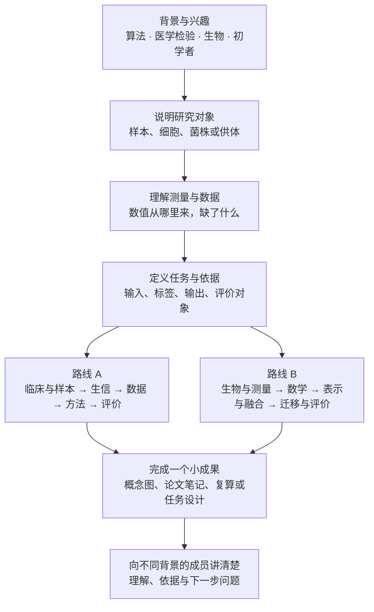

# 从这里开始：推荐学习路径

[返回统一入口](README.md) · [小组介绍](community.md) · [首轮主题](weekly-topics.md)

先带着一个感兴趣的问题进入小组，再按自己的背景选择起点。两条路线都能独立推进；共同基础帮助大家在讨论时知道彼此说的是哪一种样本、数据与证据。

## 第一次来，可以这样开始

1. 阅读[小组介绍](community.md)，在交流群介绍背景、关注方向和最近想讨论的问题。
2. 选择[路线 A：检验医学与病原生信](tracks/clinical-bioinformatics.md)或[路线 B：多模态多组学](06_多模态多组学/README.md)作为近期主线。
3. 读一份基础笔记或一个章节，记下 3 个关键概念和 1 个还不清楚的问题。
4. 参加一次讨论，或尝试一个[小练习](projects/README.md)，用[统一模板](weekly_notes_template.md)留下记录。

## 共同基础怎样连接到两条路线

图中的箭头表示学习依赖，不要求每个人用相同时间走完。

## 按背景选择入口

| 你的起点 | 先补哪一块 | 随后怎么走 |
| --- | --- | --- |
| 算法、计算机或数据科学 | 样本流程、生物对象、测量和标签的含义 | 路线 A 按下方“原路径一”；路线 B 从第 1–3 章进入 |
| 医学、检验或临床微生物 | 测序数据形态、计算任务和模型输出 | 路线 A 按“原路径二”；需要多组学时接路线 B 第 2–4 章 |
| 生命科学、生信或实验背景 | 数学记号、概率、损失和网络中的计算 | 路线 B 第 4–7 章，遇到数据问题回看第 2–3 章 |
| 刚接触交叉领域 | 样本是什么、怎么测量、表格的行列是什么 | 每次读一个小节，先做自检或画图，再参加讨论 |
| 希望先动手 | 一个可以从头算完的例子 | [双模态算例](examples/multiomics_toy/README.md)，再回读对应知识 |

## 路线 A：保留原计划的三种路径

### 原路径一：新加入的算法同学

1. [检验医学与临床微生物学概览](01_检验医学与临床微生物学/README.md)。
2. [样本采集与前处理](01_检验医学与临床微生物学/01_样本采集与前处理.md)。
3. [培养、药敏与临床判读](01_检验医学与临床微生物学/02_培养_药敏与临床判读.md)。
4. [测序技术与实验设计](02_生物信息学基础/01_测序技术与实验设计.md)。
5. [reads、contig、ORF、SNP、MAG](02_生物信息学基础/02_reads_contig_ORF_SNP_MAG.md)。
6. [物种鉴定与新物种判断](02_生物信息学基础/03_物种鉴定与新物种判断.md)。
7. [数据与统计基础](03_数据与统计基础/README.md)。
8. [方法与模型基础](04_方法与模型基础/README.md)。

### 原路径二：新加入的医学或检验背景同学

1. [生物信息学基础概览](02_生物信息学基础/README.md)。
2. [测序技术与实验设计](02_生物信息学基础/01_测序技术与实验设计.md)。
3. [reads、contig、ORF、SNP、MAG](02_生物信息学基础/02_reads_contig_ORF_SNP_MAG.md)。
4. [ARG、毒力与移动遗传元件](02_生物信息学基础/04_ARG_毒力与移动遗传元件.md)。
5. [比对、组装、k-mer 与 sketch](04_方法与模型基础/01_比对_组装_kmer与sketch.md)。
6. [病原识别任务设计](04_方法与模型基础/02_病原识别任务设计.md)。
7. [耐药检测任务设计](04_方法与模型基础/03_耐药检测任务设计.md)。

### 原路径三：准备进入项目实施的同学

先走完前两种路径之一，再读[训练、验证、测试与标签质量](03_数据与统计基础/03_训练验证测试与标签质量.md)和[评估、校准与拒识](04_方法与模型基础/04_评估_校准与拒识.md)，最后进入具体项目的代码与时间安排。

原计划的重点继续保留：先说明样本是什么、标签是什么、数据怎么来、证据如何组成，再比较具体模型。

## 路线 B：从系统阅读到完整复算

| 阶段 | 章节 | 阶段目标 |
| --- | --- | --- |
| 认识对象与数据 | 第 1–3 章 | 看懂 RNA、ATAC、ADT 的对象、行列、配对、缺失和数值尺度 |
| 建立计算语言 | 第 4–5 章 | 看懂矩阵、概率、损失、VAE、注意力和 Transformer |
| 连接模态与任务 | 第 6–7 章 | 说清融合方式、训练目标、迁移方式和任务接口 |
| 检验与解释 | 第 8–9 章 | 设计适当的留出评价，理解空间、序列、调控与实验扩展 |
| 跟算并定位方法 | 第 10–11 章 | 完整运行小例子，把常见方法放回数据与计算流程 |
| 随时查阅 | 第 12–13 章 | 核对术语、数学符号、原始论文与官方文档 |

具体章节链接和练习见[路线 B 导读](06_多模态多组学/README.md)。

## 做到什么程度再进入下一步

不以背完术语为目标。可以用自己的话说明正在处理的对象，跟上一个小例子，指出一处仍需核对的地方，就有材料参与讨论。准备开展项目时，再把问题、数据、基线、评价和预期产出写进[项目说明](projects/project-proposal-template.md)。
