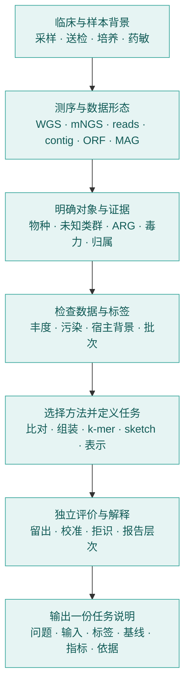
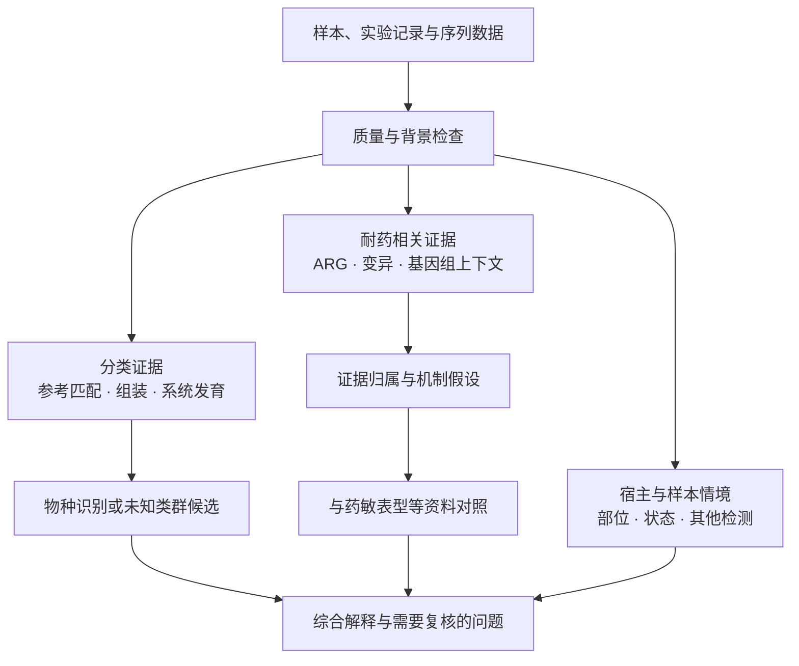

# 路线 A：检验医学与病原生信

[返回统一入口](../README.md) · [选择学习路径](../study-path.md) · [路线 B](../06_多模态多组学/README.md)

本路线沿用梅锐翔整理的 TIDE AINGS 学习计划：从样本和实验室流程进入生信数据，理解真实数据的偏差，再讨论病原识别、耐药相关任务和 AI 方法。原有知识模块与首轮八周主题保留，下面补充各阶段之间的联系和可以完成的小成果。

## 一条连续的学习主线

箭头表示学习依赖。实际讨论时可以按首轮主题深入其中一个环节。

## 六个阶段与原始材料

| 阶段 | 要回答的问题 | 保留的材料 | 建议产出 |
| --- | --- | --- | --- |
| A1 样本与临床背景 | 同一检出结果为什么随样本类型而有不同含义？ | [采集与前处理](../01_检验医学与临床微生物学/01_样本采集与前处理.md)、[培养与药敏](../01_检验医学与临床微生物学/02_培养_药敏与临床判读.md)、[污染与定植](../01_检验医学与临床微生物学/03_样本类型差异_污染与定植.md)、[病原与宿主](../01_检验医学与临床微生物学/04_病原体_致病性与宿主反应.md) | 样本到报告图，标注每一步产生什么信息 |
| A2 测量与数据 | reads、contig、ORF、SNP、MAG 各自保留什么？ | [测序与实验设计](../02_生物信息学基础/01_测序技术与实验设计.md)、[数据层级](../02_生物信息学基础/02_reads_contig_ORF_SNP_MAG.md) | 数据层级表，列出对象、来源和可回答的问题 |
| A3 分类与功能证据 | 物种归类、新物种候选、耐药与毒力有哪些不同依据？ | [物种与新物种判断](../02_生物信息学基础/03_物种鉴定与新物种判断.md)、[ARG 与移动遗传元件](../02_生物信息学基础/04_ARG_毒力与移动遗传元件.md)、[数据库与工具](../02_生物信息学基础/05_常用数据库与工具.md) | 论文证据表：观测、计算、解释分别是什么 |
| A4 数据与统计 | 测序深度、污染、批次和标签如何影响比较？ | [丰度与组成](../03_数据与统计基础/01_丰度_归一化与组成型数据.md)、[污染与宿主背景](../03_数据与统计基础/02_污染_批次效应与宿主背景.md)、[划分与标签](../03_数据与统计基础/03_训练验证测试与标签质量.md) | 数据说明：来源、对象、标签、重复、划分和偏差 |
| A5 方法与任务 | 当前问题需要什么输入、输出与比较方法？ | [方法脉络](../04_方法与模型基础/01_比对_组装_kmer与sketch.md)、[病原识别](../04_方法与模型基础/02_病原识别任务设计.md)、[耐药任务](../04_方法与模型基础/03_耐药检测任务设计.md) | 将研究问题转换成可计算对象的任务卡 |
| A6 评价与交流 | 模型的分类、概率与未判断对象分别表现如何？ | [评价、校准与拒识](../04_方法与模型基础/04_评估_校准与拒识.md)、[读书会主题](../weekly-topics.md) | 一次论文分享或小规模比较，说明适用对象 |

## 三种任务，分别建立证据

下面的图用于组织阅读与任务设计，各终点需要对应的证据。箭头表达分析步骤，不表示前一步自动证明后一步。

原计划特别强调的内容继续作为主线：检出、致病性、新物种判断和耐药判断处于不同层次；真实数据结构、标签与实验条件应先于模型比较得到说明。

## 与路线 B 在哪里相遇

| 共同问题 | 路线 A 的具体情境 | 路线 B 的对应材料 |
| --- | --- | --- |
| 数值尺度与组成 | reads、深度、相对丰度 | 知识库第 3 章的总量归一化、log、CLR |
| 独立样本与泛化 | 样本、菌株、研究来源的留出 | 第 8 章的供体划分、信息泄漏与指标 |
| 序列如何进入模型 | k-mer、sketch、embedding | 第 5、9 章的词元、注意力、序列结构 |
| 新信息是否有帮助 | 序列外背景与标签证据 | 第 6、8 章的融合、同输入比较与消融 |

可进入[路线 B 导读](../06_多模态多组学/README.md)查找相关章节，也可以从[共同实践选题](../projects/README.md)发起联合讨论。
